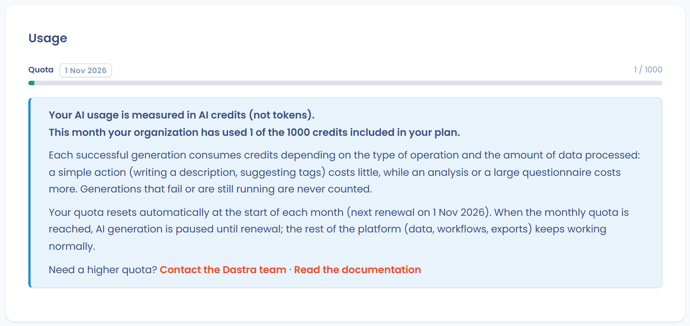

# Funktionsweise

## Modelle und Hosting

<figure><figcaption>
Organisationseinstellungen > KI-Assistent: Modellfamilie auswählen und Credits verfolgen
</figcaption></figure>

Dastra verwendet vortrainierte generative KI-Modelle, die in vier Familien zur Auswahl stehen:

| Familie | Konfigurierte Modelle | Hosting |
| --- | --- | --- |
| **OpenAI** _(standardmäßig empfohlen)_ | Fast: gpt-5-nano · Smart: gpt-5.6-terra · Large context: gpt-5.6-sol | Azure, Frankreich / EWR |
| **Mistral** | Fast: mistral-small-2503 · Smart: Mistral-Large-3 · Large context: Mistral-Large-3 | Azure, Frankreich / EWR |
| **Open Source** | Fast: DeepSeek-V4.1-Flash · Smart: DeepSeek-V3.2 · Large context: DeepSeek-V3.2 | Azure, Frankreich / EWR |
| **Benutzerdefinierter KI-Anbieter** | Ihr eigener Anbieter über einen API-Schlüssel _(siehe unten)_ | Je nach Ihrer Konfiguration |

Für die ersten drei Familien werden die Modelle auf der Infrastruktur von Microsoft Azure in Frankreich gehostet. Sie werden nicht direkt von OpenAI oder Mistral betrieben: Dastra nutzt verwaltete Azure-Dienste, das heißt, **Ihre Daten laufen nicht über die eigene Infrastruktur von OpenAI oder Mistral**.

Für jede Familie werden je nach Komplexität der Aufgabe drei Modellstufen verwendet:

* **Fast** (einfache Aktionen): Beschreibungen erstellen, Tags vorschlagen
* **Smart** (Aktionen, die mehr Überlegung erfordern): strukturierte Objekte in Dastra erstellen
* **Large context** (Aktionen, die große Datenmengen verarbeiten): einen Fragebogen beantworten, Compliance-Analyse

Der Inhaber der Organisation wählt die Modellfamilie unter **Organisationseinstellungen** > **KI-Assistent**, in der Karte **Einstellungen des KI-Assistenten**, im Feld **Familie von KI-Modellen**. Die Änderung wird gespeichert, sobald Sie eine Familie auswählen.

***

## Benutzerdefinierter KI-Anbieter

<figure><figcaption>
Der benutzerdefinierte KI-Anbieter unter den Modellfamilien
</figcaption></figure>

Sie können Ihren eigenen KI-Anbieter über einen API-Schlüssel anbinden, sofern er mit dem OpenAI-API-Standard kompatibel ist. Angeboten werden OpenAI, Google, Anthropic, Mistral und Azure AI Foundry. Die Option **Other** akzeptiert jeden anderen kompatiblen Endpunkt, auch ein selbst gehostetes LLM.

Um einen benutzerdefinierten Anbieter zu konfigurieren, wählen Sie unter **Organisationseinstellungen** > **KI-Assistent** die Familie **Maßgeschneiderte KI-Modelle** aus. Klicken Sie im Block **Anmeldedaten des KI-Anbieters** auf **Anmeldedaten hinzufügen**, geben Sie den Anbieter und seinen API-Schlüssel ein und weisen Sie dann jeder der drei Stufen (Fast, Smart, Large context) ein Modell zu.

Bei erkannten Anbietern ist die **Basis-URL** vorausgefüllt: Für Anthropic lautet sie `https://api.anthropic.com/v1/`. Bei Azure AI Foundry und bei **Other** geben Sie sie selbst ein.

* Die Schaltfläche **Verbindung testen** prüft die Gültigkeit der Zugangsdaten vor dem Speichern.
* Sie wählen für jede Stufe das zu verwendende Modell, wobei standardmäßig ein empfohlenes Modell vorgeschlagen wird.
* Der API-Schlüssel wird nie wieder im Klartext angezeigt, und die Verwaltung der Zugangsdaten ist den Inhabern der Organisation vorbehalten.

<figure><figcaption>
Konfiguration von Anthropic: vorausgefüllte Basis-URL, API-Schlüssel und Schaltfläche „Verbindung testen“
</figcaption></figure>


Bei einem benutzerdefinierten KI-Anbieter unterliegen die an das Modell gesendeten Daten der Datenschutzrichtlinie **Ihres Anbieters**, nicht den auf dieser Seite beschriebenen Azure-Garantien. Prüfen Sie die Bedingungen Ihres Anbieters, bevor Sie diese Option aktivieren, insbesondere wenn Ihre Prompts personenbezogene Daten enthalten können.


***

## Was Dastra an das Modell sendet

Dastra übermittelt nur die für die angeforderte Erstellung erforderlichen Informationen: den vom Nutzer eingegebenen Text und gegebenenfalls die strukturierten Felder des betreffenden Objekts (Verarbeitungstätigkeit, KI-System, Anfrage zur Ausübung von Rechten usw.).

Die genau übermittelten Daten pro Funktion sind im Abschnitt [An das Modell übermittelte Daten](how-it-works.md#an-das-modell-ubermittelte-daten) aufgeführt.

***

## Was Dastra nicht tut

Die folgenden Punkte sind für alle Modelle der Familien OpenAI, Mistral und Open Source vertraglich durch Microsoft Azure garantiert:

* Ihre Prompts und Ergebnisse sind für andere Azure-Kunden **nicht verfügbar**
* Ihre Daten werden **nicht an** OpenAI, Mistral oder andere Dritte **übermittelt**
* Ihre Daten werden **nicht verwendet**, um Basismodelle zu trainieren oder zu verbessern
* Die Modelle sind **zustandslos (stateless)**: Kein Prompt wird zwischen zwei Anfragen im Modell gespeichert

***

## Missbrauchsüberwachung und menschliche Prüfung

Microsoft Azure unterhält einen automatisierten Mechanismus zur Erkennung potenziell missbräuchlicher Inhalte. In Ausnahmefällen, in denen ein Inhalt gemeldet wird, kann eine Stichprobe von Prompts zu Prüfzwecken vorübergehend in einer kundenspezifisch isolierten Speicherumgebung aufbewahrt werden. Für Ressourcen, die im EWR bereitgestellt werden (was bei Dastra der Fall ist), befinden sich auch die beteiligten menschlichen Prüfer im EWR.

Diese Aufbewahrung bleibt die Ausnahme und gilt nicht für die normale Nutzung der Plattform. Weitere Einzelheiten finden Sie in der [Microsoft-Dokumentation zum Datenschutz bei direkten Azure-Modellen](https://learn.microsoft.com/en-us/azure/ai-services/openai/concepts/data-privacy).

***

## Nutzungsprotokolle der KI

Dastra führt einen Verlauf der Aufrufe des KI-Assistenten. Die Karte **AI usage** unter **Organisationseinstellungen** > **KI-Assistent** zeigt die **letzten 90 Tage** im Tab **Logs (90 days)**, der den Inhabern der Organisation vorbehalten ist. Für jeden Aufruf werden folgende Informationen erfasst:

| Feld | Beschreibung |
| --- | --- |
| **Datum** | Zeitstempel des Aufrufs |
| **Status** | Erfolg oder Fehlschlag der Erstellung |
| **Operation** | Art des verwendeten Prompts |
| **Model name** | Name des verwendeten Modells |
| **Credits** | Verbrauchte Credits. Nur erfolgreiche Erstellungen verbrauchen welche |
| **Dauer** | Verarbeitungszeit der Anfrage |
| **Nutzer** | Mitglied des Mandanten, das die Erstellung ausgelöst hat |

Die Tabs **Credits by user** und **Credits by operation** summieren den Verbrauch des aktuellen Monats.

## KI-Credits und Kontingente

Dastra misst den Verbrauch des KI-Assistenten in **KI-Credits** (nicht in Tokens). Das Kontingent gilt pro Monat und wird von allen Mandanten der Organisation gemeinsam genutzt: Es hängt vom Tarif und vom Abonnement ab und erneuert sich automatisch am ersten Tag jedes Monats. Gespräche mit Dastra AI und Agentenläufe nutzen dasselbe Kontingent.

Eine erfolgreiche Erstellung verbraucht je nach Art des Vorgangs Credits. Eine fehlgeschlagene oder laufende Erstellung wird nie gezählt.

| Vorgang | Credits |
| --- | --- |
| Erstellen einer Verarbeitungstätigkeit, eines Assets, eines Stakeholders, einer Datenkategorie, einer Sicherheitsmaßnahme, eines KI-Systems oder eines KI-Modells; Datenschutzerklärung; Tag-Vorschlag; Antwort auf eine Anfrage zur Ausübung von Rechten; Extraktion von Vertragsmetadaten; Vorschläge für Kontrollen und Tests | 1 |
| Risikoanalyse, Bewertung der DSFA-Kriterien, Überprüfung von Testnachweisen, Nachbetrachtung eines Datenschutzvorfalls, eigener Bericht | 2 |
| Beantwortung eines Fragebogens und Übersetzung eines Fragebogens | 1 pro 25 Fragen |

Die Karte **Anwendung** unter **Organisationseinstellungen** > **KI-Assistent** zeigt den Verbrauch des aktuellen Monats, das Kontingent des Tarifs und das Erneuerungsdatum. Der Fortschrittsbalken ändert seine Farbe je nach verbrauchtem Anteil des Kontingents:

* **Grün**: weniger als 80 % des Kontingents
* **Orange**: von 80 % bis 99 %
* **Rot**: das Kontingent ist erreicht

Ist das monatliche Kontingent erreicht, informiert Sie eine Meldung und bietet an, das Dastra-Team zu kontaktieren.

<figure><figcaption>
Verfolgung des KI-Credit-Verbrauchs im aktuellen Monat
</figcaption></figure>


Ist das Kontingent erreicht, sind die KI-Funktionen bis zur nächsten Erneuerung deaktiviert. Der Rest der Plattform (Daten, Workflows, Exporte) funktioniert normal weiter.



**Benutzerdefinierter KI-Anbieter: keine Credit-Zählung.** Wenn Ihre Organisation einen benutzerdefinierten KI-Anbieter verwendet, gilt das Credit-System von Dastra nicht. Der Verbrauch wird direkt von Ihrem eigenen Anbieter nach dessen eigenen Abrechnungsbedingungen verwaltet.


***

## An das Modell übermittelte Daten


Dastra übermittelt **keine Daten Ihres Mandanten** an das KI-Modell, es sei denn, Sie veranlassen es. Nur die unten aufgeführten Informationen, je nach genutzter Funktion, sind in der Anfrage an das Modell enthalten.


| Funktion | An das Modell übermittelte Daten | Mögliche personenbezogene Daten |
| --- | --- | --- |
| **Eine Verarbeitungstätigkeit erstellen** | Vom Nutzer eingegebener Freitext | Nein, es sei denn, der Nutzer nennt in der Beschreibung Personen |
| **Eine Verarbeitungstätigkeit mit der Option „Vorhandene Komponenten nutzen“ erstellen** | Vom Nutzer eingegebener Freitext + Bezeichnungen der vorhandenen Sicherheitsmaßnahmen, Assets und Datenfelder im Mandanten | Nein, es sei denn, vorhandene Bezeichnungen enthalten namentliche Verweise |
| **Ein Asset erstellen** | Freitext + angegebene URL der Datenschutzrichtlinie | Nein |
| **Einen Stakeholder erstellen** | Freitext + angegebene URL oder angegebener Anhang | Nein |
| **Eine Datenkategorie erstellen** | Vom Nutzer eingegebener Freitext | Nein |
| **Eine Sicherheitsmaßnahme erstellen** | Vom Nutzer eingegebener Freitext | Nein |
| **Eine Datenschutzerklärung erstellen** | Strukturierte Felder der Verarbeitungstätigkeit (Zwecke, Rechtsgrundlage, Speicherfristen, Empfänger, Rechte) | Möglicherweise, wenn die Felder namentliche Verweise enthalten |
| **Die Bewertung der DSFA-Kriterien erstellen** | Name, Beschreibung, Zwecke, Kategorien betroffener Personen (mit Hinweis auf Schutzbedürftigkeit und maximalem Umfang), Datenkategorien und ihre Felder (einschließlich sensibler Felder), Assets und Empfänger der Verarbeitungstätigkeit | Möglicherweise, je nach Inhalt der Verarbeitungstätigkeit |
| **Eine Beschreibung erstellen** | Vom Nutzer eingegebener Freitext | Nein |
| **Tags vorschlagen** | Textinhalt des Objekts (Name, Beschreibung) | Nein |
| **Eine Fragebogenvorlage erstellen** | Vom Nutzer eingegebener Freitext | Nein |
| **Einen Fragebogen beantworten (DSFA, Risikoanalyse …)** | Strukturierte Felder der verknüpften Verarbeitungstätigkeit + eventuelle individuelle Anweisungen | Möglicherweise, je nach Inhalt der Verarbeitungstätigkeit |
| **Eine Antwort auf eine Anfrage zur Ausübung von Rechten erstellen** | Vor- und Nachname des Antragstellers, Nachricht der Anfrage, Sprache, Name des Mandanten, Zwecke, Name des Bearbeiters, Datum der Anfrage und verbleibende Tage, Status und ID der Anfrage | **Ja**: Vorname, Nachname und Inhalt der Anfrage |
| **Eine Nachbetrachtung eines Datenschutzvorfalls erstellen** | Strukturierte Felder des Vorfalls (Beschreibung, betroffene Daten, ergriffene Maßnahmen) | Möglicherweise, je nach Inhalt des Vorfalleintrags |
| **Vertragsmetadaten extrahieren** | Textinhalt des übermittelten Dokuments (Anhang oder URL) | Möglicherweise, je nach Inhalt des Vertrags |
| **Ein eigenes Dokument erstellen** | Vom Nutzer eingegebene Anweisungen + eventueller Quellinhalt | Möglicherweise, je nach den angegebenen Anweisungen |
| **Einen eigenen Bericht erstellen** | Vom Nutzer eingegebene Anweisungen | Nein, es sei denn, der Nutzer nimmt Daten in die Anweisungen auf |
| **Risikoanalyse (KI-System)** | Strukturierte Felder des KI-Systems (Beschreibung, Zwecke, verarbeitete Daten, Stakeholder) | Möglicherweise, je nach Inhalt des KI-Systems |
| **Eine Beschreibung eines KI-Systems erstellen** | Freitext + angegebene URL oder angegebener Anhang | Nein |
| **Einen Hinweis zu einem KI-System erstellen** | Strukturierte Felder des betreffenden KI-Systems | Möglicherweise |
| **Kontrollen / Anforderungen / Tests vorschlagen** | Kontext des betreffenden Objekts (Name, Beschreibung, Framework) | Nein |
| **KI-Analyse von Testnachweisen (Compliance)** | Beschreibung des Testverfahrens + Inhalt des Nachweises (extrahierter Text, Bild oder abgerufene URL) | Möglicherweise, je nach Inhalt des Nachweises |


**Bewährte Vorgehensweise**: Vermeiden Sie es, personenbezogene Daten direkt in Freitextfelder (Beschreibungen, individuelle Anweisungen) aufzunehmen. Verwenden Sie nach Möglichkeit Kennungen oder allgemeine Begriffe.


### Daten, die nie übermittelt werden

Die folgenden Daten sind **nie** Teil der Anfragen an das KI-Modell:

* Zugangsdaten und Passwörter der Dastra-Nutzer
* Daten anderer Einträge Ihres Mandanten (nur das Objekt, an dem Sie arbeiten, ist einbezogen), mit Ausnahme der Bezeichnungen vorhandener Sicherheitsmaßnahmen, Assets und Datenfelder, wenn Sie beim Erstellen einer Verarbeitungstätigkeit die Option **Vorhandene Komponenten nutzen** aktivieren
* Sitzungsmetadaten (Name des angemeldeten Nutzers, IP-Adresse usw.)
* Anhänge, die in der betreffenden Funktion nicht ausdrücklich angegeben wurden

### Aufbewahrung der Prompts

Die von Dastra verwendeten Azure-Modelle sind **zustandslos (stateless)**: Prompts und Ergebnisse werden nicht im Modell gespeichert und nicht zum erneuten Training oder zur Verbesserung der Basismodelle verwendet.


**Ausnahme: Missbrauchserkennung**: Microsoft Azure unterhält einen automatisierten Mechanismus zur Überwachung potenziell missbräuchlicher Inhalte. Wird ein Prompt gemeldet, kann eine Stichprobe zu Prüfzwecken vorübergehend in einer kundenspezifisch isolierten Speicherumgebung aufbewahrt werden. Für Ressourcen, die im EWR bereitgestellt werden (was bei Dastra der Fall ist), befinden sich auch die beteiligten menschlichen Prüfer im EWR. Diese Aufbewahrung bleibt die Ausnahme und gilt nicht für die normale Nutzung der Plattform.


Weitere Informationen finden Sie in der [Microsoft-Dokumentation zum Datenschutz bei direkten Azure-Modellen](https://learn.microsoft.com/en-us/azure/ai-services/openai/concepts/data-privacy).
