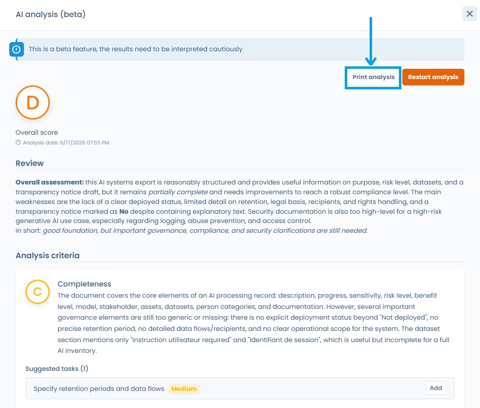

# Anwendungsfälle


**Hinweis zur Qualität der erstellten Inhalte**: Alle vom Assistenten erstellten Inhalte sind ausschließlich Vorschläge. Sie müssen vor der Verwendung von einer qualifizierten Person geprüft und angepasst werden. Dastra übernimmt keine Gewähr für die Qualität der vorgeschlagenen Informationen.


Alle Erstellungsfunktionen verwenden dasselbe Fenster: Beschreiben Sie das zu erstellende Element (oder beginnen Sie mit einem der vorgeschlagenen **Beispiele**), wählen Sie bei Bedarf die Ausgabesprache und klicken Sie dann auf **Generieren**. Der Vorschlag wird auf einer Zusammenfassungsseite angezeigt, die Sie prüfen, bevor Sie auf **Bestätigen** klicken.

In Listen ist die Erstellungsschaltfläche ein KI-Symbol links neben der Schaltfläche zum Erstellen. Es ist ausgegraut, wenn Ihr Tarif die Funktion nicht enthält. Jede Erstellung verbraucht [KI-Credits](how-it-works.md#ki-credits-und-kontingente).

***

## Verarbeitungstätigkeiten

### Eine Verarbeitungstätigkeit erstellen

Erstellen Sie aus einer kurzen Beschreibung schnell eine Verarbeitungstätigkeit im von Dastra erwarteten Format. Der Assistent schlägt einen Namen, eine oder mehrere Datenkategorien mit ihren Feldern, eine Speicherfrist, Sicherheitsmaßnahmen, Empfänger und eine Beschreibung vor.

1. Klicken Sie im Verarbeitungsverzeichnis auf das KI-Symbol links neben **Erstellen Sie eine Datenverarbeitung**, oder klicken Sie auf **Erstellen Sie eine Datenverarbeitung** und wählen Sie dann **Erstellen mit KI-Assistent**
2. Geben Sie eine kurze Beschreibung Ihrer Verarbeitungstätigkeit ein, oder klicken Sie auf eines der **Beispiele** unter dem Eingabefeld, um die Anfrage vorauszufüllen
3. Wählen Sie bei Bedarf die Ausgabesprache und aktivieren Sie die gewünschten Optionen:
   * **Verarbeitungstätigkeit als Auftragsverarbeiter**: erstellt den Eintrag für das Verzeichnis des Auftragsverarbeiters
   * **Vorhandene Komponenten nutzen**: übergibt dem Assistenten die Bezeichnungen der vorhandenen Sicherheitsmaßnahmen, Assets und Datenfelder Ihres Mandanten, damit er sie im erstellten Eintrag wiederverwendet, statt Duplikate anzulegen. Die betroffenen Referenzdaten werden unter der Option aufgelistet
4. Klicken Sie auf **Generieren** und warten Sie einen Moment
5. Prüfen Sie den Vorschlag auf der Zusammenfassungsseite und klicken Sie auf **Bestätigen**

<figure><figcaption>
Eine Verarbeitungstätigkeit mit dem KI-Assistenten erstellen: Beispiele, Ausgabesprache und Wiederverwendung vorhandener Komponenten
</figcaption></figure>

### Eine Datenschutzerklärung erstellen

1. Öffnen Sie die Bearbeitungsseite einer Verarbeitungstätigkeit
2. Klicken Sie im Abschnitt **11. Dokumentation** auf **Informationsblatt erstellen**
3. Wählen Sie das gewünschte Format (Sie können die Anweisungen anpassen, indem Sie **Personalisiert** auswählen) und die **Sprache der Anleitung**; standardmäßig wird die Sprache der Oberfläche angeboten
4. Klicken Sie auf **Generieren**: In der Vorschau können Sie den Text jedes Tabs kopieren oder auf **Exportieren** klicken, um eine PDF-, Word-, HTML- oder Markdown-Datei zu erhalten
5. Im Fenster **Die Informationsnotiz exportieren** fügt die standardmäßig aktivierte Option **Add this file to the attachments of this data processing** die exportierte Datei den Anhängen der Verarbeitungstätigkeit hinzu; jeder Export erzeugt einen neuen Anhang

<figure><figcaption>
Die KI-generierte Datenschutzerklärung exportieren
</figcaption></figure>

<figure><figcaption>
Die exportierte Erklärung den Anhängen der Verarbeitungstätigkeit hinzufügen
</figcaption></figure>

### Die Bewertung der DSFA-Kriterien erstellen

Der Analyse-Tab einer Verarbeitungstätigkeit bewertet die 9 Kriterien des EDSA für eine DSFA anhand der Informationen der Verarbeitungstätigkeit.

1. Öffnen Sie eine Verarbeitungstätigkeit und dann ihren Analyse-Tab
2. Klicken Sie im Abschnitt **Bewertung der 9 Kriterien der AIPD (EDSB)** auf **Bewertung erstellen**
3. Klicken Sie im sich öffnenden Fenster auf **Generieren** und prüfen Sie dann das Ergebnis

### Eine Compliance-Analyse für eine Verarbeitungstätigkeit erstellen

Der Assistent kann eine bestehende Verarbeitungstätigkeit analysieren und eine Bewertung ihrer Konformität mit den Dokumentationsanforderungen der DSGVO erstellen.


**Beta-Funktion**: Die Ergebnisse können weniger konsistent sein als bei einer stabilen Funktion und sollten mit besonderer Sorgfalt behandelt werden. Diese Analyse ist eine Entscheidungshilfe, keine Rechtsberatung.


Sobald die Analyse erstellt ist, klicken Sie auf **Analyse ausdrucken**, um das Ergebnis als PDF zu exportieren oder direkt an den Drucker zu senden. Dieses Dokument kann Ihrer Compliance-Akte beigefügt werden.

### Einen Vertrag, einen Stakeholder, ein Asset oder eine Fragebogenantwort analysieren

Dieselbe Analyse steht für Verträge, Stakeholder, Assets und Fragebogenantworten zur Verfügung. Öffnen Sie den Eintrag und klicken Sie dann auf die Schaltfläche **KI-Analyse (Beta)**. Das Fenster zeigt die Gesamtbewertung von A bis F, die bewerteten Kriterien mit ihrer Begründung und die vorgeschlagenen Aufgaben. Mit **Verlauf der Analysen** vergleichen Sie mit einer früheren Analyse, mit **Analyse ausdrucken** exportieren Sie das Ergebnis.

### Tags vorschlagen

In einem noch leeren Feld **Tags** schlägt eine KI-Schaltfläche anhand von Name und Beschreibung des Objekts Tags vor. Klicken Sie darauf: Die vorgeschlagenen Tags füllen das Feld. Zur Verwaltung der Tags siehe [Tags verwalten](../tags.md).

***

## Referenzdaten

### Ein Asset erstellen

Erstellen Sie schnell ein Asset (Software, Werkzeug usw.) im von Dastra erwarteten Format. Der Assistent schlägt einen Namen und Links zur Datenschutzrichtlinie des Stakeholders vor und legt einen Stakeholder als Herausgeber an.

1. Klicken Sie in der Liste der Assets auf das KI-Symbol links neben **Asset erstellen**, oder klicken Sie auf **Asset erstellen** und wählen Sie dann **Erstellen mit KI-Assistent**
2. Geben Sie eine Beschreibung oder die URL einer Datenschutzrichtlinie ein
3. Klicken Sie auf **Generieren**, prüfen und ergänzen Sie die vorgeschlagenen Informationen und klicken Sie dann auf **Bestätigen**

### Einen Stakeholder erstellen

1. Klicken Sie in der Liste der Stakeholder auf das Symbol **Erstellen Sie einen Stakeholder mit KI**
2. Geben Sie eine kurze Zusammenfassung des Stakeholders an. Der Assistent durchsucht das Web
3. Klicken Sie auf **Generieren**, prüfen Sie den Vorschlag und klicken Sie dann auf **Bestätigen**

### Eine Datenkategorie erstellen

1. Öffnen Sie die Seite **Datenkategorien**
2. Klicken Sie auf das Symbol **Erstellen Sie einen Datensatz mit KI**, oder auf **Datensatz erstellen** und dann auf **Erstellen mit KI-Assistent**
3. Geben Sie eine kurze Beschreibung Ihrer Datenkategorie ein
4. Klicken Sie auf **Generieren** und warten Sie einen Moment
5. Nehmen Sie auf der Zusammenfassungsseite Ihre Korrekturen vor und klicken Sie auf **Bestätigen**

### Eine Sicherheitsmaßnahme erstellen

Klicken Sie in der Liste der Maßnahmen auf das Symbol **Erstellen Sie eine Messung mit KI**, beschreiben Sie die Maßnahme, klicken Sie auf **Generieren** und dann auf **Bestätigen**. Diese Funktion gehört zu den Risikooptionen Ihres Tarifs.

***

## Fragebögen (DSFA, Risikoanalyse …)

### Eine KI-gestützte Antwort erstellen

1. Öffnen Sie den Bereich **Fragebögen** und wählen Sie die gewünschte Vorlage aus (zum Beispiel CNIL-PIA)
2. Klicken Sie auf **Fragebogen planen**
3. Wählen Sie **KI-gestützte Antwort**
4. Geben Sie die Verarbeitungstätigkeit an, die als Quelle dienen soll, oder geben Sie eigene Anweisungen ein
5. Sobald die Antwort erstellt ist, nehmen Sie Ihre Korrekturen direkt im Fragebogen vor


Wurde eine KI-Analyse zu einer Fragebogenantwort oder einer DSFA durchgeführt, erscheint im Kopf des Analysebereichs eine Schaltfläche **Analyse ausdrucken**, sobald ein Ergebnis vorliegt. Das strukturierte Dokument enthält die Gesamtbewertung (A bis F), die allgemeine Einschätzung, die bewerteten Kriterien mit ihrer Bewertung und Begründung sowie die vorgeschlagenen Aufgaben nach Priorität geordnet, ohne auf Screenshots zurückzugreifen.


### Eine Fragebogenvorlage erstellen

1. Öffnen Sie den Bereich **Fragebögen** und klicken Sie, um eine Fragebogenvorlage zu erstellen
2. Wählen Sie **Erstellt mit KI**
3. Geben Sie eine Beschreibung des Fragebogens (300 Wörter) und einen Typ an
4. Passen Sie die Anzahl der Abschnitte und Fragen an
5. Klicken Sie auf **Generieren**

### Einen Fragebogen mit KI übersetzen

Klicken Sie im Editor einer gespeicherten Fragebogenvorlage auf **Den Fragebogen übersetzen**: Die KI übersetzt alle Abschnitte und Fragen der Vorlage in eine andere Sprache. Wählen Sie die Zielsprache und die Art, wie das Ergebnis gespeichert wird.

***

## Betroffenenanfragen

### Eine Antwort auf eine Anfrage erstellen

Erstellen Sie Antworten in mehreren Sprachen mit Anpassungsoptionen (Länge, förmlicher oder informeller Ton usw.).

1. Öffnen Sie eine Anfrage, die gerade bearbeitet wird
2. Füllen Sie die Informationen bis zum Schritt **Communication / Transmission** aus
3. Klicken Sie auf **Mit KI generieren**: Der Assistent erstellt eine Antwort auf Grundlage der folgenden Informationen:
   * Vor- und Nachname des Antragstellers
   * Nachricht der Anfrage
   * Zu verwendende Sprache
   * Name des Mandanten
   * Zwecke der betreffenden Verarbeitungstätigkeit
   * Name des Bearbeiters der Anfrage
   * Datum der Anfrage und verbleibende Tage
   * Status und ID der Anfrage
4. Bearbeiten Sie den vorgeschlagenen Text oder nutzen Sie die Umformulierungsoptionen (kürzen, verlängern, Ton ändern)
5. Klicken Sie auf **Diese Nachricht verwenden**, fügen Sie gegebenenfalls Anhänge hinzu und klicken Sie dann auf **Senden**


Für diese Funktion gilt eine Begrenzung der Anzahl der Aufrufe pro Minute.



**KI-Verordnung, Artikel 50**: Wird eine Antwort vom KI-Assistenten erstellt, gilt die strikte Pflicht aus Art. 50 Abs. 1 (die Person darüber zu informieren, dass sie mit einem KI-System interagiert) **nicht**, da zwischen dem KI-System und der betroffenen Person keine direkte Interaktion besteht: Ein menschlicher Nutzer prüft, bestätigt und sendet die Antwort. Dennoch bleibt es als bewährte Vorgehensweise der DSGVO (Art. 5 Treu und Glauben) empfehlenswert, die betroffene Person zu informieren. Die vollständige Analyse finden Sie in den [häufig gestellten Fragen](faq.md).


***

## Datenschutzvorfälle

### Eine Nachbetrachtung erstellen

Aus einem bestehenden Vorfalleintrag erstellt der Assistent ein strukturiertes Nachbetrachtungsdokument mit einer Beschreibung des Vorfalls, den betroffenen Daten und den ergriffenen Maßnahmen.

Markieren Sie im Tab zur Nachbetrachtung des Vorfalleintrags die Nachbetrachtung als erledigt und klicken Sie dann auf **Mit KI generieren**.

***

## Verträge

### Vertragsmetadaten extrahieren

Importieren Sie ein Vertragsdokument (PDF, Bild oder URL) und lassen Sie den Assistenten seine Metadaten automatisch extrahieren: Parteien, Gegenstand, Laufzeit, wichtige Klauseln usw.

Klicken Sie im Modul **Verträge** auf die Schaltfläche zum Erstellen und dann auf **Bitte importieren Sie Ihr Dokument**.

***

## Eigene Dokumente und Berichte

### Ein eigenes Dokument erstellen

Geben Sie Ihre eigenen Anweisungen ein und stellen Sie optional Quellinhalte bereit. Der Assistent erstellt ein strukturiertes Dokument nach Ihren Vorgaben. Klicken Sie im Modul **Verträge** auf die Schaltfläche zum Erstellen und dann auf **Ein Dokument erstellen**.

### Einen eigenen Bericht erstellen

Klicken Sie im Modul **Personalisierte Berichte** auf das Symbol **Erstellen Sie einen personalisierten Bericht mit KI** und beschreiben Sie den gewünschten Bericht in natürlicher Sprache. Der Assistent erstellt eine erste Version, die Sie anschließend verfeinern können.

***

## KI-Systeme

### Ein KI-System erstellen

1. Klicken Sie im Verzeichnis der KI-Systeme auf das Symbol **Erstellen mit KI-Assistent** links neben der Schaltfläche zum Erstellen
2. Geben Sie eine kurze Zusammenfassung Ihres KI-Systems ein (Name, KI-Modell usw.)
3. Klicken Sie auf **Generieren**, prüfen Sie den Vorschlag und klicken Sie dann auf **Bestätigen**

Dasselbe Vorgehen gibt es für KI-Modelle: Beschreiben Sie das Modell (Name, Herausgeber usw.).

### Einen Informationshinweis für ein KI-System erstellen

Klicken Sie im Eintrag eines KI-Systems auf **Informationsblatt erstellen**, um automatisch das Informationsdokument für Nutzer oder betroffene Personen zu erstellen.

### Eine Risikoanalyse für ein KI-System erstellen

Der Assistent analysiert die im Eintrag des KI-Systems ausgefüllten Felder und erstellt eine Bewertung der damit verbundenen Risiken.


**Beta-Funktion**: mit besonderer Sorgfalt zu behandeln und vor jeder Entscheidung von einer Fachperson zu bestätigen.


Sobald die Analyse erstellt ist, klicken Sie auf **Analyse ausdrucken**, um das Ergebnis als PDF zu exportieren. Dieses Dokument kann Ihrer Compliance-Akte zur KI-Verordnung beigefügt werden.

<figure><figcaption>
Die Schaltfläche „Analyse ausdrucken“ exportiert das Analyseergebnis als PDF
</figcaption></figure>

***

## Frameworks und Kontrollen

### Kontrollen, Anforderungen und Tests vorschlagen

Aus einem Framework im Modul Compliance schlägt der Assistent Kontrollen und Tests vor, ausgehend vom Kontext des betreffenden Objekts (Name, Beschreibung, zugehöriges Framework).

* **Kontrollen**: Klicken Sie auf der Seite einer Anforderung auf **Kontrollen verknüpfen** und dann auf **Erstellen oder verknüpfen Sie mit KI**. Die Ergebnisse teilen sich auf in **Bestehende Kontrollen** Ihrer Bibliothek und **Neue Kontrollen**, die zu erstellen sind. Die Tests der neuen Kontrollen werden mit ihnen erstellt.
* **Tests**: Klicken Sie in einer Kontrolle auf **Auswahl oder Generierung von Tests mittels KI**. Die Ergebnisse teilen sich auf in **Bestehende Tests** und **Neue Tests**.
* **Anforderungen**: Im Fenster zum Erstellen einer Anforderung schlägt ein KI-Symbol neben dem Referenzfeld eine Referenz vor.

### Testnachweise analysieren

Klicken Sie in der Nachweistabelle eines Tests in der KI-Spalte auf **Analysieren**. Der Assistent vergleicht den Nachweis mit dem Testverfahren und zeigt sein **Vertrauen in die Analyse** und die **Details** an. Neue Nachweise werden automatisch analysiert, solange die **Automatische KI-Analyse von Beweismitteln** aktiviert ist, was der Standard ist: Sie schalten sie pro Mandant unter **Mandanteneinstellungen** > **Compliance** aus.
