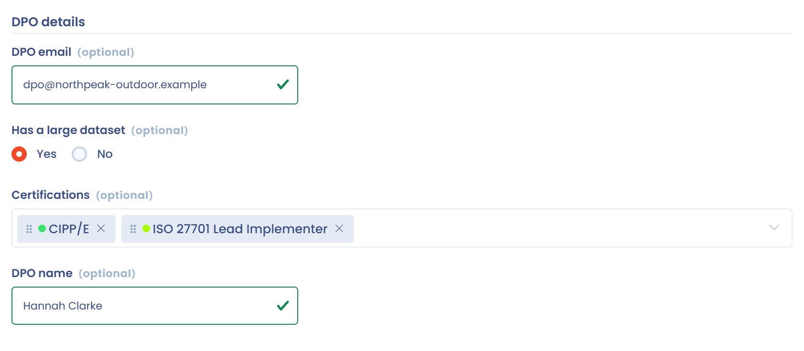
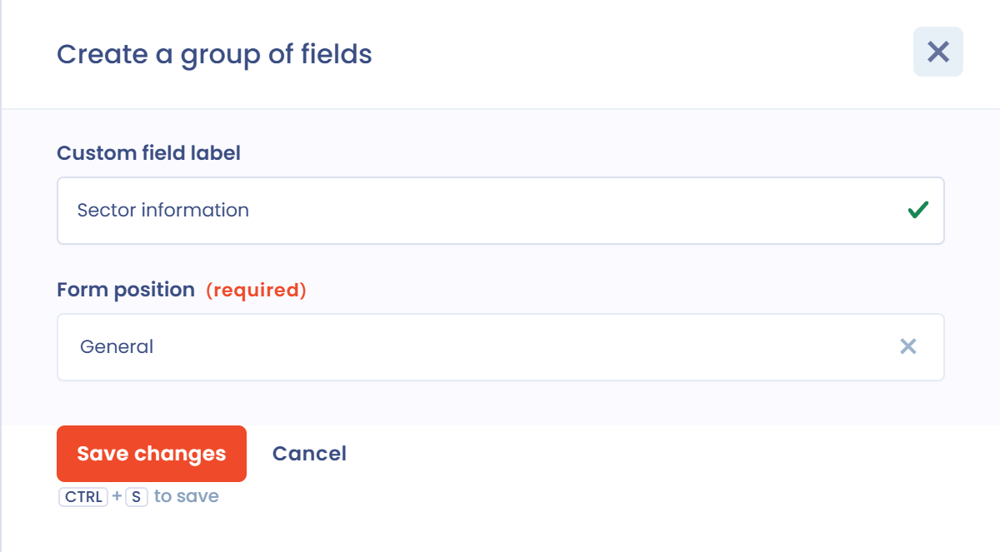
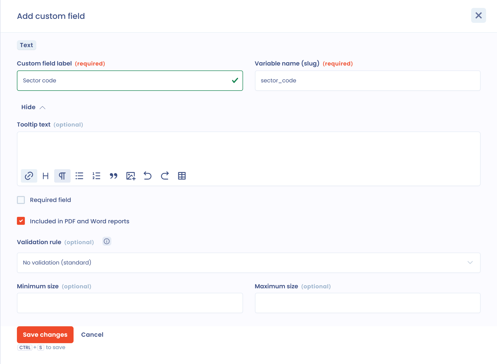

# Benutzerdefinierte Felder

## Wann benutzerdefinierte Felder verwenden

Manche Informationen, die Ihrer Branche eigen sind, sind in den Standardfeldern des Verarbeitungsverzeichnisses, der Betroffenenanfragen, der Aufgaben usw. nicht enthalten. Mit benutzerdefinierten Feldern erstellen Sie Ihre eigenen Formularfelder, um die erfassten Daten anzureichern.

Hier ein Beispiel für die Konfiguration von Feldern für einen Stakeholder:

<figure><figcaption><p>Konfiguration der Felder eines Stakeholders</p></figcaption></figure>

Und hier das Ergebnis im Formular:

<figure><figcaption><p>Die benutzerdefinierten Felder im Stakeholder-Formular</p></figcaption></figure>

## Betroffene Funktionen

Benutzerdefinierte Felder sind nicht in jedem Modul verfügbar. Sie können die folgenden Formulare anpassen:

* [Verarbeitungstätigkeiten](../ropa/README.md)
* [Betroffenenanfragen](../requests/README.md)
* [Aufgaben](../tasks/README.md)
* [Assets](../ropa/activity/assets.md)
* [Stakeholder](../ropa/activity/stakeholders.md)
* [Sicherheitsmaßnahmen](../ropa/activity/security.md)
* [Datensätze](../ropa/activity/datasets.md)
* Datenfelder
* [Datenschutzvorfälle](../incidents/README.md)
* [Risikobewertungen](../risks/attach-to-processing.md)
* [KI-Systeme](../ai-systems/README.md)
* [Verträge und Richtlinien](../contracts/README.md)
* [Kontrollpunkte](../risks/process/monitor.md)


**Begrenzte Anzahl von Feldern.** Die Anzahl der benutzerdefinierten Felder hängt vom Plan und vom Abonnement Ihrer Organisation ab. Auf der Konfigurationsseite wird eine Quotenanzeige eingeblendet. Weitere Informationen finden Sie auf der [Preisseite](https://www.dastra.eu/de/pricing).


## Verfügbare Feldtypen

Dastra bietet die folgenden Feldtypen:

| Typ | Verwendung |
| --- | --- |
| Text | Eine Textzeile |
| Textfeld | Text über mehrere Zeilen |
| Formatierter Text | Text mit Formatierung |
| Anzahl (ganze Zahl) | Eine Zahl ohne Dezimalstellen |
| Anzahl (Dezimalzahl) | Eine Zahl mit Dezimalstellen |
| Datum | Ein Datum |
| Datum und Uhrzeit | Ein Datum und eine Uhrzeit |
| Kontrollkästchen | Mehrere Antworten aus einer Liste von Auswahlmöglichkeiten möglich |
| Radio | Eine einzige Antwort aus einer Liste von Auswahlmöglichkeiten |
| Einfacher Selektor | Ein in einer Dropdown-Liste gewählter Wert |
| Mehrfachauswahl | Mehrere in einer Dropdown-Liste gewählte Werte |
| Boolesche Werte | Eine Antwort Ja oder Nein |

## Benutzerdefinierte Felder verwenden

Einmal erstellt, funktionieren benutzerdefinierte Felder wie die nativen Felder:

* Sie werden in den Formularen jedes Moduls angezeigt und bearbeitet.
* Sie können in allen Tabellen der Anwendung angezeigt werden: Klicken Sie auf die Schaltfläche **Spalten anpassen** der Tabelle. Standardmäßig sind sie ausgeblendet.
* Sie sind **in allen Excel-Datenexporten enthalten**. Weitere Informationen zu Exporten finden Sie auf [der Seite zu Exporten](../ropa/export-import.md).
* Sie sind in PDF- und Word-Berichten enthalten, wenn beim Feld **In PDF- oder Word-Berichten enthalten?** angekreuzt ist (standardmäßig angekreuzt).
* Sie lassen sich mit den [erweiterten Filtern](filters.md) filtern. Felder vom Typ **Kontrollkästchen** und **Mehrfachauswahl** können jedoch nicht zum Sortieren einer Liste verwendet werden.
* Sie können in Datentabellen gesammelt aktualisiert werden.
* Sie können mit dem [Importsystem](import.md) aus flachen Dateien importiert werden.
* Sie sind **über alle APIs zugänglich und bearbeitbar**, mit dem dem Feld zugewiesenen Variablennamen. Siehe [Benutzerdefinierte Felder in APIs verwenden](custom-fields.md#benutzerdefinierte-felder-in-apis-verwenden).

## Benutzerdefinierte Felder einrichten

1. Klicken Sie in der Seitenleiste auf **Mandanteneinstellungen** und dann auf **Benutzerdefinierte Felder**.
2. Wählen Sie in der Liste links das Modul aus, in dem Sie ein benutzerdefiniertes Feld hinzufügen möchten.
3. Felder werden in Gruppen erstellt. Klicken Sie auf **Erstellen Sie eine Gruppe von Feldern**.
4. Füllen Sie die **Bezeichnung** der Gruppe und ihre **Position im Formular** aus. Bei manchen Modulen, etwa der Verarbeitungstätigkeit, können Sie den Schritt des Formulars wählen, in dem die Gruppe angezeigt wird.

<figure><figcaption><p>Eine Feldgruppe erstellen</p></figcaption></figure>

5. Ziehen Sie nach dem Erstellen der Gruppe einen Feldtyp aus der Liste **Benutzerdefinierte Felder** in die Gruppe. Das Fenster des Feldes öffnet sich.
6. Füllen Sie die Optionen des Feldes aus (siehe unten) und speichern Sie.

<figure><figcaption><p>Die Optionen eines benutzerdefinierten Feldes</p></figcaption></figure>

Sie können Felder per Drag-and-drop neu anordnen oder von einer Gruppe in eine andere verschieben. Eine Gruppe kann erst gelöscht werden, wenn sie kein Feld mehr enthält. Ein gelöschtes Feld landet im Papierkorb: Aktivieren Sie **Papierkorb anzeigen**, um es wiederherzustellen.

### Optionen eines Feldes

| Option | Beschreibung |
| --- | --- |
| **Bezeichnung** | Der in Formularen angezeigte Name des Feldes. Pflichtangabe. |
| **Name der Variablen (Slug)** | Die Kennung des Feldes für APIs und Importe. Sie wird aus der Bezeichnung vorgeschlagen und kann nach dem Erstellen des Feldes nicht mehr geändert werden. |
| **Tooltip-Text** | Ein Hilfetext, der neben dem Feld angezeigt wird. |
| **Pflichtfeld** | Macht die Eingabe verpflichtend. |
| **In PDF- oder Word-Berichten enthalten?** | Fügt das Feld den erzeugten Berichten hinzu. Standardmäßig angekreuzt. |
| **Validierungsregel** | Bei Text-Feldern: prüft, ob die Eingabe einer Syntax (E-Mail, URL) oder einem **Benutzerdefinierten regulären Ausdruck (Javascript-Format)** folgt. |
| **Mindestgröße** und **Maximale Größe** | Länge der Eingabe bei Textfeldern. |
| **Mindestwert** und **Maximaler Wert** | Grenzen für numerische Felder. |
| **Auswahl der Antwort** | Bei Typen mit einer Liste von Auswahlmöglichkeiten: eine Zeile pro Auswahlmöglichkeit, mit einer Farbe. **Eine mögliche Option hinzufügen** fügt eine Zeile hinzu; wenn Sie Text einfügen, der eine Option pro Zeile enthält, wird pro Zeile eine Antwort erstellt. |

Die Bezeichnung und der Variablenname eines Feldes müssen innerhalb eines Moduls eindeutig sein.

## Benutzerdefinierte Felder in APIs verwenden

Mit Dastra können Sie über die [REST-API](../../api/configuration.md) alle Werte von Entitäten abrufen, ändern und erstellen, die benutzerdefinierte Felder enthalten.

Eine Eigenschaft `customFields` ist in jeder Entität vorhanden, die Sie mit einem `GET` abrufen:

```json
 {
   "id": 1234,
   "label": "Test asset",
   etc...
   "customFields": {
     "dpo_name":"jean-marc le dpo",
     "dpo_email":"dpo@github.com",
     "dpo_habilitations": ["Expert","Consulting","Data Mapping"],
     "has_large_dataset":false,
     etc...
   }
 }
```

Um diese Eigenschaft zu ändern, senden Sie das Element mit `POST` oder `PUT` und aktualisieren Sie dabei die Elemente der Sammlung. Die zu verwendenden Variablennamen sind auf der Konfigurationsseite der benutzerdefinierten Felder aufgeführt.


Alle **benutzerdefinierten Felder werden vom Server validiert**. Ist eine Spalte nicht in der Konfiguration vorhanden, wird sie automatisch entfernt.

Ist ein Feld nicht gültig (zum Beispiel wenn es leer ist, obwohl es als Pflichtfeld markiert ist), gibt die API einen Fehler mit dem Code 400 zurück.

