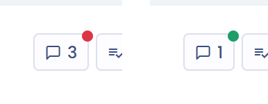

# Interne Diskussionen

Interne Diskussionen funktionieren wie ein Chat, der einem Element von Dastra zugeordnet ist: Verarbeitungstätigkeit, Betroffenenanfrage, Aufgabe, Datenschutzvorfall, Stakeholder, Asset, Datensatz, Datenfeld, Kontrollpunkt, Risikobewertung, Vertrag, KI-System, Compliance-Projekt oder Audit, Fragebogenantwort. Jedes Element hat eine einzige Unterhaltung.

## Funktionsweise

1. Öffnen Sie den Datensatz des betreffenden Elements.
2. Klicken Sie auf die Schaltfläche **Interne Diskussionen**, eine Sprechblase mit der Anzahl der Nachrichten. Der Verlauf öffnet sich in einem Bereich auf der rechten Seite.

<figure><figcaption>
Die Schaltfläche Interne Diskussionen und der Diskussionsverlauf eines Datensatzes
</figcaption></figure>

3. Klicken Sie in den Bereich **Eine Nachricht verfassen** und geben Sie Ihre Nachricht ein. Die Schaltfläche **Dokument hinzufügen** hängt eine Datei an, per Klick oder per Drag-and-drop.
4. Klicken Sie auf **Senden** oder drücken Sie **Strg+Eingabe**.

Ein nicht gesendeter Entwurf wird in Ihrem Browser gespeichert und wiederhergestellt, wenn Sie den Bereich erneut öffnen. Sie können Ihre eigenen Nachrichten über deren Menü bearbeiten oder löschen. Eine bearbeitete Nachricht zeigt **Geändert am** gefolgt vom Datum.

## Erwähnungen

Erwähnen Sie die betroffenen Nutzer mit dem Zeichen **@**. Es erscheint eine Liste der Nutzer Ihres Mandanten, die sich beim Tippen eingrenzt.

<figure><figcaption>
Die nach @ vorgeschlagene Liste der Nutzer
</figcaption></figure>

Eine Erwähnung löst sofort eine Benachrichtigung des betroffenen Nutzers aus.

## Zitate

Sie können direkt auf eine bestimmte Nachricht antworten, damit der Zusammenhang in einem langen Verlauf lesbar bleibt.

1. Fahren Sie mit der Maus über die Nachricht, auf die Sie antworten möchten, und klicken Sie auf **Antworten**. Diese Schaltfläche ist bei den Nachrichten anderer Nutzer verfügbar.
2. Über dem Textfeld erscheint ein Banner „Antwort“ mit dem Namen des Autors und einer Vorschau der zitierten Nachricht. Ihr Autor wird in Ihrer Antwort automatisch erwähnt, was seine Benachrichtigung auslöst.
3. Geben Sie Ihre Nachricht ein, fügen Sie gegebenenfalls Anhänge hinzu und klicken Sie dann auf **Senden**.

Um das Zitat zu entfernen und Ihre laufende Nachricht zu behalten, klicken Sie auf das Papierkorb-Symbol des Banners. Sie können auch die Erwähnung entfernen, wenn Sie den Autor nicht benachrichtigen möchten.


Eine Nachricht kann jeweils nur eine Nachricht zitieren. Das Zitat bleibt erhalten, wenn Sie Ihre Nachricht anschließend bearbeiten.


Nach der Veröffentlichung erscheint die zitierte Nachricht in einem Banner über Ihrer Antwort. Wird die zitierte Nachricht später gelöscht, zeigt das Banner **Diese Nachricht wurde gelöscht**: Ihre Antwort bleibt sichtbar.

## Benachrichtigungen

Bei jeder neuen Nachricht benachrichtigt Dastra:

* die in der Nachricht erwähnten Nutzer, sofort;
* die für das Element zuständigen Personen (zum Beispiel sein Inhaber, sein Bearbeiter oder die Person, der es zugewiesen ist, je nach Elementtyp), mit Ausnahme des Autors der Nachricht.

Die Zeile **Nutzer werden benachrichtigt** unter dem Eingabebereich zeigt an, wie viele Personen Ihre Nachricht erhalten, und listet sie auf. Wie jeder Nutzer Benachrichtigungen erhält, hängt von seinen Einstellungen ab: Siehe die Seite [Benachrichtigungen](../settings/notifications.md).


Wenn Sie Slack verwenden, können erwähnte Nutzer auch vom Dastra-Bot in Slack benachrichtigt werden, sofern ihre Dastra-E-Mail-Adresse mit der in Slack übereinstimmt. Siehe [Integrationen](../integrations/README.md).


## Die Unterhaltung öffnen und schließen

Sobald bei einem Element ohne laufende Unterhaltung oder nach einem Abschluss eine Nachricht gesendet wird, ist die Unterhaltung offen. Die Schaltfläche **Interne Diskussionen** zeigt dann einen kleinen roten Punkt.

<figure><figcaption>
Der rote Punkt kennzeichnet eine offene, der grüne Punkt eine geschlossene Unterhaltung
</figcaption></figure>

Ist der Austausch beendet, klicken Sie unten im Verlauf auf **Gespräch schließen**. Diese Schaltfläche ist Nutzern vorbehalten, deren Rolle die Berechtigung **Diskussionen** enthält. Der Punkt wird grün, und der Verlauf zeigt „Das Gespräch wurde beendet von“ gefolgt vom Namen der Person. Ein Nutzer mit derselben Berechtigung kann auf **Abbrechen** klicken, um die Unterhaltung wieder zu öffnen.

## Unterhaltungsübersicht

Die Übersicht sammelt alle Unterhaltungen Ihres Mandanten. Sie können dort die Fragen Ihrer Nutzer beantworten und dabei auf die betreffenden Datensätze zugreifen.

Um sie zu öffnen, klicken Sie in der oberen Leiste auf das Sprechblasen-Symbol (**Alle Diskussionen**). Ein rotes Zeichen zeigt die Anzahl der offenen Unterhaltungen an.

<figure><figcaption>
Das Symbol Alle Diskussionen und die Unterhaltungsübersicht
</figcaption></figure>

Auf der Seite der Übersicht:

* Die linke Spalte listet die Objekttypen auf, die Unterhaltungen haben; wählen Sie einen aus, um zu filtern.
* Aktivieren Sie **Geschlossene Unterhaltungen anzeigen**, um geschlossene Unterhaltungen einzubeziehen.
* Jede Unterhaltung wird als Karte mit dem Namen des Elements, einem Link zu seinem Datensatz, ihren letzten Nachrichten und einem Antwortbereich angezeigt.
