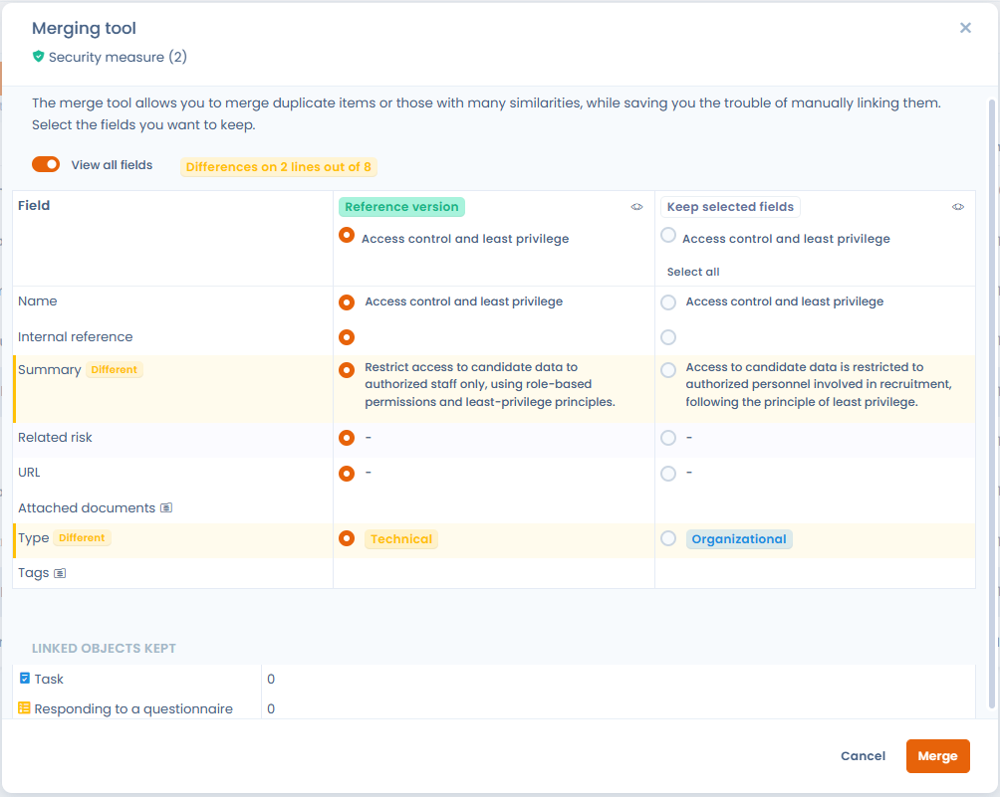

# Elemente zusammenführen

## Wozu dient das Zusammenführungstool

Die **Zusammenführungsfunktion** von Dastra wurde entwickelt, um die Verwaltung von Duplikaten und ähnlichen Elementen in Ihren Compliance-Daten zu vereinfachen. Sie ermöglicht es Ihnen, **mehrere identische oder ähnliche Elemente** zu einem einzigen zusammenzuführen, ohne die komplexe **Zuordnung zu allen zugehörigen Entitäten** (Verarbeitungen, Verantwortliche, Verzeichnisse...) manuell durchführen zu müssen.

Diese Funktion zielt darauf ab, **die Konsistenz Ihres Referenzsystems sicherzustellen** und gleichzeitig **manuelle Eingriffe zu minimieren**, wodurch Sie Zeit sparen und die Zuverlässigkeit erhöhen.

## Auf welche Elemente kann das Zusammenführungstool angewendet werden

Das Zusammenführungstool kann verwendet werden für:

* Verarbeitungen
* Assets
* Stakeholder
* Datensätze
* Datenglossare
* Maßnahmen
* Kategorien betroffener Personen
* Aufgaben
* Compliance-Kontrollen (angewandte Kontrollen und Referenzkontrollen)
* Compliance-Tests (operative Tests und Referenztests)
* Risikoszenarien und Bedrohungen der Compliance-Bibliothek


Kontrollen, Tests, Risikoszenarien und Bedrohungen werden aus der Bibliothek oder dem Projekt des Moduls Compliance zusammengeführt. Die Einzelheiten dieses Vorgangs finden Sie auf den Seiten [Kontrollen](../compliance/library/controls.md), [Tests](../compliance/library/tests.md), [Risiken](../compliance/library/risks.md) und [Bedrohungen](../compliance/library/threats.md).


## Elemente zusammenführen

1. Wählen Sie in der Liste die zusammenzuführenden Elemente aus. Wählen Sie weniger als 30 Elemente aus.
2. Klicken Sie auf "**Bitte wählen Sie eine Sammelaktion aus**" und dann auf "**Zusammenführen**".

<figure><figcaption>
Zwei ausgewählte Elemente und die Sammelaktion Zusammenführen
</figcaption></figure>

3. Wählen Sie im Fenster "**Tool zum Zusammenführen von Daten**" das Hauptelement aus, das nach der Zusammenführung erhalten bleiben soll, indem Sie es in der Kopfzeile seiner Spalte auswählen: Es wird zur **Reference version**. Die anderen Spalten zeigen das Zeichen **Keep selected fields**: Diese Elemente werden nach der Bestätigung der Zusammenführung gelöscht, und nur die Felder, die Sie in ihnen auswählen, werden in die Referenzversion übernommen.
4. Wählen Sie für jedes abweichende Feld den Wert aus, den Sie behalten möchten.
5. Klicken Sie auf **Zusammenführen**.

<figure><figcaption>
Das Fenster Tool zum Zusammenführen von Daten
</figcaption></figure>

Sie können auch von einem einzelnen Element ausgehen: Klicken Sie in seinem Aktionsmenü auf **Zusammenführen**, wählen Sie die Objekte aus, mit denen die Daten zusammengeführt werden sollen, und klicken Sie dann auf **Weiter**.

Um die zu behaltenden Werte schneller auszuwählen:

* Jedes Feld, dessen Wert sich von einem Element zum anderen unterscheidet, ist mit **Different** markiert, und ein Zähler zeigt die Anzahl der betroffenen Zeilen an.
* Die Tabelle zeigt nur die abweichenden Zeilen; aktivieren Sie **View all fields**, um alle vergleichbaren Felder anzuzeigen. Wenn Felder nicht angezeigt werden, werden automatisch die Feldwerte des beibehaltenen Elements übernommen.
* Die Schaltfläche **Select all** unter einer Spaltenüberschrift behält ihre Werte in allen abweichenden Zeilen; **Undo selection** macht dies rückgängig. Ein leerer Wert ersetzt nie einen ausgefüllten Wert.


Die zugehörigen Entitäten (Verarbeitungen, Analysen, Aufgaben usw.) der gelöschten Elemente werden automatisch dem beibehaltenen Element zugeordnet, sodass keine Verluste oder Unterbrechungen in Ihrem Verzeichnis entstehen. Der Abschnitt **Linked objects kept** des Fensters zeigt an, wie viele es sind.


Wird ein Objekt anhand der Antworten auf einen Fragebogen aktualisiert, öffnet sich dasselbe Fenster mit einer Spalte **Questionnaire’s responses**. Das bestehende Objekt bleibt immer die Referenzversion: Es behält seine Kennung, seinen Verlauf und seine Verknüpfungen.

## Datenqualitätswerkzeug

Das **Datenqualitätswerkzeug** durchsucht Ihre Referenzdaten ohne vorherige Auswahl nach Elementen, die wahrscheinlich Duplikate sind. Es schlägt Ihnen anschließend vor, sie mit dem Zusammenführungstool zusammenzuführen.

### Wo Sie es finden

Das Werkzeug ist in den Listen der Verarbeitungen, Stakeholder, Assets, Datenfelder, Datensätze und Sicherheitsmaßnahmen verfügbar. Für Kategorien betroffener Personen wird es nicht angeboten; diese lassen sich weiterhin aus der Liste zusammenführen.

Klicken Sie in der Liste oben rechts auf den Pfeil der Schaltfläche zum Erstellen (zum Beispiel **Erstellen Sie eine Datenverarbeitung**) und dann auf **Datenqualitätswerkzeug**. Diese Aktion erfordert Schreibzugriff auf das Modul.

### Intelligente Erkennung

Der Tab **Intelligente Erkennung** führt eine Ähnlichkeitsanalyse durch (Levenshtein-Distanz und Jaccard-Index) und speichert die wahrscheinlichen Duplikate als Vorschläge. Die Analyse startet beim ersten Öffnen des Tabs von selbst; klicken Sie auf **Analyse starten**, um sie erneut auszuführen.

<figure><figcaption>
Die Duplikatvorschläge des Tabs Intelligente Erkennung
</figcaption></figure>

Jeder Vorschlag stellt zwei Datensätze gegenüber (**Registrierung A** und **Registrierung B**). Der Algorithmus vergleicht vor allem das Label und, je nach Elementtyp, die Beschreibung, die Adresse, die E-Mail-Adresse, die Telefonnummer oder die Definition. Daraus leitet er einen Wert für das **Vertrauen** von 0 % bis 100 % ab, den Sie vor dem Zusammenführen ablesen können. Ein rotes Symbol **Andere UO** kennzeichnet zwei Datensätze, die verschiedenen Organisationseinheiten zugeordnet sind.

Für jeden Vorschlag gilt:

* **Zusammenführen** öffnet das Zusammenführungstool mit den beiden Datensätzen.
* **Ignorieren** legt den Vorschlag beiseite: Sein Status wird **Ignoriert**, und die Analyse schlägt ihn nicht erneut vor.
* **Zurückstellen** setzt einen ignorierten Vorschlag wieder zu den Vorschlägen mit dem Status **In Bearbeitung** zurück.

Sie können die Liste nach Status filtern (**Alle Statusmeldungen**, **In Bearbeitung**, **Ignoriert**). Das Werkzeug löscht nie von selbst ein Duplikat: Gelöscht werden nur die Elemente, die Sie bei einer Zusammenführung nicht behalten.

### Exakte Übereinstimmung

Der Tab **Exakte Übereinstimmung** gruppiert die Datensätze, die in der Spalte Ihrer Wahl denselben Wert haben. Wählen Sie die Spalte aus und klicken Sie dann neben einer Gruppe auf **Zusammenführen**, um das Zusammenführungstool zu öffnen.
