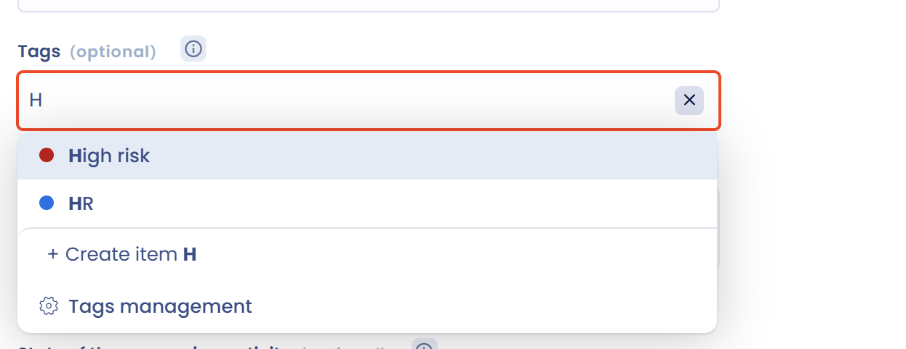

# Tags verwalten

## Wozu dienen Tags

Tags dienen dazu, Informationen nach Ihrer eigenen Methodik zu klassifizieren. Sie ermöglichen es, Verarbeitungstätigkeiten oder andere Elemente in Dastra hervorzuheben, um sie von der Masse abzuheben.

So können Sie beispielsweise einen Tag „prioritär“, „Zu überprüfen“ oder „sensible Verarbeitung“ vergeben, um die betreffenden Elemente leicht wiederzufinden. Die Tag-Liste ist unbegrenzt, und Sie können mehrere Tags pro Verarbeitungstätigkeit vergeben. Ein Klick auf einen Tag filtert die Elemente, die ihn tragen.

Ein Tag gehört zu einem Objekttyp: Die Tags der Verarbeitungstätigkeiten, Anfragen, Datenschutzvorfälle, Aufgaben, Stakeholder, Maßnahmen, Assets, Risiken, Datensätze, Fragebogenvorlagen, KI-Systeme, KI-Modelle, Verträge, Kontrollen und Risikoszenarien werden getrennt verwaltet. Jeder Tag hat eine Farbe.

## Tags erstellen

Beginnen Sie in einem Feld **Tags**, den Namen eines Tags einzutippen. Existiert der Tag bereits, wählen Sie ihn aus. Existiert er nicht, drücken Sie die **Eingabetaste**: Dastra erstellt den Tag und fügt ihn der Auswahl hinzu. Nur Nutzer mit der erweiterten Schreibberechtigung können auf diese Weise einen Tag erstellen.

<figure><figcaption>
Einen Tag in einem Formular eingeben
</figcaption></figure>

Ist das Feld leer, kann eine Schaltfläche des KI-Assistenten anhand von Name und Beschreibung des Objekts Tags vorschlagen. Siehe [Anwendungsfälle](ai-assistant/use-cases.md).

## Die Tags des Mandanten verwalten

1. Klicken Sie in der Seitenleiste auf **Mandanteneinstellungen**.
2. Klicken Sie im Abschnitt **Prozess** auf **Tags**.
3. Wählen Sie den Objekttyp aus, dessen Tags Sie verwalten möchten.

<figure><figcaption>
Die Liste der Tags eines Objekttyps
</figcaption></figure>

Auf dieser Seite können Sie:

* auf **Tag erstellen** klicken, sein **Label** eingeben und seine **Farbe** wählen;
* auf den Pfeil der Schaltfläche klicken, um mit **Erstellen Sie auf der Grundlage von Vorlagen** einen Tag aus der Bibliothek zu erstellen, Tags aus einer Datei zu **importieren** (siehe [Daten importieren](import.md)) oder die Liste als CSV, XLSX, JSON oder Markdown zu **exportieren**;
* das Menü eines Tags öffnen, um **Tag bearbeiten**, den Tag zu **löschen** oder auf **Verwandte Objekte** zu klicken, was die Liste der Elemente öffnet, die diesen Tag tragen;
* mehrere Tags auswählen und dann **Bitte wählen Sie eine Sammelaktion aus** > **Löschen** wählen.

Über den Link **Verwaltung von Tags** am Ende der Liste eines Feldes **Tags** öffnen Sie dieselbe Liste, beschränkt auf den Objekttyp des Formulars.

Der Abschnitt **Prozess** ist nur für Nutzer mit der erweiterten Schreibberechtigung sichtbar.
