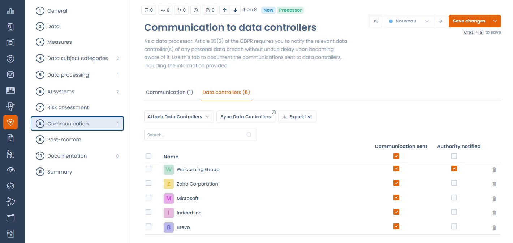

# Datenschutzvorfälle als Auftragsverarbeiter

Das Modul für Datenschutzvorfälle in Dastra passt sich der **Rolle Ihrer Organisation** im Vorfall an: Verantwortlicher oder Auftragsverarbeiter. Diese Rolle bestimmt die geltenden Pflichten und die Schritte, die im Formular angezeigt werden.

***

## Die Rolle beim Erstellen angeben

Beim Erstellen eines neuen Vorfalls legen Sie fest, ob Ihre Organisation als Verantwortlicher oder als Auftragsverarbeiter handelt. Dafür beantworten Sie die Frage **Sind Sie im Zusammenhang mit diesem Vorfall als Auftragsverarbeiter tätig?** mit Ja oder Nein:

* **Verantwortlicher**: der übliche Ablauf mit Meldung an die Aufsichtsbehörde, Benachrichtigung der betroffenen Personen und Risikoanalyse.
* **Auftragsverarbeiter**: ein angepasster Ablauf. Die Pflicht, die Aufsichtsbehörde direkt zu melden, entfällt: Die Meldung ist Sache des Verantwortlichen.

<figure><figcaption>
Geben Sie beim Erstellen eines Vorfalls an, ob Ihre Organisation als Auftragsverarbeiter handelt
</figcaption></figure>


**Rechtsgrundlage: Art. 33 Abs. 2 DSGVO**

Der Auftragsverarbeiter muss jede Verletzung des Schutzes personenbezogener Daten **unverzüglich**, nachdem sie ihm bekannt wurde, dem Verantwortlichen melden. Der Auftragsverarbeiter ist nicht verpflichtet, die Aufsichtsbehörde direkt zu informieren: Diese Pflicht liegt beim Verantwortlichen.


***

## Unterschiede im Formular im Modus Auftragsverarbeiter

Wenn die Rolle **Auftragsverarbeiter** gewählt ist:

| Element | Modus Verantwortlicher | Modus Auftragsverarbeiter |
| ------- | ---------------------- | ------------------------- |
| Schritt Meldung an die Aufsichtsbehörde | Angezeigt | Ausgeblendet |
| Bereich Benachrichtigung der betroffenen Personen | Standard | Ersetzt durch den Bereich für Auftragsverarbeiter (siehe unten) |
| Bereich Mitteilung an Kunden als Verantwortliche | Nicht vorhanden | Vorhanden |

***

## Mitteilung an Kunden als Verantwortliche

Im Modus Auftragsverarbeiter ersetzt ein eigener Bereich den üblichen Bereich zur Benachrichtigung. Er ermöglicht Ihnen:

* die **am Vorfall beteiligten Kunden als Verantwortliche zuzuordnen**: Die Liste kann automatisch aus den mit dem Vorfall verknüpften Verarbeitungstätigkeiten synchronisiert werden.
* den **Benachrichtigungsstatus** jedes Verantwortlichen zu verfolgen (benachrichtigt oder ausstehend).
* die **Liste** der beteiligten Verantwortlichen für Ihre Compliance-Akte zu **exportieren**.

<figure><figcaption>
Der Tab RT-Mitteilung listet die zu benachrichtigenden Verantwortlichen auf, mit den Schaltflächen zum Zuordnen, Synchronisieren und Exportieren
</figcaption></figure>

Die Schaltflächen des Bereichs heißen **RT zuordnen**, **RTs synchronisieren** und **RTs exportieren**.

### Verantwortliche automatisch aus verknüpften Verarbeitungstätigkeiten synchronisieren

Sind dem Vorfall Verarbeitungstätigkeiten zugeordnet, kann Dastra daraus automatisch die betroffenen Kunden als Verantwortliche ermitteln und in die Benachrichtigungsliste aufnehmen. Klicken Sie dazu im Bereich auf **RTs synchronisieren**.

***

## Bewährte Vorgehensweisen

* Benachrichtigen Sie Ihre Kunden als Verantwortliche **unverzüglich**, sobald Ihnen der Vorfall bekannt wird. Die DSGVO legt keine feste Frist für die Meldung des Auftragsverarbeiters an den Verantwortlichen fest (anders als die 72 Stunden, die für Verantwortliche gegenüber der Aufsichtsbehörde gelten), aber ein rasches Handeln ist entscheidend.
* Dokumentieren Sie Datum und Uhrzeit jeder an Verantwortliche gesendeten Benachrichtigung im dafür vorgesehenen Bereich.
* Bewahren Sie Empfangsbestätigungen oder Antworten der Verantwortlichen in den Anhängen des Vorfalls auf.
