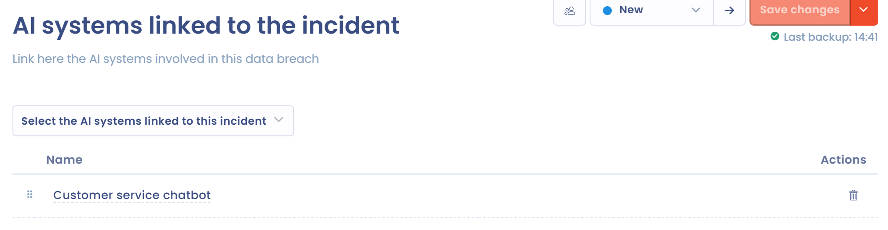

# Einen neuen Datenschutzvorfall dokumentieren

Diese Seite erklärt, wie Sie in Dastra einen Vorfall erstellen und jeden Schritt seines Formulars ausfüllen. Wenn Ihre Organisation als Auftragsverarbeiter handelt, lesen Sie auch [Datenschutzvorfälle als Auftragsverarbeiter](as-processor.md).

## Einen Vorfall erstellen

Es gibt drei Wege, einen Vorfall zu erstellen:

* manuell, mit der Schaltfläche **Einen Vorfall hinzufügen**;
* durch den Import einer Excel-, CSV- oder Textdatei: Öffnen Sie im Verzeichnis den Pfeil der Schaltfläche **Einen Vorfall hinzufügen**, wählen Sie **Importieren** und folgen Sie dem Assistenten, der unter [Daten importieren (Excel, CSV)](../general/import.md) beschrieben ist;
* per E-Mail: Eine Erfassungsadresse wandelt jede E-Mail, die sie erhält, samt Anhängen in einen Vorfall um. Siehe [E-Mail-Adressen für Datenerfassung](../settings/mailboxes.md).

### Einen Vorfall manuell erstellen

1. Öffnen Sie **Betrieb** > **Vorfälle** > **Verzeichnis der Vorfälle** und klicken Sie dann auf **Einen Vorfall hinzufügen**.
2. Geben Sie die **Bezeichnung des Vorfalls** ein und wählen Sie die **Organisationseinheit**. Beide Felder sind erforderlich.
3. Beantworten Sie die Frage **Sind Sie im Zusammenhang mit diesem Vorfall als Auftragsverarbeiter tätig?**. Die Standardantwort ist **Nein**.
4. Klicken Sie auf **Erstellen**. Das Formular des Vorfalls öffnet sich im ersten Schritt.

<figure><figcaption>
Das Fenster zum Erstellen eines Vorfalls
</figcaption></figure>

Antworten Sie nur dann mit **Ja**, wenn Ihre Organisation die betroffenen Daten im Auftrag eines Verantwortlichen verarbeitet. Das Formular wird dann angepasst, wie unter [Datenschutzvorfälle als Auftragsverarbeiter](as-processor.md) erklärt.

## Sich im Formular bewegen

Die Schritte des Formulars stehen links. Bei Schritten mit einer Liste zeigt ein Zähler, wie viele Elemente ausgefüllt sind. Gehen Sie sie der Reihe nach mit **Weiter** und **Zurück** durch oder springen Sie direkt zum gewünschten Schritt.

<figure><figcaption>
Das Formular eines Vorfalls, hier im Schritt Beschreibung des Vorfalls
</figcaption></figure>

* Klicken Sie auf **Speichern**, um Ihre Änderungen zu sichern, oder öffnen Sie den Pfeil der Schaltfläche und wählen Sie **Speichern und beenden**.
* Oben im Formular geben Tabs Zugriff auf die Diskussionen, die zugehörigen Aufgaben, die Beziehungen zu anderen Objekten, den Verlauf und die Audits.
* Die Auswahl des Workflow-Schritts bringt den Vorfall in Ihrem Workflow voran. Zur Konfiguration siehe [Prozessschritte](../settings/workflow-stages.md).
* Das Menü der Schaltfläche **Speichern** gibt außerdem Zugriff auf **Exportieren**, **Teilen**, **Workflow-Regel**, **Benutzerdefinierte Felder**, **Duplizieren** und **In den Papierkorb verschieben**.

Der Schritt **Benachrichtigung** erscheint nicht bei einem Vorfall, der als Auftragsverarbeiter behandelt wird, und der Schritt **KI-Systeme** erscheint nur, wenn das Modul KI-Systeme aktiviert ist.

## Schritt Beschreibung des Vorfalls

Beschreiben Sie den Vorfall und seine Umstände:

* **Bezeichnung des Vorfalls**, **Interne Referenz**, **Organisationseinheit** und **Tags**;
* **Art des Vorfalls**: Verlust der Vertraulichkeit, Verlust der Integrität oder Verlust der Verfügbarkeit. Sie können mehrere ankreuzen;
* **Datum und Uhrzeit des Beginns des Vorfalls**, **Datum und Uhrzeit des Vorfalls** (Ende) und das Kästchen **Der Vorfall ist noch nicht abgeschlossen.**;
* **Datum und Uhrzeit der Feststellung des Vorfalls**;
* **Person, die für den Vorfall verantwortlich ist**;
* **Allgemeine Beschreibung des Vorfalls** und **Ort des Vorfalls**;
* **Hauptursache des Vorfalls** (Unbekannt, Intern und vorsätzlich, Intern und versehentlich, Extern und vorsätzlich, Extern und versehentlich oder Sonstiger Grund), eine optionale zweite Ursache und weitere Angaben zur Ursache;
* **Sind Auftragsverarbeiter beteiligt?** Wenn Sie mit **Ja** antworten, listen Sie die beteiligten Auftragsverarbeiter unter den Stakeholdern Ihres Mandanten auf.


Das Datum der Feststellung ist der Ausgangspunkt der Meldefrist. Geben Sie Datum und Uhrzeit ein, zu denen Ihnen die Verletzung bekannt wurde, nicht den Zeitpunkt, zu dem sie begann.


## Schritt Betroffene Daten

Geben Sie die betroffenen personenbezogenen Daten an:

* **Von dem Vorfall betroffene Datensätze**: Wählen Sie die Datenkategorien Ihres Mandanten aus;
* **Datenvolumen**: Wählen Sie einen Wert in einer Liste (**Bitte auswählen**) oder geben Sie eine Zahl ein. Das ist die ungefähre Anzahl der betroffenen Datensätze;
* **Von dem Vorfall betroffene Datenträger**;
* **Sind sensible Daten betroffen?** Die Antwort fließt in die Kennzahl **Mit sensiblen Daten** des Verzeichnisses ein.

## Schritt Maßnahmen

Beschreiben Sie die Sicherheitsmaßnahmen in zwei Teilen:

* **Vor dem Vorfall vorhandene Sicherheitsmaßnahmen**: Wählen Sie vorhandene Sicherheitsmaßnahmen aus und ergänzen Sie sie mit einem Text;
* **Nach dem Vorfall ergriffene Sicherheitsmaßnahmen**, auf dieselbe Weise dargestellt.

Das sind die Angaben, die Artikel 33 Absatz 3 DSGVO in der Meldung an die Aufsichtsbehörde zu beschreiben verlangt.

## Schritt Kategorien betroffener Personen

Klicken Sie für jede betroffene Kategorie auf **Eine Kategorie betroffener Personen hinzufügen**. Wählen Sie im Fenster die Kategorie, geben Sie die **Ungefähre Anzahl der betroffenen Personen** ein und fügen Sie bei Bedarf einen Kommentar hinzu. Sie können jede Zeile danach bearbeiten oder löschen.

## Schritt Verarbeitungen

Wählen Sie unter **Bitte geben Sie die mit dem Vorfall verbundenen Verarbeitungen an.** die betroffenen Verarbeitungstätigkeiten des Verzeichnisses aus und ergänzen Sie bei Bedarf **Weitere Anmerkungen**. Dastra nutzt diese Verknüpfungen auch, um die Verantwortlichen eines Vorfalls zu finden, der als Auftragsverarbeiter behandelt wird.

## Schritt KI-Systeme

Wenn an einer Verletzung ein KI-System beteiligt ist, sei es als Ursache, als Übertragungsweg oder weil es die betroffenen Daten verarbeitet, wählen Sie es unter **Geben Sie die KI-Systeme an, die mit dem Vorfall in Zusammenhang stehen** aus. Sie können mehrere verknüpfen, unter den KI-Systemen Ihres Mandanten.

<figure><figcaption>
Der Schritt KI-Systeme
</figcaption></figure>

Mit dieser Verknüpfung können Sie:

* die Spalte **KI-Systeme** im Verzeichnis anzeigen und die Vorfälle mit **KI-Systeme** oder **Verknüpft mit einem KI-System** filtern;
* den Anteil der Vorfälle, an denen ein KI-System beteiligt ist, mit der Kennzahl **Einschließlich eines KI-Systems** des Verzeichnisses und der Seite **Statistiken** verfolgen;
* das von der KI erzeugte Post-Mortem diese Systeme berücksichtigen lassen.

## Schritt Risikoanalyse

Die Risikoanalyse bestimmt, ob Sie die Aufsichtsbehörde benachrichtigen und die betroffenen Personen informieren müssen.

<figure><figcaption>
Der Schritt Risikoanalyse mit der berechneten Risikostufe
</figcaption></figure>

Beantworten Sie zuerst **Wurde bereits eine Risikoanalyse durchgeführt?**.

* Bei **Nein** bewerten Sie den Vorfall in Dastra. Wählen Sie eine Bewertung von 1 (vernachlässigbar) bis 4 (maximal) für **Identifizierung der betroffenen Personen**, die misst, wie leicht sich Personen anhand der Daten identifizieren lassen, und für **Auswirkungen auf die betroffenen Personen**, die misst, wie schwerwiegend die Folgen für sie sind. Dastra addiert die beiden Bewertungen und zeigt die **Risikostufe** an.
* Bei **Ja** haben Sie bereits Ihre eigene Analyse durchgeführt. Wählen Sie die Stufe unter **Fazit der Risikoanalyse: Geschätzte Risikostufe** und klicken Sie dann auf **Meine Analyse senden**, um das Dokument im Schritt Dokumentation anzuhängen.

| Summe der beiden Bewertungen | Risikostufe | Von Dastra angezeigte Folge |
| --- | --- | --- |
| 2 und 3 | Geringes Risiko | Eine Meldung an die Aufsichtsbehörde und eine Mitteilung an die Personen sind nicht erforderlich |
| 4 und 5 | Mittleres Risiko | Sie müssen die Aufsichtsbehörde benachrichtigen |
| 6 bis 8 | Hohes Risiko | Meldung an die Aufsichtsbehörde und Mitteilung an die betroffenen Personen sind verpflichtend |

Zum rechtlichen Rahmen dieser Analyse (Artikel 33 und 34 DSGVO) siehe [Meldung von Datenschutzverletzungen](../../gdpr/concepts/breaches.md).

## Schritt Benachrichtigung

Der Schritt **Benachrichtigung** verfolgt die Meldung an die Aufsichtsbehörde. Die DSGVO verlangt, die Verletzung unverzüglich und möglichst binnen 72 Stunden, nachdem sie Ihnen bekannt wurde, zu melden (Artikel 33).

<figure><figcaption>
Der Schritt Benachrichtigung und sein Countdown
</figcaption></figure>

Sobald die Risikoanalyse zu einem mittleren oder hohen Risiko kommt, zählt eine Meldung die 72 Stunden ab dem Datum der Feststellung herunter. Sie zeigt die verbleibenden Stunden an, dann „Sie müssen die Aufsichtsbehörden unverzüglich benachrichtigen (Frist von 72 Stunden überschritten).“, wenn Sie in Verzug sind, und schließlich „Sie haben die Aufsichtsbehörde informiert“, sobald die Meldung erfasst ist. Bei einem geringen Risiko stellt die Meldung fest, dass Sie die Aufsichtsbehörde nicht benachrichtigen müssen.

So erfassen Sie eine Meldung:

1. Klicken Sie auf **Benachrichtigung hinzufügen**.
2. Klicken Sie auf den Link „Bitte besuchen Sie die Website der zuständigen Behörde“, um die Verletzung auf der Website der Behörde zu melden. Dastra sendet die Meldung nicht: Es hält sie nur fest.
3. Tragen Sie das Datum der Meldung ein (in der Anwendung **Datum und Uhrzeit der Benachrichtigung**), die **Nummer der Meldung (von der Aufsichtsbehörde bereitgestellt)** und die **Weitere Anmerkungen**.
4. Bestätigen Sie das Fenster und speichern Sie dann das Formular.

Die angebotene Behörde ist die der Organisationseinheit des Vorfalls. Ist keine festgelegt, zeigt das Fenster „Für Ihre Entität wurde keine Aufsichtsbehörde festgelegt.“ und einen Link zu den Einstellungen der Organisationseinheit. Siehe [Eine federführende Aufsichtsbehörde hinzufügen](../../getting-started/setup/lead-authority.md).

## Schritt Mitteilung

Dieser Schritt verfolgt die Information der betroffenen Personen. Artikel 34 DSGVO verlangt sie, wenn die Verletzung voraussichtlich ein hohes Risiko für ihre Rechte und Freiheiten zur Folge hat.

Eine Meldung erinnert Sie daran, was die Risikoanalyse bedeutet. Beantworten Sie dann **Haben Sie die betroffenen Personen benachrichtigt?** mit **Nicht zutreffend**, **Ja** oder **Nein**.

* Klicken Sie bei **Ja** auf **Eine Mitteilung hinzufügen** und füllen Sie die **Kommunikationsunterstützung** (E-Mail, Brief, Anruf, Banner auf der Website, Kommunikationskampagne oder anderer Weg), das Datum der Mitteilung, die **Anzahl der informierten Personen** und den gesendeten Inhalt aus.
* Beantworten Sie bei **Nein** die Frage **Aus welchen Gründen haben Sie die betroffenen Personen nicht informiert?**: „Voraussichtlich kein hohes Risiko für die Personen“ oder „Die personenbezogenen Daten waren für unbefugte Personen nicht zugänglich (verschlüsselt, pseudonymisiert oder anderweitig geschützt)“. Erläutern Sie Ihre Wahl unter **Begründung für die Nichtmitteilung**.

<figure><figcaption>
Das Fenster Eine Mitteilung hinzufügen
</figcaption></figure>

## Schritt Nachbetrachtung

Ein Post-Mortem ist eine ausführliche Auswertung des Vorfalls, sobald er gelöst ist. Es ist empfohlen, aber nicht verpflichtend. Beantworten Sie **Möchten Sie ein Post-Mortem erstellen?**. Geben Sie bei **Ja** das **Erstellungsdatum** ein und wählen Sie dann eine von drei Methoden:

* Geben Sie die Referenz, den Ablageort oder die URL des Dokuments ein, wenn es bereits an anderer Stelle existiert;
* klicken Sie auf **Bitte fügen Sie eine Nachbesprechung als Anhang hinzu.**;
* schreiben Sie den Text im Editor und starten Sie mit **Verwenden Sie die Vorlage** von einer Standardgliederung oder mit **Mit KI generieren**.

<figure><figcaption>
Der Schritt Nachbetrachtung
</figcaption></figure>

**Mit KI generieren** schreibt einen Entwurf aus den Informationen des Vorfalls: Kontext (einschließlich der verknüpften Verarbeitungstätigkeiten und KI-Systeme), Zeitverlauf, Auswirkungen, Maßnahmen und Risikoanalyse, Mitteilungen, gewonnene Erkenntnisse und Verbesserungsideen. Prüfen und korrigieren Sie den Text, bevor Sie ihn speichern. **Als PDF speichern** exportiert das geschriebene Post-Mortem.

## Schritt Dokumentation

Sammeln Sie hier alles, was den Vorfall dokumentiert: Freitext mit Links und Bildern sowie angehängte Dateien wie das Post-Mortem oder den Bericht zur Meldung.

## Schritt Zusammenfassung

Der Schritt **Zusammenfassung** fasst alle Informationen des Vorfalls schreibgeschützt zusammen. Mit **Alle ausblenden** und **Alle anzeigen** blättern Sie durch die Abschnitte, mit **Drucken** erhalten Sie eine Papierkopie.

## Kollegen einladen, den Vorfall zu vervollständigen

An einem Vorfall arbeiten oft mehrere Personen. Klicken Sie oben rechts im Formular auf die Schaltfläche der Nutzer, neben der Auswahl des Workflow-Schritts. Wählen Sie im Fenster den auszufüllenden **Abschnitt** und **Bitte wählen Sie die einzuladenden Nutzer aus.**, geben Sie Ihre Nachricht ein (mit einer Vorlage können Sie beginnen) und klicken Sie dann auf **Eine Einladung senden**.

<figure><figcaption>
Das Fenster, um Kollegen einzuladen, einen Vorfall zu vervollständigen
</figcaption></figure>

## Einen Vorfall teilen

**Teilen** im Menü der Schaltfläche **Speichern** oder im Menü der Schaltfläche **Einen Vorfall hinzufügen** des Verzeichnisses öffnet das Fenster zum Erstellen eines Freigabelinks. Wie Freigabelinks allgemein funktionieren, lesen Sie unter [Das Verzeichnis teilen](../ropa/share.md).
