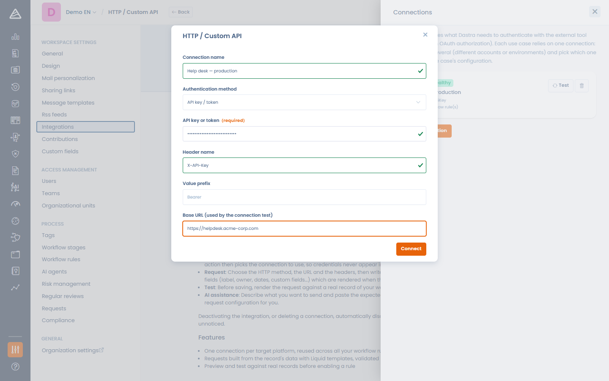

# HTTP / Benutzerdefinierte API

## Funktionsweise der Integration

Mit der Integration HTTP / Benutzerdefinierte API können Ihre **Workflow-Regeln jede Plattform aufrufen, die eine HTTP-API bereitstellt**, wenn eine Regel ausgelöst wird: ein Ticketsystem, ein ITSM, einen internen Dienst, einen Automatisierungs-Hub. Sie gestalten die Anfrage selbst: die Methode, die URL, die Header und einen JSON- oder XML-Body, der aus den Daten des Eintrags aufgebaut wird. Diese Integration nutzen Sie, wenn für Ihr Tool kein nativer Konnektor existiert.

<figure><figcaption>
Die Workflow-Aktion Send an HTTP request
</figcaption></figure>

## Voraussetzungen

* Ein Endpunkt auf der Zielplattform, der eine HTTP-Anfrage akzeptiert (GET, POST, PUT, PATCH oder DELETE), und seine Zugangsdaten: ein API-Schlüssel oder Token, ein Benutzername mit Passwort oder ein OAuth-2.0-Client (Client-ID, Client-Secret und Token-URL).
* Die Berechtigung für Integrationen im Mandanten, um die Integration zu aktivieren, Verbindungen zu verwalten und HTTP-Anfrage-Aktionen hinzuzufügen oder zu ändern. Workflow-Designer ohne diese Berechtigung können den Rest einer Regel, die eine solche Aktion enthält, weiterhin bearbeiten oder die Aktion entfernen, sie aber nicht hinzufügen oder ändern.
* Ein Ziel, das aus dem Internet erreichbar ist: Dastra blockiert Anfragen an private oder interne Netzwerkadressen.

## Installation

1. Öffnen Sie in Dastra **Mandanteneinstellungen** > **Integrationen** und wählen Sie **HTTP / Custom API** aus.
2. Aktivieren Sie den Anwendungsfall: In diesem Schritt müssen Sie keine Zugangsdaten eingeben, der Schalter aktiviert die Aktion lediglich für den Mandanten.
3. Klicken Sie auf **Verbindungen verwalten** und fügen Sie für jede Zielplattform eine Verbindung hinzu. Eine Verbindung enthält eine Art der Authentifizierung:
   * **API key / token**: der Schlüssel, der Header, der ihn überträgt (standardmäßig `Authorization`), und ein optionales Präfix des Werts (standardmäßig `Bearer `, wenn der Header `Authorization` ist). Bei einem Header wie `X-API-Key` lassen Sie das Präfix leer.
   * **Basic (Anmeldedaten / API-Schlüssel)**: ein Benutzername und ein Passwort.
   * **OAuth 2.0 (client credentials)**: eine Token-URL, eine Client-ID und ein Client-Secret (plus optionale Scopes). Dastra fordert die Zugriffstoken selbst an und erneuert sie vor ihrem Ablauf.

   Die optionale **Base URL** wird nur vom Verbindungstest verwendet: Dastra sendet mit den Zugangsdaten ein GET an sie und erwartet eine Erfolgsantwort.

<figure><figcaption>
Die Integration ist ein einfacher Aktivierungsschalter, die Zugangsdaten liegen in den Verbindungen
</figcaption></figure>

<figure><figcaption>
Eine Verbindung mit API-Schlüssel hinzufügen
</figcaption></figure>


Die Zugangsdaten liegen in der Verbindung, nie in der Workflow-Regel. Mehrere Regeln können sich eine Verbindung teilen, und ein Mandant kann so viele Verbindungen haben, wie er Zielplattformen hat. Die Verwaltung der Verbindungen zeigt, wie viele Regeln jede nutzen.


## Eine Anfrage aus einer Workflow-Regel senden

Ist die Integration aktiv, bietet der Workflow-Regel-Designer die Aktion **Send an HTTP request** an:

* **Method** und **URL**: Die URL muss absolut sein (`https://…`). Ihr Host ist fest, der Pfad und der Query-String können Variablen enthalten.
* Tab **Authentication**: Wählen Sie die zu verwendende Verbindung oder **No authentication** für einen öffentlichen Endpunkt. Von hier aus lässt sich eine Verbindung erstellen.
* Tab **Header**: bis zu 20 benutzerdefinierte Header. Die Werte akzeptieren Variablen. Der Authentifizierungs-Header der Verbindung hat immer Vorrang vor einem Header mit demselben Namen.
* Tab **Body** (POST, PUT und PATCH): Wählen Sie das Format (**JSON**, **XML** oder **No body**) und schreiben Sie den Body als Vorlage.

Geben Sie `{{` in der URL, in einem Header-Wert oder im Body ein, um die Felder des Eintrags einzufügen (Bezeichnung, Inhaber, Daten, benutzerdefinierte Felder und weitere). Sie werden beim Auslösen der Regel aufgelöst. Der aufgelöste Body muss wohlgeformtes JSON oder XML sein, sonst wird nichts gesendet und die Ausführung der Regel wird als Fehler protokolliert.

### Die Anfrage testen

**Test the request** löst die URL, die Header und den Body gegen einen echten Eintrag Ihres Mandanten auf und validiert sie. Der Authentifizierungs-Header wird mit maskiertem Geheimnis angezeigt. **Preview** sendet nichts, **Send the request** führt den echten Aufruf aus und zeigt den Antwortstatus des Ziels und, bei einem Fehler, den Anfang seiner Fehlermeldung.

<figure><figcaption>
Probelauf der Anfrage gegen einen echten Eintrag
</figcaption></figure>

### Die Anfrage mit KI erzeugen

Mit dem Dastra-AI-Assistenten entwirft die Schaltfläche neben dem URL-Feld (**Generate with AI**) die gesamte Anfrage: Beschreiben Sie, was sie tun soll, und fügen Sie die vom Ziel erwartete Nutzlast oder einen Auszug aus seiner API-Dokumentation ein. Mit dem Assistenten werden nur die Namen und Typen der Felder des Eintrags geteilt, nie Ihre Daten und nie Ihre Zugangsdaten. Der Entwurf enthält auch keine Authentifizierung: Sie bleibt in der Verbindung. Prüfen Sie den Entwurf und nutzen Sie dann die Test-Schaltfläche.

<figure><figcaption>
Die Anfrage aus einer Anweisung und der erwarteten Nutzlast entwerfen
</figcaption></figure>

## Protokolle

Jede von einer Regel ausgeführte Zustellung wird in den Integrationsprotokollen des Anwendungsfalls festgehalten (**Protokolle anzeigen** im Menü des Anwendungsfalls): die Regel, die Methode, der Zielhost und der Antwortstatus, nie die vollständige URL, die Header oder der Body. Die eigenen Ausführungsprotokolle der Regel enthalten die detaillierte Fehlermeldung, und eine Regel, die bei demselben Eintrag immer wieder fehlschlägt, versucht es nach drei Versuchen nicht mehr.

<figure><figcaption>
Integrationsprotokolle der HTTP-Zustellungen
</figcaption></figure>

## Deaktivierung und Deinstallation

Wenn Sie den Anwendungsfall ausschalten, deinstallieren oder eine Verbindung löschen, werden **die davon abhängigen Workflow-Regeln automatisch deaktiviert** (sie werden nicht gelöscht), damit nichts unbemerkt weiter fehlschlägt. Aktivieren Sie die Regeln wieder, sobald die Abhängigkeit wiederhergestellt ist.


Anfragen laufen nach 15 Sekunden in ein Zeitlimit. Eine 2xx-Antwort gilt als Erfolg, alles andere wird als Fehler protokolliert, mit dem Anfang der Antwort des Ziels. Anfragen an private oder interne Adressen werden immer blockiert.

