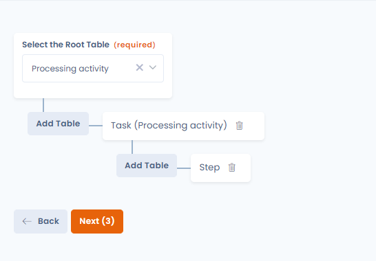
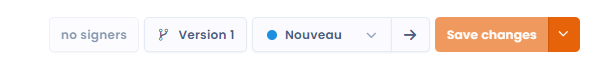

# Filerskeepers

## Über Filerskeepers

[Filerskeepers](https://www.filerskeepers.co/) ist ein Dienst, der **gebrauchsfertige Aufbewahrungspläne** bereitstellt und die gesetzlichen Aufbewahrungspflichten aus aller Welt abdeckt.\
Er hilft Unternehmen zu **bestimmen, wie lange sie jede Art von Daten aufbewahren oder wann sie sie löschen müssen**, um die geltenden Vorschriften einzuhalten.

## Voraussetzungen

* Eine kostenpflichtige Dastra-Lizenz
* Ein Filerskeepers-Konto. Wenn Sie noch keines haben und bereits Dastra-Kunde sind, können Sie [unser Vertriebsteam kontaktieren](https://meetings-eu1.hubspot.com/yann-forveille/rendez-vous-avec-un-expert?message=Filerskeepers+Integration), das Ihnen Vorzugskonditionen anbieten kann.
* Ein in der Filerskeepers-Software eingerichtetes Verzeichnis der Aufbewahrungsfristen („Schedule“). Die Integration benötigt dieses Verzeichnis, um auf Ihre Katalogdaten zuzugreifen.


Die Nutzung des Konnektors unterliegt den Nutzungsbedingungen von Filerskeepers. Die von Filerskeepers bereitgestellten Daten sind ausschließlich für den internen Gebrauch in Ihrer Organisation bestimmt: Sie dürfen weder kopiert, exportiert oder weitergegeben noch kommerziell genutzt werden. Filerskeepers-Zugangsdaten können nur mit einer Dastra-Organisation verknüpft werden. Endet der Dienst, müssen Sie alle Filerskeepers-Daten löschen. Dastra ist nicht verantwortlich für die Inhalte oder Aktualisierungen von Filerskeepers.


## Installation

Die Installation folgt dem gemeinsamen Ablauf der Integrationen (siehe [Verbindungen, Anwendungsfälle und Feld-Mapping](connections.md)):

1. Öffnen Sie **Mandanteneinstellungen** > **Integrationen** und wählen Sie **Filerskeepers** aus.
2. Klicken Sie im Anwendungsfall für Datenkategorien auf **Integration hinzufügen**.
3. Wählen Sie im Schritt **Anmelden** die Option **Verbindung hinzufügen**. Geben Sie die **E-Mail-Adresse** und das **Passwort** eines Filerskeepers-Administratorkontos ein und klicken Sie dann auf **Anmelden**. Dastra verwendet diese Zugangsdaten, um ein Zugriffstoken für die Filerskeepers-API zu erhalten.

<figure><figcaption>
Verbindung mit Filerskeepers herstellen
</figcaption></figure>

4. Wählen Sie im Schritt **Konfiguration** den Schedule aus, der mit Dastra synchronisiert werden soll. Dieser Schritt ist erforderlich, um die Installation abzuschließen.

<figure><figcaption></figcaption></figure>

## Konfiguration

Öffnen Sie die Konfiguration über das Menü des Anwendungsfalls erneut, Eintrag **Konfiguration**.

* **Wählen Sie den filerskeepers-Aufbewahrungsplan (Schedule) aus, den Sie synchronisieren möchten** (erforderlich): der Filerskeepers-Schedule, der mit Dastra synchronisiert werden soll.
* Der Schalter, der die Speicherdauern synchron hält: Ist er aktiviert, werden die mit Filerskeepers synchronisierten Datenkategorien einmal täglich aktualisiert.
* **Nutzer, die bei der Erstellung/Aktualisierung von Datensätzen benachrichtigt werden sollen** (erforderlich, wenn die Synchronisierung aktiviert ist, höchstens 10): Diese Nutzer erhalten eine E-Mail mit den Datenkategorien, die erstellt oder aktualisiert wurden.
* Der Schalter, der die fehlenden Datenkategorien erstellt: Ist er aktiviert, wird für jede in Ihrem Filerskeepers-Konto deklarierte Datenart eine Datenkategorie erstellt.
* Die optionale Auswahl der Rechtsordnung, die bei aktiviertem Erstellen von Datenkategorien angezeigt wird: Sie bestimmt die Rechtsordnung, die für die erstellten Datenkategorien synchronisiert wird. Passt keine Rechtsordnung, verwendet Dastra die Referenz-Speicherdauer (Golden Standard).


Wenn Sie das Erstellen von Datenkategorien aktivieren, werden in Ihrem Mandanten automatisch sehr viele Datenkategorien angelegt.


### Eine Synchronisierung starten

Um zu synchronisieren, ohne den täglichen Lauf abzuwarten, öffnen Sie das Menü des Anwendungsfalls und klicken Sie auf **Synchronisierung starten**. Eine von Hand gestartete Synchronisierung erstellt die fehlenden Datenkategorien, auch wenn die Option zum Erstellen deaktiviert ist.

**Protokolle anzeigen** im selben Menü listet die vergangenen Läufe und ihr Ergebnis auf.

## Die Speicherdauer auswählen

Der Filerskeepers-Konnektor bietet mehrere Betriebsarten:

* Anzeige der Auswahl der Speicherdauer auf Grundlage Ihres Filerskeepers-Verzeichnisses der Aufbewahrungsfristen (in der Software „Schedule“ genannt).

Wenn Sie ab jetzt in Dastra eine Datenkategorie öffnen, erscheint im Bereich **Speicherdauer** eine Schaltfläche zur Auswahl einer Aufbewahrungsrichtlinie.

<figure><figcaption>
Aus dem Filerskeepers-Schedule auswählen
</figcaption></figure>

Mit einem Klick auf diese Schaltfläche können Sie direkt einen Eintrag aus Ihrem Filerskeepers-Verzeichnis auswählen. **Diese Speicherdauer wird automatisch mit Dastra synchronisiert**, wenn Sie diese Option in der Konfiguration der Integration aktiviert haben.

Wählen Sie einen Eintrag mit der Schaltfläche **Bitte auswählen** aus.

<figure><figcaption>
Tabelle der Speicherdauern im Schedule
</figcaption></figure>

Sobald Sie die Speicherdauer ausgewählt haben, schließt sich das Fenster und die Details der Speicherdauer werden angezeigt.

<figure><figcaption>
Eine synchronisierte Speicherdauer
</figcaption></figure>


Es werden nur Speicherdauern synchronisiert, die sich auf aktive Datenspeicher beziehen.


## Datenabgleich zwischen Dastra und Filerskeepers

Mehrere Felder aus Filerskeepers werden automatisch Ihrer Speicherdauer zugeordnet:

* **Die Aufbewahrungsdauer** (ab)
* **Die Beschreibung der Aufbewahrungsrichtlinie**
* **Die rechtliche Begründung, der Link und die Rechtsordnung**, die im Feld für die Begründung zusammengeführt werden
