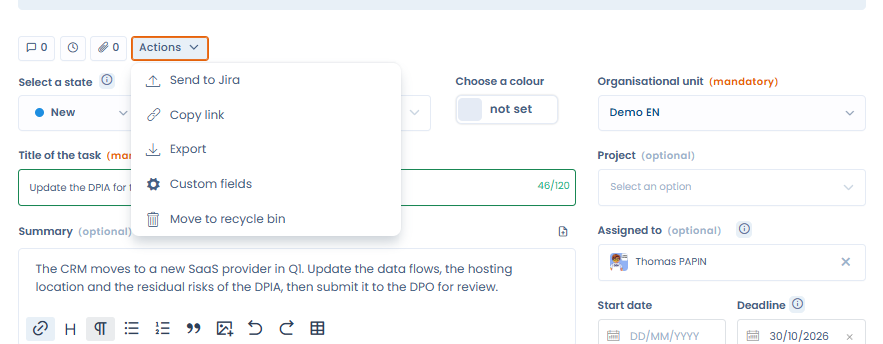

# Jira

### Was macht die Integration?

Die Jira-Integration bietet **zwei Anwendungsfälle**. Sie nutzen dieselbe Jira-Verbindung, und jeder hat seine eigene Konfiguration: Jira-Projekt, Ticket-Typ, Feld-Mapping, Zuordnung von Schritten zu Status und Webhook.

| Anwendungsfall | Funktion |
| --- | --- |
| **Anfragen betroffener Personen** | Ein Jira-Ticket erstellt oder aktualisiert in Dastra eine Anfrage einer betroffenen Person (DSR). Erreicht die Anfrage einen Workflow-Schritt, wechselt das verknüpfte Ticket in den Jira-Status, der diesem Schritt zugeordnet ist. |
| **Aufgaben** | Sie senden eine Dastra-Aufgabe an Jira, wo sie zu einem Ticket wird. Aufgabe und Ticket bleiben danach verknüpft: Status, Zuständiger und zugeordnete Felder kommen aus Jira zurück, und Schrittwechsel in Dastra verschieben das Ticket in den passenden Jira-Status. |

Sie können einen Anwendungsfall oder beide installieren.

Der Anwendungsfall Anfragen betroffener Personen im Einzelnen:

Die Jira-Integration synchronisiert **Jira-Tickets mit Anfragen zur Ausübung von Betroffenenrechten (DSR) in Dastra** – in beide Richtungen:

* **Jira → Dastra**: Wenn ein Ticket im konfigurierten Jira-Projekt erstellt oder aktualisiert wird, erstellt oder aktualisiert Dastra die entsprechende Anfrage und füllt deren Felder entsprechend Ihrem Mapping aus.
* **Dastra → Jira**: Wenn eine Anfrage eine bestimmte Workflow-Phase erreicht, setzt Dastra das verknüpfte Jira-Ticket automatisch auf den Status, den Sie dieser Phase zugeordnet haben.

### Voraussetzungen

* Eine Jira-Cloud-Instanz (z. B. `https://ihr-unternehmen.atlassian.net`) und ein Projekt für jeden Anwendungsfall.
*   Je nach Authentifizierungsmethode:

    * **Basic** — die E-Mail-Adresse eines Jira-Kontos und ein [API-Token](https://id.atlassian.com/manage-profile/security/api-tokens) für dieses Konto.
    * **OAuth** — kein Token muss erstellt werden: Sie melden sich mit Ihrem Atlassian-Konto an und autorisieren Dastra.

Jeder Anwendungsfall wird nur Nutzern angezeigt, die das passende Modul und die passende Berechtigung haben:

| Anwendungsfall | Modul | Berechtigung |
| --- | --- | --- |
| Anfragen betroffener Personen | Anfragen betroffener Personen | Schreibzugriff auf Anfragen |
| Aufgaben | Aufgaben | Schreibzugriff auf Aufgaben |


Die OAuth-Methode wird in der Liste **Authentifizierungsmethode** angezeigt, sofern sie in Ihrer Dastra-Umgebung verfügbar ist. Andernfalls verwenden Sie ein API-Token.


### Installation

1. Öffnen Sie **Mandanteneinstellungen** > **Integrationen** und wählen Sie **Jira** aus.
2. Klicken Sie beim gewünschten Anwendungsfall auf **Integration hinzufügen**.
3. Fügen Sie eine Verbindung hinzu oder wählen Sie die Jira-Verbindung aus, die Sie bereits für den anderen Anwendungsfall verwenden:
   * **Basic**: Geben Sie die **Instanz-URL**, die **E-Mail-Adresse** und das **API-Token** ein und klicken Sie anschließend auf **Verbinden**.
   * **OAuth**: Geben Sie die **Instanz-URL** ein und klicken Sie anschließend auf **Speichern und verbinden** — Sie werden zu Atlassian weitergeleitet, um Dastra zu autorisieren.

<figure><figcaption></figcaption></figure>


Wenn beide Anwendungsfälle dieselbe Jira-Instanz nutzen, geben Sie jedem **ein eigenes Projekt oder einen eigenen Ticket-Typ**. Jeder Anwendungsfall liest nur die Tickets seines eigenen Projekts und Ticket-Typs. Zwei Anwendungsfälle mit demselben Projekt und Ticket-Typ würden um dieselben Tickets konkurrieren.


## Anwendungsfall Anfragen betroffener Personen

### Konfiguration

* **Jira-Projekt** — das zu synchronisierende Projekt.
* **Ticket-Typ** — der Ticket-Typ, der eine Anfrage zur Ausübung von Betroffenenrechten darstellt.
* **Feld-Mapping** — ordnen Sie die Felder einer Dastra-Anfrage den Jira-Feldern zu. Wenn ein Jira-Ticket eine Anfrage erstellt oder aktualisiert, wird jedes Feld mit dem ausgewählten Jira-Wert ausgefüllt. Als Quellen stehen die Jira-Standardfelder (Zusammenfassung, E-Mail-Adresse des Meldenden, Beschreibung, Status) **sowie Ihre benutzerdefinierten Jira-Felder** zur Verfügung. Felder mit festgelegten Werten (Status, Auswahllisten) können im Bereich **Erweitert** in Dastra-Werte umgewandelt werden.
* **DSR-Status mit Jira-Übergängen verknüpfen** — ordnen Sie jeder Phase des DSR-Workflows einen Jira-Status zu. Wenn eine Anfrage diese Phase erreicht, führt Dastra die entsprechende Transition des verknüpften Tickets aus. Lassen Sie eine Phase auf **Keine Transition**, um sie zu ignorieren.
* **Standard-Organisationseinheit** (erforderlich) — die Organisationseinheit, die den von der Integration erstellten Anfragen zugewiesen wird.

<figure><figcaption></figcaption></figure>


Das Feld **E-Mail** der Anfrage muss zugeordnet werden (oder einen Standardwert erhalten), da es die betroffene Person identifiziert. Ohne dieses Feld kann die Konfiguration nicht gespeichert werden.


<figure><figcaption></figcaption></figure>

#### Felder mit einer geschlossenen Werteliste

Einige Dastra-Felder akzeptieren nur eine feste Werteliste, zum Beispiel **Rechte der betroffenen Person**. Wenn Sie eines davon einem Jira-Feld zuordnen, zeigt die Zeile **Erforderliche Zuordnung** an, bis Sie Dastra mitteilen, wie die Jira-Werte umzuwandeln sind. Öffnen Sie dazu den Bereich **Fortgeschritten** der Zeile und gehen Sie wie folgt vor:

* Ordnen Sie jedem Jira-Wert einen Dastra-Wert zu und/oder
* legen Sie einen **Standardwert** fest, der verwendet wird, wenn der Jira-Wert keine Entsprechung hat.

Die Konfiguration kann nicht gespeichert werden, solange eine Zeile unvollständig ist. Jira-Felder mit geschlossenen Werten (Status, Auswahllisten) bieten ihre möglichen Werte im selben Bereich **Fortgeschritten** an. Einzelheiten zum Editor für das Mapping finden Sie unter [Verbindungen, Anwendungsfälle und Feld-Mapping](connections.md).

<figure><figcaption>
Jira-Werte im Bereich Fortgeschritten in Rechte der betroffenen Person umwandeln
</figcaption></figure>

#### Workflow-Schritte und Jira-Status

<figure><figcaption>
Die Workflow-Schritte der DSR den Jira-Status zuordnen
</figcaption></figure>

Erreicht eine Anfrage einen zugeordneten Schritt, sucht Dastra eine Jira-Transition, die vom aktuellen Status des Tickets zum zugeordneten Status führt:

* Das Ticket hat bereits diesen Status: Es wird nichts unternommen.
* Der Jira-Workflow bietet keine solche Transition: Das Ticket bleibt unverändert, und das Integrationsprotokoll zeigt einen Eintrag **Sync error** mit dem aktuellen Status und dem Zielstatus. Passen Sie den Jira-Workflow oder die Zuordnung der Schritte an.

## Anwendungsfall Aufgaben

### Konfiguration

* **Jira-Projekt** und **Ticket-Typ**: der Ort, an dem die aus Aufgaben erstellten Tickets landen. Sie können sich von denen des Anwendungsfalls Anfragen betroffener Personen unterscheiden.
* **Feld-Mapping**: Wählen Sie für jedes Aufgabenfeld das Jira-Ticketfeld, das es befüllt. Jedes Mal, wenn ein mit einer Aufgabe verknüpftes Ticket in Jira aktualisiert wird, werden die zugeordneten Werte in die Aufgabe kopiert. Nicht zugeordnete Felder werden nie angetastet.
  * Quellen sind die Jira-Standardfelder (Zusammenfassung, Beschreibung, Status, E-Mail-Adresse des Zuständigen, Priorität, Fälligkeitsdatum) und Ihre benutzerdefinierten Jira-Felder.
  * Ziele sind die Aufgabenfelder, **einschließlich der benutzerdefinierten Felder der Aufgabe**.
  * Der Workflow-Schritt und der Zuständige werden nicht als Ziele angeboten: Sie folgen der Zuordnung von Schritten zu Status und der unten beschriebenen Regel für den Zuständigen.
* **Die Priorität funktioniert in beide Richtungen.** Das Wörterbuch der Werte, das Sie im Bereich **Fortgeschritten** der Zeile **Priorität** festlegen, wandelt Jira-Prioritäten in Dastra-Prioritäten um und bestimmt auch, welche Jira-Priorität gesetzt wird, wenn eine Aufgabe an Jira gesendet wird. Ohne Eintrag im Wörterbuch wird die Dastra-Priorität unter ihrem eigenen Namen gesendet (Low, Medium, High), der zum Standard-Prioritätsschema von Jira passt.
* **Die Schritte der Aufgaben den Jira-Status zuordnen**: Ordnen Sie jedem Workflow-Schritt der Aufgaben einen Jira-Status zu. Erreicht eine Aufgabe diesen Schritt, verschiebt Dastra das verknüpfte Ticket in diesen Status. Ändert das Ticket in Jira seinen Status, wechselt die Aufgabe in den zugeordneten Schritt. Nur zugeordnete Schritte werden synchronisiert, in beide Richtungen.

Es ist keine Standard-Organisationseinheit erforderlich: Dieser Anwendungsfall erstellt nie Objekte in Dastra.

<figure><figcaption>
Den Anwendungsfall Aufgaben konfigurieren
</figcaption></figure>

### Eine Aufgabe an Jira senden

Öffnen Sie in einer Aufgabe das Aktionsmenü, klicken Sie auf **Send to Jira** und bestätigen Sie.

<figure><figcaption>
Eine Aufgabe über ihr Aktionsmenü an Jira senden
</figcaption></figure>

Dastra erstellt im konfigurierten Projekt und Ticket-Typ ein Ticket mit:

* der **Bezeichnung** der Aufgabe als Zusammenfassung, der **Beschreibung** der Aufgabe als einfachem Text und dem **Fälligkeitsdatum** der Aufgabe;
* der Jira-**Priorität**, die wie oben erklärt gewählt wird;
* einem **Rückverweis** auf die Aufgabe in Dastra, der im Jira-Ticket sichtbar ist;
* dem Jira-**Status**, der dem aktuellen Schritt der Aufgabe zugeordnet ist, sofern dieser Schritt zugeordnet ist.

Die Aufgabe zeigt danach den Hinweis „Dieses Element wird mit Jira synchronisiert“ mit dem Ticketschlüssel und dem Datum der letzten Aktualisierung, und die Aktion **Send to Jira** verschwindet.

<figure><figcaption>
Eine mit ihrem Jira-Ticket verknüpfte Aufgabe
</figcaption></figure>

Gut zu wissen:

* Die Aktion steht bei jeder Aufgabe des Mandanten zur Verfügung, unabhängig davon, worauf sie sich bezieht (Verarbeitungstätigkeit, Risiko, Audit, Anfrage usw.), für Nutzer mit Schreibzugriff auf Aufgaben, sofern der Anwendungsfall Aufgaben installiert, konfiguriert und aktiv ist.
* Sie wird bei einer archivierten Aufgabe oder bei einer Aufgabe, die bereits mit einem externen System verknüpft ist, nicht angeboten.
* Das Senden erfolgt manuell und Aufgabe für Aufgabe: Das Erstellen oder Bearbeiten einer Aufgabe erzeugt nie von selbst ein Jira-Ticket.
* Wird eine Aufgabe zweimal gesendet (zum Beispiel aus zwei Browser-Tabs), entsteht nie ein zweites Ticket: Dastra antwortet, dass die Aufgabe bereits mit ihrem Ticket verknüpft ist.
* Lassen sich der Rückverweis oder der Anfangsstatus nicht setzen, wird das Ticket trotzdem erstellt und mit der Aufgabe verknüpft.

### Was synchron bleibt

| Änderung | Richtung | Wirkung |
| --- | --- | --- |
| Die Aufgabe wechselt in einen zugeordneten Schritt | Dastra → Jira | Das Ticket wechselt in den zugeordneten Jira-Status. |
| Das Ticket ändert in Jira seinen Status | Jira → Dastra | Die Aufgabe wechselt in den zugeordneten Schritt. Ihr Zustand (offen, in Bearbeitung, geschlossen) und ihre Aktivierungs- und Abschlussdaten werden wie bei einer Änderung in Dastra aktualisiert. Das Erreichen des letzten Schritts schließt auch die Unteraufgaben. |
| Der Zuständige ändert sich in Jira | Jira → Dastra | Die Aufgabe wird dem aktiven Nutzer Ihrer Organisation zugewiesen, dessen E-Mail-Adresse die des Jira-Zuständigen ist. Der neue Zuständige wird benachrichtigt. |
| Ein zugeordnetes Feld ändert sich in Jira | Jira → Dastra | Der Wert wird in die Aufgabe kopiert und, falls die Zeile ein Wörterbuch der Werte hat, damit umgewandelt. |

Änderungen aus Jira erscheinen im Verlauf der Aufgabe und lösen Benachrichtigungen und Workflow-Regeln aus, wie Änderungen in Dastra. Eine Änderung, die aus Jira stammt, wird nie an Jira zurückgesendet.

Lässt sich ein Schrittwechsel in Jira nicht anwenden, weil der Jira-Workflow keine Transition zum zugeordneten Status bietet, bleibt das Ticket unverändert, und das Integrationsprotokoll zeigt einen Eintrag **Sync error** mit dem aktuellen Status und dem Zielstatus.

Grenzen dieser Version:

* Es werden nur Tickets synchronisiert, die aus einer Dastra-Aufgabe erstellt wurden. Die übrigen Tickets des Projekts werden ignoriert, und aus Jira wird keine Aufgabe erstellt.
* Nach dem Erstellen des Tickets gehen nur Schrittwechsel von Dastra nach Jira. Spätere Änderungen von Bezeichnung, Beschreibung, Fälligkeitsdatum oder Priorität in Dastra werden nicht an Jira gesendet.
* Ist die E-Mail-Adresse des Jira-Zuständigen durch die Datenschutzeinstellungen von Atlassian verborgen oder stimmt sie mit keinem aktiven Nutzer Ihrer Organisation überein, bleibt der Zuständige der Aufgabe unverändert, und das Integrationsprotokoll nennt den Grund. Die E-Mail-Adresse selbst wird nie ins Protokoll geschrieben.
* Wird der Zuständige in Jira entfernt, wird die Zuweisung der Aufgabe nicht aufgehoben.
* Kommentare und Anhänge werden nicht synchronisiert.

### Spalten der Aufgabenliste

Die Spaltenauswahl der Aufgabenliste bietet **Integration source**, **Integration identifier** und **Last external integration sync.** an. Sie sind standardmäßig ausgeblendet.

## Webhook (Jira → Dastra)

Jeder Anwendungsfall hat **eine eigene Webhook-URL**: Über sie gelangen die Änderungen aus Jira zu Dastra. Speichern Sie zunächst die Konfiguration — die URL des eingehenden Webhooks wird verfügbar, sobald die Integration konfiguriert wurde. Im Schritt **Webhook** haben Sie anschließend zwei Möglichkeiten:

* **Manuelle Registrierung** — kopieren Sie die **Webhook-URL** und gehen Sie in Jira zu **Projekteinstellungen > Automation** (oder **Webhooks**). Fügen Sie dort einen Webhook hinzu, der auf diese URL verweist. Verwenden Sie für Anfragen betroffener Personen die Ereignisse _Ticket erstellt_ und _Ticket aktualisiert_, für Aufgaben genügt _Ticket aktualisiert_.
* **Automatische Registrierung** — klicken Sie auf **Webhook in Jira registrieren**. Dastra registriert ihn anschließend über die Jira-API für Sie, gefiltert nach dem Projekt und dem Ticket-Typ des Anwendungsfalls. Dafür benötigt das konfigurierte Konto die globale Berechtigung **Jira administrieren**. Eine erneute Registrierung ersetzt den vorherigen Webhook. Sie können den Webhook später über **Webhook löschen** wieder entfernen.

<figure><figcaption></figcaption></figure>


Webhooks, die vor der Einführung des Anwendungsfalls Aufgaben registriert wurden, funktionieren weiterhin: Ihre URL verweist weiterhin auf den Anwendungsfall Anfragen betroffener Personen.


## Integrationsprotokoll

Klicken Sie bei einem Anwendungsfall auf **Protokolle anzeigen**, um zu sehen, was die Synchronisierung mit Jira getan hat. Ein Eintrag **Sync error** nennt, was nicht ausgeführt wurde und warum: zum Beispiel ein Jira-Workflow, der den erwarteten Statuswechsel nicht erlaubt, oder ein Zuständiger, der nicht zugeordnet werden konnte.

## Deaktivieren und deinstallieren

* Beim **Deaktivieren** eines Anwendungsfalls endet seine Synchronisierung, der andere Anwendungsfall arbeitet weiter. Bei Aufgaben wird die Aktion **Send to Jira** nicht mehr angeboten. Die Synchronisierung wird für Änderungen fortgesetzt, die nach der Reaktivierung erfolgen.
* Beim **Deinstallieren** eines Anwendungsfalls werden die gespeicherten Zugangsdaten gelöscht und der in Jira registrierte Webhook entfernt (sofern dieser automatisch registriert wurde). Die von der Integration erstellten Anfragen bleiben erhalten, und Aufgaben behalten den Schlüssel ihres Jira-Tickets.
