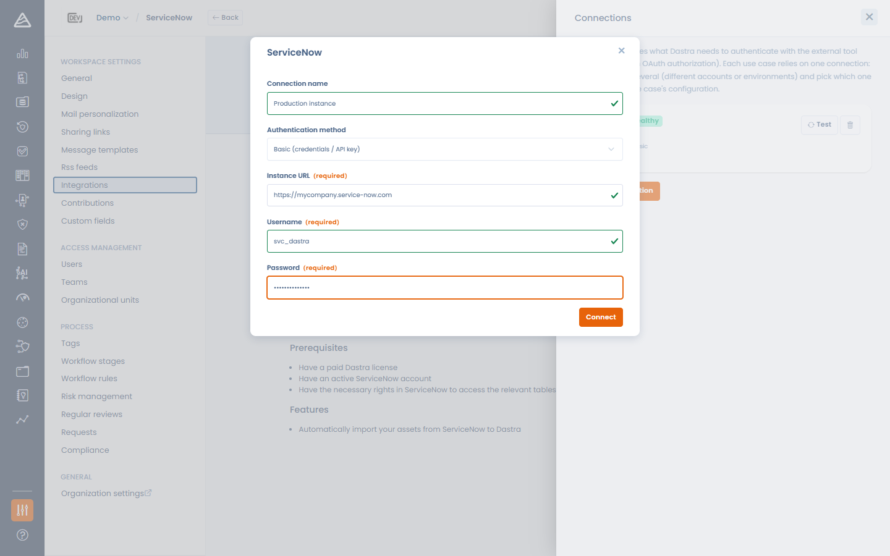

# ServiceNow

## Über ServiceNow

Mit der Integration von [**ServiceNow**](https://www.servicenow.com/) synchronisieren Sie die Geschäftsanwendungen aus der ServiceNow-CMDB automatisch direkt in Dastra.

Sie ermöglicht es,

* doppelte Dateneingaben zu vermeiden;
* die technischen Assets, die in der gesamten Organisation genutzt werden, zentral zu erfassen;
* diese Assets in Ihrem Verarbeitungsverzeichnis, Ihren Datenkategorien, Folgenabschätzungen, Risikoanalysen, Audits usw. zu verwenden;
* dafür zu sorgen, dass die Informationen aus ServiceNow in Dastra aktuell bleiben.

## Voraussetzungen

* Eine kostenpflichtige Dastra-Lizenz mit Zugriff auf das Modul Integrationen / Konnektoren.
* Eine ServiceNow-Instanz (z. B. `https://ihre-instanz.service-now.com`), die REST-API-Aufrufe aus externen Quellen zulässt, und je nach Authentifizierungsmethode:
  * **OAuth 2.0 (empfohlen)**: die Möglichkeit, in Ihrer Instanz eine OAuth-Anwendung zu registrieren,
  * **Basic**: ein Dienstkonto mit Lesezugriff auf `cmdb_ci_business_app`.

## Installation

Die Einrichtung folgt dem gemeinsamen Ablauf der Integrationen (siehe [Verbindungen, Anwendungsfälle und Feld-Mapping](connections.md)):

1. Öffnen Sie die ServiceNow-Seite im Integrations-Marktplatz von Dastra.\
   Beispiel:\
   [https://app.dastra.eu/workspace/0/settings/integrations/servicenow](https://app.dastra.eu/workspace/0/settings/integrations/servicenow)
2. Klicken Sie im Anwendungsfall für den Asset-Import auf **Integration hinzufügen**.
3. Fügen Sie eine Verbindung hinzu und wählen Sie das **Authentifizierungsverfahren** (siehe unten).
4. Schließen Sie den Schritt **Konfiguration** ab. Er ist zwingend erforderlich, um die Installation abzuschließen.

<figure><figcaption>
Die ServiceNow-Verbindung erstellen
</figcaption></figure>

## Authentifizierungsmethoden

**OAuth 2.0 (empfohlen)**: Dastra speichert nie ein Passwort; ServiceNow stellt kurzlebige Token aus, die Dastra automatisch erneuert.

1. Erstellen Sie in ServiceNow eine OAuth-App für Dastra: **All > Application Registry** (bei aktuellen Versionen: *Inbound integrations > Authorization code grant*), Typ *OAuth API endpoint for external clients*.
2. Legen Sie als Redirect-URL fest: `https://api.dastra.eu/v1/integrationaccounts/callback/servicenow`
3. Stellen Sie sicher, dass die Bereichseinschränkung der App auf **Broadly scoped** steht (oder deklarieren Sie den Scope `useraccount`): Eine *securely scoped* App ohne Scopes lehnt den Token-Austausch ab.
4. Erstellen Sie in Dastra die Verbindung mit dem Verfahren **OAuth**, geben Sie die **URL der Instanz**, die **OAuth client ID** und das **OAuth client secret** ein, klicken Sie auf **Registrieren und anmelden** und autorisieren Sie Dastra in ServiceNow.

**Basic-Authentifizierung**: Benutzername und Passwort eines ServiceNow-Kontos, von Dastra verschlüsselt gespeichert.


Neuere ServiceNow-Instanzen schränken die Basic-Authentifizierung für die REST-API auf Kontoebene ein. Wenn Sie die Basic-Authentifizierung verwenden, erstellen Sie ein **dediziertes Dienstkonto mit aktiviertem „Web service access only“**, nie ein persönliches Konto oder ein Administratorkonto. Symptom der Einschränkung: eine Antwort `401 User is not authenticated`, auch bei gültigen Zugangsdaten.


## Konfiguration

* Wählen Sie die **Nutzer, die im Falle eines Fehlers benachrichtigt werden sollen** (erforderlich). Sie erhalten eine E-Mail, wenn eine Synchronisierung fehlschlägt, mit Informationen zu den aktualisierten Assets.
* **Erstellen Sie den Datensatz „Dastra“, falls dieser noch nicht vorhanden ist**: wenn die Option aktiviert ist, wird ein Asset auf Grundlage der externen Referenz angelegt, sofern es in Dastra noch nicht existiert.
* **Duplikate bei synchronisierten Elementen entfernen**: eingehende Anwendungen werden anhand eines **Korrespondenzfelds** (**Label** oder **Referenz**) mit bestehenden Assets abgeglichen und aktualisiert, statt Duplikate zu erzeugen.
* **Feld-Mapping**: legen Sie fest, welches ServiceNow-Feld (aus `cmdb_ci_business_app`) welches Dastra-Feld befüllt. Die Auswahllisten werden live aus dem Datenwörterbuch Ihrer Instanz gelesen, sodass Auswahlwerte in Dastra-Werte umgewandelt werden können. Siehe [Verbindungen, Anwendungsfälle und Feld-Mapping](connections.md).


Achtung: Wenn Sie die Option zum Erstellen aktivieren, können in Ihrem Mandanten automatisch sehr viele Assets angelegt werden. Konfigurieren Sie die externen Referenzen daher sorgfältig.


<figure><figcaption>
Die ServiceNow-Konfiguration: Optionen und Feld-Mapping
</figcaption></figure>

## Datensynchronisierung zwischen Dastra und ServiceNow

Die Synchronisierung läuft automatisch **einmal täglich** und kann jederzeit mit **Synchronisierung starten** auf der Karte des Anwendungsfalls ausgelöst werden. Bei jeder Synchronisierung werden Felder aus ServiceNow in Ihr Asset-Verzeichnis in Dastra übernommen. Standardmäßig werden folgende Informationen abgerufen und aktualisiert:

* **Bezeichnung** des Assets
* **Beschreibung** (die Kurzbeschreibung in ServiceNow)
* **Anwendungstyp**
* **Installationsstatus / Status**
* **Asset-Typ** (grundsätzlich als _Software_ importiert)
* **Zugeordneter Bereich / zugeordnete Domäne** (AreaId)
* Zugeordnete **Tags**
* **Externe Kennung** aus ServiceNow (`sys_id`)
* **Externe Quelle** (`ServiceNow`)
* **Datum der letzten Synchronisierung**
* **Verantwortlicher** des Assets

Jedes dieser Standardverhalten kann pro Feld im Editor **Feld-Mapping** überschrieben werden. Alle diese Daten sorgen für eine zuverlässige und aktuelle Verbindung zwischen Ihrer ServiceNow-CMDB und Ihrem Dastra-Verzeichnis.

### Verwaltung gelöschter Assets auf ServiceNow-Seite

Stellt Dastra fest, dass ein zuvor synchronisiertes Asset in ServiceNow nicht mehr existiert, wird es in Dastra nicht automatisch gelöscht.

Stattdessen versieht Dastra das Asset mit einem automatischen Tag (`To-delete-servicenow`), das anzeigt, dass es in ServiceNow gelöscht wurde. Erscheint die Anwendung später wieder in ServiceNow, wird das Tag automatisch entfernt.

So lässt sich:

* der Verlauf in Dastra erhalten,
* ein versehentliches Löschen vermeiden,
* die manuelle Prüfung veralteter Assets erleichtern.

Findet die Deduplizierung für eine eingehende Anwendung **mehrere** passende Assets, erhalten die Kandidaten das Tag `To-merge-servicenow`, damit über ein manuelles Zusammenführen entschieden werden kann.
