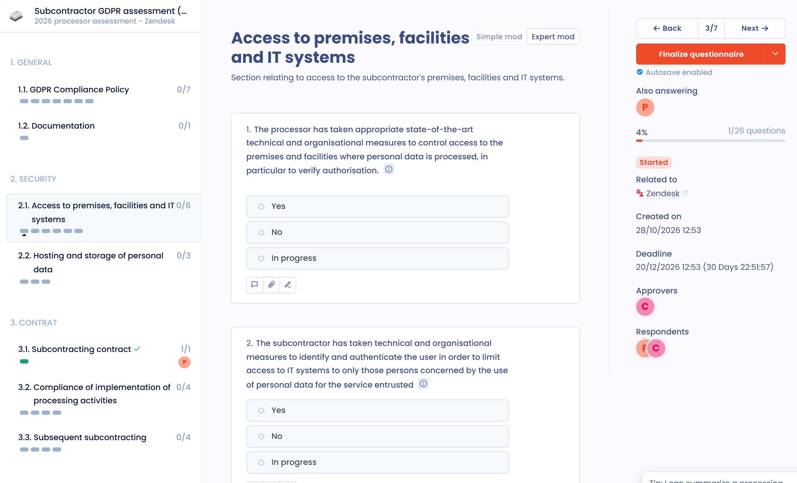

# Fragebögen

Mit dem Fragebogenmodul von Dastra erfassen Sie die Informationen, die Sie für Ihre Compliance benötigen: DSFA, Fragebögen für Auftragsverarbeiter, Compliance-Fragebögen, Transfer Impact Assessments und mehr.

Um das Modul zu öffnen, klicken Sie im linken Menü auf **Fragebögen**. Das Menü bietet drei Einträge:

* **Vorlagen**: die Vorlagen, die Sie erstellen, importieren oder aus der Bibliothek installieren;
* **Alle Fragebögen**: die Antworten auf alle im Mandanten geplanten Fragebögen;
* **Meine Fragebögen**: die Fragebögen, die an Sie gerichtet sind, als Befragter oder als Genehmiger.

## Einen an Sie gerichteten Fragebogen beantworten

Wenn Sie Befragter oder Genehmiger sind, öffnen Sie **Fragebögen** > **Meine Fragebögen**. Die Liste zeigt nur die an Sie gerichteten Fragebögen mit Frist, Befragten, Status und Bearbeitungsgrad. Ein Fragebogen nach Ablauf der Frist trägt das Badge **Abgelaufen**.

1. Filtern Sie mit den Tabs über der Liste nach Status: **Alle**, **Validierung ausstehend**, **Validiert** oder **Abgelaufen**.
2. Klicken Sie auf eine Zeile, um den Fragebogen zu öffnen und zu beantworten.
3. Wenn Sie alle erforderlichen Fragen beantwortet haben, schließen Sie den Fragebogen ab. Er geht dann an seine Genehmiger: siehe [Einen Fragebogen validieren](validate.md).

Das Menü einer Zeile bietet je nach Ihren Berechtigungen außerdem **Teilen**, **Exportieren** und **Den Fragebogen abbrechen**. Fragebögen, die Sie in den Papierkorb verschieben, erscheinen, wenn Sie **Papierkorb anzeigen** aktivieren, wie unter [Einen Fragebogen oder eine Vorlage löschen](delete.md) beschrieben.

### Mit mehreren Befragten antworten

Ist ein Fragebogen an mehrere Befragte gerichtet, Dastra-Nutzer oder externe Befragte, sieht jeder von ihnen, wer gleichzeitig daran arbeitet.

* **Wer da ist**: Die Zeile **Also answering** über dem Fortschrittsbalken zeigt die Avatare der anderen Personen, die gerade im Fragebogen sind. Fahren Sie über einen Avatar, um den Namen und den Abschnitt der Person zu sehen. Dieselben Avatare erscheinen neben dem Abschnitt in der linken Navigation. Ein Befragter ohne Namen, der nur per E-Mail eingeladen wurde, erscheint als **External respondent**.
* **Antworten der anderen**: Die Antworten, die sie speichern, erscheinen auf Ihrem Bildschirm, ohne dass die Seite neu geladen wird. Haben Sie an derselben Frage eine noch nicht gespeicherte Änderung, bleibt Ihre Änderung erhalten und wird nach der üblichen Verzögerung gespeichert.
* **Abschluss**: Schließt ein anderer Befragter den Fragebogen ab, teilt Ihnen eine Meldung mit, wer es war und dass der Fragebogen keine Antworten mehr annimmt. Klicken Sie auf **Aktualisieren**, um die Seite des abgeschlossenen Fragebogens zu öffnen.

<figure><figcaption>
Zwei Befragte bei der Arbeit: die Zeile Also answering und die Avatare der Abschnitte
</figcaption></figure>

Nur der Name und der Avatar der Befragten werden mit den anderen geteilt. Es wird keine E-Mail-Adresse angezeigt.

## Eine Vorlage erstellen


[Eine Fragebogenvorlage erstellen](templates/README.md)


Die Anzahl der Vorlagen hängt von Ihrem Abonnement ab: siehe [Credits und Kontingente](../../getting-started/setup/key-concepts.md#credits-und-kontingente).

## Einen Fragebogen planen


[Einen Fragebogen planen](schedule.md)


## Fragebögen überwachen


[Fragebögen überwachen](monitor.md)


## Einen Fragebogen validieren


[Einen Fragebogen validieren](validate.md)


## Einen Bericht exportieren


[Einen Bericht exportieren](export.md)


## Fragebogentypen


[Fragebogentypen](types/README.md)


## Einen Fragebogen mit KI übersetzen


[Einen Fragebogen mit KI übersetzen](translate.md)


## Einen Fragebogen oder eine Vorlage löschen


[Einen Fragebogen oder eine Vorlage löschen](delete.md)


## Häufig gestellte Fragen


[Häufig gestellte Fragen](faq.md)


## Weiterführende Informationen


[Risikomanagement](../risks/README.md)

