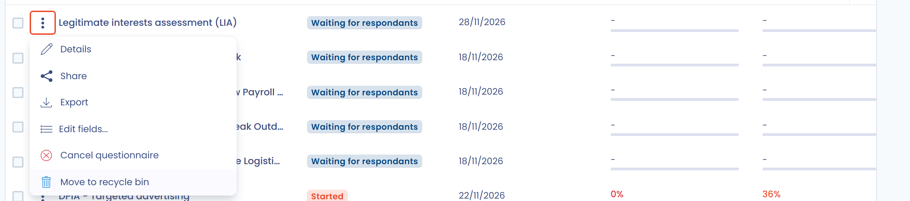

# Einen Fragebogen oder eine Vorlage löschen

In Dastra durchläuft ein Fragebogen oder eine Fragebogenvorlage den Papierkorb, bevor sie endgültig gelöscht wird. Dieser Schritt schützt vor versehentlichem Löschen: Solange sich das Element im Papierkorb befindet, können Sie es wiederherstellen.

## Einen Fragebogen löschen

### In den Papierkorb verschieben

1. Klicken Sie in einer Liste von Fragebögen (**Alle Fragebögen**, **Meine Fragebögen** oder das Dashboard einer Vorlage) auf die drei Punkte der betreffenden Zeile.
2. Klicken Sie auf **In den Papierkorb verschieben** und bestätigen Sie.

Sie können den Fragebogen auch öffnen und im Menü neben seiner Hauptschaltfläche **In den Papierkorb verschieben** wählen. Um mehrere Fragebögen auf einmal zu bearbeiten, wählen Sie die Zeilen aus und verwenden Sie die entsprechende Sammelaktion.

<figure><figcaption>
Die Aktion „In den Papierkorb verschieben“ im Menü eines Fragebogens
</figcaption></figure>

### Wiederherstellen oder endgültig löschen

1. Klicken Sie über der Liste auf **Filter** und aktivieren Sie dann **Papierkorb anzeigen**.
2. Klicken Sie im Menü des Fragebogens auf **Wiederherstellen**, um ihn wieder in Ihre Listen aufzunehmen, oder auf **Löschen**, um ihn endgültig zu löschen.

<figure><figcaption>
Der Papierkorb der Fragebögen: Wiederherstellen oder Löschen
</figcaption></figure>


Das endgültige Löschen eines Fragebogens kann nicht rückgängig gemacht werden.


## Eine Vorlage löschen

Auch Fragebogenvorlagen haben einen Papierkorb.

1. Klicken Sie unter **Vorlagen** auf die drei Punkte der Vorlage.
2. Klicken Sie auf **In den Papierkorb verschieben** und bestätigen Sie.

<figure><figcaption>
Das Menü einer Fragebogenvorlage
</figcaption></figure>

Um eine Vorlage wiederherzustellen oder endgültig zu löschen, aktivieren Sie oben in der Vorlagenliste **Papierkorb anzeigen**. Klicken Sie im Menü der Vorlage auf **Wiederherstellen** oder **Dauerhaft löschen**.

<figure><figcaption>
Der Papierkorb der Fragebogenvorlagen
</figcaption></figure>


Die Anzahl der Vorlagen hängt von Ihrem Tarif ab, und der Papierkorb der Vorlagen zählt zu diesem Kontingent: Eine Vorlage im Papierkorb belegt weiterhin einen Platz, bis sie endgültig gelöscht wird. Wenn Sie vor dem Löschen eine Kopie einer Vorlage behalten möchten, exportieren Sie sie in ihrem Menü als JSON: Sie können sie später wieder importieren.

