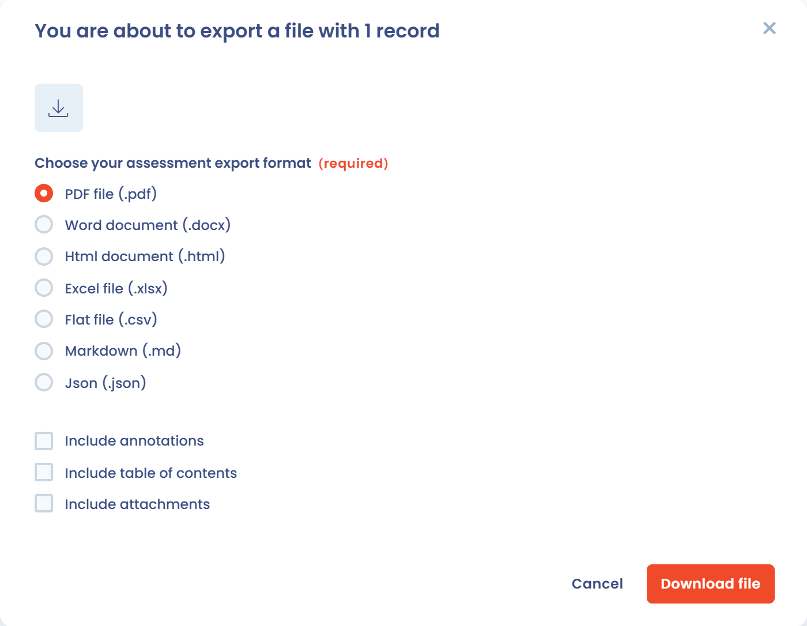

# Einen Bericht exportieren

Sobald die Antworten erfasst und der Fragebogen validiert sind, können Sie den Bericht in mehreren Formaten exportieren oder per Link teilen. Für den Export benötigen Sie die Berechtigung zum Exportieren von Fragebögen, und die Exportfunktion muss in Ihrem Tarif enthalten sein. Andernfalls zeigt das Exportfenster eine Meldung an, dass die Funktion nicht verfügbar ist.

## Eine oder mehrere Antworten exportieren

Sie können einen Export von mehreren Stellen aus starten:

* **eine Antwort**: Öffnen Sie sie, klicken Sie auf den Pfeil neben der Hauptschaltfläche und dann auf **Fragebogen exportieren**;
* **mehrere Antworten**: Wählen Sie in einer Liste von Antworten (**Alle Fragebögen**, **Meine Fragebögen** oder das Dashboard einer Vorlage) die Zeilen aus und verwenden Sie die Aktion **Exportieren**;
* **alle Antworten einer Vorlage**: Klicken Sie im Dashboard der Vorlage auf den Pfeil neben **Fragebogen planen** und dann auf **Antworten exportieren**.

Das Exportfenster fordert Sie auf, ein Format und Optionen zu wählen.

<figure><figcaption>
Das Exportfenster eines Fragebogens
</figcaption></figure>

### Formate

| Format | Höchstzahl der Elemente pro Export |
| --- | --- |
| PDF-Datei (.pdf) | 200 |
| Word (.docx) | 1.000 |
| HTML-Datei (.html) | 1.000 |
| Excel-Datei (.xlsx) | 10.000 |
| Flache Datei (.csv) | 10.000 |
| Markdown | 10.000 |
| JSON-Datei (.json) | 10.000 |

Über der Grenze des Formats hinaus exportiert Dastra nur die ersten Elemente: Verkleinern Sie Ihre Auswahl, um die folgenden abzurufen.

### Optionen

* **Anmerkungen hinzufügen**: verfügbar für die Formate PDF, Word und HTML;
* **Zusammenfassung einfügen**;
* **Anhänge hinzufügen**.

Klicken Sie auf **Datei herunterladen**, um den Export zu starten. Die Kommentare der Genehmiger zur Überprüfung erscheinen im Bericht (siehe [Einen Fragebogen validieren](validate.md)).

## Den Bericht teilen

Eine validierte Antwort kann per Link geteilt werden. Öffnen Sie sie, klicken Sie auf den Pfeil neben der Hauptschaltfläche und dann auf **Bericht teilen**. Die Aktion wird nur angeboten, wenn die Antwort den Status **Validiert** hat.

## Weiterführende Informationen

Informationen zum Exportieren der Vorlage selbst finden Sie unter [Eine Fragebogenvorlage erstellen](templates/README.md). Informationen zum Entfernen einer Antwort aus Ihren Listen finden Sie unter [Einen Fragebogen oder eine Vorlage löschen](delete.md).
