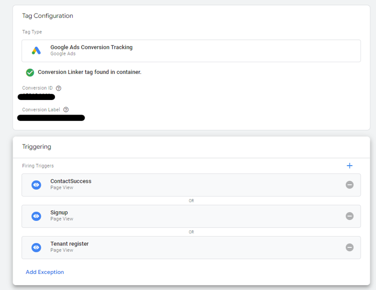
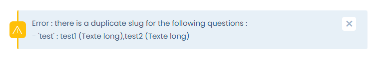
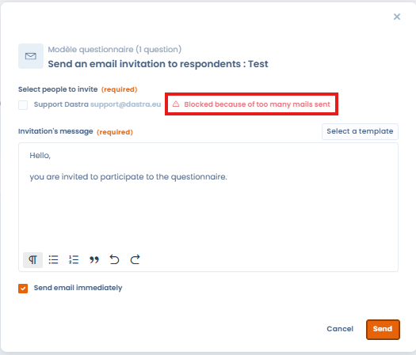

# Häufig gestellte Fragen

## Kann ich eine DSFA für mehrere Verarbeitungsvorgänge durchführen?

Eine Datenschutz-Folgenabschätzung kann sich auf einen Verarbeitungsvorgang oder auf eine Reihe ähnlicher Verarbeitungsvorgänge beziehen. Eine einzige DSFA kann verwendet werden, um mehrere Verarbeitungsvorgänge zu bewerten, die sich in Art, Umfang, Kontext, Zwecken und Risiken ähneln.&#x20;

Zum Beispiel:

* Gebietskörperschaften, die jeweils ein ähnliches Videoüberwachungssystem einführen, könnten eine einzige Analyse dieses Systems durchführen, auch wenn es anschließend von getrennten Verantwortlichen betrieben wird;&#x20;
* ein Eisenbahnbetreiber (einziger Verantwortlicher) könnte eine einzige Folgenabschätzung für das in mehreren Bahnhöfen eingesetzte Videoüberwachungssystem durchführen.&#x20;

In Dastra ist das Standardmodell für die PIA an einen einzelnen Verarbeitungsvorgang gebunden. Sie können die Vorlage so ändern, dass die PIA nicht an eine Verarbeitung gebunden ist. In diesem Fall können Sie die PIA durchführen, exportieren und in die Dokumentation der betreffenden Verarbeitungstätigkeiten aufnehmen.

## Kann beim Erstellen eines Fragebogens automatisch eine E-Mail-Vorlage eingerichtet werden?

Sie können eine E-Mail-Vorlage erstellen, die in den Einladungen zu Fragebögen verwendet werden kann: Klicken Sie im Planungsformular neben der **Einladungsnachricht** auf **Wählen Sie eine Vorlage aus**.

Um weitere Aktionen zu automatisieren, verwenden Sie eine Workflow-Regel. Antworten auf Fragebögen sind eine Entität der Workflow-Regeln mit dem Namen **Responding to a questionnaire**. Um eine Regel zu erstellen, öffnen Sie eine Antwort, klicken Sie auf den Pfeil neben ihrer Hauptschaltfläche und dann auf **Workflow-Regel** und **Erstellen Sie eine Workflow-Regel**. Eine Regel kann zum Beispiel eine Benachrichtigung senden oder eine Aufgabe erstellen, wenn eine Antwort die von Ihnen definierten Bedingungen erfüllt. Siehe die Seite [Workflow-Regeln](../settings/workflow-rules.md).

## Kann ich als externer Befragter Bilder in die Antworten einfügen?

Nein, das ist nicht möglich. Diese Option steht nur internen Befragten (Dastra-Nutzern) zur Verfügung.

## Kann anhand der Antwort auf einen Fragebogen automatisch eine Aufgabe vorgeschlagen werden?

Ja, das ist beim Fragetyp „Ausführlicher Text“ möglich, indem Sie das Kästchen „Automatisches Vorschlagen einer Aufgabe(n) basierend auf der Antwort“ aktivieren.

## Kann eine Fragebogenvorlage für alle Dastra-Nutzer veröffentlicht werden?

Ja, das können Sie im Vorlageneditor tun, indem Sie auf **Beitrag leisten** klicken:

<figure><figcaption></figcaption></figure>

## Was bedeuten die Farben in den Antworten eines Fragebogens?

In den Abschnitten des Fragebogens sind den Symbolen der Fragen Farben zugeordnet.

Das bedeuten die Farben:

| Farbe | Bild | Beschreibung |
| --- | --- | --- |
| Grau mit rotem Rand |  | Pflichtfrage nicht beantwortet |
| Schwarz mit rotem Rand |  | Pflichtfrage beantwortet |
| Grau |  | Optionale Frage nicht beantwortet |
| Grün |  | Alle Fragen des Abschnitts sind beantwortet. Optionale Frage beantwortet |
| Grün mit rotem Rand |  | Alle Fragen des Abschnitts sind beantwortet. Pflichtfrage beantwortet |
| Schwarz |  | Optionale Frage beantwortet. Einige Fragen des Abschnitts sind noch unbeantwortet |

## Was tun bei der Fehlermeldung „Error: there is a duplicate slug for the following questions“ beim Speichern eines Fragebogens? 

<figure><figcaption></figcaption></figure>

Diese Meldung zeigt an, dass eine oder mehrere Fragen des Fragebogens exakt denselben „Namen der Variablen“ haben, was den Fehler verursacht.

<figure><figcaption></figcaption></figure>

Fragen mit demselben „Namen der Variablen“ erkennen Sie an der Fehlermeldung „Der Name der Variablen … ist in einer anderen Frage enthalten“, die über ihnen angezeigt wird.

<figure><figcaption></figcaption></figure>

Um das Problem zu lösen, ändern Sie den „Namen der Variablen“ jeder doppelten Frage so, dass er eindeutig ist, zum Beispiel indem Sie am Ende jedes „Namens der Variablen“ eine fortlaufende Nummer anhängen.

<figure><figcaption></figcaption></figure>

Wenn der Fragebogen keinen doppelten „Namen der Variablen“ mehr enthält, lässt er sich normal speichern.

## Was tun bei der Fehlermeldung „Gesperrt aufgrund einer zu hohen Anzahl an Einladungen“? 

<figure><figcaption></figcaption></figure>

Diese Meldung erscheint, wenn aus demselben Fragebogen bereits 5 E-Mail-Einladungen an einen Befragten gesendet wurden.

Wenn diese Meldung erscheint, können Sie den Befragten dennoch einladen, indem Sie ihm den Einladungslink zum Fragebogen senden, der hier verfügbar ist:

<figure><figcaption></figcaption></figure>

## Was tun, wenn ich nicht auf **Überprüfen und bestätigen Sie den Fragebogen** klicken kann, obwohl ich Genehmiger des Fragebogens bin?

Das kann vorkommen, wenn der Befragte seinen Fragebogen noch nicht abgeschlossen hat, indem er nach dem Ausfüllen auf die Schaltfläche **Abschließen** geklickt hat.

In diesem Fall können Sie als Genehmiger den Status des Fragebogens aus Sicht des Befragten prüfen, über den Zugangslink des Befragten, der hier verfügbar ist:

<figure><figcaption></figcaption></figure>

## Gibt es eine Begrenzung der Anzahl von Fragebogenvorlagen?

Ja, die Anzahl der verfügbaren Vorlagen hängt von Ihrem Tarif ab. Dieses Kontingent wird **von allen Mandanten** Ihrer Organisation **gemeinsam genutzt**. **Der Papierkorb der Vorlagen zählt zum Kontingent**: Gelöschte Vorlagen, die nicht endgültig entfernt wurden, belegen weiterhin einen Platz. Wenn Sie die Grenze erreichen, leeren Sie den Papierkorb in der Vorlagenverwaltung, um Plätze freizugeben.

## Kann der Zugangslink zu einem Fragebogen mit mehreren Personen geteilt werden?

Ja. Wenn ein Befragter per E-Mail einen Einladungslink erhält, erfordert der **erste Zugriff über diesen Link keinen PIN-Code**. Leitet der Befragte den Link jedoch an einen Kollegen weiter, muss diese Person ihren Zugriff über einen **per E-Mail erhaltenen PIN-Code** bestätigen. Dieser Mechanismus gewährleistet die Sicherheit und erlaubt zugleich die Zusammenarbeit innerhalb eines externen Teams, ohne dass ein Dastra-Konto erforderlich ist.

## Kann ein externer Befragter selbst weitere Befragte hinzufügen?

Nein, nur ein **Genehmiger des Fragebogens** kann in der Dastra-Oberfläche neue Befragte hinzufügen. Wenn ein externer Befragter einen Kollegen einbeziehen möchte, gibt es zwei Möglichkeiten: Ein Genehmiger kann die neue E-Mail-Adresse direkt in der Verwaltungsansicht des Fragebogens hinzufügen, oder der Befragte kann seinen Einladungslink teilen, wobei der Kollege seinen Zugriff dann über einen per E-Mail gesendeten PIN-Code bestätigen muss.

## Gibt es eine automatische Erinnerung, wenn ein Fragebogen auf Validierung wartet?

Derzeit erhält der Genehmiger eine **Benachrichtigung** (in Dastra und per E-Mail), wenn der Befragte den Fragebogen abschließt, es gibt jedoch kein System für periodische automatische Erinnerungen. Um keine ausstehenden Fragebögen zu übersehen, gibt es zwei Alternativen: Prüfen Sie regelmäßig **Meine Fragebögen**, gefiltert nach dem Status **Zur Freigabe vorgelegt**, oder richten Sie eine **Workflow-Regel** ein, um den Versand eines Fragebogens oder einer Benachrichtigung in regelmäßigen Abständen zu automatisieren.

## Erfordern Fragen mit dynamischer Auswahl besondere Berechtigungen für Befragte?

Ja. Die Fragetypen **„Dynamischer Einfachauswahlschalter“** und **„Dynamischer Mehrfachauswahlschalter“** zeigen Listen von Objekten aus Dastra an (Assets, Verarbeitungstätigkeiten, Stakeholder usw.). Damit diese Liste erscheint, muss der Befragte **Lesezugriff** auf die entsprechenden Objekte in Dastra haben. Ein externer Befragter ohne Dastra-Konto oder ohne die passenden Berechtigungen kann die Liste nicht sehen.
