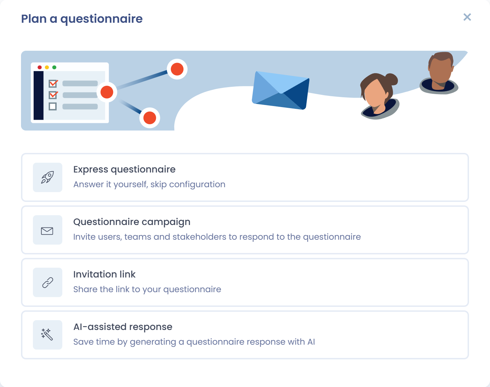
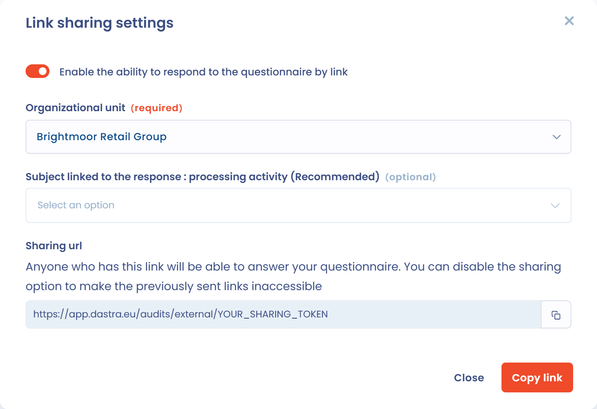
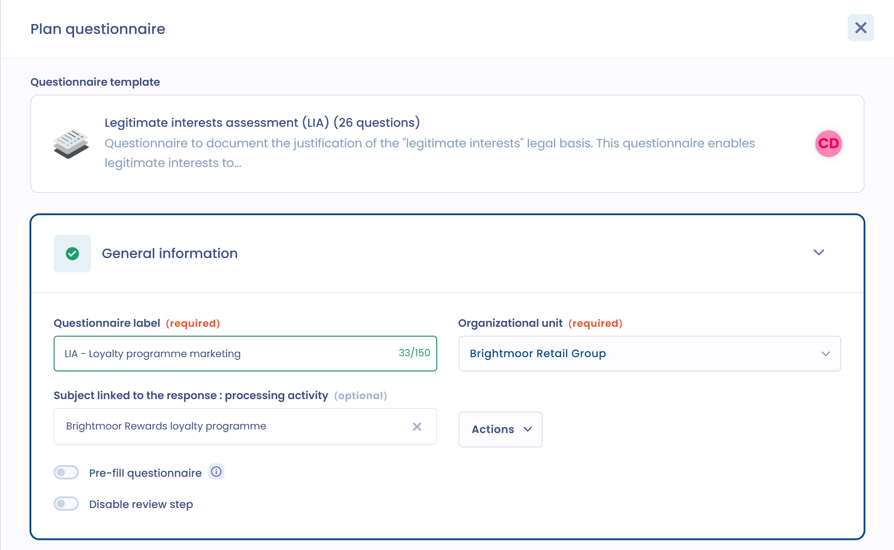

# Einen Fragebogen planen

Einen Fragebogen zu planen bedeutet, eine Vorlage an ihre Befragten zu senden oder sie selbst zu beantworten. Diese Seite behandelt die vier Erstellungsmodi, die Einstellungen der Planung und die Verknüpfung mit den anderen Objekten in Dastra.

## Eine Planung starten

Sobald die Fragebogenvorlage erstellt und angepasst ist, klicken Sie auf **Fragebogen planen**. Die Schaltfläche steht in der Liste **Vorlagen**, oben auf der Seite einer Vorlage und, für PIA-, TIA- und LIA-Fragebögen, in der betreffenden Verarbeitungstätigkeit zur Verfügung (siehe [DSFA / PIA](types/dpia.md)).

Das Fenster **Einen Fragebogen planen** bietet vier Erstellungsmodi.

<figure><figcaption>
Die vier Erstellungsmodi eines Fragebogens
</figcaption></figure>

### Schneller Fragebogen

**Schnelle Einrichtung**: Sie beantworten den Fragebogen selbst und überspringen die Konfiguration. Dastra erstellt den Fragebogen sofort, mit Ihnen als Befragtem und als Genehmiger, ohne Überprüfungsschritt und ohne Einladungs-E-Mail, und öffnet das Antwortformular. Dieser Modus eignet sich für interne Selbstbewertungen.

### Fragebogenkampagne

**Befragte einladen**: Laden Sie Nutzer, Teams und Stakeholder ein, den Fragebogen zu beantworten. Dieser Modus öffnet das Planungsformular, das im nächsten Abschnitt beschrieben wird. Interne und externe Befragte erhalten eine E-Mail mit einem Link zu einem Online-Bereich, in dem sie ihre Antworten eintragen. Mit **Einladungen versenden** im Menü der Antwort können Sie die Personen, die noch nicht geantwortet haben, erneut einladen.

### Einladungslink

**Einladungslink erstellen**: Teilen Sie den Link zu Ihrem Fragebogen. Im Fenster, das sich öffnet:

1. Wählen Sie die **Organisationseinheit** und, wenn die Vorlage mit einem Objekttyp verknüpft ist, das betreffende Objekt.
2. Klicken Sie auf **Link kopieren** und teilen Sie ihn.

Dieser Modus aktiviert das Teilen per Link für die Vorlage selbstständig: Es gibt keinen Schalter, den Sie einschalten müssten. Jeder, der den Link hat, wird zum Befragten des Fragebogens. Bei jedem Zugriff wird ein Fragebogen erzeugt, und der Link bleibt verfügbar, bis er deaktiviert wird: Schalten Sie die Option aus, damit bereits versendete Links nicht mehr erreichbar sind. Stimmt die vom Befragten eingegebene E-Mail-Adresse mit einem Dastra-Konto überein, wird sie in den Anmeldeschritt übernommen, und der Befragte wird direkt zum Identitätsanbieter seiner Organisation weitergeleitet, wenn SSO eingerichtet ist.

Um den Link wiederzufinden oder später zu deaktivieren, öffnen Sie die Seite der Vorlage und klicken Sie unter ihrem Titel auf die Schaltfläche **Zugang**. Das Fenster **Einstellungen für den Einladungslink** öffnet sich: Es enthält den Schalter **Bitte aktiviere die Möglichkeit, den Fragebogen über einen Link auszufüllen**. Dasselbe Fenster ist über das Menü neben **Fragebogen planen** erreichbar. Eine Vorlage, die in einem Trust Center verwendet wird, kann ihren Link nicht deaktivieren, solange sie nicht aus diesem Trust Center entfernt ist.

<figure><figcaption>
Die Einstellungen für den Einladungslink einer Vorlage
</figcaption></figure>

### KI-gestützte Antwort

**KI-gestützte Antwort**: Sparen Sie Zeit, indem Sie die Antwort auf einen Fragebogen mit KI erzeugen. Dies ist ein Erstellungsmodus, keine Aktion innerhalb eines bereits geöffneten Fragebogens. Er ist ausgegraut, wenn die KI-Funktion für Fragebögen für Ihre Organisation nicht aktiviert ist.

Im Fenster **KI-gestützte Antwort**:

1. Geben Sie die **Bezeichnung des Fragebogens** ein und wählen Sie die **Organisationseinheit**.
2. Wenn die Vorlage mit einem Objekt verknüpft ist, wählen Sie das zugehörige Element aus: Seine Informationen werden an die KI gesendet.
3. Fügen Sie unter **Bitte geben Sie dem Assistenten detaillierte Anweisungen.** bei Bedarf Hinweise hinzu (höchstens 300 Zeichen).
4. Wählen Sie die **Answer language** (Sprache der Antworten). Die Antworten werden in dieser Sprache verfasst, unabhängig von der Sprache der Oberfläche, und Dastra merkt sie sich von einer Erzeugung zur nächsten.
5. Fügen Sie mit **Dokument hinzufügen** bis zu drei Dokumente an (PDF, Word, Markdown, HTML, JSON, CSV oder Text: Projektnotizen, Sicherheitsrichtlinie, Auftragsverarbeitungsvertrag, bestehende Analyse usw.), oder geben Sie mit **Webseiten-URL** eine Website-Adresse an.
6. Klicken Sie auf **Generieren**.

Dastra erstellt den Fragebogen, mit Ihnen als Befragtem und als Genehmiger, trägt die von der KI vorgeschlagenen Antworten ein und öffnet ihn. Prüfen Sie jede Antwort, passen Sie sie an und schließen Sie den Fragebogen dann wie jede andere Antwort ab. Dieser Modus ist besonders nützlich für lange Fragebögen wie DSFA, TIA oder LIA, wenn Sie bereits über Dokumentation verfügen.

Eine Anzeige **Anwendung** erscheint, sobald Ihr Kontingent an KI-Credits 80 % erreicht. Die Erzeugung wird blockiert, wenn das Kontingent überschritten ist.


Die Nutzung der KI-gestützten Antwort verbraucht KI-Credits. Details zu Ihrem Kontingent und Ihrer Nutzung finden Sie auf der Seite [KI-Assistent](../general/ai-assistant/README.md).


<figure><figcaption>
Die Antwort auf einen Fragebogen mit KI erzeugen
</figcaption></figure>

## Einstellungen der Planung

Der Modus **Befragte einladen** öffnet ein Formular, das in vier Abschnitte gegliedert ist.

<figure><figcaption>
Der Abschnitt „Allgemeines“ des Planungsformulars
</figcaption></figure>

### Allgemeines

* **Bezeichnung des Fragebogens** und **Organisationseinheit** sind Pflichtfelder.
* **Gegenstand der Antwort** erscheint, wenn die Vorlage mit einem Objekttyp verknüpft ist (siehe den Abschnitt „Den Fragebogen mit anderen Objekten in Dastra verknüpfen“ weiter unten).
* **Den Fragebogen vorab ausfüllen** übernimmt die Felder des verknüpften Objekts in die Antworten. Bei einer Vorlage vom Typ PIA heißt die Option **Automatisches Ausfüllen der DSFA anhand der Verarbeitung**.
* **Genehmigungsschritt deaktivieren** veröffentlicht die Antwort, sobald die Befragten sie abgeschlossen haben (siehe [Einen Fragebogen validieren](validate.md)).

### Befragte

Wählen Sie zuerst den Antwortmodus:

* **Individueller Fragebogen**: Jeder Befragte beantwortet seinen eigenen Fragebogen. Wenn Sie mehrere Befragte hinzufügen, erzeugt Dastra für jeden einen eigenen Fragebogen. Dieser Modus eignet sich, um vergleichbare Informationen von mehreren Personen oder Entitäten zu erfassen (Lieferantenbewertungen, Bewertungen Abteilung für Abteilung) und eine konsolidierte Auswertung zu erstellen.
* **Gemeinsamer Fragebogen**: Die Befragten arbeiten gemeinsam am selben Fragebogen. Dieser Modus eignet sich für lange oder bereichsübergreifende Fragebögen, an denen mehrere Teams beteiligt sind (zum Beispiel eine DSFA, die Beiträge von Rechtsabteilung, IT und Fachbereichen benötigt).

Klicken Sie dann auf **Befragte hinzufügen**:

* **Nutzer hinzufügen** und **Ein Team hinzufügen** für Dastra-Nutzer;
* **E-Mails hinzufügen** für externe Befragte;
* **E-Mails von Stakeholdern hinzufügen**, um die Kontakt-E-Mail der Stakeholder in Ihrem Mandanten zu verwenden;
* **Als Befragter hinzufügen**;
* **Importiere eine CSV-Datei mit E-Mail-Adressen**, mit den Spalten `email` und `displayName` (UTF-8, Semikolon als Trennzeichen).

Ein Fragebogen akzeptiert bis zu 50 Befragte. Jeder Befragte kann erforderlich sein oder nicht: Die Antwort wechselt zur Freigabe, sobald alle erforderlichen Befragten ihre Antworten abgeschlossen haben.

<figure><figcaption>
Der Abschnitt „Befragte“ des Planungsformulars
</figcaption></figure>

### Einladungen

* **Frist**: das Datum und die Uhrzeit, bis zu denen geantwortet werden muss. Sie wird aus der **Standardantwortzeit** der Vorlage vorgeschlagen.
* **Einladungen per E-Mail versenden**: Schalten Sie die Option aus, wenn Sie die Zugangslinks lieber selbst versenden. Andernfalls verfassen Sie die **Einladungsnachricht** oder verwenden eine Nachrichtenvorlage mit **Wählen Sie eine Vorlage aus**.
* **Versand der Benachrichtigung planen**: Wählen Sie ein **Datum des E-Mail-Versands** innerhalb der nächsten 70 Stunden.

Ein externer Befragter muss gegebenenfalls seine Identität mit einem 6-stelligen Code bestätigen, der per E-Mail gesendet wird, bevor er auf den Fragebogen zugreifen kann. Die [FAQ](faq.md) erklärt, wann das der Fall ist.

<figure><figcaption>
Der Abschnitt „Einladungen“ des Planungsformulars
</figcaption></figure>

### Genehmiger

Genehmiger prüfen die Antworten und validieren den Fragebogen. Legen Sie unter **Genehmiger erforderlich** mindestens einen Genehmiger fest und schalten Sie bei Bedarf **Optionale Genehmiger hinzufügen** ein. Der vollständige Ablauf ist unter [Einen Fragebogen validieren](validate.md) beschrieben.

## Antworten importieren

Um bereits erfasste Antworten zu übernehmen, öffnen Sie die Seite der Vorlage, klicken Sie auf den Pfeil neben **Fragebogen planen** und dann auf **Antworten importieren**. Laden Sie die xlsx-Vorlagendatei herunter, füllen Sie sie im für jede Frage erforderlichen Format aus und importieren Sie sie dann (xlsx oder csv).

## Wiederkehrende Fragebögen und Erneuerung

Antworten Sie in der Konfiguration der Vorlage mit **Ja** auf **Soll dieser Fragebogen regelmäßig ausgefüllt werden?** und legen Sie die **Tage zwischen den einzelnen Antworten** fest. Eine validierte Antwort zeigt dann das Datum an, bis zu dem sie erneuert werden muss, und das Badge **Zu erneuern** kennzeichnet in den Listen die Antworten, die zu erneuern sind.

Um eine Antwort zu erneuern, öffnen Sie sie und wählen Sie in ihrem Menü **Bitte füllen Sie diesen Fragebogen erneut aus.** Sie können die Version der Vorlage wählen und dann angeben, ob der erneuerte Fragebogen die Antworten des vorherigen übernimmt. Wenn Sie mit **Nein** antworten, beginnen Sie mit einem leeren Fragebogen, und die alten Antworten werden archiviert.

## Den Fragebogen mit anderen Objekten in Dastra verknüpfen

Sie können den Fragebogen an ein anderes Modul von Dastra anbinden. Wählen Sie in der Konfiguration der Vorlage, nachdem Sie ihr einen Namen und eine Beschreibung gegeben haben, unter **Verwandtes Thema** einen Objekttyp. Mögliche Objekte sind Stakeholder, Assets, Verarbeitungstätigkeiten, Datenschutzvorfälle, Anfragen, Sicherheitsmaßnahmen, Datenkategorien, Risikobewertungen, KI-Systeme und Verträge.

<figure><figcaption>
Das Feld „Gegenstand der Antwort“ bei der Planung
</figcaption></figure>

Wenn die Vorlage bereits existiert, können Sie ihr dennoch ein Objekt zuordnen: Öffnen Sie das Menü der Vorlage (die drei Punkte), klicken Sie auf **Konfiguration** und füllen Sie dann **Verwandtes Thema** aus.

Wenn Sie den Fragebogen anschließend planen, erscheint das Feld **Gegenstand der Antwort**. Mit seiner Auswahl legen Sie fest, mit welchem Objekt die Antwort genau verknüpft wird.


Sie können einen Fragebogen nur mit einem Objekt in Dastra verknüpfen.


## Direkter Zugriff auf die DSFA aus einer Verarbeitungstätigkeit

Bei Fragebögen vom Typ PIA können Sie die Folgenabschätzung aus einer Verarbeitungstätigkeit heraus starten. Im Schritt **Folgenabschätzung** der Verarbeitungstätigkeit öffnet die Schaltfläche **Erstellen Sie eine DSFA** den passenden Fragebogen, ohne die Verarbeitungstätigkeit zu verlassen.
