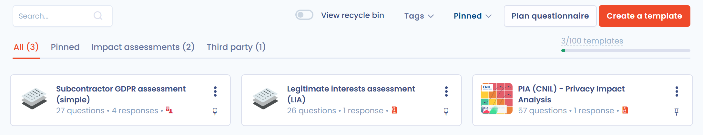
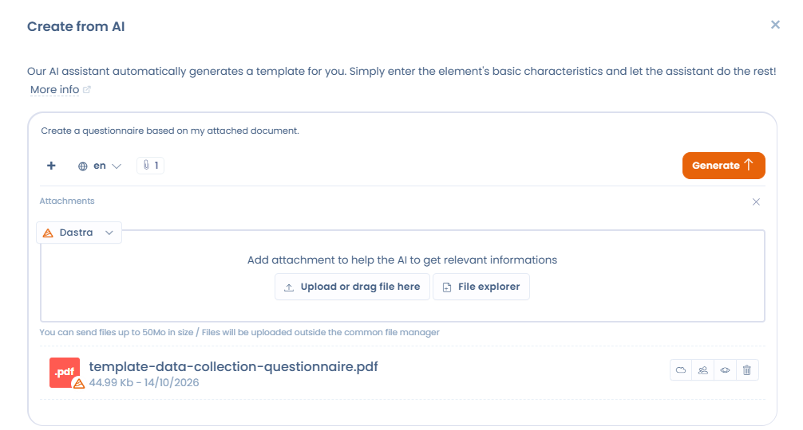
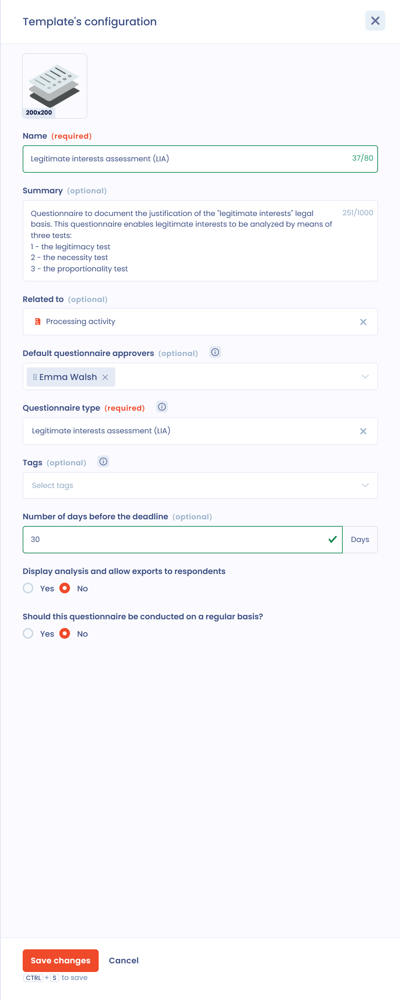

# Eine Fragebogenvorlage erstellen

Eine Fragebogenvorlage beschreibt die Abschnitte, die Fragen und die Bewertungsregeln eines Fragebogens. Sie erstellen sie einmal und planen sie anschließend so oft wie nötig. Um zu den Vorlagen zu gelangen, öffnen Sie **Fragebögen** > **Vorlagen**.

## Eine Fragebogenvorlage erstellen oder bearbeiten

Um eine Vorlage zu erstellen, klicken Sie oben in der Liste der Fragebogenvorlagen auf **Vorlage erstellen**. Die Schaltfläche ist ausgegraut, wenn Sie die Anzahl der in Ihrem Tarif enthaltenen Vorlagen erreicht haben.

<figure><figcaption><p>Die Liste der Fragebogenvorlagen</p></figcaption></figure>

Das Fenster **Auswahl des Fragebogens** bietet vier Optionen:

* **Basierend auf einer Vorlage**: Wählen Sie eine vordefinierte Vorlage aus der Dastra-Bibliothek. Siehe [Automatisierte Fragebogenvorlagen](#automatisierte-fragebogenvorlagen).
* **Von Grund auf neu**: Erstellen Sie Ihre eigene Vorlage. Siehe [Angepasste Fragebogenvorlagen](#angepasste-fragebogenvorlagen).
* **Erstellt mit KI**: Der KI-Assistent erzeugt die Vorlage aus Ihrer Beschreibung. Mit der Schaltfläche **+** können Sie Dokumente anhängen (ein internes Auditraster in Word, einen Sicherheitsfragebogen als PDF usw.): Der Assistent überträgt den vorgelegten Fragebogen in Abschnitte, Fragen, Fragetypen und Antwortoptionen. Legen Sie den Fragebogentyp fest (**Standard**, **Cyber-Compliance** oder **Schulung**) und anschließend unter **Weitere Optionen** die gewünschten Abschnitte, die Anzahl der Fragen (von 1 bis 50) und, bei einem Schulungsfragebogen, den Schwierigkeitsgrad. Sie sehen das Ergebnis in einer Vorschau, bevor Sie die Vorlage erstellen. Die Option ist ausgegraut, wenn die KI-Funktion für Fragebögen in Ihrer Organisation nicht aktiviert ist.
* **Eine Datei senden**: Importieren Sie eine vorhandene Vorlage mit **JSON-Datei** (eine aus Dastra exportierte Vorlage) oder **Excel-Datei** (ein Fragebogen im Excel- oder CSV-Format).

<figure><figcaption><p>Die vier Optionen zum Erstellen einer Vorlage</p></figcaption></figure>

<figure><figcaption><p>Eine Fragebogenvorlage mit KI aus einem Dokument erstellen</p></figcaption></figure>


Im Gegensatz zu automatisierten Fragebögen sind personalisierte Fragebögen vollständig anpassbar. Anhand der von den Befragten gewählten Antworten können Sie automatisch einen Aktionsplan erzeugen oder die mit der Vorlage verbundenen Risiken abbilden.


## Automatisierte Fragebogenvorlagen

Dastra bietet viele automatisierte Fragebogenvorlagen, mit denen Sie die Compliance dokumentieren und Prozesse steuern. Dazu gehören DSFA, TIA, LIA und Fragebögen für Auftragsverarbeiter.

Filtern Sie die Bibliothek im Auswahlfenster mit **Datenquelle der Bibliothek**, **Sprache**, **Tags** und **Typen** oder suchen Sie eine Vorlage nach ihrem Namen. Klicken Sie auf das Augensymbol einer Vorlage, um ihre Details anzuzeigen. Klicken Sie auf die Vorlage, um sie zu installieren: Dastra erstellt eine Kopie in Ihrem Mandanten und öffnet deren Seite.

<figure><figcaption><p>Die Bibliothek der Fragebogenvorlagen</p></figcaption></figure>

Auf der Seite der Vorlage können Sie:

* die Vorlage mit **Vorlage bearbeiten** ändern;
* mit **Fragebogen planen** einen Fragebogen planen.


Einige Fragebogentypen (DSFA, TIA, LIA) können auch direkt aus einer Verarbeitungstätigkeit gestartet werden, zum Beispiel in den Schritten **Folgenabschätzung**, **Empfänger** oder **Zwecke**. Details finden Sie auf den unten verlinkten Seiten.


## Angepasste Fragebogenvorlagen

Um Ihre eigene Vorlage zu erstellen, klicken Sie auf **Von Grund auf neu**. Das Fenster **Erstellung einer Fragebogen-Vorlage** öffnet sich: Füllen Sie es aus (siehe nächster Abschnitt) und erstellen Sie dann die Abschnitte und Fragen im Vorlageneditor. Klicken Sie auf **Speichern**, um Ihre Änderungen zu behalten, oder auf **Speichern und beenden**, um den Editor zu schließen.

<figure><figcaption><p>Der Editor für Fragebogenvorlagen</p></figcaption></figure>

### Die Vorlage konfigurieren

Das Konfigurationsfenster öffnet sich beim Erstellen einer Vorlage. Um später dorthin zurückzukehren, öffnen Sie in der Liste das Menü der Vorlage und klicken auf **Konfiguration**, oder Sie klicken im Editor auf **Konfigurieren**. Beim erneuten Öffnen trägt es den Titel **Konfiguration der Vorlage**.

<figure><figcaption><p>Das Konfigurationsfenster einer Vorlage</p></figcaption></figure>

| Feld | Zweck |
| --- | --- |
| **Name**, **Zusammenfassung**, Logo | Die Identität der Vorlage in den Listen und in der Bibliothek. |
| **Verwandtes Thema** | Der Objekttyp, mit dem jede Antwort verknüpft wird (siehe [Bewertete Objekte](#bewertete-objekte)). |
| **Verantwortliche für den Fragebogen** | Die Genehmiger, die beim Planen standardmäßig ausgewählt werden. Sie können weiterhin geändert werden. |
| **Art des Fragebogens** | Das Verhalten des Fragebogens in der Anwendung (siehe [Arten von Vorlagen](#arten-von-vorlagen)). |
| **Tags** | Labels zum Filtern der Vorlagen. |
| **Standardantwortzeit** | Die Anzahl der Tage, die beim Planen als Frist vorgeschlagen wird. Standardmäßig sind es 30 Tage. |
| **Analyseblöcke und Bewertungen für Befragte anzeigen** | Die Befragten sehen die Analyseblöcke und die Bewertungen und können ihre Antworten exportieren. |
| **Soll dieser Fragebogen regelmäßig ausgefüllt werden?** | Wenn Sie **Ja** wählen, legen Sie die **Tage zwischen den einzelnen Antworten** fest. Siehe [Einen Fragebogen planen](../schedule.md). |

### Bewertete Objekte

Sie können Fragebögen mit Objekten in Dastra verknüpfen. Wenn Sie unter **Verwandtes Thema** den Typ des bewerteten Objekts wählen, erzwingen Sie, dass alle Antworten auf Basis dieser Vorlage mit einem Objekt des gewählten Typs verknüpft werden. Diese Fragebogenvorlage ist zum Beispiel dann immer mit einer Verarbeitungstätigkeit verknüpft.

Mögliche Objekttypen sind Stakeholder, Assets, Verarbeitungstätigkeiten, Datenschutzvorfälle, Anfragen, Sicherheitsmaßnahmen, Datenkategorien, Risikoanalysen, KI-Systeme und Verträge.

Sie können einen Fragebogen auch mit keinem bestimmten Objekt verknüpfen. Die Antwort ist dann immer mit einer Organisationseinheit verknüpft, was sich zum Beispiel für globale Compliance-Fragebögen eignet.

### Arten von Vorlagen

Das Feld **Art des Fragebogens** klassifiziert die Vorlage und ändert ihr Verhalten in der Anwendung. Dastra bietet 19 Typen, die in der Liste wie folgt gruppiert sind:

| Gruppe | Typen |
| --- | --- |
| Assessments | DSFA (PIA), Übertragung Impact Analysis (TIA), Analyse der Rechtsgrundlage für die Verarbeitung (LIA), Rechtsgrundlage Einwilligung, Analyse der Auswirkungen eines KI-Systems |
| Compliance | Cyber-Compliance, Privacy Compliance, CSR-Compliance |
| Auftragsverarbeiter/Dritte | Audit des Auftragsverarbeiters, Erstellung eines Stakeholders |
| E-Learning | Schulung |
| Privacy by Design | Erfassung von Verarbeitungsvorhaben |
| Vorgangsmanagement | Erstellung von Datenschutzverletzungen |
| Vermögensverwaltung | Erstellung von Assets |
| Verträge | Vertragsgestaltung |
| KI | Entwicklung eines KI-Systems, Risikoanalyse eines KI-Systems, Bewertung von Rollen und Verantwortlichkeiten |
| Sonstiges | Standard |

Einige Typen aktivieren ein besonderes Verhalten:

* **Standard**: ein Standardfragebogen mit Standardauswertung;
* **Cyber-Compliance**: ein Fragebogen zur Einhaltung einer bestimmten Vorschrift, mit einer Compliance-Bewertung;
* **DSFA (PIA)**: Diese Vorlage zeigt eine Risikomatrix an (bei entsprechender Konfiguration) und kann im Schritt **Folgenabschätzung** einer Verarbeitungstätigkeit aufgerufen werden. Siehe [Eine DSFA-Vorlage erstellen oder bearbeiten](pia.md);
* **Audit des Auftragsverarbeiters**: Diese Vorlage wird im Schritt der Empfänger, die Auftragsverarbeiter sind, einer Verarbeitungstätigkeit aufgerufen;
* **Übertragung Impact Analysis (TIA)**: ein Fragebogen zur Analyse der Risiken einer Datenübermittlung außerhalb der EU;
* **Analyse der Rechtsgrundlage für die Verarbeitung (LIA)**: ein Fragebogen zur Rechtsgrundlage der berechtigten Interessen, um sicherzustellen, dass diese Interessen die Rechte und Freiheiten der Personen nicht überwiegen;
* **Schulung**: ein Fragebogen für Schulungsquiz. Sie können unter den angebotenen Antworten die richtige markieren und die richtigen Antworten am Ende des Fragebogens anzeigen lassen;
* die Typen zum **Erstellen** (Verarbeitungsvorhaben, Datenschutzvorfall, Asset, Vertrag, KI-System oder Stakeholder-Erfassung): Sobald die Antwort validiert ist, werden ihre Daten verwendet, um das entsprechende Objekt zu erstellen oder zu aktualisieren (siehe [Fragebögen steuern](../monitor.md)). Diese Vorlagen speisen auch die Erfassung über ein Trust Center (siehe [Verarbeitungs-, Vorfalls-, Asset- oder Vertragsprojekte erfassen](../../trust-center/creation-questionnaires.md)).

### Berechnungsregel für die Bewertung von Mehrfachauswahlfragen

Bei einer Mehrfachauswahlfrage, deren Antworten eine Punktzahl tragen, legt das Feld **Scoring calculation rule** fest, welche Punktzahl berücksichtigt wird:

* **Sum of values** (Standard): addiert die Punktzahlen aller ausgewählten Antworten;
* **Maximum value**: behält nur die höchste Punktzahl unter den ausgewählten Antworten. In einer DSFA spiegelt der Risikograd einer Frage zu den „Datenkategorien“ dann die sensibelste Kategorie wider und nicht die Summe der angekreuzten Kategorien.

Die **Maximale Punktzahl** der Frage wird unter der Auswahl angezeigt. Die Regel gilt für die Gesamtpunktzahl, die prozentuale Punktzahl und die Punktzahl je Kategorie und wird mit der Vorlage gespeichert.

<figure><figcaption><p>Berechnungsregel für die Bewertung einer Mehrfachauswahlfrage</p></figcaption></figure>

## Eine eigene Fragebogenvorlage laden

Sie können eine Ihrer Fragebogenvorlagen im JSON-Format importieren. Klicken Sie beim Erstellen der Vorlage auf **Eine Datei senden**, dann auf **JSON-Datei** und legen Sie die Datei ab. Um diese Datei zu erhalten, exportieren Sie eine Vorlage über ihr Menü mit **Exportieren**.

## Fragen mit dynamischer Auswahl

Unter den im Vorlageneditor verfügbaren Fragetypen verbinden zwei Typen eine Frage direkt mit Daten in Ihrem Dastra-Mandanten: **Dynamischer Einfachauswahlschalter** und **Dynamischer Mehrfachauswahlschalter**.

Diese Fragetypen zeigen dem Befragten eine Liste von Objekten aus Dastra an: Assets, Verarbeitungstätigkeiten, Stakeholder, Sicherheitsmaßnahmen, Datenkategorien, Datenfelder, KI-Systeme, Verträge usw. Der Befragte wählt als Antwort ein oder mehrere Elemente aus seiner Bibliothek aus.


Damit die Liste korrekt angezeigt wird, muss der Befragte **Leserechte** für die entsprechenden Objekte in Dastra haben. Ein externer Befragter ohne Dastra-Konto oder ohne die passenden Berechtigungen kann die Liste nicht sehen.


## Benutzerdefinierte Felder aus einem Fragebogen befüllen

Mit einem Fragebogen können Sie benutzerdefinierte Felder in den Dastra-Verzeichnissen automatisch befüllen. Konfigurieren Sie dazu die Variable der Frage mit dem Präfix `custom_`, gefolgt vom technischen Namen des Feldes.



### Die Frage der Vorlage konfigurieren

Öffnen Sie unter **Fragebögen** die betreffende Vorlage und fügen Sie die Frage hinzu, die das benutzerdefinierte Feld befüllen soll. Wählen Sie einen Fragetyp, der mit dem Feldtyp kompatibel ist.

Öffnen Sie die Eigenschaften der Frage und aktivieren Sie **Möchten Sie den Namen der Variablen anpassen (nur für fortgeschrittene Nutzer)?**. Geben Sie unter **Identifikationsnummer der Frage (Slug)** den Text `custom_` gefolgt vom technischen Namen des Feldes ein.

Für ein Feld mit dem technischen Namen `business_owner` verwenden Sie:

```
custom_business_owner
```

Speichern Sie anschließend die Änderungen an der Vorlage.



### Syntax der Variablen

Der Variablenname muss dem Format `custom_variable_name` folgen. Verwenden Sie nach dem Präfix den technischen Namen des Feldes genau so, wie er geschrieben ist.


Das benutzerdefinierte Feld muss nicht unter **Bitte wählen Sie eine zuzuordnende Variable aus** erscheinen. Geben Sie den vollständigen Variablennamen direkt ein.



Das Präfix `custom_` ist zwingend erforderlich. Verwenden Sie für das Feld `business_owner` den Namen `custom_business_owner`, nicht `business_owner`.


## Versionsverwaltung der Vorlagen

Wenn Sie eine bereits verwendete Vorlage ändern, bietet Dastra zwei Optionen:

* **Aktuelle Version überschreiben**: Die Änderungen ersetzen die Vorlage an Ort und Stelle, ohne Versionsverlauf. Vorhandene Antworten bleiben erhalten, aber Antworten auf entfernte oder umstrukturierte Fragen werden möglicherweise nicht mehr angezeigt oder gezählt. Vor der Bestätigung wird ein Vergleich zwischen der gespeicherten Version und Ihren Änderungen angezeigt, und Sie können noch abbrechen.
* **Neue Version erstellen**: Es wird eine neue Version der Vorlage erstellt. Sie können sie während der Vorbereitung als **Entwurf** belassen und anschließend zur **Hauptversion** erheben, wenn sie bereit ist. Bestehende Fragebögen verwenden weiterhin die vorherige Hauptversion, bis Sie ausdrücklich wechseln.

Um zwischen den Versionen zu wechseln, verwenden Sie die Versionsauswahl in der Oberfläche der Vorlage. Die als Hauptversion markierte Version wird für alle neuen Kampagnen verwendet.

Die Aktion **Versionen vergleichen** zeigt zwei Versionen nebeneinander. Jeder Abschnitt und jede Frage hat einen Status: **Unchanged**, **Modified**, **Removed**, **Added** oder **Moved**; ein Element, das nur verschoben wurde, wird nicht als entfernt und anschließend hinzugefügt gemeldet. Zum Vergleich gehört ein Hinweis auf die Auswirkungen auf die bereits erfassten Antworten.

<figure><figcaption><p>Zwei Versionen einer Fragebogenvorlage vergleichen</p></figcaption></figure>


Die Anzahl der verfügbaren Vorlagen hängt von Ihrem Abonnement ab. Dieses Kontingent gilt gemeinsam für alle Mandanten Ihrer Organisation. Auch der Papierkorb der Vorlagen zählt zum Kontingent: Denken Sie daran, ihn regelmäßig zu leeren, um Plätze freizugeben.


## Verlauf, Export und Beitrag

Im Editor gibt das Menü neben der Schaltfläche **Speichern** Zugriff auf mehrere Aktionen:

* **Eine Version erstellen**;
* **Fragebogen planen**;
* **Konfigurieren**;
* **Aktivitätsverlauf**: frühere Änderungen an der Vorlage ansehen und wiederherstellen;
* **Exportieren**: die Vorlage herunterladen (JSON, Excel, CSV, PDF, Word, HTML oder Markdown);
* **Beitrag leisten**: die Vorlage für alle Dastra-Nutzer veröffentlichen, für Nutzer, die beitragen dürfen.

Informationen zum Löschen einer Vorlage finden Sie unter [Einen Fragebogen oder eine Vorlage löschen](../delete.md).

## Analyseblöcke

Analyseblöcke zeigen einen individuellen Text an, der auf der Punktzahl des Fragebogens oder auf den gegebenen Antworten beruht.

## Weiterführende Informationen


[Einen Fragebogen planen](../schedule.md)



[Einen Bericht exportieren](../export.md)



[DSFA / PIA](../types/dpia.md)



[Transferfolgenabschätzung (TIA)](../types/tia.md)



[Interessenabwägung (LIA)](../types/lia.md)



[Eine DSFA-Vorlage erstellen oder bearbeiten](pia.md)

