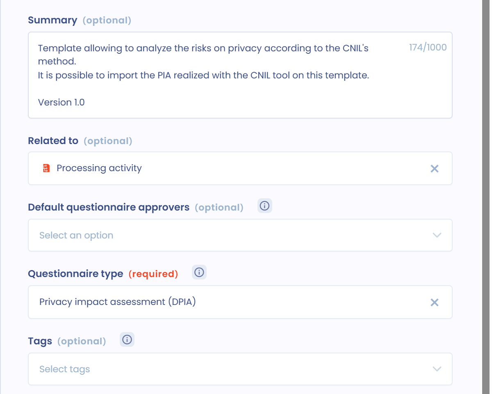

# Eine DSFA-Vorlage erstellen oder bearbeiten

Dastra bietet mehrere Vorlagen für Datenschutz-Folgenabschätzungen (DSFA). Sie können auch Ihre eigene Vorlage erstellen.


Beginnen Sie nicht bei null: Verwenden Sie eine vorhandene Vorlage und passen Sie sie an. Sie erhalten so einen Ausgangspunkt.


## Schritt 1: Die Vorlage erstellen

Klicken Sie im Modul **Fragebögen** auf **Vorlage erstellen** und dann auf **Von Grund auf neu**.

<figure><figcaption>
Die Option Von Grund auf neu im Fenster zum Erstellen
</figcaption></figure>

## Schritt 2: Die Vorlage konfigurieren

Wählen Sie im Fenster **Erstellung einer Fragebogen-Vorlage** die folgenden Optionen, um alle DSFA-Funktionen zu nutzen.

<figure><figcaption>
Die Konfiguration einer DSFA-Vorlage
</figcaption></figure>

* **Art des Fragebogens**: Wählen Sie **DSFA (PIA)**.


Der Typ DSFA zeigt die für DSFA spezifischen Elemente an, insbesondere die Heatmap im Dashboard des Fragebogens, und übernimmt die Daten der Verarbeitungstätigkeit, wenn die DSFA erstellt wird. Außerdem können Sie damit DSFA im JSON-Format aus dem PIA-Tool der CNIL importieren.


* **Verwandtes Thema**: Wählen Sie die Verarbeitungstätigkeit. Ihr DSFA-Fragebogen wird dann mit einer Verarbeitungstätigkeit verknüpft, und Sie finden die DSFA über diese Verarbeitungstätigkeit. Außerdem wird das **Datum der letzten DSFA** der Verarbeitungstätigkeit automatisch aktualisiert, sobald die DSFA veröffentlicht wird: wenn der Fragebogen abgeschlossen wird, falls der Prüfschritt deaktiviert ist, andernfalls bei seiner Validierung.

## Schritt 3: Die Variablennamen festlegen

Vorlagen vom Typ DSFA speisen zwei Arten von Elementen:

* Risikoanalysen (anfängliche Auswirkung und Wahrscheinlichkeit, verbleibende Auswirkung und Wahrscheinlichkeit);
* Maßnahmen zur Risikominderung.

Damit der Ergebnisbericht der DSFA angezeigt wird, benennen Sie die Variablen der Abschnitte (Feld **Link (Slug)**) und der Fragen (Feld **Identifikationsnummer der Frage (Slug)**) gemäß dem folgenden Plan. Der Plan folgt der Vorlage PIA (CNIL) aus der Bibliothek, die drei Sicherheitsrisiken enthält. Jedes Risiko hat zwei Abschnitte: den Abschnitt zum anfänglichen Risiko und den Abschnitt zum verbleibenden Risiko, dessen Name mit `pia_todo_` beginnt.

<figure><figcaption>
Der Slug des Abschnitts Verlust von Daten
</figcaption></figure>

| Abschnitt oder Frage | Variable | Typ |
| --- | --- | --- |
| Unrechtmäßiger Zugriff auf Daten (Risiko 3.2) | `pia_32` | Abschnitt |
| Bestehende Maßnahmen | `pia_324` | Dynamischer Mehrfachauswahlschalter |
| Anfängliche Schwere (Auswirkung) | `pia_325` | Einzelauswahl mit Punktzahl |
| Anfängliche Wahrscheinlichkeit | `pia_326` | Einzelauswahl mit Punktzahl |
| Unrechtmäßiger Zugriff: verbleibendes Risiko | `pia_todo_32` | Abschnitt |
| Geplante Maßnahmen (Risikominderung) | `pia_todo_324` | Dynamischer Mehrfachauswahlschalter |
| Details des Aktionsplans | `pia_todo_321` | Formatierter Text |
| Verbleibende Schwere (Auswirkung) | `pia_todo_325` | Einzelauswahl mit Punktzahl |
| Verbleibende Wahrscheinlichkeit | `pia_todo_326` | Einzelauswahl mit Punktzahl |
| Unerwünschte Veränderung von Daten (Risiko 3.3) | `pia_33` | Abschnitt |
| Verlust von Daten (Risiko 3.4) | `pia_34` | Abschnitt |

Verwenden Sie für die Risiken 3.3 und 3.4 dieselbe Struktur und ersetzen Sie in allen Namen `32` durch `33` oder `34`, auch in `pia_todo_`. Verwenden Sie für ein zusätzliches Risiko die nächste Nummer (`pia_35`, `pia_todo_35` usw.). In der CNIL-Vorlage tragen die Fragen zu Schwere und Wahrscheinlichkeit eine Punktzahl von 0 bis 4.
