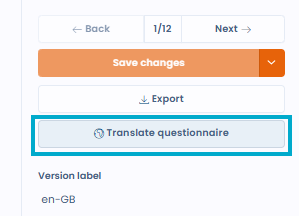

# Einen Fragebogen mit KI übersetzen

Im Vorlageneditor übersetzt der KI-Assistent alle Abschnitte und alle Fragen einer Fragebogenvorlage in die Sprache Ihrer Wahl. Die Funktion ist deaktiviert, wenn die KI-Funktion für Fragebögen für Ihre Organisation nicht aktiviert ist.

So starten Sie eine Übersetzung:

1. Öffnen Sie unter **Vorlagen** das Menü der zu übersetzenden Vorlage und klicken Sie auf **Bearbeiten**, um den Editor zu öffnen.
2. Klicken Sie in der rechten Spalte auf **Den Fragebogen übersetzen**.
3. Wählen Sie die **Zielsprache**.
4. Wählen Sie unter **Speichern als** eine der beiden Optionen:
   * **Neue Version**: ersetzt die aktuelle Version dieser Vorlage durch die Übersetzung;
   * **Neues unabhängiges Modell**: erstellt eine eigene Vorlage ohne Verbindung zum Original.
5. Klicken Sie auf **Generieren**.

<figure><figcaption>
Die Schaltfläche „Den Fragebogen übersetzen“ im Vorlageneditor
</figcaption></figure>

Dastra übersetzt und speichert das Ergebnis anschließend direkt, entsprechend dem gewählten Modus. Die Liste der Sprachen entspricht den Sprachen der Anwendung.

<figure><figcaption>
Auswahl der Zielsprache und des Speichermodus
</figcaption></figure>
