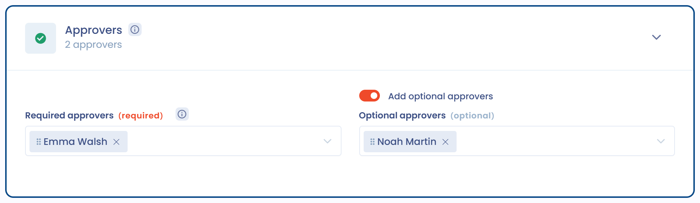

# Einen Fragebogen validieren

Die Validierung ist die Prüfphase, die auf den Abschluss eines Fragebogens durch seine Befragten folgt. Sie ermöglicht es den benannten Genehmigern, jede Antwort zu prüfen, bei Bedarf Korrekturen anzufordern und den Fragebogen anschließend zu genehmigen und zu veröffentlichen.

## Lebenszyklus einer Antwort

1. **Wir erwarten Ihre Rückmeldung** / **Gestartet**: Die Befragten füllen das Formular aus.
2. **Zur Freigabe vorgelegt**: Sobald alle **erforderlichen** Befragten auf **Abschließen** geklickt haben, wechselt die Antwort in diesen Status und die Genehmiger werden benachrichtigt.
3. **Validiert**: nachdem alle erforderlichen Genehmiger zugestimmt haben und die endgültige Validierung erfolgt ist.

Aus dem Status „Zur Freigabe vorgelegt“ gibt es drei mögliche Ergebnisse: **validieren**, **eine Überprüfung beantragen** (den Fragebogen an die Befragten zurückschicken) oder den Fragebogen **abbrechen**.


Wenn keine der Schaltflächen verfügbar ist, prüfen Sie, ob die Antwort tatsächlich den Status „Zur Freigabe vorgelegt“ hat. Alle Validierungsaktionen sind in jedem anderen Status gesperrt.


## Die Genehmiger

Die Prüfer werden beim Planen des Fragebogens im Abschnitt **Genehmiger** festgelegt (siehe [Einen Fragebogen planen](schedule.md)):

* **Genehmiger erforderlich**: Alle müssen den Fragebogen genehmigen, bevor er validiert werden kann. Mindestens ein erforderlicher Genehmiger ist verpflichtend.
* **Optionale Genehmiger**: Aktivieren Sie **Optionale Genehmiger hinzufügen**, um Genehmiger einzubinden, deren Genehmigung nachverfolgt wird, aber **nicht blockierend** ist.

<figure><figcaption>
Der Abschnitt Genehmiger des Planungsformulars
</figcaption></figure>

Die standardmäßig vorgeschlagenen Genehmiger werden in der Konfiguration der Vorlage mit dem Feld **Verantwortliche für den Fragebogen** festgelegt (siehe [Eine Fragebogenvorlage erstellen](templates/README.md)). Nur die Genehmiger der Antwort können sie genehmigen, validieren, eine Überprüfung anfordern oder sie abbrechen.


Sie können diesen Schritt beim Planen des Fragebogens mit der Option **Genehmigungsschritt deaktivieren** ganz abschalten. Die Antwort wird dann direkt veröffentlicht, sobald die Befragten sie abschließen.


## Der Prüfbildschirm

Klicken Sie in der Antwort auf **Überprüfen und bestätigen Sie den Fragebogen**. Der Prüfbildschirm spiegelt den Aufbau des Fragebogens wider: Abschnittsnavigation links, Fragen und Antworten in der Mitte, Validierungsaktionen rechts.

### Jede Antwort qualifizieren

Jeder Frage kann ein Bewertungsstatus zugewiesen werden:

* **Kein Status**: Die Frage wurde nicht qualifiziert (Standard, nicht blockierend)
* **Validiert**: Die Antwort wird akzeptiert
* **Korrekturen erforderlich**: Die Antwort muss ergänzt oder korrigiert werden
* **Nicht validiert**: Die Antwort wird abgelehnt

Eine Auswahl am Anfang jedes Abschnitts weist allen angezeigten Fragen auf einmal denselben Status zu.

Für jede Frage können Sie außerdem:

* eine Anmerkung hinzufügen: eine interne Diskussion mit den Befragten und den anderen Genehmigern
* **Aufgabe hinzufügen**: fließt direkt in den Aktionsplan ein
* die **Begründung der Antwort** ergänzen und eine Datei anhängen
* ein Risiko qualifizieren, wenn die Frage mit einem Risiko verknüpft ist


Wenn mindestens eine Frage mit „Korrekturen erforderlich“ oder „Nicht validiert“ markiert ist, sind die Genehmigung und die Validierung gesperrt: Verwenden Sie **Überprüfung beantragen**, um den Fragebogen an die Befragten zurückzuschicken.


## Den Fragebogen genehmigen

Jeder Genehmiger gibt seine Genehmigung einzeln mit der Schaltfläche **Den Fragebogen genehmigen** ab:

* Sie können **Prüfkommentare** verfassen: Sie werden aufbewahrt und **in den Berichtsexport aufgenommen**.
* Eine **E-Mail-Benachrichtigung** geht an die Genehmiger, die noch nicht genehmigt haben.

Der Bereich **Erforderliche Freigaben (n/Gesamt)** fasst den Status jedes Genehmigers zusammen (genehmigt, mit Datum, oder „Freigabe ausstehend“), dazu gegebenenfalls ein eigener Block „Optionale Freigaben“. Dort lassen sich auch die Prüfkommentare jedes Genehmigers einsehen.

Zwei weitere Aktionen:

* **Meine Einwilligung widerrufen**: zieht Ihre Genehmigung zurück, solange der Fragebogen noch nicht validiert wurde.
* Wenn Sie der **letzte erforderliche Genehmiger** sind, der genehmigt, bietet Dastra sofort an, mit der Validierung und Veröffentlichung fortzufahren.

## Validieren und veröffentlichen

Die Schaltfläche **Den Fragebogen bestätigen** wird erst aktiv, wenn **alle erforderlichen Genehmiger zugestimmt haben** und keine Frage zur Korrektur markiert ist. Das Validierungsfenster zeigt:

* die Anzahl der validierten Fragen im Verhältnis zur Gesamtzahl;
* den Status der Genehmigungen;
* bei einer **DSFA / PIA**, die mit einer Verarbeitungstätigkeit verknüpft ist, die Meldung „Das Datum der letzten DSFA für die zugehörige Verarbeitung wird aktualisiert.“: Das **Datum der letzten DSFA** der Verarbeitungstätigkeit wird bei der Validierung automatisch aktualisiert;
* die Option, den Stakeholdern eine **Benachrichtigung** zu senden.

Die Antwort wechselt dann in den Status **Validiert** mit ihrem Veröffentlichungsdatum, und Sie werden zu ihrem Bericht weitergeleitet. Anschließend können Sie [den Bericht exportieren](export.md), einen Aktionsplan erzeugen oder die Antworten in das verknüpfte Objekt übernehmen (siehe [Fragebögen steuern](monitor.md)).

Nach der Validierung erhält jeder Befragte, intern oder extern, eine Benachrichtigungs-E-Mail mit Angabe des Fragebogens, des Mandanten und des Validierungsdatums sowie einem Link zu seinem Abschlussbildschirm. Auf diesem Bildschirm kann er mit der Aktion **Export to PDF** seine Fragen und Antworten herunterladen, ohne Dastra-Konto. Der Export ist erst verfügbar, wenn der Fragebogen validiert ist, und jeder Befragte kann nur den Fragebogen exportieren, den er beantwortet hat. Um ohne Benachrichtigung zu validieren, deaktivieren Sie die Benachrichtigungsoption im Validierungsfenster.

## Eine Überprüfung beantragen

Die Aktion **Überprüfung beantragen** schickt den Fragebogen an die Befragten zurück:

* die Antwort kehrt in den Status „In Bearbeitung“ zurück und eine **neue Frist** wird aus der Standardantwortzeit der Vorlage berechnet (standardmäßig 30 Tage);
* **jede bereits erteilte Genehmigung wird zurückgesetzt**;
* eine **Korrekturrunde** wird im Verlauf der Antwort festgehalten;
* jeder Befragte erhält eine Benachrichtigung zusammen mit Ihrer Prüfnachricht, die Sie frei verfassen oder aus einer E-Mail-Vorlage vorausfüllen können.

Wenn die Befragten erneut abschließen, beginnt der Validierungszyklus von vorn.

## Den Fragebogen abbrechen

Die Aktion **Den Fragebogen abbrechen** beendet den Zyklus ohne Veröffentlichung. In einem optionalen Kommentar können Sie den Grund erläutern; er wird im Verlauf aufbewahrt und ist für die Befragten sichtbar. Die Genehmigungen werden zurückgesetzt und die Antwort erhält den Status **Abgebrochen**: Sie kann nicht mehr bearbeitet werden und fließt nicht in die Ergebnisse ein.

## Fragebögen verfolgen, die auf Validierung warten

Um die Fragebögen zu finden, die auf Ihre Genehmigung warten, öffnen Sie **Meine Fragebögen** und filtern Sie nach dem Status **Zur Freigabe vorgelegt**. Dasselbe Badge kennzeichnet diese Antworten in den Listen und in den Reporting-Ansichten.
