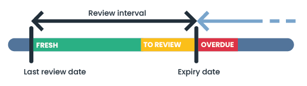
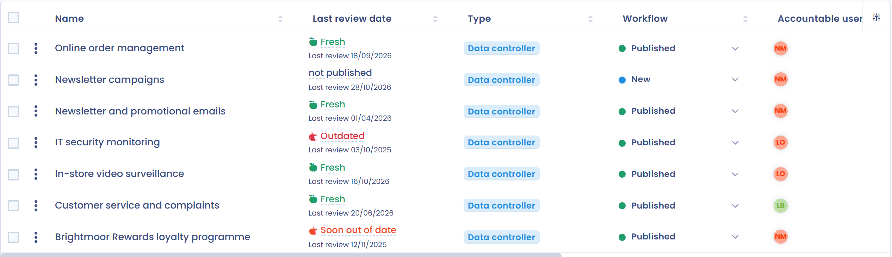
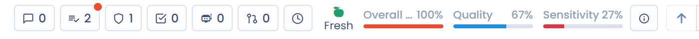

# Regelmäßige Überprüfung (Aktualität)

Die Aktualität zeigt Ihnen, wann ein Element zuletzt überprüft wurde. Wenn Sie die regelmäßige Überprüfung für eine Art von Elementen aktivieren, legen Sie ein Intervall zwischen zwei Überprüfungen fest. Jede Überprüfung setzt ein nächstes Überprüfungsdatum, und die Aktualität nimmt ab, je näher dieses Datum rückt. So stellen Sie sicher, dass die in Dastra erfassten Informationen regelmäßig überprüft werden.

Die regelmäßige Überprüfung steht für Verarbeitungstätigkeiten, Stakeholder, Assets, KI-Systeme, Verträge und die Kontrollpunkte des Risikomanagements zur Verfügung, je nach den Modulen Ihres Abonnements. Die Besonderheiten der Verarbeitungstätigkeiten sind unter [Aktualität der Verarbeitungen](ropa/freshness.md) beschrieben.

<figure><figcaption>
Funktionsweise der Aktualitätsanzeige
</figcaption></figure>

## Die regelmäßige Überprüfung aktivieren

Nur Nutzer mit der Berechtigung **Erweiterte Konfiguration** können diese Einstellung ändern.

1. Klicken Sie im linken Menü auf **Mandanteneinstellungen** und dann unter **Prozess** auf **Regelmäßige Überprüfungen**. Sie können auch im Optionsmenü der Liste eines Moduls auf **Regelmäßige Überprüfung (Aktualität) konfigurieren** klicken: Der Eintrag zeigt, ob die regelmäßige Überprüfung für diese Art von Elementen bereits aktiviert ist.
2. Wählen Sie in der Auswahl oben auf der Seite die Art des Elements.
3. Aktivieren Sie **Die regelmäßige Überprüfung des Elements aktivieren**.
4. Geben Sie unter **Bitte wählen Sie das gewünschte Intervall zwischen den einzelnen Überprüfungen aus** das Intervall in Jahren, Monaten oder Tagen ein.
5. Klicken Sie auf **Speichern**.

<figure><figcaption>
Die Einstellungen Regelmäßige Überprüfungen
</figcaption></figure>

<figure><figcaption>
Die verfügbaren Arten von Elementen
</figcaption></figure>

Das Intervall ist für alle Elemente einer Art gleich. Sobald Sie es speichern, fragt Dastra **Das neue Intervall anwenden?**:

* **Auf alle bestehenden Überprüfungen anwenden** ersetzt alle bereits gesetzten nächsten Überprüfungsdaten durch neue Daten, die aus dem neuen Intervall berechnet werden.
* **Nur auf zukünftige Überprüfungen anwenden** behält die bestehenden Daten bei, und das neue Intervall gilt ab der nächsten Überprüfung.

## Die regelmäßige Überprüfung deaktivieren

Wählen Sie in denselben Einstellungen die Art des Elements, deaktivieren Sie **Die regelmäßige Überprüfung des Elements aktivieren** und klicken Sie auf **Speichern**.

## Die Aktualität anzeigen

Die Aktualität wird nur für **veröffentlichte** Elemente angezeigt, die mindestens einmal überprüft wurden.

Alle betroffenen Elemente haben eine Spalte **Datum der letzten Überprüfung**, die Sie zu den Spalten der Liste hinzufügen können. Sie zeigt den Aktualitätszustand jedes Elements.

<figure><figcaption>
Die Spalte Datum der letzten Überprüfung
</figcaption></figure>

Auf der Seite einer Verarbeitungstätigkeit oder eines KI-Systems zeigt der rechte Bereich außerdem den Balken **Aktualität**, der kürzer wird, je näher das nächste Überprüfungsdatum rückt. Neben dem Zustand und seiner Farbe sehen Sie den Link **Überprüfung** und die Anzahl der verbleibenden oder überschrittenen Tage.

<figure><figcaption>
Die Aktualitätsanzeige auf der Seite einer Verarbeitungstätigkeit
</figcaption></figure>

### Aktualitätszustände

| Zustand | Anzeigeregel |
| --- | --- |
| **Aktuell** (grün) | Das Element wurde kürzlich überprüft und braucht keine sofortige Aufmerksamkeit. Dieser Zustand wird angezeigt, bis das aktuelle Datum in den letzten 10 Prozent des Intervalls liegt. |
| **Demnächst fällig** (orange) | Das Element muss geprüft werden. Dieser Zustand wird in den letzten 10 Prozent des Intervalls nach der letzten Überprüfung angezeigt. |
| **Veraltet** (rot) | Das nächste Überprüfungsdatum ist überschritten: Das Element entspricht nicht mehr der Überprüfungsrichtlinie. |

**Beispiel:** Sie haben ein Intervall von 1 Jahr festgelegt. Ein Element, das am 1. Januar 2026 überprüft wurde, wird bis Ende November 2026 als **Aktuell** angezeigt, dann als **Demnächst fällig** bis zum 1. Januar 2027. Danach wird es als **Veraltet** angezeigt, bis es überprüft wird.

## Ein Element überprüfen

Sie können ein Element jederzeit überprüfen, ohne auf sein nächstes Überprüfungsdatum zu warten. Klicken Sie in einer Liste auf die Zelle der Spalte **Datum der letzten Überprüfung** des Elements. Klicken Sie auf der Seite einer Verarbeitungstätigkeit oder eines KI-Systems auf **Überprüfung**.

<figure><figcaption>
Das Fenster Überprüfung
</figcaption></figure>

Füllen Sie im Tab **Neue Überprüfung** Folgendes aus:

* **Verantwortlicher für die Überprüfung**: der Nutzer, der die Überprüfung durchgeführt hat.
* **Überprüfung** (das Datum der Überprüfung).
* **Versionsbeschreibung:** was geprüft oder geändert wurde (optional).
* **Datum vor der nächsten Überprüfung**: berechnet aus dem in den Einstellungen festgelegten Intervall. Um ein Datum festzulegen, das für dieses Element gilt, aktivieren Sie **Ändern Sie das Datum der nächsten Überprüfung** und wählen Sie ein Datum (frühestens am nächsten Tag).

Klicken Sie auf **Überprüfung**, um zu speichern: Ab dem Datum der Überprüfung beginnt ein neuer Aktualitätszyklus.

Der Tab **Frühere Überprüfungen** listet die vergangenen Überprüfungen des Elements auf. Er bietet außerdem die Schaltfläche **Delete all reviews**, die den Verlauf löscht. Nach einer Bestätigung gilt das Element als nie überprüft, seine Überprüfungsdaten werden gelöscht, und die Aktualitätsanzeige verschwindet. Diese Aktion lässt sich nicht rückgängig machen.

## Überprüfungen im Dashboard verfolgen

Die Kachel **Datenverarbeitung** des [Dashboards](dashboard.md) zeigt die Kennzahl **Überprüfung erforderlich**: die Anzahl der Verarbeitungstätigkeiten, die nach dem festgelegten Intervall zu überprüfen sind, und die Anzahl der aktuellen.

## Benachrichtigungen

Wird ein Element veraltet, werden sein Ersteller und die mit ihm verknüpften Nutzer (zum Beispiel die Inhaber einer Verarbeitungstätigkeit) per E-Mail benachrichtigt: Das Element wurde lange nicht überprüft, und es ist Zeit, es zu aktualisieren.
