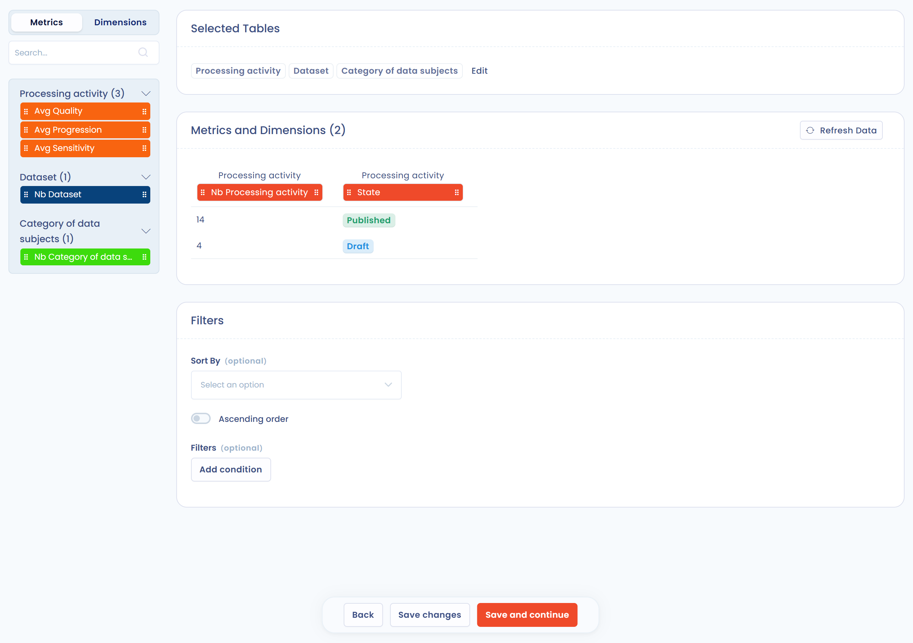
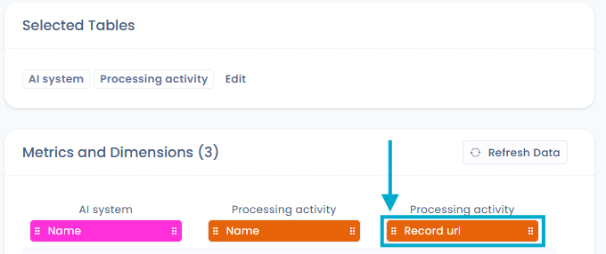
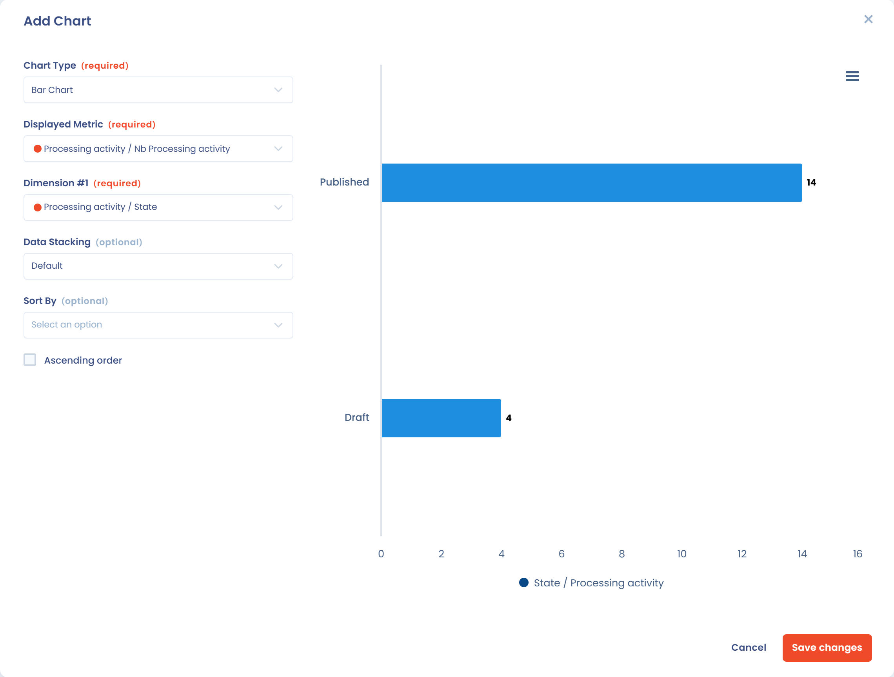

# Personalisierte Berichte

Personalisierte Berichte entnehmen den Dastra-Daten die Informationen, die Sie brauchen, in der Form Ihrer Wahl: Tabelle, Grafik oder Export.

## Schnellstart

1. Klicken Sie im linken Menü unter **Ressourcen** auf **Personalisierte Berichte**.
2. Berichte sind in Kategorien gegliedert. Bevor Sie Ihren ersten Bericht erstellen, müssen Sie mit **Kategorie erstellen** **eine erste Kategorie anlegen**.
3. Klicken Sie auf **Erstellen Sie einen Bericht**, um einen leeren Bericht zu erstellen, oder öffnen Sie den Pfeil der Schaltfläche und wählen Sie **Erstellen Sie auf der Grundlage von Vorlagen**.

Wenn die KI-Analyse in Ihrem Abonnement enthalten ist, erzeugt die KI-Schaltfläche neben **Erstellen Sie einen Bericht** (**Erstellen Sie einen personalisierten Bericht mit KI**) einen Bericht aus einer kurzen Beschreibung, zum Beispiel „Anzahl der Verarbeitungen pro Workflow-Schritt mit einer Grafik“.

## Glossar

* **Metrik**: ein messbarer Wert, der verwendet wird, um Elemente zu gruppieren (zu aggregieren). _Beispiel: die Anzahl der Verarbeitungstätigkeiten, die durchschnittliche Bearbeitungszeit einer Aufgabe usw._
* **Dimension**: Anders als eine Metrik aggregiert eine Dimension keine Daten. Sie ist eine einfache Eigenschaft (eine Spalte) eines Elements. _Beispiel: der Name der Verarbeitungstätigkeit, ihr Status, ihre Referenz usw._

## Aufbau des Berichts

Ein Bericht entsteht in vier Schritten:

1. **Datenauswahl**: Wählen Sie die Tabellen, die Sie abfragen möchten, und dann die passenden Metriken und Dimensionen.
2. **Filter**: Verfeinern Sie Ihre Ergebnisse mit Kriterien, um nur die für Ihre Analyse relevanten Daten zu behalten.
3. **Grafik**: Stellen Sie den Bericht als Grafik oder als Tabelle dar.
4. **Export und Freigabe**: Exportieren Sie den Bericht als PDF, Word, HTML, Excel, CSV, JSON oder Markdown, geben Sie ihn frei oder verbinden Sie ihn mit einem BI-Tool wie Power BI.

### Tabellen auswählen

Wählen Sie zuerst in der Liste **Bitte wählen Sie die Stammtabelle aus** die Stammtabelle: Sie ist die Haupttabelle des Berichts, zum Beispiel die Verarbeitungstätigkeiten. Klicken Sie dann auf **Tabelle hinzufügen**, um mit der Stammtabelle verknüpfte Tabellen hinzuzufügen (Bearbeitungsschritte, Zweck, Tags usw.). Sie können in jedem Bericht bis zu 7 Tabellen abfragen, die Stammtabelle eingeschlossen.

<figure><figcaption>
Die Auswahl der Stammtabelle und der verknüpften Tabellen
</figcaption></figure>

Klicken Sie auf **Weiter**, wenn Sie die Tabellen gewählt haben.


Sie können im Berichtseditor mit der Schaltfläche **Bearbeiten** der Karte **Ausgewählte Tabellen** zur Tabellenauswahl zurückkehren, um weitere Tabellen hinzuzufügen. Die vom Bericht bereits verwendeten Tabellen sind gesperrt.


### Mit Metriken und Dimensionen aufbauen

Bauen Sie Ihren Bericht auf, indem Sie die gewünschten Metriken und Dimensionen aus dem linken Bereich in den Bereich **Bitte geben Sie hier Metriken und Dimensionen ein** ziehen oder sie dort auswählen. Eine Meldung warnt Sie, wenn Sie die maximale Anzahl von Metriken und Dimensionen für einen Bericht erreicht haben.

<figure><figcaption>
Der Editor für Metriken und Dimensionen
</figcaption></figure>

Die Karte **Filter** begrenzt die Daten, und **Sortieren nach** legt die Reihenfolge der Zeilen fest (aktivieren Sie **Aufsteigende Sortierung** für eine aufsteigende Sortierung). **Daten aktualisieren** aktualisiert die Vorschau.

Klicken Sie auf **Speichern und fortfahren**, um den Bericht zu öffnen, oder auf **Speichern**, um im Editor zu bleiben.


Die Daten werden automatisch nach Dimension aggregiert, um die gewählten Metriken zu berechnen.


Beispiel: Wenn Sie die Metrik **Number of Data processing** und die Dimension **Status** wählen, erhalten Sie einen Bericht mit dieser Gruppierung:

| Status | Number of Data processing |
| ------ | ------------------------- |
| Draft  | 12                        |
| Active | 560                       |

### Link zum Eintrag

Bei Tabellen von Objekten, die einen Eintrag haben (Verarbeitungstätigkeiten, Anfragen betroffener Personen, Datenschutzverletzungen, Assets, Stakeholder, Audits, Sicherheitsmaßnahmen, Verträge, KI-Systeme und Aufgaben), fügt die Dimension **Record url** jeder Zeile einen anklickbaren Link **Details** hinzu. Dieser Link öffnet den Eintrag des Objekts im richtigen Modul, in einem neuen Tab und für den aktuellen Mandanten. Die Spalte ist auch in den Exporten enthalten, als URL.

<figure><figcaption>
Die Dimension Record url zum Bericht hinzufügen
</figcaption></figure>

<figure><figcaption>
Jede Zeile zeigt einen Link Details, der den Eintrag des Objekts öffnet
</figcaption></figure>

## Den Bericht anzeigen und eine Grafik hinzufügen

Sobald der Bericht gespeichert ist, gelangen Sie auf seine Seite. Die Datentabelle wird mit einem Filter für die Organisationseinheit, **Filter löschen** und der Beschreibung des Berichts angezeigt, die Sie direkt bearbeiten können.

<figure><figcaption>
Die Seite eines personalisierten Berichts
</figcaption></figure>

Um eine Grafik hinzuzufügen, klicken Sie auf **Grafik hinzufügen** und legen dann die Optionen fest:

* **Art der Grafik**: **Säulendiagramm**, **Balkendiagramm**, **Kreisdiagramm** oder **Wärmezone**.
* **Angezeigte Metrik**: der von der Grafik gemessene Wert.
* **Dimension Nr. 1** und **Dimension Nr. 2**: die Achsen der Grafik.
* **Anordnung der Daten**: **Standardmäßig**, **Aufteilung in der Spalte** (gestapelte Werte) oder **Prozentuale Aufteilung** (auf 100 % gestapelt).
* **Sortieren nach** und **Aufsteigende Sortierung**: die Anzeigereihenfolge.

Die Vorschau wird bei jeder Auswahl aktualisiert. Um die Grafik später zu ändern oder zu entfernen, verwenden Sie **Grafik bearbeiten** oder **Grafik löschen** über der Grafik.

<figure><figcaption>
Das Fenster Grafik hinzufügen
</figcaption></figure>

## Drucken, exportieren und freigeben

Auf der Seite eines Berichts:

* **Exportieren** lädt den Bericht als CSV, Excel, JSON, PDF, Word, HTML oder Markdown herunter.
* Das Menü der Schaltfläche **Bearbeiten** bietet **Drucken**, **Exportieren**, **Teilen** (Nutzern mit der Berechtigung **Erweiterte Konfiguration** vorbehalten) und **In den Papierkorb verschieben**.
* **BI-Tools verbinden** verbindet den Bericht mit einem Datenanalyse-Tool: siehe [Integration in Datenanalyse-Tools (BI)](bi-tools.md).

## Papierkorb

Ein gelöschter Bericht oder eine gelöschte Kategorie kommt zuerst in den Papierkorb: Sie können sie wiederherstellen, solange sie nicht endgültig gelöscht sind.

* **Ein Element in den Papierkorb verschieben**: Klicken Sie im Aktionsmenü eines Berichts auf **In den Papierkorb verschieben** und bestätigen Sie. Das Aktionsmenü einer Kategorie im linken Bereich bietet dieselbe Aktion: Die Kategorie und alle ihre Berichte werden in den Papierkorb verschoben.
* **Den Papierkorb anzeigen**: Aktivieren Sie die Option **Papierkorb anzeigen** über der Liste der Berichte oder verwenden Sie das Menü des Bereichs der Kategorien.
* **Wiederherstellen**: Im Papierkorb setzt **Wiederherstellen** das Element zurück in die aktive Liste. Beim Wiederherstellen einer Kategorie werden auch die mit ihr in den Papierkorb verschobenen Berichte wiederhergestellt. Beim Wiederherstellen eines Berichts, dessen Kategorie im Papierkorb liegt, wird auch diese Kategorie wiederhergestellt.
* **Endgültig löschen**: Im Papierkorb löscht **Endgültig löschen** das Element nach einer Bestätigung. Beim Löschen einer Kategorie werden auch alle ihre Berichte gelöscht. Diese Aktion lässt sich nicht rückgängig machen.


Aktionen im Papierkorb erfordern die Berechtigung, personalisierte Berichte zu bearbeiten.

