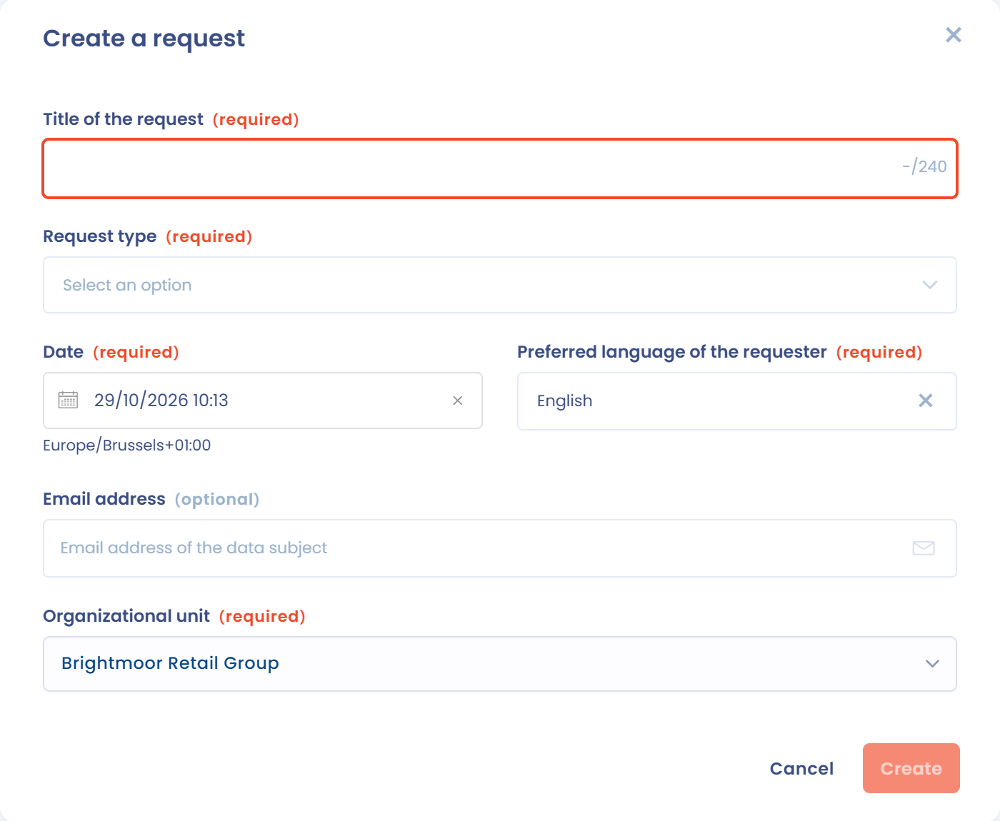

# Betroffenenanfragen

Mit der DSGVO können europäische Bürger von einem Unternehmen oder einer Organisation, die ihre personenbezogenen Daten verarbeitet, verlangen, ihre Rechte auszuüben. Die Organisation ist verpflichtet, die Ausübung dieser Rechte zu erleichtern.


[Betroffenenrechte](../../gdpr/concepts/rights.md)


Dazu muss die Organisation Verfahren einrichten, die es ihr erlauben, auf diese Anfragen zu antworten und den Nachweis dafür zu erbringen. Das bedeutet festgelegte Schritte und eine Dokumentation in einem Verzeichnis.

## Der Prozess zur Verwaltung einer Betroffenenanfrage

Die Verwaltung einer Anfrage zur Ausübung eines Rechts lässt sich in 4 große Schritte zusammenfassen:

<figure><figcaption>
Der Prozess zur Verwaltung von Betroffenenanfragen
</figcaption></figure>

Weitere Details zur Verwaltung von Anfragen finden Sie auf dieser Seite:


[Verwaltung von Betroffenenanfragen](manage.md)


## Das Verzeichnis der Betroffenenanfragen

Mit Dastra können Sie ein Verzeichnis aufbauen, das alle vergangenen, aktuellen und künftigen Anfragen zentralisiert. Um es zu öffnen, klicken Sie in der Seitenleiste auf **Anfragen** und dann im Untermenü auf **Anfragen**.

<figure><figcaption>
Das Verzeichnis der Anfragen
</figcaption></figure>

Das Menü **Anfragen** bietet Zugriff auf fünf Seiten:

* **Anfragen**: die Liste aller Anfragen mit ihren Filtern und Spalten.
* **Statistiken**: die Kennzahlen zur Nachverfolgung (siehe [Statistiken zu den Anfragen](process.md#statistiken-zu-den-anfragen)).
* **Nachrichten**: der Austausch mit den Antragstellern (siehe [Nachrichten der Antragsteller](process.md#nachrichten-der-antragsteller)).
* **Formulare zur Datenerfassung**: die Widgets, die Anfragen auf Ihrer Website erfassen. Diese Seite steht nur Nutzern zur Verfügung, die Erfassungsformulare verwalten dürfen.
* **Ausführung der Anfragen**: die Oberfläche für Asset-Inhaber (siehe [Bearbeitungsoberfläche für Anfragen](advanced/asset-owners.md)).

## Eine neue Betroffenenanfrage erfassen

Es gibt 5 Möglichkeiten, eine neue Anfrage in Dastra zu erfassen:

1. [Die Anfrage direkt im Tool erfassen](manage.md#eine-anfrage-manuell-erstellen).
2. [Anfragen aus einer Excel-, CSV- oder Textdatei importieren](manage.md#anfragen-importieren-und-exportieren).
3. [Anfragen über eine Sammel-E-Mail-Adresse empfangen](manage.md#eine-anfrage-uber-eine-sammel-e-mail-adresse-erstellen).
4. [Ein Erfassungsformular (Widget)](widget.md) auf Ihrer Website einrichten.
5. [Anfragen über die REST-API erstellen](api.md).

### Eine Anfrage manuell erstellen

Klicken Sie auf **Anfrage erstellen**. Geben Sie im sich öffnenden Fenster den Titel, den oder die Anfragetypen, das Datum, die Sprache des Antragstellers, die E-Mail-Adresse (optional) und die Organisationseinheit ein und klicken Sie dann auf **Erstellen**. Dastra öffnet die Anfrage, damit Sie sie detaillieren und bearbeiten können.

<figure><figcaption>
Das Fenster zum Erstellen einer Anfrage
</figcaption></figure>

### Das Verzeichnis der Anfragen importieren und exportieren

Das gesamte Verzeichnis kann importiert und exportiert werden. Um Anfragen zu importieren, klicken Sie auf den Pfeil neben der Schaltfläche **Anfrage erstellen** und dann auf **Importieren**.

<figure><figcaption></figcaption></figure>

Klicken Sie auf der Importseite auf **Laden Sie die Dateivorlage herunter**, um das erwartete Format zu sehen (**Spaltenformat anzeigen** listet die Spalten auf), und legen Sie Ihre Datei (csv, txt oder xlsx) dann im Upload-Bereich ab. Folgen Sie den Schritten des Assistenten (Datenimport, Spaltenzuordnung, Import und Ergebnis), um die Anfragen in Dastra zu importieren. Nach dem Import stehen die Anfragen im Verzeichnis zur Verfügung.

<figure><figcaption></figcaption></figure>

### Ein Widget für Anfragen einrichten

Anfragen können auch aus einem dedizierten Widget stammen, das Sie in Dastra konfigurieren.

Lesen Sie unseren [Leitfaden zur Einrichtung des Widgets für Betroffenenanfragen](widget.md).


[Ein Widget für Betroffenenanfragen implementieren](widget.md)

