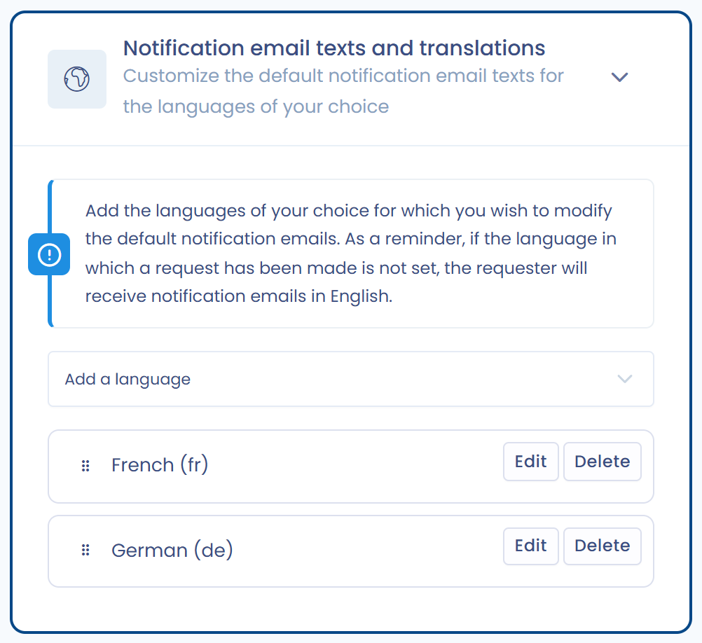

# Anpassung der E-Mails an Antragsteller

Wenn Sie die Standardformulierungen nicht verwenden möchten, können Sie alle Benachrichtigungs-E-Mails anpassen, die an Antragsteller gesendet werden.

Sie können:

* Die **Betreffzeilen und Nachrichtentexte** bearbeiten.
* Die **Übersetzungen** verwalten, damit E-Mails in der Sprache des Antragstellers versendet werden.
* Sprachen hinzufügen. Ist die Sprache einer Anfrage nicht eingerichtet, erhält der Antragsteller die E-Mails auf Englisch.

## Eine Sprache hinzufügen und die Texte bearbeiten

1. Öffnen Sie in den Mandanteneinstellungen unter **Prozess** den Eintrag **Anfragen**.
2. Öffnen Sie den Abschnitt **Texte und Übersetzungen der Benachrichtigungs-E-Mails**.
3. Wählen Sie in der Liste **Sprache hinzufügen** eine Sprache aus.
4. Klicken Sie neben der Sprache auf **Bearbeiten** und passen Sie dann die Betreffzeilen und Texte an.
5. Öffnen Sie die anzupassende E-Mail (**Kopf- und Fußzeile**, **E-Mail zur Bestätigung der Identität, um mit der Registrierung des Antrags fortzufahren**, **Bestätigungs-E-Mail**, **E-Mail mit dem Zugangscode zum Antragstellerbereich**, **E-Mail-Benachrichtigung über eine neue Nachricht** oder die E-Mail bei einer geschlossenen Anfrage), ersetzen Sie die unter jeder Feldbezeichnung angezeigten Standardwerte und klicken Sie dann auf **Speichern**.

<figure><figcaption>
Angepasste Sprachen
</figcaption></figure>

<figure><figcaption>
Eine Nachricht anpassen
</figcaption></figure>


Behalten Sie Platzhalter wie `{{data.Code}}` bei: Sie werden beim Versand der E-Mail durch Daten ersetzt, und die Nachricht benötigt sie, um zu funktionieren. Sie können weitere Variablen in den Text einfügen: Geben Sie `{{` ein, um die Liste der verfügbaren Variablen zu öffnen.

