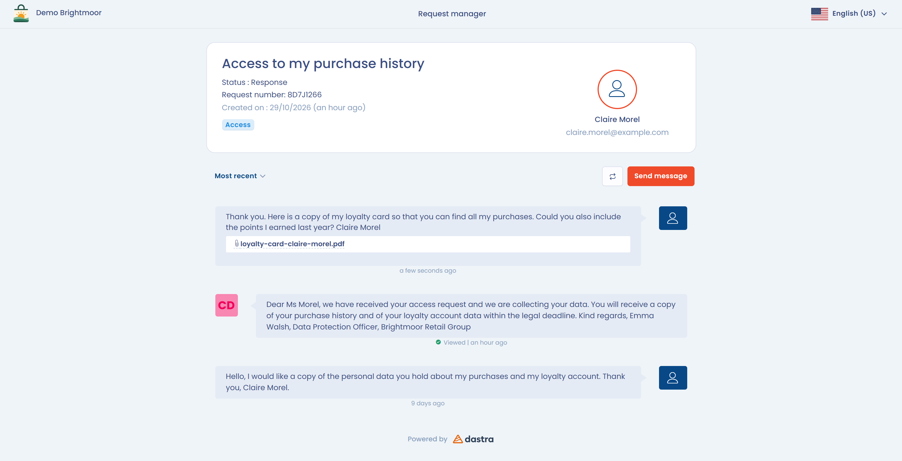

# Antragstellerbereich

Jede Person, die eine Anfrage stellt, erhält einen **eigenen Bereich**, der durch einen per E-Mail gesendeten, einmalig gültigen 6-stelligen Code gesichert ist.

In diesem Bereich kann der Antragsteller:

* Den Fortschritt der Anfrage verfolgen.
* Die von der Organisation gesendeten Nachrichten lesen.
* Antworten und sich direkt mit der Person austauschen, die die Anfrage bearbeitet.
* Nachweisdokumente herunterladen oder hochladen.

<figure><figcaption>
Der Bereich für den Austausch mit dem Antragsteller
</figcaption></figure>

Dieser Bereich gewährleistet die Nachvollziehbarkeit, Nachverfolgung und Transparenz des Austauschs und vermeidet ungesicherte E-Mails. Nach dem Abschluss der Anfrage behält der Antragsteller für begrenzte Zeit Zugriff auf den Bereich: Siehe die [FAQ](../faq.md).

Um den Zugangslink zum Bereich einer Anfrage abzurufen, öffnen Sie das Menü **Aktionen** der Anfrage und klicken Sie auf **Bitte kopieren Sie den Link zum Antragstellerportal.**


**Gesundheitsdaten**: Dastra ist nicht nach HDS zertifiziert (der französischen Zertifizierung für das Hosting von Gesundheitsdaten), unser Hosting-Anbieter Microsoft Azure jedoch schon. Enthalten Dokumente, die über die Oberfläche gesendet werden (vom Antragsteller oder von Ihrer Organisation), Gesundheitsdaten, stellen Sie sicher, dass diese Nutzung mit Ihren eigenen Pflichten vereinbar ist.

