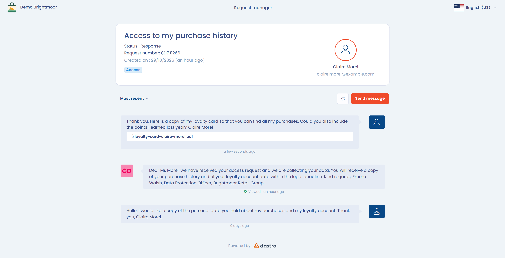
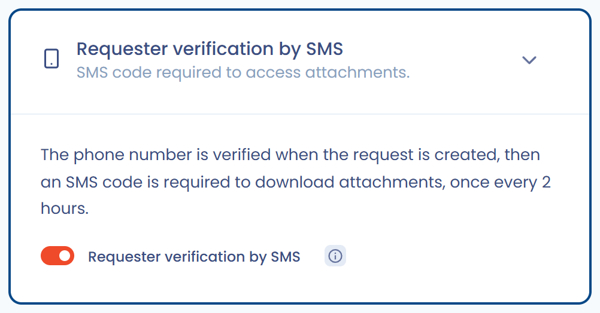
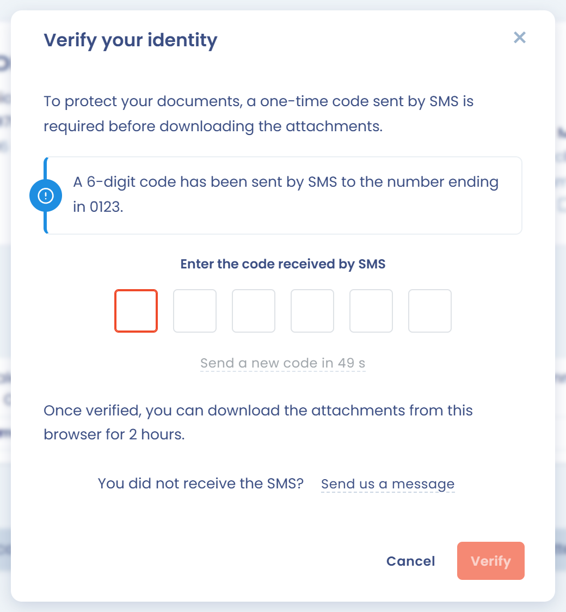

# Antragstellerbereich

Jede Person, die eine Anfrage stellt, erhält einen **eigenen Bereich**, der durch einen per E-Mail gesendeten, einmalig gültigen 6-stelligen Code gesichert ist.

In diesem Bereich kann der Antragsteller:

* Den Fortschritt der Anfrage verfolgen.
* Die von der Organisation gesendeten Nachrichten lesen.
* Antworten und sich direkt mit der Person austauschen, die die Anfrage bearbeitet.
* Nachweisdokumente herunterladen oder hochladen.

<figure><figcaption>
Der Bereich für den Austausch mit dem Antragsteller
</figcaption></figure>

Dieser Bereich gewährleistet die Nachvollziehbarkeit, Nachverfolgung und Transparenz des Austauschs und vermeidet ungesicherte E-Mails. Nach dem Abschluss der Anfrage behält der Antragsteller für begrenzte Zeit Zugriff auf den Bereich: Siehe die [FAQ](../faq.md).

Um den Zugangslink zum Bereich einer Anfrage abzurufen, öffnen Sie das Menü **Aktionen** der Anfrage und klicken Sie auf **Bitte kopieren Sie den Link zum Antragstellerportal.**


**Gesundheitsdaten**: Dastra ist nicht nach HDS zertifiziert (der französischen Zertifizierung für das Hosting von Gesundheitsdaten), unser Hosting-Anbieter Microsoft Azure jedoch schon. Enthalten Dokumente, die über die Oberfläche gesendet werden (vom Antragsteller oder von Ihrer Organisation), Gesundheitsdaten, stellen Sie sicher, dass diese Nutzung mit Ihren eigenen Pflichten vereinbar ist.


***

## Den Antragsteller per SMS verifizieren

Die Verifizierung des Antragstellers per SMS fügt einen zweiten Faktor hinzu, unabhängig von der E-Mail. Der Antragsteller weist nach, dass er eine Telefonnummer besitzt, und gibt dann einen per SMS gesendeten Code ein, bevor er die Anhänge der Anfrage herunterlädt. Die SMS belegt den Besitz einer Nummer: Sie ersetzt nicht die Prüfung der Identität des Antragstellers (siehe [Die Identität prüfen](../process.md#die-identitat-prufen)).

Dies ist eine Option Ihres Tarifs. Ohne sie zeigt die Einstellung **Option not included in your subscription** an.

### Aktivieren

1. Öffnen Sie in den Mandanteneinstellungen unter **Prozess** den Eintrag **Betroffenenanfragen**.
2. Öffnen Sie den Abschnitt **Requester verification by SMS** und schalten Sie die Option ein. Sie benötigen das Recht, erweiterte Einstellungen zu verwalten.
3. Öffnen Sie jedes Erfassungsformular, gehen Sie zu seinem Abschnitt **Konfiguration** und aktivieren Sie **Enable phone validation**. Dieser Schalter erscheint erst, wenn die Option im Mandanten aktiv ist, und er ist in jedem Formular standardmäßig eingeschaltet.

<figure><figcaption>
Die Option in den Mandanteneinstellungen
</figcaption></figure>

Verifiziert ein Formular die Nummer, wird sein Telefonfeld immer angezeigt und ist für jeden Anfragetyp ein Pflichtfeld. In der Anpassung der Felder erscheint es gesperrt, mit einer Kurzinfo, die den Grund erklärt.

### Was der Antragsteller sieht

Bei der Erstellung bestätigt der Antragsteller seine E-Mail-Adresse. Die Bestätigungsseite fordert ihn dann auf, seine Telefonnummer zu verifizieren: Dastra sendet einen 6-stelligen Code per SMS an die eingegebene Nummer, und der Antragsteller tippt ihn ein. Die Anfrage wird registriert, sobald die E-Mail-Adresse bestätigt ist, auch wenn die Nummer noch nicht verifiziert ist. Die Telefonprüfung steht 24 Stunden nach dem Absenden zur Verfügung. Leitet Ihr Formular auf Ihre eigene Seite weiter (**Weiterleitungslink im Falle eines Erfolgs (nach der Identifizierungsphase)**), wird die Bestätigungsseite nicht angezeigt, und dieser Schritt entfällt.

Lädt der Antragsteller einen Anhang aus seinem Bereich herunter, zeigt ein Schlosssymbol an, dass ein Code erforderlich ist. Das Fenster **Verify your identity** fragt nach einem Code, der per SMS an die Nummer der Anfrage gesendet wurde und von der nur die letzten vier Ziffern angezeigt werden. Ist der Code gültig, kann der Antragsteller die Anhänge 2 Stunden lang im selben Browser herunterladen, danach ist ein neuer Code nötig. Eine Änderung der Telefonnummer der Anfrage beendet diese Sitzung.

<figure><figcaption>
Das Fenster, das vor einem Download den SMS-Code verlangt
</figcaption></figure>

Eine Anfrage ohne Anhang löst über die erste Verifizierung hinaus keine SMS aus.

Hat der Antragsteller die SMS nicht erhalten, klickt er auf **Send a new code** oder auf **Send us a message**, um der Organisation zu schreiben.

### Grenzen

| Regel | Wert |
| --- | --- |
| Gültigkeit eines Codes | 10 Minuten, und ein Code kann nur einmal verwendet werden |
| Wartezeit vor einem neuen Code | 60 Sekunden |
| Gesendete Codes pro Anfrage | 5 pro Stunde |
| Falsche Codes bis zur Sperre | 4, danach ist die Verifizierung 30 Minuten lang gesperrt |
| Download-Sitzung nach einem gültigen Code | 2 Stunden |

### Auf Seiten der Organisation

Im Abschnitt **Identitätsdaten** einer Anfrage zeigt das Feld **Telefon** **Verified on** gefolgt vom Datum, **Not verified** oder die Warnung **Attachments not protected by SMS: no phone number provided**. Ohne Telefonnummer wird kein Code verlangt, und die Anhänge werden ohne SMS heruntergeladen.

Eine von einem Nutzer eingegebene oder geänderte Nummer gilt nie als verifiziert. Ändern Sie sie, bittet Dastra Sie im Fenster **Change the phone number?** um Bestätigung: Ändern Sie die Nummer nur, wenn Sie sicher sind, dass die Anfrage vom Antragsteller stammt. Die Verifizierung wird dann zurückgesetzt, der ausstehende Code und die Download-Sitzung werden verworfen, und die nächsten Codes gehen an die neue Nummer.

Der Verlauf der Anfrage hält jeden Schritt fest: Code gesendet, Nummer verifiziert, Download bestätigt, Verifizierung gesperrt und Nummer geändert. Siehe [Bearbeitung und Verarbeitung der Anfragen](../process.md#gesamtubersicht).
