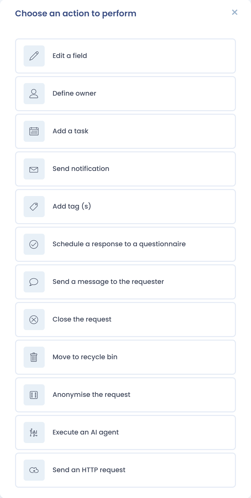

# Zusätzliche Aktionen in automatischen Workflows

Workflow-Regeln automatisieren Vorgänge in Dastra. Für Betroffenenanfragen bieten sie spezifische Aktionen, die Sie passend zu Ihren eigenen Bearbeitungsregeln konfigurieren. Öffnen Sie in den Mandanteneinstellungen die **Workflow-Regeln** und fügen Sie dann einer Regel, die für Anfragen gilt, eine Aktion hinzu.

<figure><figcaption>
Spezifische Aktionen für Betroffenenanfragen
</figcaption></figure>

## Aktionen speziell für Anfragen

* **Bitte senden Sie eine Anfrage**: sendet vom Antrag aus eine Nachricht an den Antragsteller, mit freiem Text oder einer Vorlage.
* **Anfrage abschließen**: schließt die Anfrage mit einem Abschlussgrund ab und kann die Abschlussbenachrichtigung an den Antragsteller senden.
* **Anonymisierung der Anfrage**: löscht die identifizierenden Daten der Anfrage. Die Aktion ist unumkehrbar.
* **In den Papierkorb verschieben**: verschiebt die Anfrage in den Papierkorb, wo anschließend die [Löschregeln](purge.md) gelten.

## Weitere nützliche Aktionen für Anfragen

* **Ein Feld bearbeiten**: aktualisiert ein Feld der Anfrage.
* **Aufgabe hinzufügen**: erstellt eine Aufgabe, zum Beispiel damit der Datenschutzbeauftragte die Antwort validiert.
* **Eine Benachrichtigung senden**: benachrichtigt Personen über die Anfrage.
* **Zugewiesenen Nutzer definieren**: legt den Inhaber der Anfrage fest.
* **Tags hinzufügen**: fügt der Anfrage Tags hinzu.
* **Planung einer Antwort auf einen Fragebogen**: plant die Beantwortung eines Fragebogens.
* **Send an HTTP request**: ruft einen externen Dienst auf.
* **Einen KI-Agenten ausführen**: führt einen KI-Agenten aus, abhängig von Ihrem Tarif und Ihren Berechtigungen.


Weitere Informationen zu Workflows finden Sie unter [Workflow-Regeln](../../settings/workflow-rules.md).

