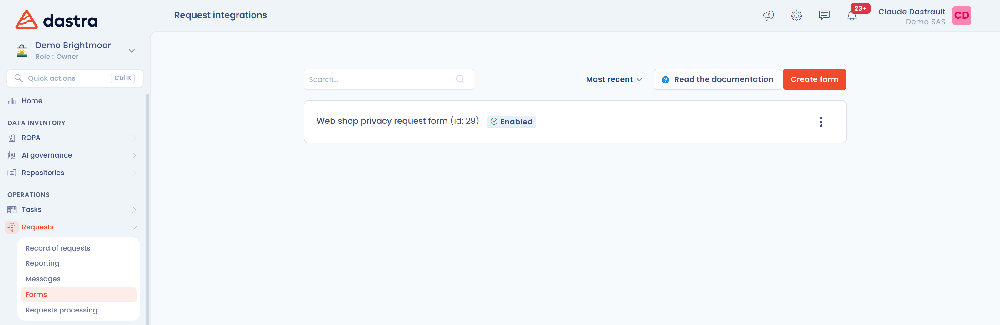

# Technische Integration

## Zweck

Das Widget für Betroffenenanfragen erfasst automatisch Betroffenenanfragen verschiedener Typen (Löschungen, Änderungen, Berichtigungen ...) von einer Seite Ihrer Website.

Das Widget ist Teil des Dastra-JavaScript-SDK.

## Voraussetzungen

Um das Widget für Betroffenenanfragen einzurichten, benötigen Sie einen öffentlichen API-Schlüssel: Lesen Sie [Verwaltung der API-Schlüssel](../settings/api-keys.md) oder [gehen Sie direkt zur Verwaltung der API-Schlüssel](https://app.dastra.eu/general-settings/api).

## Das Widget in der dedizierten Oberfläche einrichten

Richten Sie zunächst das Widget in der Liste der Formulare ein: Klicken Sie im Menü **Anfragen** auf **Formulare zur Datenerfassung**.

<figure><figcaption><p>Die Liste der Formulare</p></figcaption></figure>

Kopieren Sie den Code immer aus der Anwendung: Die Adresse des Skripts hängt von der Hosting-Region Ihrer Organisation ab (`cdn-bleu.dastra.eu` statt `cdn.dastra.eu` auf [Bleu](../../security/bleu.md)).

Hier ist ein einfaches Beispiel für die Integration des Widgets (im Popup-Modus mit einer Schaltfläche zum Öffnen):

```html
<div id="customer-subject-form-custom"></div>
<button id="customer-request-button">Open the widget</button>
<script
  src="https://cdn.dastra.eu/sdk/dastra.js?key={YOUR PUBLIC KEY}"
  async
></script>
<script>
  window.dastra = window.dastra || [];
  dastra.debug = true;
  window.dastra.push(function(){
    dastra.loadCustomerSubjectForm({
      selector: '#customer-subject-form-custom',
      widgetId: {your widget id},
      onLoad: function (form) {
        document.getElementById('customer-request-button').addEventListener('click',function () {
          form.open()
        })
      }
    })
  })
</script>
```

## Die Sprache des Formulars erzwingen

Standardmäßig wird die Sprache des Browsers verwendet. Ist die Sprache in den Übersetzungen des Widgets nicht verfügbar, wird automatisch die Standardsprache gewählt. Sie können die Sprache des Widgets erzwingen, indem Sie die Eigenschaft **data-lang** zum div hinzufügen, in dem das Formular angezeigt wird.

_In diesem Beispiel ist standardmäßig Italienisch ausgewählt (sofern verfügbar)_

```html
<div id="customer-subject-popup" data-lang="it"></div>
```

## Die Formularfelder vorausfüllen

Sie können die Formularfelder aus dem Authentifizierungskontext des Nutzers vorausfüllen. Vorausgefüllte Felder werden dem Nutzer **schreibgeschützt** (ausgegraut) angezeigt.

**Verfügbare Standardfelder:**

```javascript
dastra.push(['set', 'dsr:refId', '{unique_user_id}'])
dastra.push(['set', 'dsr:email', '{email}'])
dastra.push(['set', 'dsr:givenName', '{first_name}'])
dastra.push(['set', 'dsr:familyName', '{last_name}'])
dastra.push(['set', 'dsr:address', '{address}'])
dastra.push(['set', 'dsr:zipCode', '{postcode}'])
dastra.push(['set', 'dsr:city', '{city}'])
dastra.push(['set', 'dsr:countryCode', '{country_code}']) // z. B. "FR"
dastra.push(['set', 'dsr:phoneNumber', '{phone}'])
dastra.push(['set', 'dsr:message', '{message}'])
```

Die Eigenschaft `refId` ist die eindeutige Kennung der Person in Ihrem System (Kundennummer, Sitzungs-ID ...). Sie wird nur dann schreibgeschützt angezeigt, wenn das Feld **Referenznummer der Anfrage** zu den aktiven Feldern des Formulars gehört.

**Benutzerdefinierte Felder:**

```javascript
// Ein vollständiges Objekt übergeben
var payload = {
  customFieldSlug1: 'value1',
  customFieldSlug2: 'value2'
}
dastra.push(['set', 'dsr:additionalDatas', payload])

// Oder Feld für Feld (Präfix @)
dastra.push(['set', 'dsr:@customFieldSlug1', 'value1'])
```

## Parameter im Seitenmodus senden

Sie können diese Parameter auch in der Query-String übergeben: Stellen Sie dem Parameternamen das Präfix `dsr_` voran.

```url
https://api.dastra.eu/v1/client/data-subject-request/page?id=<Your widget id>
&key=<your public key>
&dsr_email=test@github.org
&dsr_givenName=Dastonaute
&dsr_refId=123456
&...etc...
```

## Das Widget durch einen Klick außerhalb des Fensters schließen

Verwendet Ihr Widget das Layout **Modales Fenster (Popup)**, schließt sich das Fenster nicht, wenn der Nutzer außerhalb davon klickt. Das ist so gewollt: Das Risiko, die vom Nutzer eingegebenen Daten zu verlieren, ist zu hoch.

Möchten Sie dennoch, dass sich das Widget bei einem Klick außerhalb des Fensters schließt, verwenden Sie den folgenden Code:

```javascript
window.dastra.customerSubjectReady().then((form) => {
  form.closeOnBackdrop = true
})
```


Dadurch wird der gesamte vom Nutzer eingegebene Text ohne jede Warnung gelöscht. Bei einem langen Formular kann das passieren, wenn sich eine Textauswahl über ein langes Textfeld hinaus erstreckt.


## Mehrere Widgets in eine Seite einbetten

Standardmäßig unterstützt Dastra nicht mehrere Widgets auf derselben Seite.

Sie können es dennoch mit zwei Aufrufen von `loadCustomerSubjectForm` umsetzen, einem pro Widget, mit unterschiedlichen Selektoren und Widget-IDs.

```html
<html lang="en-GB">
  <body>
    <h2>My first widget</h2>
    <div id="widget-1"></div>
    <h2>My second widget</h2>
    <div id="widget-2"></div>
    <script
      async
      src="https://cdn.dastra.eu/sdk/dastra.js?key={YOUR_PUBLIC_KEY}"
    ></script>
    <script>
      window.dastra = window.dastra || []

      // Initialisierung von Widget 1
      window.dastra.push(function () {
        window.dastra.loadCustomerSubjectForm({
          selector: '#widget-1',
          widgetId: 991, // YOUR_WIDGET_ID_
          onLoad: function (form) {
            // Initialisierung
          }
        })
      })

      // Initialisierung von Widget 2
      window.dastra.push(function () {
        window.dastra.loadCustomerSubjectForm({
          selector: '#widget-2',
          widgetId: 992, // die Widget-Kennung des zweiten Widgets
          onLoad: function (form) {
            // Initialisierung
          }
        })
      })
    </script>
  </body>
</html>
```

Um in dieser Konstellation die Anfangswerte der Felder eines Widgets festzulegen, verwenden Sie die Eigenschaft `form.initialData` in `onLoad`:

```javascript
window.dastra.push(function () {
  dastra.loadCustomerSubjectForm({
    selector: '#customer-subject-form-custom',
    widgetId: widgetId,
    onLoad: function (form) {
      form.initialData = {
        givenName: 'testFirstName'
      }
      document
        .getElementById('customer-request-button')
        .addEventListener('click', function () {
          form.closeOnBackdrop = true
          form.open()
        })
    }
  })
})
```
