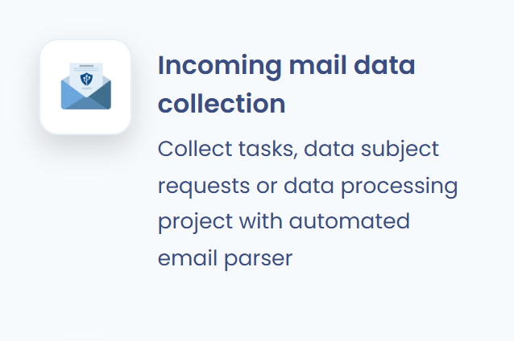

# Verwaltung von Betroffenenanfragen

## Eine Anfrage erstellen

Es gibt 5 Möglichkeiten, eine Betroffenenanfrage in Dastra zu erstellen:

1. Manuell aus dem Verzeichnis der Anfragen.
2. Durch den Import einer Datei (siehe [Anfragen importieren und exportieren](manage.md#anfragen-importieren-und-exportieren)).
3. Automatisch über eine Sammel-E-Mail-Adresse.
4. Automatisch über ein Formular zur Erfassung von Anfragen.
5. Automatisch über die REST-API.

### Eine Anfrage manuell erstellen

Um eine Anfrage manuell aus dem Verzeichnis zu erstellen, klicken Sie in der Seitenleiste auf **Anfragen**, dann auf **Anfragen** und anschließend auf die Schaltfläche **Anfrage erstellen**.

<figure><figcaption>
Das Verzeichnis der Anfragen
</figcaption></figure>


Sie können Anfragen auch automatisch erstellen (siehe unten).


### Eine Anfrage über eine Sammel-E-Mail-Adresse erstellen

Um Anfragen über eine Sammel-E-Mail-Adresse zu erstellen, aktivieren Sie zunächst die Integration **E-Mail-Adresse für die Datenerfassung** (siehe [E-Mail-Adressen für Datenerfassung](../settings/mailboxes.md)).

Öffnen Sie dazu die **Mandanteneinstellungen**, dann den Bereich **Integrationen**, und klicken Sie auf die Kachel **E-Mail-Adresse für die Datenerfassung**.

<figure><figcaption>
Die Integration „E-Mail-Adresse für die Datenerfassung“ in Dastra
</figcaption></figure>


Ist diese Integration noch nicht installiert, installieren Sie sie. Im Verzeichnis der Anfragen führt der Eintrag **E-Mails in Betroffenenanfragen umwandeln** im Menü der Schaltfläche **Anfrage erstellen** direkt dorthin.


Klicken Sie anschließend in der Liste der vorkonfigurierten Anwendungsfälle in der Zeile **Wandelt eine eingehende E-Mail in eine Anfrage mit den entsprechenden Anhängen um** auf **Integration hinzufügen**. Eine E-Mail-Adresse wird automatisch generiert.

<figure><figcaption></figcaption></figure>

Jede an diese Adresse gesendete E-Mail wird dann mit ihren Anhängen zu einer Anfrage in Dastra.

### Eine Anfrage über ein Erfassungsformular erstellen

Informationen zum automatischen Erstellen von Anfragen über ein Erfassungsformular (Widget) finden Sie auf der Seite „Ein Widget für Betroffenenanfragen implementieren“:


[Ein Widget für Betroffenenanfragen implementieren](widget.md)


### Eine Anfrage über die API erstellen

Anfragen können auch aus einem anderen Tool über die Dastra-REST-API erstellt werden. Siehe die Seite „API-Integration“:


[API-Integration](api.md)


## Anfragen importieren und exportieren

Klicken Sie auf den Pfeil neben der Schaltfläche **Anfrage erstellen** und dann auf **Importieren**.

Folgen Sie anschließend dem Leitfaden zum [Datenimport in Dastra](../general/import.md).

Zum Exportieren klicken Sie im selben Menü auf **Exportieren**.
