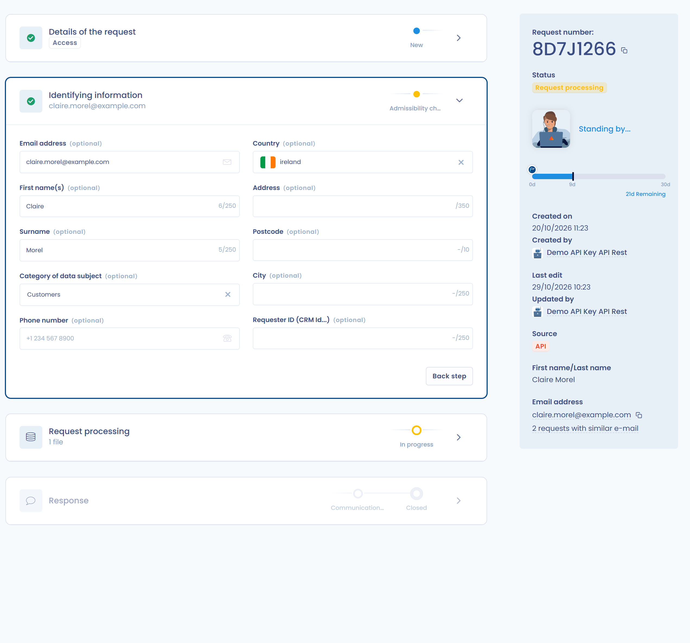
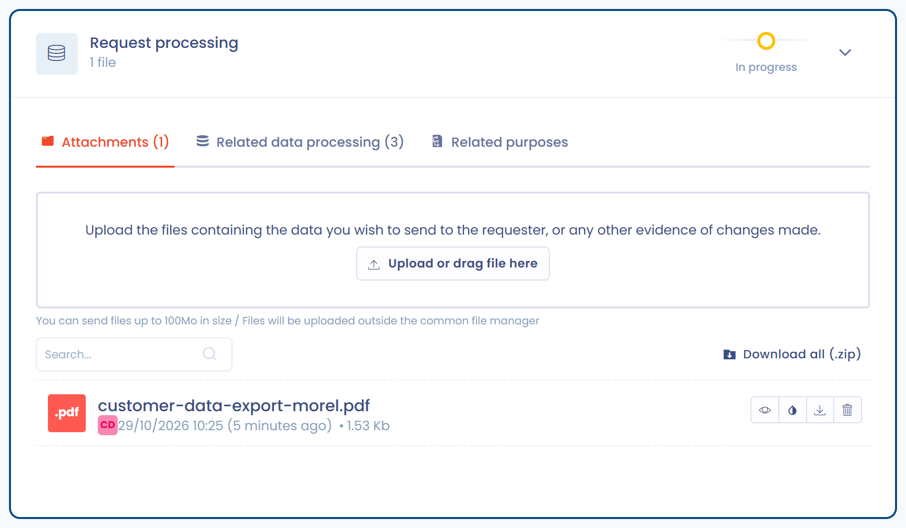
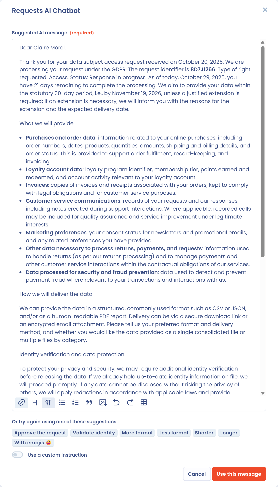
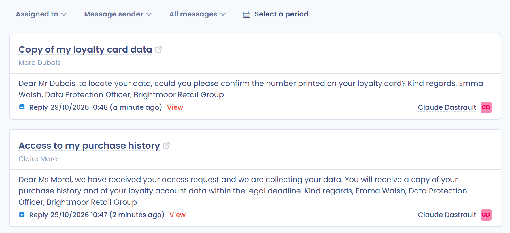
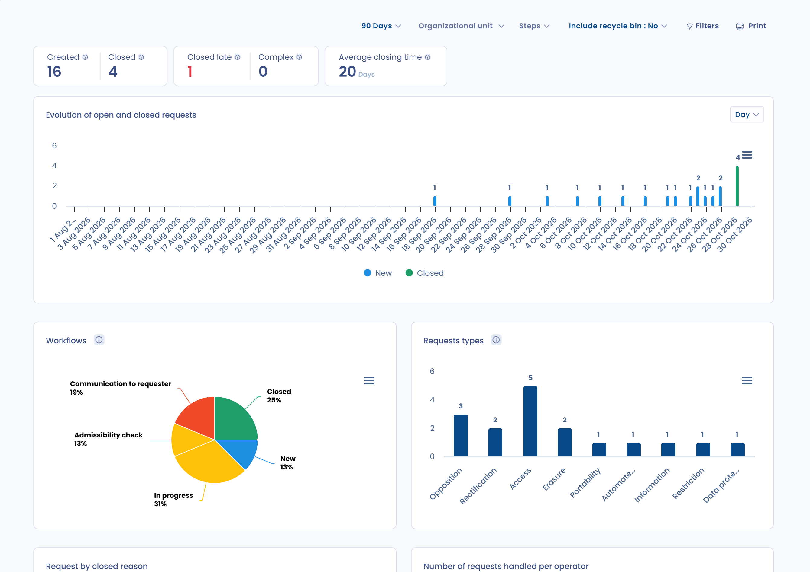

# Bearbeitung und Verarbeitung der Anfragen

Mit Dastra verwalten Sie den gesamten Lebenszyklus einer Betroffenenanfrage (DSAR).\
Über die Oberfläche können Sie:

* **Die Anfrage qualifizieren**: betroffener Rechtstyp, Organisationseinheit, Fristenverwaltung.
* **Die Identität** des Antragstellers überprüfen, indem Sie die erfassten Informationen vervollständigen oder anpassen.
* **Die zugehörigen Daten verarbeiten**, indem Sie die verknüpften Datenkategorien einsehen, Nachweise hochladen und die Verantwortlichen benachrichtigen.
* **Dem Antragsteller direkt antworten**, auf Wunsch mit Unterstützung des KI-Assistenten und mit vollständiger Nachverfolgbarkeit des Austauschs.
* **Die Anfrage abschließen**, indem Sie den Abschlussgrund erfassen.

Jeder Schritt wird dokumentiert und in der Historie festgehalten. So können Sie die Einhaltung der Vorgaben belegen und den betroffenen Personen eine klare Antwort geben.

***

## Die Anfrage qualifizieren

Wenn eine Anfrage erfasst wird, erscheint sie im Anfragenverzeichnis.\
Im Abschnitt **Qualifizierung der Anfrage** können Sie:

1. Die betroffenen **Anfragetypen** festlegen.
2. Die Anfrage einem Bearbeiter und einer **Organisationseinheit** zuweisen.
3. Die **Bearbeitungsfristen** verwalten.

<figure><figcaption>
Der Abschnitt Qualifizierung der Anfrage
</figcaption></figure>

Der Abschnitt enthält außerdem die **Sprache des Browsers** (die bevorzugte Sprache des Antragstellers), die **Tags**, die **Nachricht der Anfrage** (vom Antragsteller), **Weitere Informationen zur Anfrage** und die **Referenznummer der Anfrage**.

### Anfragetypen

Dastra bietet 17 Anfragetypen:

* Auskunft
* Zugang
* Berichtigung
* Löschung
* Einschränkung
* Widerspruch
* Portabilität
* Verfahren für Daten nach dem Tod
* Keine automatisierte Entscheidungsfindung
* Zugriff auf Verwaltungsdokumente
* Anfrage an den Datenschutzbeauftragten
* Anfrage eines Dritten
* Data protection complaint
* Meine Daten nicht verkaufen/weitergeben
* Einschränkung der Verwendung sensibler personenbezogener Daten
* Widerruf der Einwilligung
* Sonstiges

Eine Anfrage kann mehrere Typen abdecken.

### Bearbeitungsfristen

Die gesetzliche Frist wird ab dem Datum der Anfrage berechnet:

* Standardmäßig 30 Tage.
* 20 Tage, wenn der Typ **Zugriff auf Verwaltungsdokumente** ausgewählt ist.
* 90 Tage, wenn Sie **Komplexe Anfrage (90 Tage)** auswählen. Diese Option hat Vorrang vor den beiden anderen Fristen, und die Verlängerung muss begründet werden.

Sie können das **Ablaufdatum** auch mit einem Klick festlegen: Die Schaltflächen **+8t**, **+30t** und **+90t** addieren 8, 30 oder 90 Tage zum Datum der Anfrage.

Wenn Sie die Anfrage aussetzen (siehe [Aussetzung einer Anfrage](#aussetzung-einer-anfrage)), verschiebt das **Voraussichtliche Ablaufdatum** die Frist um die Dauer der Aussetzung.

***

## Die Identität prüfen

Dastra ermöglicht die Überprüfung der Identität der Person, die die Anfrage gestellt hat.\
Sie können die über das ursprüngliche Formular erfassten Informationen vervollständigen oder ändern:

* E-Mail-Adresse, Vorname, Nachname.
* Zusätzliche Daten: Land, Postadresse, Telefonnummer, Nutzer-ID usw.
* Kategorie der betroffenen Person (zum Beispiel Newsletter-Abonnenten, Kunden, Mitarbeiter).

<figure><figcaption>
Der Abschnitt Identitätsdaten
</figcaption></figure>

Stammt die Anfrage aus einem Erfassungsformular, sind die vom Antragsteller ausgefüllten Felder (die Nachricht und die E-Mail-Adresse) gesperrt und können nicht bearbeitet werden.

Haben andere Anfragen dieselbe E-Mail-Adresse, zeigt das Seitenfenster den Link **n Anfragen mit identischer E-Mail-Adresse** an. Damit erkennen Sie Duplikate.

***

## Ausführung der Anfrage

Der Abschnitt **Ausführung der Anfrage** fasst alle Aktionen zusammen, die mit der Ausführung verbunden sind. Er hat drei Reiter: **Anhänge**, **Verknüpfte Daten** und **Verbundene Zwecke**.

### Anhänge

Sie können Nachweisdateien oder Exporte mit den Daten des Antragstellers hochladen.\
Diese Dateien können anschließend bei der Antwort beigefügt werden. Jede Datei hat Schaltflächen zum Ansehen, Schwärzen (je nach Abonnement), Herunterladen oder Löschen, und **Alles herunterladen (.zip)** lädt alle Dateien auf einmal herunter. Dateien dürfen bis zu 100 MB groß sein.

<figure><figcaption>
Dateien zur Anfrage hinzufügen
</figcaption></figure>

Wie Sie Informationen Dritter in einem Dokument vor dem Versand unkenntlich machen, lesen Sie unter [Dokumente schwärzen](redaction.md).


**Gesundheitsdaten**: Dastra ist nicht HDS-zertifiziert (die französische Zertifizierung für das Hosting von Gesundheitsdaten), unser Hostinganbieter Microsoft Azure jedoch schon. Berücksichtigen Sie dies, bevor Sie Dokumente mit Gesundheitsdaten über die Oberfläche versenden.


### Verknüpfte Daten

Dastra ermittelt automatisch die Datenkategorien, die mit der **Kategorie der betroffenen Personen** verknüpft sind.\
Jede Datenkategorie muss einzeln bearbeitet werden.

* Verfügbare Status: **In Bearbeitung** / **Beendet**. Eine Datenkategorie kann außerdem als nicht zutreffend gekennzeichnet werden.
* Anzeige des Gesamtfortschritts (in Prozent).

Der Reiter **Verknüpfte Daten** zeigt alle relevanten Datenkategorien nach einem **kumulativen Modell** an: die der Organisationseinheit, die der Anfrage zugewiesen ist, die **aller übergeordneten Einheiten** (bis zur Wurzel der Hierarchie) und die **aller untergeordneten Einheiten**. Diese Ansicht stellt sicher, dass bei der Bearbeitung keine geerbte Datenkategorie übersehen wird.

<figure><figcaption>
Die von übergeordneten und untergeordneten Einheiten geerbten Datenkategorien werden nach einem kumulativen Modell angezeigt
</figcaption></figure>


Eine Anfrage kann nicht als zu 100 % bearbeitet gelten, solange geerbte Datenkategorien weder bearbeitet noch ausdrücklich als nicht zutreffend gekennzeichnet wurden.


Hat der für die Anfrage zuständige Bearbeiter keine Zugriffsrechte auf einige der angezeigten Datenkategorien, weist ein **visueller Hinweis** ihn darauf hin, die betroffenen Inhaber zu kontaktieren.

#### Details einer Datenkategorie

Klicken Sie auf die Schaltfläche **Data Mapping**, um die Verbindungen zwischen der Kategorie der betroffenen Personen, den Datenkategorien und den Assets einzusehen.

<figure><figcaption>
Visualisieren Sie die Verbindung zwischen der Personenkategorie und dem zu kontaktierenden Inhaber
</figcaption></figure>

Mit einem Klick auf **Überprüfen** gelangen Sie zu den detaillierten Informationen:

* Betroffene personenbezogene Datenfelder (zum Beispiel vollständiger Name, E-Mail-Adresse).
* Rechtsgrundlage und Speicherdauer.
* Löschmodalitäten nach Ablauf der Speicherdauer.

<figure><figcaption>
Schnellzugriff auf die Asset-Details
</figcaption></figure>

#### Eine Datenkategorie als bearbeitet markieren

Für jede Datenkategorie:

1. Sehen Sie die Informationen ein.
2. Begründen Sie die durchgeführte Verarbeitung (zum Beispiel Löschung, Berichtigung) im Feld **Begründung**. Dieses Feld ist erforderlich, und **Generieren** erstellt den Text mit KI.
3. Fügen Sie bei Bedarf Nachweisdateien hinzu.
4. Klicken Sie auf **Bestätigen**.

Ist die Datenkategorie von der Anfrage nicht betroffen, klicken Sie auf **Nicht zutreffend**. Der Status wird aktualisiert, und der Kommentar bleibt erhalten.

<figure><figcaption>
Bearbeitungsoberfläche der Anfrage spezifisch für das Asset
</figcaption></figure>

#### Zusammenarbeit und Benachrichtigungen

Sie können die Inhaber der betroffenen Assets automatisch benachrichtigen.\
Klicken Sie auf **Benachrichtigung der Verantwortlichen**: In einem Fenster wählen Sie die Personen aus, die per E-Mail benachrichtigt werden sollen, und klicken dann auf **Senden**.

<figure><figcaption>
Benachrichtigen Sie schnell die Inhaber der Assets
</figcaption></figure>

### Verbundene Zwecke

Der Reiter **Verbundene Zwecke** listet in einer Tabelle die Verarbeitungszwecke auf, die mit der Kategorie der betroffenen Personen verknüpft sind (**Zweck**), mit ihrer **Rechtsgrundlage** und der **Datenverarbeitung der zugehörigen Daten**. Zwecke erscheinen nur, wenn sie zur selben Organisationseinheit wie die Anfrage gehören.

<figure><figcaption>
Die mit der Kategorie der betroffenen Personen verbundenen Zwecke
</figcaption></figure>

***

## Auf die Anfrage antworten

Sobald die Bearbeitung abgeschlossen ist, können Sie dem Antragsteller direkt im Abschnitt **Antwort auf die Anfrage** antworten.

* Klicken Sie auf **Mit KI generieren**: Der **KI-Assistent** schlägt im Fenster **KI-Chatbot** eine konforme und anpassbare Nachricht vor.
* Passen Sie die Nachricht mit den Vorschlägen an: formeller, weniger formell, kürzer, länger, mit Emojis, den Antrag genehmigen, Identität bestätigen. Sie können auch eine eigene Anweisung mit **Verwenden Sie eine benutzerdefinierte Anweisung** eingeben.
* Klicken Sie auf **Diese Nachricht verwenden** und versenden Sie sie direkt aus Dastra.

<figure><figcaption>
Tauschen Sie Nachrichten mit dem Antragsteller aus, auf Wunsch unter Verwendung von KI
</figcaption></figure>

***

## Eine Anfrage abschließen

Um eine Anfrage abzuschließen, klicken Sie im Menü **Aktionen** oder am Ende der Seite auf **Anfrage abschließen**. Im Fenster, das sich öffnet:

1. Wählen Sie in der Liste **Grund für die Schließung für den Antragsteller** den Abschlussgrund aus. Dieses Feld ist erforderlich.
2. Geben Sie unter **Bitte geben Sie den Grund für die Schließung an (für den Antragsteller sichtbar).** eine Erläuterung ein, die der Antragsteller in seinem Bereich sieht. Dieses Feld ist optional.
3. Ergänzen Sie unter **Interner Abschlussgrund (für den Antragsteller nicht sichtbar)** bei Bedarf eine Notiz für Ihr Team.
4. Prüfen Sie das **Abschlussdatum**.
5. Um den Antragsteller per E-Mail zu benachrichtigen, aktivieren Sie das Kontrollkästchen mit der Beschriftung „Bitte senden Sie eine Benachrichtigung über den Abschluss des Antrags an“, gefolgt von seiner Adresse. Das Kontrollkästchen erscheint nur, wenn die Anfrage eine E-Mail-Adresse hat, und es ist nicht standardmäßig aktiviert.
6. Klicken Sie auf **Speichern**.

<figure><figcaption>
Das Fenster zum Abschließen einer Anfrage
</figcaption></figure>

Ist die Anfrage ausgesetzt, hebt der Abschluss die Aussetzung automatisch auf. Eine abgeschlossene Anfrage kann mit der Schaltfläche **Wieder öffnen** erneut geöffnet werden.

***

## Zusätzliche Aktionen für eine Anfrage

Zusätzlich zu den Hauptschritten (Qualifizierung, Überprüfung, Ausführung und Antwort) bietet Dastra ein Menü **Aktionen**, mit dem erweiterte Operationen für eine Anfrage durchgeführt werden können.

<figure><figcaption>
Greifen Sie schnell auf die zahlreichen verfügbaren Zusatzaktionen zu
</figcaption></figure>

Zu den verfügbaren Aktionen gehören insbesondere:

* **Benutzerdefinierte Felder**: spezifische Felder hinzufügen oder bearbeiten, um die Anfrage anzureichern.
* **Link zum Antragstellerportal kopieren**: einen direkten Link mit der betroffenen Person teilen.
* **E-Mail senden**: eine mit der Anfrage verbundene Nachricht direkt von der Plattform aus senden.
* **Exportieren**: die Informationen der Anfrage exportieren.
* **Workflow-Regeln**: eine Automatisierungsregel anwenden oder auslösen.
* **Antrag aussetzen**: die gesetzliche Bearbeitungsfrist pausieren (siehe unten).
* **Anfrage abschließen**: die Anfrage manuell als abgeschlossen markieren.
* **Zugriffstoken zurücksetzen**: einen neuen sicheren Link für den Antragsteller erstellen.
* **Anonymisieren**: die identifizierenden Daten der Anfrage löschen. Die Aktion steht zur Verfügung, sobald die Anfrage abgeschlossen ist.
* **Dateien löschen**: die übermittelten Anhänge löschen. Das Menü zeigt deren Anzahl an, zum Beispiel **Dateien löschen (1)**. Ihre Namen und Daten bleiben erhalten. Diese Aktion erscheint erst, wenn die Anfrage abgeschlossen ist.
* **In den Papierkorb verschieben**: die Anfrage in den Papierkorb legen. Danach gelten die Löschregeln (siehe [Löschregeln für Anfragen](advanced/purge.md)).

### Aussetzung einer Anfrage

In bestimmten Fällen ist es notwendig, eine Anfrage **vorübergehend auszusetzen** (zum Beispiel in Erwartung einer Identitätsprüfung).\
Die Aussetzung unterbricht die gesetzliche Frist, die erst nach Aufhebung der Aussetzung weiterläuft.

<figure><figcaption>
Setzen Sie eine Anfrage aus, zum Beispiel in Erwartung einer Antwort des Antragstellers
</figcaption></figure>

* **Datum der Aussetzung**: Pflichtfeld.
* **Begründung für die Aussetzung**: Freitextfeld zur Dokumentation des Grundes (zum Beispiel in Erwartung von Nachweisdokumenten).

Klicken Sie anschließend auf **Speichern**.

Sobald die Anfrage ausgesetzt ist, zeigt die Oberfläche den Status deutlich an und bietet die Schaltfläche **Aufhebung der Aussetzung**.

<figure><figcaption></figcaption></figure>

Der Zähler der verbleibenden Tage wird automatisch unter Berücksichtigung der Aussetzungsdauer neu berechnet.

***

## Nachrichten der Antragsteller

Die Seite **Nachrichten** im Menü **Anfragen** bündelt, Anfrage für Anfrage, die mit den Antragstellern ausgetauschten Nachrichten. Jede Gruppe zeigt den Titel der Anfrage und den Namen des Antragstellers. Sie können die Liste nach Bearbeiter (**Zugewiesen an**), nach Absender (**Absender der Nachricht**), nach Nachrichtentyp (**Nachrichten von Antragstellern**, **Mitteilungen des Betreibers** oder **Alle Nachrichten**) und nach Zeitraum filtern.

<figure><figcaption>
Der Posteingang der Antragstellernachrichten
</figcaption></figure>

Eine noch ungelesene Nachricht eines Antragstellers ist mit einem Umschlag-Symbol gekennzeichnet. Sobald sie gelesen wurde, erscheint ein Häkchen **Aufgerufen**. Um die Unterhaltung zu öffnen, klicken Sie auf **Anzeigen**: In der Anfrage markiert die Schaltfläche **Als gelesen markieren** die neuen Nachrichten als gelesen.

## Statistiken zu den Anfragen

Die Seite **Statistiken** im Menü **Anfragen** zeigt die Aktivität des Moduls über den gewählten Zeitraum (30, 90, 180 oder 365 Tage oder ein benutzerdefinierter Zeitraum). Sie zeigt insbesondere:

* die Anzahl der erstellten, abgeschlossenen, verspätet abgeschlossenen und komplexen Anfragen;
* die durchschnittliche Abschlusszeit;
* die Entwicklung der offenen und geschlossenen Anfragen;
* die Verteilung der Anfragen nach Typ, nach Schritt, nach Bearbeiter und nach Abschlussgrund.

Sie können nach Organisationseinheit und Schritt filtern, den Papierkorb einbeziehen (**Papierkorb einbeziehen**), mit **Filter** zusätzliche Kriterien festlegen (zum Beispiel ein Erfassungsformular auswählen oder anonymisierte Anfragen ausschließen) und die Seite mit **Drucken** ausdrucken.

<figure><figcaption>
Die Statistiken der Anfragen
</figcaption></figure>

***

## Gesamtübersicht

Jede Anfrage bewahrt die vollständige Historie:

* Ausgetauschte Nachrichten.
* Hinzugefügte Anhänge.
* Status und Fortschritt der Bearbeitung.

Dies ermöglicht es, die Nachverfolgbarkeit und Konformität im Falle einer Kontrolle zu gewährleisten.
