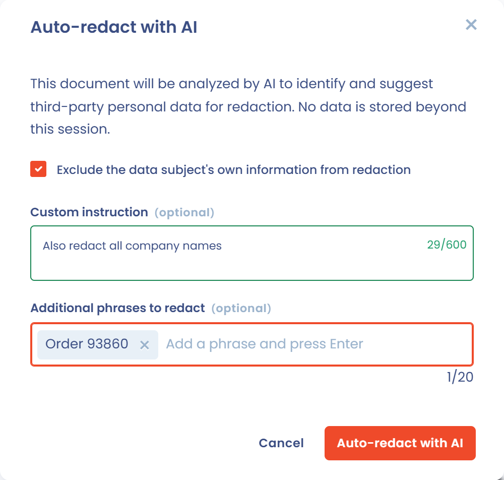
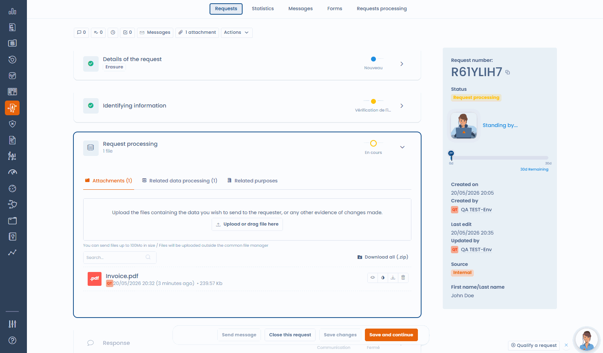

# Dokumente schwärzen

Bei der Bearbeitung einer Betroffenenanfrage müssen Sie dem Antragsteller oft Dokumente übermitteln: die Kopie eines Ausweises, einen Vertrag, einen Kontoverlauf, eine Kundenakte. Diese Dokumente enthalten fast immer vertrauliche Informationen, die nicht offengelegt werden dürfen: Daten Dritter, interne Vertragsbedingungen, namentlich genannte Referenzen.

Dastra enthält dafür ein Schwärzungswerkzeug direkt in der Anfrage. In der Oberfläche heißt es **Dateiverdeckung**.

***

## Das Schwärzungswerkzeug öffnen

Das Werkzeug öffnet sich über die Anhänge der Anfrage. Es akzeptiert PDF-, PNG- und JPEG-Dateien und hängt von Ihrem Tarif ab: Ist die Schwärzung nicht enthalten, erscheint die Schaltfläche nicht.

1. Öffnen Sie im Menü **Anfragen** den Eintrag **Anfragen** und dann die Anfrage, die Sie bearbeiten möchten.
2. Öffnen Sie im Abschnitt **Ausführung der Anfrage** den Tab **Anhänge**. Laden Sie bei Bedarf das Dokument hoch.
3. Klicken Sie in der Zeile der Datei auf das Symbol **Datensperrung**. Sie können auch die Dateivorschau öffnen und dort auf **Datensperrung** klicken.

Der Editor **Dateiverdeckung** öffnet sich mit dem Dokument.

<figure><figcaption>
Die Anhänge der Anfrage, mit dem Schwärzungssymbol bei jeder kompatiblen Datei
</figcaption></figure>

***

## Manuell schwärzen

Zeichnen Sie mit der Maus auf jeder Seite die Bereiche ein, die ausgeblendet werden sollen. Der Editor zeigt die Anzahl der Ausblendungen an und bietet diese Aktionen:

* **Ausblendung aufheben** löscht einen Bereich.
* **Letzte Ausblendung rückgängig machen** geht um einen Bereich zurück.
* **Ausblendungen auf der Seite entfernen** und **Alle Ausblendungen löschen** beginnen mit einer sauberen Seite von vorn.
* Mit den Schaltflächen für Zoom und Seitenwechsel lassen sich lange Dokumente leichter lesen.

<figure><figcaption>
Zeichnen Sie die zu schwärzenden Bereiche direkt auf das Dokument
</figcaption></figure>

<figure><figcaption>
Der Editor Dateiverdeckung
</figcaption></figure>

***

## Mit KI schwärzen

Klicken Sie im Editor auf **Automatische Schwärzung**, um den Dialog **Automatische Maskierung mittels KI** zu öffnen. Die KI analysiert das Dokument, findet personenbezogene Daten Dritter (Namen, Adressen, Kontaktdaten, Identifikationsnummern) und setzt Schwärzungsbereiche. Über die Sitzung hinaus werden keine Daten gespeichert.

Der Dialog bietet drei Optionen:

* **Die Daten der betroffenen Person von der Anonymisierung ausnehmen**: standardmäßig ausgewählt, damit die Daten des Antragstellers lesbar bleiben.
* **Individuelle Schulung**: eine zusätzliche Anweisung, zum Beispiel auch alle Firmennamen zu schwärzen.
* **Weitere auszublendenen Ausdrücke**: bis zu 20 Ausdrücke, die überall ausgeblendet werden, wo sie vorkommen. Geben Sie einen Ausdruck ein und drücken Sie die Eingabetaste.

Klicken Sie anschließend auf **Automatische Schwärzung**. Die vorgeschlagenen Bereiche werden im Editor ergänzt: Entfernen Sie die irrtümlich erkannten und ergänzen Sie die, die die KI übersehen hat. Die Schaltfläche **Automatische Schwärzung** erscheint nur, wenn die KI-Schwärzung in Ihrem Tarif enthalten ist.

<figure><figcaption>
Die Optionen der automatischen KI-Schwärzung
</figcaption></figure>

<figure><figcaption>
Die KI analysiert das Dokument und setzt die Schwärzungsbereiche, die Sie anschließend prüfen
</figcaption></figure>


Das Ergebnis der KI ist ein Vorschlag, keine endgültige Entscheidung. Eine qualifizierte Person muss jeden Bereich prüfen und bestätigen, bevor das Dokument versendet wird.


***

## Die geschwärzte Datei speichern

Klicken Sie nach der Prüfung auf **Ausgeblendete Datei speichern**. Die Schaltfläche bleibt inaktiv, bis mindestens ein Bereich eingezeichnet ist. Der Schalter **Die Originaldatei löschen**, standardmäßig aktiviert, legt fest, was mit dem Original geschieht:

* Aktiviert: Die geschwärzte Datei ersetzt das Original endgültig, das Original wird gelöscht.
* Deaktiviert: Die geschwärzte Datei wird als neuer Anhang mit dem Suffix `-redacted` hinzugefügt, das Original bleibt erhalten.

Dastra bittet Sie vor dem Speichern um eine Bestätigung. Die Seiten werden zu Bildern abgeflacht: Der ausgeblendete Text existiert in der entstehenden Datei nicht mehr und lässt sich nicht extrahieren. Eine geschwärzte Datei zeigt den Hinweis **Anonymisierte Daten** mit der Anzahl der geschwärzten Bereiche.


Ein einfaches deckendes Rechteck über einem nicht abgeflachten PDF lässt sich umgehen und ist keine konforme Schwärzung. Das Abflachen zu einem Bild ist die von den Datenschutzbehörden empfohlene Methode.


***

## Bewährte Vorgehensweisen

* Prüfen Sie das geschwärzte Dokument vor dem Versand, um sicherzustellen, dass keine vertraulichen Informationen sichtbar sind.
* Deaktivieren Sie **Die Originaldatei löschen**, um das Original in der Anfrage zu behalten, zum Beispiel für Ihre Compliance-Dokumentation, sofern Ihre interne Richtlinie das Löschen nicht verlangt.
* Kombinieren Sie bei langen oder komplexen Dokumenten (mehrseitige Verträge, Kontoauszüge) die KI-Erkennung mit einer manuellen Prüfung Seite für Seite.
