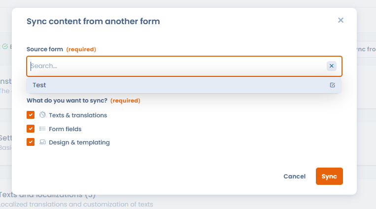

# Widget-Synchronisierung

Wenn mehrere Widgets für Betroffenenanfragen eine ähnliche Konfiguration teilen (gleiche Felder, gleiche Texte), können Sie sie synchronisieren. Legen Sie ein Widget als Quelle fest, synchronisieren Sie die untergeordneten Widgets von dort aus und übertragen Sie dann jede Änderung mit einem einzigen Klick auf alle verknüpften Widgets.

Diese Funktion ist besonders nützlich für Organisationen, die mehrere Varianten desselben Widgets verwalten (zum Beispiel ein Widget zur Kontolöschung, das je nach Anwendung oder geografischem Markt variiert).

In der Anwendung ist ein Widget ein Formular: Sie öffnen es unter **Anfragen** > **Formulare zur Datenerfassung**. Die Synchronisierungsschaltflächen befinden sich oben auf der Formularseite, neben **Übersicht** (der Vorschau).

## Inhalte aus einem anderen Widget synchronisieren

So importieren Sie die Konfiguration eines bestehenden Widgets in das aktuelle:

1. Klicken Sie neben **Übersicht** auf die Dropdown-Schaltfläche **Synchronisieren**.
2. Klicken Sie auf **Von einem anderen Formular synchronisieren**.
3. Wählen Sie unter **Quellformular** das Quell-Widget aus.
4. Wählen Sie unter **Was möchten Sie synchronisieren?** die zu importierenden Elemente aus: **Texte und Übersetzungen**, **Formularfelder** und **Design und Erscheinungsbild**.
5. Klicken Sie auf **Synchronisieren**.

<figure><figcaption>
Die Synchronisierungsschaltfläche neben Übersicht importiert die Konfiguration eines Quell-Widgets
</figcaption></figure>

<figure><figcaption>
Auswahl des Quell-Widgets und der zu importierenden Elemente
</figcaption></figure>

Nach der Synchronisierung wird das Widget zu einem untergeordneten Widget des Quell-Widgets. Die Beschriftung der Schaltfläche ändert sich, und die Dropdown-Liste bietet nun **Löschen**, um die Verknüpfung mit der Quelle aufzuheben.

## Änderungen auf untergeordnete Widgets übertragen

Sobald Sie das Quell-Widget geändert haben, übertragen Sie die Änderungen mit einem Klick auf alle verknüpften Widgets:

1. Klicken Sie auf **Änderungen auf verknüpfte Formulare übertragen**, gefolgt von der Anzahl der untergeordneten Widgets in Klammern.
2. Prüfen Sie die Liste der untergeordneten Widgets und wählen Sie dann die zu übertragenden Elemente aus.
3. Klicken Sie auf **Teilen**.

<figure><figcaption>
Änderungen des Quell-Widgets auf alle untergeordneten Widgets übertragen (Texte, Felder, Design)
</figcaption></figure>


Die Schaltfläche **Änderungen auf verknüpfte Formulare übertragen** erscheint nur bei einem Widget, das mindestens ein untergeordnetes Widget hat. In diesem Fall ist die Synchronisierungsschaltfläche ausgeblendet: Ein Quell-Widget kann nicht selbst aus einem anderen Widget synchronisiert werden.

