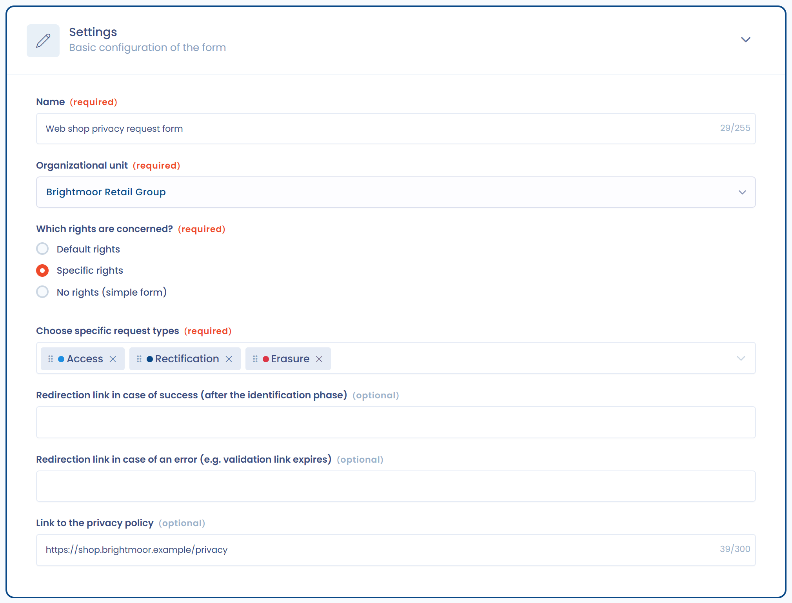
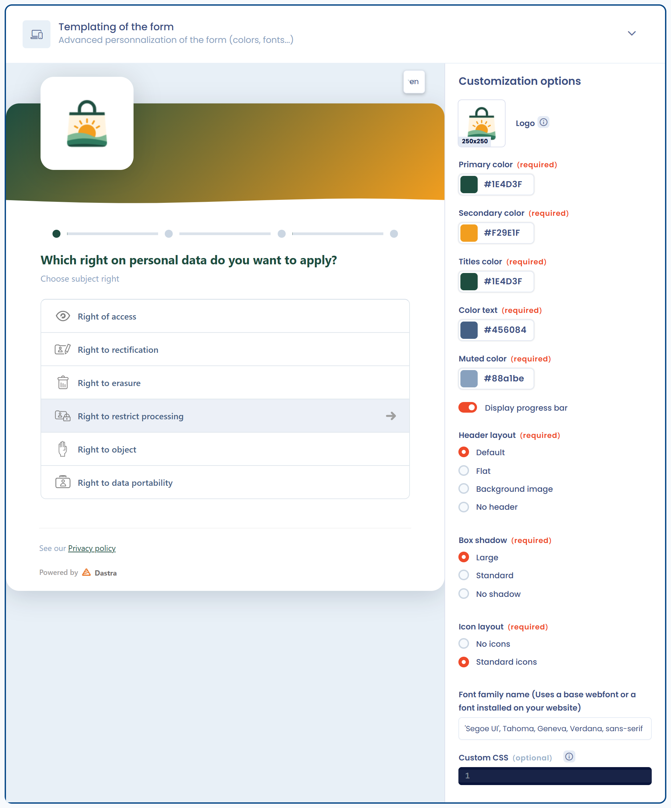

# Ein Widget für Betroffenenanfragen implementieren

Das Dastra-Widget fügt ein Formular für Betroffenenanfragen direkt auf Ihrer Website ein. In der Anwendung verwalten Sie es unter **Anfragen** > **Formulare zur Datenerfassung**: Klicken Sie auf **Formular erstellen**, um ein neues hinzuzufügen.

Sie können es auf fünf Arten anpassen:

* **Allgemeine Konfiguration**: angebotene Anfragetypen, Weiterleitungen und Link zur Datenschutzinformation.
* **Visuelle Anpassung**: Farben, Logo, Hintergrundbild, Symbole, Schriftart und Fortschrittsbalken.
* **Felder**: Standardfelder und benutzerdefinierte Felder, Pflichtfelder oder optionale Felder.
* **Integrationsmodi**: in eine Seite eingebettet, in einem modalen Fenster (Popup), in einem iFrame oder auf einer eigenen Webseite.
* **Mehrsprachigkeit**: Übersetzen und Anpassen aller Texte des Widgets.

***

## Integrations-Workflow

Das folgende Diagramm zeigt, wie ein Widget für Betroffenenanfragen in Dastra funktioniert:

<figure><figcaption>
Der Weg einer über das Widget erfassten Anfrage
</figcaption></figure>

Der Ablauf ist folgender:

1. Die betroffene Person reicht eine Anfrage über das Widget ein.
2. Die Anfrage wird an Dastra übermittelt und gespeichert.
3. Sie werden benachrichtigt und können sie in der Plattform qualifizieren und bearbeiten.
4. Die betroffene Person erhält eine Antwort über das Antragstellerportal.

***

## Allgemeine Konfiguration

Öffnen Sie ein Formular und gehen Sie zum Abschnitt **Konfiguration**. Sie legen fest:

* Den **Namen** des Widgets und seine **Organisationseinheit**.
* Die verfügbaren Anfragetypen mit der Frage **Für welches Betroffenenrecht?**: **Standardmäßige Rechtsarten**, **Bestimmte Arten von Rechten** (Sie wählen die Typen dann unter **Auswahl der zulässigen Anfragetypen** aus) oder **Keine Rechtsform (einfaches Formular)**. Letzteres bittet die Person nicht, einen Anfragetyp zu wählen.
* Die Links **Weiterleitungslink im Falle eines Erfolgs (nach der Identifizierungsphase)**, **Weiterleitungslink im Falle eines Fehlers (z. B. Ablauf des Bestätigungslinks)** und **Link zur Datenschutzinformation**. Alle drei Links sind optional.

<figure><figcaption>
Konfiguration des Widgets
</figcaption></figure>

***

## Das Erscheinungsbild anpassen

Der Abschnitt **Erscheinungsbild und Design** passt das Formular an Ihre Marke an. Die Vorschau wird bei jeder Änderung aktualisiert.

Verfügbare Optionen:

* **Logo** und **Hintergrundbild** (angeboten mit dem Kopfzeilenlayout **Hintergrundbild** oder im Modus der eigenen Webseite).
* Farben: **Primäre Farbe des Formulars**, **Sekundäre Farbe** (mit dem Kopfzeilenlayout **Vollständig**), **Farbe der Überschriften**, **Textfarbe** und **Gedämpfte Farbe**.
* **Anordnung der Kopfzeile**: **Vollständig**, **Plat**, **Hintergrundbild** oder **Keine Kopfzeile**.
* **Formularschatten**: **Umfassend**, **Standard** oder **Keine Schatten**.
* **Darstellung der Symbole**: **Keine Symbole** oder **Standard-Symbole**.
* **Fortschrittsbalken anzeigen**.
* **Name der Schriftart**: der Name einer auf Ihrer Website installierten Schriftart.
* **Individuelles CSS** für fortgeschrittene Nutzer.

<figure><figcaption>
Passen Sie das Erscheinungsbild des Widgets an
</figcaption></figure>

***

## Die Felder anpassen

Der Abschnitt **Anpassung des Formulars** zeigt links die Liste **Aktive Felder** und rechts die Liste **Verfügbare Felder**. Klicken Sie auf ein verfügbares Feld, um es hinzuzufügen, ziehen Sie die aktiven Felder, um ihre Reihenfolge zu ändern, und klicken Sie auf ein aktives Feld, um es zu bearbeiten.

* Die E-Mail-Adresse ist immer vorhanden. Standardmäßig fragt das Formular außerdem nach Vorname, Nachname, Referenznummer der Anfrage und Nachricht.
* Sie können Standardfelder hinzufügen: **Telefon**, **Adresse**, **Postleitzahl**, **Gemeinde**, **Land**, **Anhänge** und **Persongruppe** (die Kategorie der betroffenen Person).
* Sie können eigene **benutzerdefinierte Felder** hinzufügen, die in den benutzerdefinierten Feldern der Anfragen erstellt werden.
* Jedes Feld hat einen Schalter **Pflichtfeld**.
* Klicken Sie beim Feld für die Kategorie der betroffenen Person auf **Kategorien konfigurieren**, um die Kategorien auszuwählen, die der Person angeboten werden.

<figure><figcaption>
Passen Sie die im Widget verfügbaren Felder an
</figcaption></figure>

***

## Bedingte Logik (Skip Logic)

Für jedes Feld legen Sie fest, wann es angezeigt wird: **Immer anzeigen**, **Nach Art der Anfrage anzeigen** oder **Individuell anpassbare Anzeigeoptionen**. Bei individuellen Bedingungen erscheint ein Feld nur, wenn die Antwort auf eine vorherige Frage eine definierte Bedingung erfüllt.

Die angebotenen Operatoren hängen vom Feldtyp ab, wie bei den Workflow-Regeln:

* Vergleiche (kleiner als, größer als und ihre Varianten mit Gleichheit) für Zahlen und Datumsangaben;
* „ist in“ und „ist nicht in“ für Dropdown-Listen und Optionsfelder;
* „enthält alle“, „schließt alle aus“, „ist leer“ und „ist nicht leer“ für Kontrollkästchen;
* Vorhandensein oder Fehlen eines Werts für optionale Felder.

Die Formularvorschau wendet diese Regeln an. Sie werden dynamisch auf Seiten des Befragten interpretiert: Das Formular passt sich in Echtzeit an, während die Antworten eingegeben werden.

Damit können Sie:

* Felder je nach Art des ausgeübten Rechts, der Art der Anfrage oder einer vorherigen Antwort ein- oder ausblenden
* Mehrere Szenarien innerhalb eines **einzelnen Widgets** verwalten, ohne für jede Variante ein separates Formular erstellen und pflegen zu müssen
* Den Wartungsaufwand bei inhaltlichen Änderungen oder neuen Compliance-Anforderungen reduzieren

***

## Das Widget installieren

Der Abschnitt **Installation** bietet vier Integrationsmodi, die Sie unter **Art der Formularanzeige** auswählen:

* **In die Seite integriert** (empfohlen): ein HTML-Snippet, das Sie an der Stelle einfügen, an der das Formular erscheinen soll.
* **Modales Fenster (Popup)**: Eine Schaltfläche öffnet das Formular in einem Fenster.
* **Spezielle Webseite (URL angegeben)**: Dastra hostet eine Seite, und Sie teilen deren URL, zum Beispiel in Ihrer Datenschutzinformation.
* **In einen Iframe integriert**: ein iFrame, den Sie in Ihre Seite einfügen. Die Option **Automatische Größenanpassung des Iframes** vermeidet eine Bildlaufleiste, andernfalls ist die Höhe auf 1000 px festgelegt.

Der bereitgestellte Code ist ein HTML-Snippet und ein JavaScript-Skript, das Sie auf Ihrer Website oder in einem Tag-Manager (zum Beispiel Google Tag Manager) einfügen. Erweiterte Optionen (Sprache, vorausgefüllte Felder, mehrere Widgets auf einer Seite) finden Sie unter [Technische Integration](integration.md).

<figure><figcaption>
Installationsanleitung
</figcaption></figure>

***

## Texte und Übersetzungen

Das Widget ist mehrsprachig: Im Abschnitt **Texte und Übersetzungen** fügen Sie mit **Sprache hinzufügen** Sprachen hinzu und passen die Übersetzungen an.\
Die erste Sprache in der Liste ist die Standardsprache: Dastra verwendet sie, wenn die Sprache des Browsers der Person nicht verfügbar ist.

<figure><figcaption>
Passen Sie die Texte des Widgets an
</figcaption></figure>

Klicken Sie bei jeder Sprache auf **Bearbeiten**, um die Texte zu öffnen, die in vier Abschnitte gegliedert sind (**General settings**, **Types of right**, **Contact form** und **Custom fields**). Sie können ändern:

* Den Seitennamen (für den Modus der eigenen Webseite).
* Die Nachrichten vor den Links zur Datenschutzinformation.
* Den Text von Schaltflächen und Anleitungen.
* Die Übersetzung der Kategorien betroffener Personen und der benutzerdefinierten Felder (Bezeichnung, Beschreibung, Platzhalter und Optionen).

<figure><figcaption>
Ändern Sie einen Teil der Texte
</figcaption></figure>

***

## Ergebnis für die betroffene Person

Das so konfigurierte Widget ermöglicht es betroffenen Personen, die Art des Rechts auszuwählen, das sie ausüben möchten, und ihre Anfrage einzureichen.\
Das Formular passt sich der Konfiguration an (Sprachen, Erscheinungsbild, Felder).

Am Ende des Formulars erhält die anfragende Person eine E-Mail mit einem Bestätigungslink und einem 6-stelligen Code und gibt den Code im Formular ein: **Bitte geben Sie den 6-stelligen Code ein, den Sie soeben per E-Mail erhalten haben.** Die Anfrage wird erst berücksichtigt, wenn die Adresse bestätigt ist. Siehe die [häufig gestellten Fragen](faq.md).
