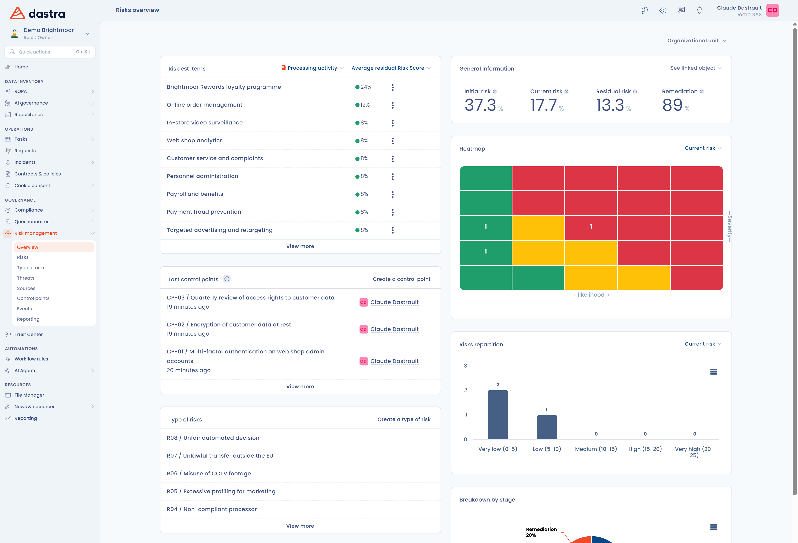

# Risikomanagement

Datenschutzrisiken, strategische, Compliance-, operationelle, finanzielle und Lieferantenrisiken: Das Risikomanagement-Modul führt sie in einem einzigen Verzeichnis zusammen. Es richtet sich an Datenschutzbeauftragte, Compliance-Teams und Risikomanager.

Es bietet Ihnen einen Gesamtüberblick über Ihre Risiken, um Ihre Maßnahmenpläne zu speisen, Ihre Abdeckung zu erweitern und Ihre Risikoexposition zu verringern.

## Das Risikomanagement in Dastra in wenigen Worten

Mit dem Modul identifizieren, bewerten, behandeln und überwachen Sie Ihre Risiken an einem Ort, mit einem Überblick über die Exposition Ihrer Organisation.

Mit Dastra können Sie:

* Ihre Risiken nach Organisationseinheit, Verarbeitungstätigkeit, Asset, Stakeholder oder KI-System anzeigen;
* die Bewertung, Kontrolle, das Reporting und die Verfolgung der Maßnahmenaufgaben zentralisieren;
* die Risikodaten aktuell, zuverlässig und für das gesamte Team verfügbar halten.

<figure><figcaption>
Der Überblick des Risikomanagement-Moduls
</figcaption></figure>

## Ein Risiko zuordnen

In Dastra wird ein Risiko einem der folgenden Objekte zugeordnet:

* Organisationseinheit;
* Verarbeitungstätigkeit;
* Stakeholder, zum Beispiel ein Auftragsverarbeiter;
* Asset;
* KI-System.

Welche Objekttypen Sie sehen, hängt von den Modulen ab, die in Ihrem Mandanten aktiviert sind. Sie können denselben Risikotyp auf beliebig vielen Objekten bewerten.

<figure><figcaption>
Beispiel einer konsolidierten Risikoansicht
</figcaption></figure>

## Das Modul im Überblick

Öffnen Sie **Risikomanagement** in der Seitenleiste. Das Modul ist mit Lesezugriff auf Risiken sichtbar; zum Erstellen und Bearbeiten ist Schreibzugriff erforderlich.

| Menüeintrag | Inhalt |
| --- | --- |
| **Überblick** | Die Kennzahlen (anfängliches, aktuelles und Restrisiko, Behebung), die Heatmap, die risikoreichsten Elemente und die letzten Kontrollpunkte. |
| **Risiken** | Die bewerteten Risiken, mit einem Tab pro Objekttyp. Sie erstellen sie einzeln oder als Stapel. |
| **Risikotypen** | Das Verzeichnis der Risikotypen: befürchtetes Ereignis, Bedrohungen, Quellen, Kontrollpunkte und Vorabbewertung. |
| **Bedrohungen** | Das Verzeichnis der Bedrohungen, die Sie für mehrere Risikotypen wiederverwenden. |
| **Quellen** | Das Verzeichnis der Risikoquellen. |
| **Kontrollpunkte** | Die Maßnahmen, die das Risiko verringern, mit ihren aufeinanderfolgenden Antworten. |
| **Tagebuch** | Der Verlauf der Ereignisse, die in der Organisation eingetreten sind, mit Datum und finanziellen Auswirkungen. |
| **Statistiken** | Die anfänglichen, aktuellen und Restwerte pro Objekt (Minimum, Durchschnitt, Maximum), mit einem Tab pro Objekttyp. |

### Risikostatus

Jedes Risiko durchläuft fünf Schritte, die oben auf seiner Seite angezeigt werden: **Identifizierung**, **Bewertung**, **Verarbeitung**, **Überwachung** und **Archivierung**. Jeder Schritt wird im [Risikomanagement-Prozess](process/README.md) beschrieben.


Nur der Inhaber des Risikos kann den Status eines Risikos ändern. Der Inhaber wird im Abschnitt **Identifizierung** des Risikos angezeigt.


### Mehrere Risiken gleichzeitig erstellen

Öffnen Sie in einem Tab von **Risiken** das Menü der Schaltfläche **Ein Risiko erstellen** und klicken Sie auf **Erzeugung von Massenrisiken**. Wählen Sie die Organisationseinheit, den Risikotyp, den Inhaber des Risikos, das Identifizierungsdatum und die betroffenen Objekte aus: Dastra erstellt pro Objekt ein Risiko, mit der Vorabbewertung des Risikotyps.

## Weiterführende Informationen


[definition.md](../../gdpr/risks/definition.md)



[assessment.md](../../gdpr/risks/assessment.md)



[attach-to-processing.md](attach-to-processing.md)

