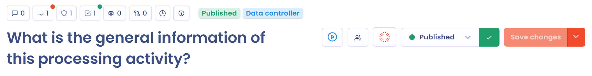

# Ein Risiko einer Verarbeitungstätigkeit zuordnen

## Ein Risiko zu einer Verarbeitungstätigkeit hinzufügen

1. Öffnen Sie die Verarbeitungstätigkeit im Verzeichnis der Verarbeitungstätigkeiten.
2. Klicken Sie in der Schaltflächenleiste unter dem Titel auf **Risiken**. Die Schaltfläche zeigt die Anzahl der Risiken an, die der Verarbeitungstätigkeit bereits zugeordnet sind.

<figure><figcaption>
Die Schaltfläche Risiken einer Verarbeitungstätigkeit
</figcaption></figure>

3. Klicken Sie im Bereich, der sich öffnet, auf **Ein Risiko erstellen**.

<figure><figcaption>
Der Bereich Risiken einer Verarbeitungstätigkeit
</figcaption></figure>

Sie gelangen auf die Bearbeitungsseite des Risikos, auf der die Verarbeitungstätigkeit und ihre Organisationseinheit bereits ausgefüllt sind. Beginnen Sie mit der Eingabe der Informationen zu dem Risiko, das Sie identifiziert haben, wie unter [Identifizieren](process/identify.md) beschrieben.

Sie können ein Risiko auch im Risikomanagement-Modul einer Verarbeitungstätigkeit zuordnen: Öffnen Sie **Risikomanagement** > **Risiken**, wählen Sie den Tab **Datenverarbeitung** und klicken Sie auf **Ein Risiko erstellen**.

## Die Risiken einer Verarbeitungstätigkeit anzeigen

Um die Risiken aller Ihrer Verarbeitungstätigkeiten zu sehen, öffnen Sie **Risikomanagement** > **Risiken** und wählen Sie den Tab **Datenverarbeitung**. Jede Zeile zeigt den Risikotyp, die betroffene Verarbeitungstätigkeit sowie die Stufen des anfänglichen, aktuellen und Restrisikos.

<figure><figcaption>
Die Risiken, die Verarbeitungstätigkeiten zugeordnet sind
</figcaption></figure>

## Bewertung der Risikostufe

Die Risikostufe wird mit der folgenden Formel berechnet:

`Risikostufe = Wahrscheinlichkeitswert x Auswirkungswert`

Dastra zeigt sie in Punkten von der Höchstpunktzahl der Skala (zum Beispiel 16/25) und als Prozentsatz an. Der Prozentsatz wird mit der folgenden Formel berechnet:

`(Auswirkung x Wahrscheinlichkeit) / Höchstpunktzahl der aktiven Risikoskala`

Die Höchstpunktzahl der Skala beträgt 25 bei der Standardskala mit 5 Stufen (5 x 5), 16 bei der Skala mit 4 Stufen und 9 bei der Skala mit 3 Stufen. Siehe [Die Risikoskala konfigurieren](process/assess.md#die-risikoskala-konfigurieren).

Das Dashboard des Mandanten enthält ein Modul **Risikomanagement**. Es zeigt die Durchschnittswerte des anfänglichen, aktuellen und Restrisikos in Prozent, die durchschnittliche Behebung, die Anzahl der Risiken pro Schritt (**Gesamt**, **Identifiziert**, **Keine Antwort**) und die Aufteilung der niedrigen, mittleren und hohen Restrisiken. Jeder Durchschnittswert beruht auf den oben berechneten Prozentsätzen.

## Weiterführende Informationen


[Planung](../tasks/README.md)

