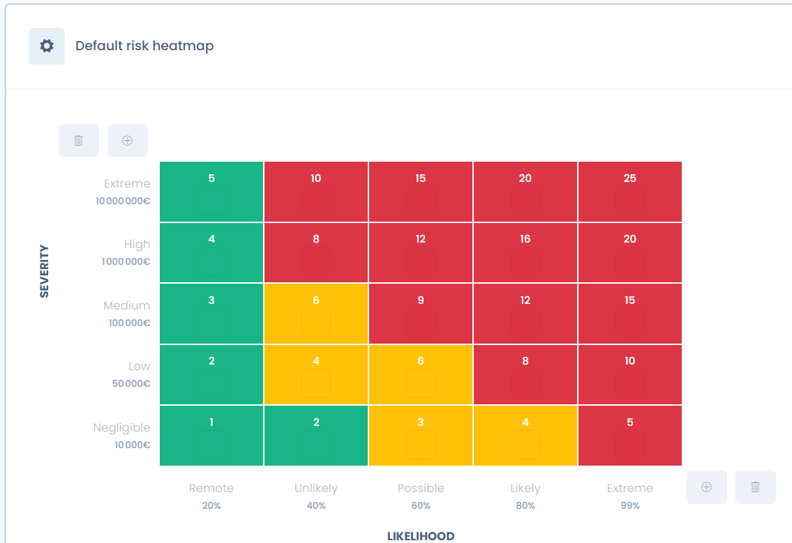
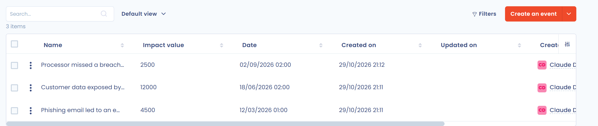

# 2. Bewerten

Bewerten Sie das Risiko auf Grundlage der Elemente, die im Risikotyp identifiziert wurden, und des Kontexts des Objekts. Die Bewertung beruht auf Wahrscheinlichkeit und Auswirkung. Die App bezeichnet sie als **Wahrscheinlichkeit** und **Schweregrad**.

Öffnen Sie auf der Seite des Risikos den Abschnitt **Risikobewertung**. Wählen Sie die Wahrscheinlichkeit und den Schweregrad des anfänglichen Risikos und anschließend die des Restrisikos. Enthält der Risikotyp eine Vorabbewertung, sind diese Werte bereits ausgefüllt. Das Feld **Begründung der Bewertung** hält Ihre Überlegungen fest.

<figure><figcaption>
Der Abschnitt Risikobewertung und seine Matrix
</figcaption></figure>

Klicken Sie auf **Bewertung bestätigen**, um das Risiko in den Schritt **Verarbeitung** zu verschieben. Nur der Inhaber des Risikos kann dies tun. Die Schaltfläche **Zurück zu diesem Schritt** führt das Risiko einen Schritt zurück.

## Die Risikoskala bestimmen

Um ein Risiko zu bewerten, positionieren Sie diese beiden Werte auf einer Skala: der Risikoskala. Sie beruht in der Regel auf 5 Stufen. In Frankreich verwendet die Ebios-Methode (insbesondere von der CNIL und der ANSSI gefördert) eine Skala mit 4 Stufen.

Legen Sie für jede Stufe eine Anwendungsbedingung fest. Die Skala kann einem finanziellen Betrag entsprechen, zum Beispiel für die Auswirkung.

<figure><figcaption>
Die Standard-Risikoskala
</figcaption></figure>

### Die Risikoskala konfigurieren

Die Skala ist anpassbar. Sie wird pro Mandant festgelegt, unter **Mandanteneinstellungen** > **Risikomanagement**, im Bereich **Prozess**. Dieser Eintrag ist mit Schreibzugriff auf Risiken sichtbar; zum Erstellen, Speichern oder Aktivieren einer Skala ist außerdem Schreibzugriff auf die erweiterten Einstellungen erforderlich.

<figure><figcaption>
Die Risikoskalen des Mandanten
</figcaption></figure>

Die Standardskala **Standard-Risikoskala** (5 Stufen) ist schreibgeschützt. So verwenden Sie eine andere:

1. Klicken Sie auf **Erstellen Sie eine personalisierte Skala**.
2. Benennen Sie die Skala und wählen Sie ein **Risikoskalamodell**: Standard mit 5 Stufen, DSFA-Modell der CNIL mit 4 Stufen oder leichtes Modell mit 3 Stufen.
3. Öffnen Sie die neue Skala. Klicken Sie auf eine Abstufung der Wahrscheinlichkeit oder des Schweregrads, um ihre Bezeichnung, ihre Beschreibung und ihren Wert zu bearbeiten: standardmäßig ein Betrag in Euro für den Schweregrad und ein Prozentsatz für die Wahrscheinlichkeit. Mit den Schaltflächen Plus und Papierkorb fügen Sie Stufen hinzu oder entfernen sie, von 1 bis 9 Stufen.
4. Ändern Sie bei Bedarf die Einheiten (**Einheit zur Messung der Auswirkungen**, **Einheit zur Messung der Wahrscheinlichkeit**) und die Farbe jeder Matrixzelle.
5. Klicken Sie auf **Speichern** und dann auf **Dieses Raster speichern und aktivieren**, um die Skala zu verwenden.


Das Aktivieren einer anderen Skala, wenn bereits Risiken vorhanden sind, wirkt sich erheblich auf die Risikostatistiken aus: Die App bittet vor dem Aktivieren des Profils um eine Bestätigung.


Der Wert eines Risikos ist das Produkt aus seinem Schweregrad und seiner Wahrscheinlichkeit. Die Höchstpunktzahl einer Skala ist das Produkt ihrer beiden höchsten Stufen: 25 bei der Skala mit 5 Stufen, 16 bei der Skala mit 4 Stufen und 9 bei der Skala mit 3 Stufen. Die in Dastra angezeigten Prozentsätze drücken einen Wert im Verhältnis zu dieser Höchstpunktzahl aus.

## Wahrscheinlichkeit

Die Wahrscheinlichkeit ist eine Bewertung der Häufigkeit, mit der ein Risiko eintritt. Es handelt sich um einen empirisch bewerteten Wert (traditionell auf einer Skala von 5). Jede Stufe kann einer Häufigkeit des Eintretens des Risikos und damit der Bedrohung entsprechen.

## Auswirkung (Schweregrad)

Die Auswirkung ist die Bewertung der Folgen eines befürchteten Ereignisses für die Organisation. Geschätzt wird die Schwere dieser Folge.

Je nach bewertetem Risiko variiert die Auswirkung. Sie können sie empirisch schätzen, zum Beispiel indem Sie die Kosten einer Datenschutzverletzung oder der Nichtverfügbarkeit von Daten nach einem Cyberangriff beziffern.

### Das Ereignisprotokoll nutzen

Das **Tagebuch** der Ereignisse bewahrt die Erinnerung an vergangene Ereignisse. Um ein Ereignis hinzuzufügen, öffnen Sie **Risikomanagement** > **Tagebuch** und klicken Sie auf **Veranstaltung erstellen**. Geben Sie seinen Namen, das **Datum der Veranstaltung**, die **Finanzielle Auswirkungen des Vorfalls** und, wenn möglich, den betroffenen Risikotyp an.

<figure><figcaption>
Das Ereignisprotokoll
</figcaption></figure>

Bei einem Risiko, dessen Typ mit Ereignissen verknüpft ist, zeigt der Abschnitt **Risikobewertung** deren Häufigkeit pro Jahr und pro Monat sowie ihre minimalen, durchschnittlichen und maximalen finanziellen Auswirkungen. Diese Zahlen helfen Ihnen, eine realistische Wahrscheinlichkeit und einen realistischen Schweregrad zu wählen.


Bei Risiken für Einzelpersonen (zum Beispiel nach der DSGVO) ist die Auswirkung der Schaden, den die betroffenen Personen erleiden, und die Beeinträchtigung ihrer Rechte und Freiheiten: Diskriminierung, Ablehnung eines Vertrags, Unannehmlichkeiten.


## Eine Vorlage für die Datenschutz-Folgenabschätzung

Eine Bewertung ist immer kontextabhängig. Die von der CNIL veröffentlichte Methodik zur Durchführung von Datenschutz-Folgenabschätzungen (DSFA) liefert jedoch ein Raster zum Lesen der Risikoskala. Hier ist die Tabelle, die die CNIL in ihrem Leitfaden zu Folgenabschätzungen vorschlägt.

### Schweregrad

<table data-view="cards" data-full-width="true"><thead><tr><th>Stufen</th><th>Allgemeine Beschreibungen der Auswirkungen (direkt und indirekt)</th><th>Beispiele für körperliche Auswirkungen</th><th>Beispiele für materielle Auswirkungen</th><th>Beispiele für immaterielle Auswirkungen</th></tr></thead><tbody><tr><td>1. Vernachlässigbar</td><td>Die betroffenen Personen sind nicht betroffen oder erleben einige Unannehmlichkeiten, die sie ohne Schwierigkeiten überwinden.</td><td>Fehlende angemessene Betreuung einer nicht selbstständigen Person (Minderjährige, Person unter Vormundschaft); vorübergehende Kopfschmerzen.</td><td>Zeitverlust, weil Verfahren wiederholt werden müssen oder auf deren Abschluss gewartet werden muss; Erhalt unerwünschter Post (Spam); Wiederverwendung von auf Websites veröffentlichten Daten für gezielte Werbung (Informationen aus sozialen Netzwerken, die für einen Postversand wiederverwendet werden); gezielte Werbung für alltägliche Verbrauchsgüter.</td><td>Bloßer Ärger über erhaltene oder angeforderte Informationen; Angst, die Kontrolle über die eigenen Daten zu verlieren; Gefühl eines Eingriffs in die Privatsphäre ohne tatsächlichen oder objektiven Schaden (kommerzielle Aufdringlichkeit); Zeitverlust bei der Einrichtung der eigenen Daten; Nichtachtung der Freiheit, sich online zu bewegen, aufgrund einer verweigerten Zugangsberechtigung zu einer kommerziellen Website (Alkohol, wegen eines falschen Alters).</td></tr><tr><td>2. Begrenzt</td><td>Die betroffenen Personen könnten erhebliche Unannehmlichkeiten erleben, die sie trotz einiger Schwierigkeiten überwinden können.</td><td>Leichte körperliche Beschwerden (harmlose Erkrankung durch Nichtbeachtung von Gegenanzeigen); fehlende Betreuung, die einen geringen, aber realen Schaden verursacht (Behinderung); Verleumdung, die körperliche oder psychische Vergeltungsmaßnahmen nach sich zieht.</td><td>Nicht vorgesehene Zahlungen (irrtümlich verhängte Bußgelder), zusätzliche Kosten (Bankgebühren, Rechtskosten), Nichtzahlung; Verweigerung des Zugangs zu Verwaltungs- oder kommerziellen Dienstleistungen; entgangene Möglichkeiten zur Steigerung des Komforts (Absage von Freizeitaktivitäten, Einkäufen, Urlauben, Schließung eines Online-Kontos); entgangene berufliche Beförderung; gesperrtes Konto bei Online-Diensten (Spiele, Verwaltung); Erhalt unerwünschter gezielter Post, die dem Ruf der betroffenen Personen schaden kann; höhere Kosten (höherer Versicherungspreis); Verarbeitung fehlerhafter Daten, die Fehlfunktionen von Konten verursacht (Bank, Kunde, Sozialversicherung); gezielte Online-Werbung zu einem privaten Aspekt, den die Person vertraulich halten wollte (Schwangerschaft, medikamentöse Behandlung); ungenaues oder missbräuchliches Profiling.</td><td>Verweigerung der weiteren Nutzung von Informationssystemen (Hinweisgebersystem, soziale Netzwerke); geringer, aber objektiver psychischer Schaden (Verleumdung, Ruf); Beziehungsschwierigkeiten zu persönlichen oder beruflichen Kontakten (Image, beschädigter Ruf, Verlust von Anerkennung); Gefühl eines Eingriffs in die Privatsphäre ohne unumkehrbaren Schaden; Einschüchterung in sozialen Netzwerken.</td></tr><tr><td>3. Erheblich</td><td>Die betroffenen Personen könnten erhebliche Folgen erleben, die sie überwinden können sollten, jedoch mit realen und beträchtlichen Schwierigkeiten.</td><td>Schwerer körperlicher Zustand mit langfristigen Schäden (Verschlechterung der Gesundheit durch schlechte Behandlung oder Nichtbeachtung von Gegenanzeigen); Beeinträchtigung der körperlichen Unversehrtheit, zum Beispiel nach einem Übergriff, einem Haushaltsunfall oder einem Arbeitsunfall.</td><td>Nicht entschädigte Veruntreuung; nicht vorübergehende finanzielle Schwierigkeiten (Verpflichtung, einen Kredit aufzunehmen); gezielte, einmalige, nicht wiederkehrende entgangene Möglichkeiten (Immobilienkredit, Ablehnung von Studium, Praktika oder Stellen, Prüfungsausschluss); Bankensperre; Sachschäden; Verlust der Wohnung; Verlust des Arbeitsplatzes; Trennung oder Scheidung; finanzieller Verlust nach einem Betrug (Phishing); im Ausland festgesetzt; Verlust von Kundendaten.</td><td>Schwerer psychischer Zustand (Depression, Entwicklung einer Phobie); Gefühl eines Eingriffs in die Privatsphäre und unumkehrbaren Schadens; Gefühl der Verletzlichkeit nach einer Vorladung; Gefühl der Verletzung von Grundrechten (Diskriminierung, Meinungsfreiheit); Opfer von Erpressung; Cybermobbing und Mobbing.</td></tr><tr><td>4. Maximal</td><td>Die betroffenen Personen könnten erhebliche, sogar unumkehrbare Folgen erleben, die sie möglicherweise nicht überwinden können.</td><td>Langfristige oder dauerhafte körperliche Beschwerden (nach Nichtbeachtung einer Gegenanzeige); Tod (Mord, Suizid, tödlicher Unfall); dauerhafte Beeinträchtigung der körperlichen Unversehrtheit.</td><td>Finanzielle Gefährdung; erhebliche Schulden; Arbeitsunfähigkeit; Unmöglichkeit, den Wohnort zu wechseln; Verlust von Beweismitteln in einem Rechtsstreit; Verlust des Zugangs zu lebenswichtiger Infrastruktur (Wasser, Strom).</td><td>Langfristiger oder dauerhafter psychischer Zustand; strafrechtliche Sanktion; Entführung; Verlust familiärer Bindungen; Unmöglichkeit, rechtliche Schritte einzuleiten; Änderung des Verwaltungsstatus und/oder Verlust der rechtlichen Selbstständigkeit (Vormundschaft).</td></tr></tbody></table>

Berücksichtigen Sie bei dieser Skala die folgenden Kontextelemente:

* den identifizierenden Charakter der Daten;
* die Art der Risikoquellen;
* die Anzahl der Verknüpfungen, insbesondere mit anderen Ländern;
* die Anzahl der Empfänger, die es erleichtert, ursprünglich getrennte Daten miteinander zu korrelieren.

### Wahrscheinlichkeit

Zur Bewertung der Wahrscheinlichkeit schlägt die CNIL die folgende Skala vor:

| Stufen | Beschreibung |
| --- | --- |
| Vernachlässigbar | Es erscheint für die ausgewählten Risikoquellen nicht möglich, die Bedrohung unter Ausnutzung der Eigenschaften der Datenträger auszuführen (zum Beispiel der Diebstahl von Papierdatenträgern, die in den Räumen einer Organisation aufbewahrt werden, zu denen der Zugang durch Ausweis und Zugangscode kontrolliert wird). |
| Begrenzt | Es erscheint für die ausgewählten Risikoquellen schwierig, die Bedrohung unter Ausnutzung der Eigenschaften der Datenträger auszuführen (zum Beispiel der Diebstahl von Papierdatenträgern, die in den Räumen einer Organisation aufbewahrt werden, zu denen der Zugang durch Ausweis kontrolliert wird). |
| Erheblich | Es erscheint für die ausgewählten Risikoquellen möglich, die Bedrohung unter Ausnutzung der Eigenschaften der Datenträger auszuführen (zum Beispiel der Diebstahl von Papierdatenträgern, die in den Büros einer Organisation aufbewahrt werden, zu denen der Zugang durch eine Empfangskraft kontrolliert wird). |
| Maximal | Es erscheint für die ausgewählten Risikoquellen äußerst leicht, die Bedrohung unter Ausnutzung der Eigenschaften der Datenträger auszuführen (zum Beispiel der Diebstahl von Papierdatenträgern, die in der öffentlichen Eingangshalle der Organisation aufbewahrt werden). |

Berücksichtigen Sie bei dieser Skala die folgenden Kontextelemente:

* ob das System zum Internet hin offen oder geschlossen ist;
* ob Daten mit anderen Ländern ausgetauscht werden oder nicht;
* die Verknüpfungen mit anderen Systemen oder deren Fehlen;
* die Heterogenität oder Homogenität des Systems;
* die Veränderlichkeit oder Stabilität des Systems;
* das Image der Organisation.
