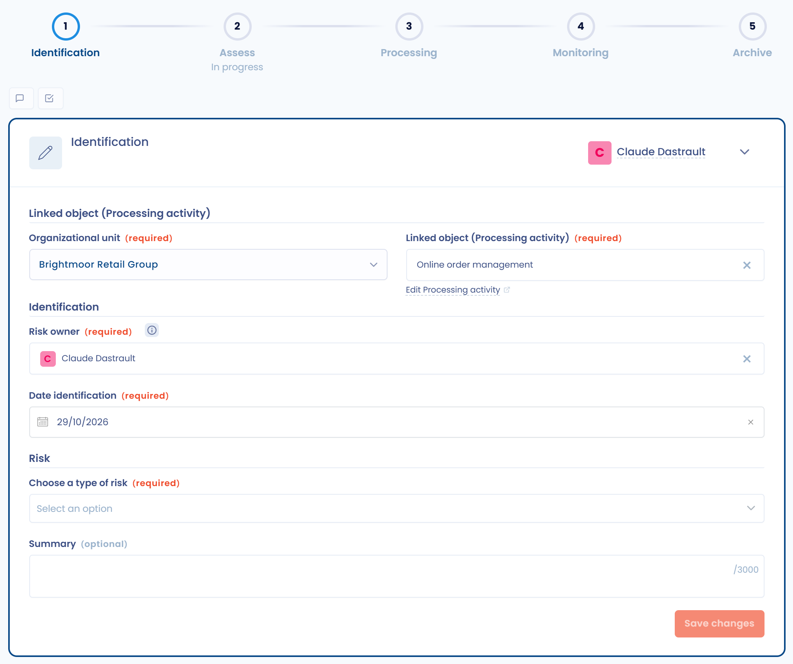
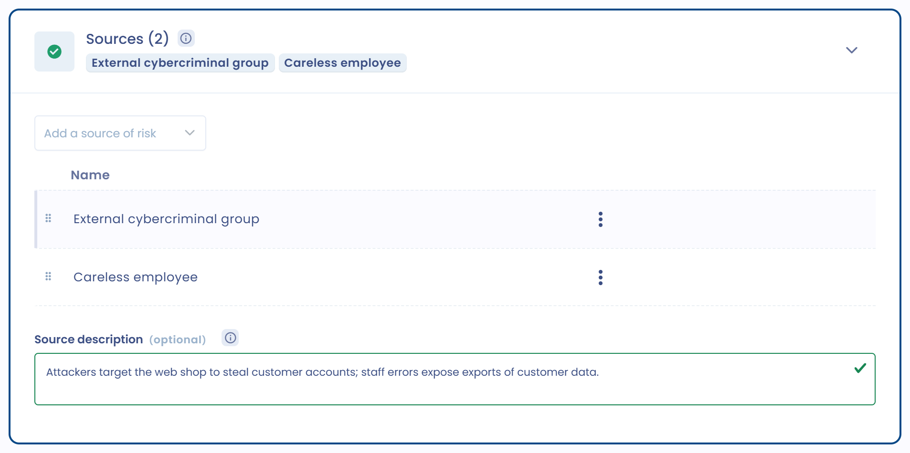
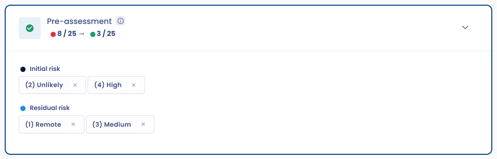

# 1. Identifizieren

Um ein Risiko zu erstellen, öffnen Sie **Risikomanagement** > **Risiken**, wählen Sie den Tab des betroffenen Objekttyps und klicken Sie auf **Ein Risiko erstellen**. Sie können es auch auf der Seite einer Verarbeitungstätigkeit erstellen (siehe [Ein Risiko einer Verarbeitungstätigkeit zuordnen](../attach-to-processing.md)). Der Abschnitt **Identifizierung** öffnet sich.

<figure><figcaption>
Der Abschnitt Identifizierung eines Risikos
</figcaption></figure>

Füllen Sie die Angaben zur Identifizierung aus:

* die Organisationseinheit: standardmäßig die der Verarbeitungstätigkeit, wenn das Risiko einer solchen zugeordnet ist;
* das betroffene Objekt, zum Beispiel die Verarbeitungstätigkeit;
* der Inhaber des Risikos, der für die Überwachung und Steuerung des Risikos verantwortlich ist;
* das Identifizierungsdatum;
* der Risikotyp, ausgewählt aus dem Verzeichnis;
* eine Zusammenfassung des Risikos, die für dieses Objekt spezifisch ist.


Mit Dastra bauen Sie ein Verzeichnis von Risikotypen auf. Das Verzeichnis spart Zeit und ermöglicht es, einen Risikotyp für andere Objekte wiederzuverwenden.


Wenn Ihr Risikotyp nicht im Verzeichnis enthalten ist, fügen Sie ihn von dieser Seite aus mit **Risikotyp erstellen** hinzu.

## Einen Risikotyp hinzufügen 

Sie können Risikotypen auch unter **Risikomanagement** > **Risikotypen** verwalten, mit der Schaltfläche **Risikotyp erstellen**.

Sie verwenden einen Risikotyp wieder, um dasselbe Risiko auf beliebig vielen Objekten zu erzeugen. Zum Beispiel möchten Sie dasselbe Risiko für mehrere Ihrer Auftragsverarbeiter identifizieren: Erfassen Sie den Risikotyp einmal und verwenden Sie ihn dann für jeden Auftragsverarbeiter oder Dienstleister wieder.

Geben Sie ihm im Abschnitt **Identifizierung** des Risikotyps einen Namen und eine interne Referenz. Tags sind optional.

<figure><figcaption>
Ein Risikotyp: Name, Referenz und befürchtetes Ereignis
</figcaption></figure>

Ein Risiko ist die Kombination aus einem befürchteten Ereignis und einer oder mehreren Bedrohungen, die es verursachen könnten. Es wird anhand der Wahrscheinlichkeit (Eintrittswahrscheinlichkeit) und der Schwere (Auswirkung) gemessen.

### Befürchtetes Ereignis

Um einen Risikotyp hinzuzufügen, identifizieren Sie das befürchtete Ereignis und seine Auswirkungen. Das befürchtete Ereignis ist die Folge des Eintretens eines Risikos.

Klassischerweise werden für die Informationssicherheit und den Datenschutz drei Arten von befürchteten Ereignissen genannt. Die DSGVO verpflichtet Sie, die [Sicherheit](https://eur-lex.europa.eu/legal-content/DE/TXT/?uri=CELEX%3A32016R0679#d1e3428-1-1) personenbezogener Daten entlang dieser drei Achsen zu gewährleisten (Artikel 32):

* Beeinträchtigung der **Vertraulichkeit**
* Beeinträchtigung der **Verfügbarkeit**
* Beeinträchtigung der **Integrität**

Mit **Ein Ereignis erstellen** können Sie eigene Kategorien befürchteter Ereignisse anlegen, zum Beispiel einen Industrieunfall oder einen Korruptionsakt. Die Anzahl der befürchteten Ereignisse ist nicht begrenzt. Das Modul konzentriert sich zunächst auf Risiken für Informationssysteme.

Geben Sie für jedes befürchtete Ereignis im Feld **Beschreibung des befürchteten Ereignisses** die Auswirkungen an, die es verursacht.

Die Auswirkungen variieren je nach Kontext und Objekt, für das das Risiko behandelt wird. Bei Risiken im Zusammenhang mit personenbezogenen Daten bestehen die Auswirkungen in Schäden für die Personen: Identitätsdiebstahl, falsche Anschuldigung, Verlust des Personenstands und so weiter.

### Bedrohungen

Identifizieren Sie für jedes befürchtete Ereignis die Bedrohung oder Bedrohungen, die sein Eintreten ermöglichen. Stellen Sie sich ein Szenario vor: Nutzen Sie vergangene Ereignisse oder Ihre Vorstellungskraft, um vorherzusehen, was passieren könnte.

Wählen Sie im Abschnitt **Bedrohungen** mit **Eine Bedrohung hinzufügen** eine vorhandene Bedrohung aus oder erstellen Sie eine. Das Feld **Beschreibung der Bedrohung** beschreibt das Szenario.

<figure><figcaption>
Der Abschnitt Bedrohungen eines Risikotyps
</figcaption></figure>

Dastra bietet Vorlagen für generische Bedrohungen. Um sie zu importieren, öffnen Sie **Risikomanagement** > **Bedrohungen**, öffnen das Menü der Schaltfläche **Eine Bedrohung erstellen** und klicken auf **Erstellen Sie auf der Grundlage von Vorlagen**.

### Quellen

Risikoquellen sind die Elemente, die das Eintreten des befürchteten Ereignisses ermöglichen: Wer oder was könnte seinen Ursprung sein?

Berücksichtigen Sie menschliche Quellen, zum Beispiel einen IT-Administrator, einen Cyberangreifer oder einen fremden Staat, und nicht menschliche Quellen, zum Beispiel Wasser, ein Erdbeben oder einen nicht gezielten Computervirus.

Wählen Sie im Abschnitt **Quellen** die Quellen aus oder erstellen Sie sie, und beschreiben Sie sie dann in **Beschreibung der Quelle**.

<figure><figcaption>
Der Abschnitt Quellen eines Risikotyps
</figcaption></figure>

### Kontrollpunkte

Bestimmen Sie für jeden Risikotyp die bestehenden oder geplanten Maßnahmen, die dem Risiko begegnen. Diese Kontrollpunkte können verschiedener Art sein: Sicherheitsmaßnahmen, technische, organisatorische, rechtliche oder funktionale Maßnahmen.

Wählen Sie im Abschnitt **Kontrollpunkte** vorhandene Kontrollpunkte mit **Bitte wählen Sie die Kontrollpunkte aus.** aus oder erstellen Sie neue mit **Erstellen Sie einen Kontrollpunkt**. Jeder Kontrollpunkt legt fest:

* seinen Einfluss: die Auswirkung (Minderung) oder die Wahrscheinlichkeit (Prävention) des Risikos verringern;
* seine möglichen Antworten und deren Punktzahl, von 0 bis 100 Punkten. Standardmäßig bietet ein neuer Kontrollpunkt die Antworten **Ja** (1 Punkt), **Nein** (0 Punkte) und **Nicht zutreffend**;
* seinen Verantwortlichen, seine Priorität (1 ist die höchste, 10 die niedrigste) und bei Bedarf eine wiederkehrende Bewertung mit der Anzahl der Tage zwischen zwei Kontrollen.

<figure><figcaption>
Der Abschnitt Kontrollpunkte eines Risikotyps
</figcaption></figure>

Für Risiken der Informationssicherheit legt ISO 27001 Standard-Kontrollpunkte fest. Auch der Leitfaden der CNIL zur Sicherheit personenbezogener Daten schlägt mehrere vor.

### Vorabbewertung

In einen Risikotyp können Sie eine Bewertung aufnehmen. Sie wird in jedes Risiko übernommen, das aus diesem Typ erstellt wird, was Zeit spart. Sie ist optional.

Die Bewertung erfolgt anhand von Wahrscheinlichkeit und Schwere, entsprechend der von Ihnen festgelegten Skala (siehe [Bewerten](assess.md)).

Sie können das anfängliche Risiko festlegen: das theoretische Risiko, das mit der Tätigkeit verbunden ist, vor jeder Kontrollmaßnahme (interne Kontrolle).

Sie können auch das Restrisiko festlegen: das Risiko, das nach der Umsetzung von Kontrollmaßnahmen, insbesondere von Kontrollpunkten, verbleibt. Es darf das anfängliche Risiko nicht überschreiten.

<figure><figcaption>
Die Vorabbewertung des anfänglichen und des Restrisikos
</figcaption></figure>
