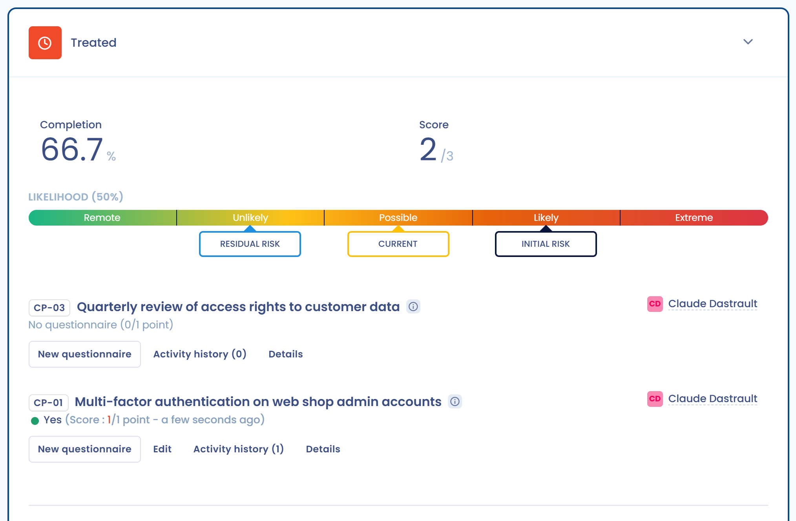

# 4. Kontrollieren

Sobald das Risiko behandelt ist, stellen Sie sicher, dass es im Zeitverlauf verfolgt wird, und erkennen Sie jede Veränderung. Auf der Seite des Risikos heißt der Schritt **Überwachung** **Kontrollen**, wenn der Antworttyp **Reduzierung und Kontrollen** ist; bei einer anderen Option trägt er den Namen dieser Option.

## Die Kontrollpunkte verfolgen

Bei der Option **Reduzierung und Kontrollen** zeigt der Abschnitt zwei Kennzahlen: die **Abhilfemaßnahmen** in Prozent und die **Bewertung** in Punkten von der Höchstpunktzahl. Die Kontrollpunkte sind nach Einfluss gruppiert: diejenigen, die die Schwere verringern, und diejenigen, die die Wahrscheinlichkeit verringern, jeweils mit ihrem Prozentsatz.

<figure><figcaption>
Die Kontrollpunkte eines Risikos und seine Behebung
</figcaption></figure>

1. Klicken Sie auf **Kontrollpunkte zuweisen**, um die Kontrollpunkte des Risikotyps auszuwählen.
2. Klicken Sie beim betreffenden Kontrollpunkt auf **Neues Audit**.
3. Wählen Sie die Antwort, geben Sie das **Datum der Umsetzung** ein und fügen Sie bei Bedarf eine Beschreibung und Dateien unter **Dateien zum Nachweis der Umsetzung** hinzu.
4. Klicken Sie auf **Antwort einreichen**.

Jede Antwort wird aufbewahrt: Die Schaltfläche **Audit-Verlauf** des Kontrollpunkts listet sie auf, und die jüngste ist die aktuelle Antwort. Wird der Kontrollpunkt wiederkehrend bewertet, benachrichtigt Dastra Sie, sobald die gewählte Anzahl von Tagen verstrichen ist.

## Auswirkung auf das aktuelle Risiko

Nach jeder neuen Antwort berechnet Dastra die Behebungsrate und dann das aktuelle Risiko neu: {Aktuelles Risiko} = {Anfängliches Risiko} - ({Anfängliches Risiko} - {Restrisiko}) \* {Behebungsrate}. Je näher die Behebung an 100 % liegt, desto näher liegt das aktuelle Risiko am Restrisiko. Die Berechnung ist im [Glossar](../glossary.md) beschrieben.

## Veränderungen im Zeitverlauf verfolgen

Der **Überblick** des Moduls und das Dashboard des Mandanten verfolgen die Entwicklung der Risiken: durchschnittliches anfängliches, aktuelles und Restrisiko, durchschnittliche Behebung, Anzahl der Risiken pro Schritt. Die Heatmap zeigt das anfängliche, das Rest- oder das aktuelle Risiko. Die **Statistiken** schlüsseln die minimalen, durchschnittlichen und maximalen Werte pro Objekt auf.

<figure><figcaption>
Das Risiko-Dashboard verfolgt die Entwicklung im Zeitverlauf
</figcaption></figure>

## Ein Risiko archivieren

Wenn ein Risiko verschwunden ist, klicken Sie auf **Archivieren**. Das Risiko wechselt zum Schritt **Archivierung**: Sie können es weiterhin lesen, aber nicht mehr bearbeiten. Um es wieder unter Überwachung zu stellen, klicken Sie im Archivabschnitt auf **Abbrechen**. Nur der Inhaber des Risikos kann ein Risiko archivieren oder seine Archivierung rückgängig machen.
