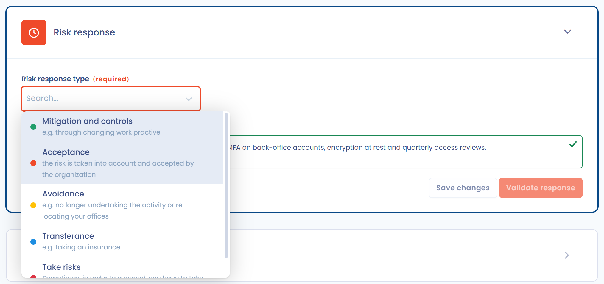

# 3. Steuern

Der Schritt der Behandlung ist die Antwort auf das identifizierte und bewertete Risiko. Auf der Seite des Risikos ist es der Abschnitt **Risikobewältigung**.

Wählen Sie eine Option im Feld **Optionen zur Verarbeitung des Risikos**:

* **Reduzierung und Kontrollen**: Es müssen Maßnahmen umgesetzt werden, um das Risiko zu verringern;
* **Akzeptanz**: Die Organisation akzeptiert das Bruttorisiko, wie es ist, ohne Minderungsmaßnahmen;
* **Vermeidung**: Das Risiko verhindert die Durchführung der betreffenden Tätigkeit;
* **Risikoübertragung**: Das Risiko, das auf der Organisation lastet, wird auf eine andere Organisation übertragen, zum Beispiel über eine Versicherung;
* **Das Risiko eingehen**: Das Risiko sollte Gegenstand von Minderungsmaßnahmen sein, aber die Organisation ist damit einverstanden, diese nicht umzusetzen.

<figure><figcaption>
Der Abschnitt Risikobewältigung
</figcaption></figure>

Erläutern Sie Ihre Wahl unter **Begründung der Antwort** und klicken Sie dann auf **Bitte bestätigen Sie Ihre Antwort**, um zum Schritt **Überwachung** zu wechseln. Diese Entscheidung liegt beim Inhaber des Risikos: Nur der Inhaber kann die Antwort bestätigen.


Nur die Option **Reduzierung und Kontrollen** stützt sich auf Kontrollpunkte und auf die Behebungsrate, die das aktuelle Risiko verändern. Für die anderen Optionen berechnet Dastra keine Behebungsrate.

