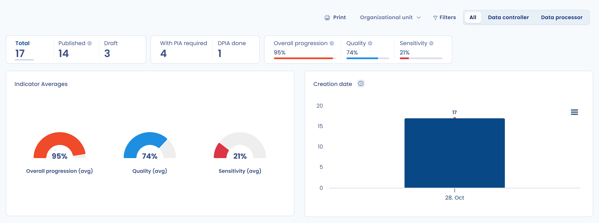

# Verarbeitungsverzeichnis

## Einführung

Mit dem Verarbeitungsverzeichnis kartieren Sie Ihre **Datenverarbeitungen** und behalten einen **Gesamtüberblick** darüber, was Sie mit den betreffenden personenbezogenen Daten tun. Ein vollständiges Verzeichnis zu führen ist eine **Pflicht** gemäß [Artikel 30 der DSGVO](https://dsgvo-gesetz.de/art-30-dsgvo/). Über die rechtliche Pflicht hinaus ist es vor allem **ein Instrument, um Ihre Daten besser zu verstehen** und **die damit verbundene Wertschöpfungskette zu beherrschen**, von der Erzeugung der Daten bis zu ihrer Nutzung.

Dastra stellt Ihnen ein Verzeichnis und **Fragebögen** zur Verfügung, die Sie Schritt für Schritt bei der Kartierung Ihrer Verarbeitungstätigkeiten führen.

## Das Dastra-Verzeichnis in Kürze

Das Verarbeitungsverzeichnis von Dastra erfüllt alle regulatorischen Anforderungen. Beide Verzeichnisse, das des Verantwortlichen und das des Auftragsverarbeiters, beruhen auf Referenzdaten (Stakeholder, Assets, Datenkategorien, Daten, Risiken und Sicherheitsmaßnahmen), mit denen Sie **Ihre Verarbeitungstätigkeiten kartieren** und im Tagesgeschäft **Zeit sparen**.

Verarbeitungstätigkeiten lassen sich kopieren, und Vorlagen stehen in einer Bibliothek bereit, die allen Nutzern frei zugänglich ist. Ein Workflow ist integriert, eine Suchfunktion ist von Haus aus vorhanden, und Sie können Verarbeitungstätigkeiten in verschiedenen Formaten exportieren (PDF, Word, HTML, Excel, CSV, JSON, Markdown) und aus CSV-, Excel- oder JSON-Dateien importieren. Außerdem können Sie Ihren Verarbeitungstätigkeiten Dokumente, Datenschutzvorfälle oder Risiken zuordnen.

<figure><figcaption>
Das Verarbeitungsverzeichnis: oben die Kennzahlenkacheln, darunter die Liste der Verarbeitungstätigkeiten
</figcaption></figure>

## Verzeichnis „Verantwortlicher“ und Verzeichnis „Auftragsverarbeiter“

Artikel 30 der DSGVO legt besondere Pflichten für das _Verzeichnis des Verantwortlichen_ und das _Verzeichnis des Auftragsverarbeiters_ fest. Wenn Ihre Organisation sowohl als Auftragsverarbeiter als auch als Verantwortlicher tätig ist, muss Ihr Verzeichnis die beiden Kategorien von Tätigkeiten daher klar unterscheiden.

**In der Praxis empfiehlt die französische Aufsichtsbehörde CNIL in diesem Fall, zwei Verzeichnisse zu führen:**

1. eines für die Verarbeitungen personenbezogener Daten, für die Sie selbst verantwortlich sind,
2. ein weiteres für die Verarbeitungen, die Sie als Auftragsverarbeiter im Auftrag Ihrer Kunden durchführen.


[Verzeichnis „Verantwortlicher“](controller.md)



[Verzeichnis „Auftragsverarbeiter“](processor.md)


## Die Methoden zur Einrichtung des Verarbeitungsverzeichnisses

Es gibt zwei Methoden, ein Verzeichnis aufzubauen:

* **Top-down**: Sie beginnen das Projekt mit der Bestandsaufnahme der Datenverarbeitungen und erfassen dann die Informationen zu jeder einzelnen Verarbeitungstätigkeit (Daten, Auftragsverarbeiter usw.).
* **Bottom-up**: Sie beginnen mit der Bestandsaufnahme der Daten (Software, Datenkategorien und Felder mit personenbezogenen Daten) und leiten daraus die Verarbeitungstätigkeiten ab.

### Die Wahl der Methode

Es gibt keine richtige oder falsche Methode: Alles hängt vom Kontext Ihrer Organisation ab, von den Kompetenzen des DSB-Teams und davon, wie gut Sie die Personen erreichen, die mit den Daten arbeiten.

Die folgende Tabelle vergleicht beide Ansätze:

<table><thead><tr><th width="129">Methode</th><th width="178">Zielgruppe</th><th>Vorteile</th><th>Nachteile</th></tr></thead><tbody><tr><td><strong>Top-down</strong></td><td>Kleine Organisationen oder Gebietskörperschaften Unternehmen mit geringer Datenkultur Rechtsteam mit geringer IT-Affinität</td><td>Schnell einzurichten Weniger Arbeit Entspricht gut den rechtlichen Anforderungen der DSGVO</td><td>Kann schwierig werden, wenn das Team, das das Verzeichnis aufbaut, die Daten der Organisation nicht kennt Anspruchsvoller für die Fachbereiche Die Dateninventur ist deutlich weniger wertvoll, weil sie nur für rechtliche Zwecke modelliert ist Langfristig aufwendiger zu pflegen</td></tr><tr><td><strong>Bottom-up</strong></td><td>Große oder mittlere Organisationen Mit ausgeprägter Datenkultur Rechtsteam mit ausgeprägter IT-Affinität</td><td>Eine Bestandsaufnahme der Daten ist weniger abstrakt, als Verarbeitungstätigkeiten direkt anzulegen Das Verzeichnis spiegelt die Realität der Organisation wider Das Verzeichnis ist langfristig leichter zu pflegen Mehr Mitglieder der Organisation sind eingebunden Das Anlegen von Verarbeitungstätigkeiten ist stärker automatisiert</td><td>Insgesamt schwieriger und zeitaufwendiger einzuführen Das Projekt erfordert eine gute Governance</td></tr></tbody></table>

Dastra unterstützt beide Ansätze. Für den Top-down-Ansatz legen Sie Verarbeitungstätigkeiten [aus Vorlagen](templates.md) an. Bevorzugen Sie den Bottom-up-Ansatz, können Sie zuerst [Ihre Datenkartierung aufbauen](../mapping/README.md) und dann direkt aus einem Asset (Software, Datenbank) eine Verarbeitungstätigkeit anlegen.

## Das Verzeichnis einrichten

Wenn Sie wissen möchten, wie Sie Ihr Verarbeitungsverzeichnis entwerfen und verwalten, beginnen Sie hier:


[Ihr Verzeichnis erstellen](establish.md)


Wenn Sie wissen möchten, wie Sie eine Ihrer Verarbeitungstätigkeiten entwerfen und verwalten, beginnen Sie hier:


[Eine Verarbeitung anlegen](declare.md)


Wenn Sie die einzelnen Schritte des Fragebogens verstehen möchten, lesen Sie hier weiter:


[Eine Verarbeitung ausfüllen](activity/README.md)


Wenn Sie wissen möchten, wie Sie das Verzeichnis teilen, lesen Sie hier weiter:


[Das Verzeichnis teilen](share.md)


## Aktionen auf mehrere Verarbeitungstätigkeiten gleichzeitig anwenden

Aktivieren Sie in der Ansicht **Tabelle** die Kontrollkästchen links neben den Verarbeitungstätigkeiten, die Sie bearbeiten möchten. Über der Liste erscheint dann die Schaltfläche **Bitte wählen Sie eine Sammelaktion aus**. Je nach Ihren Berechtigungen und den in Ihrem Mandanten aktivierten Funktionen bietet sie folgende Aktionen an:

* **Prozessschritt umschalten**
* **Exportieren**
* **Stakeholder vernetzen**: Stakeholder oder Empfänger bei allen ausgewählten Verarbeitungstätigkeiten hinzufügen oder entfernen
* **Felder bearbeiten**: den Wert eines oder mehrerer Felder bei allen ausgewählten Verarbeitungstätigkeiten ändern
* **Zusammenführen**: siehe [Elemente zusammenführen](../general/merge.md)
* **Fragebögen versenden**
* **Überprüfung**
* **Teilen**
* **In den Papierkorb verschieben**

## Das Verzeichnis mit den Statistiken verfolgen

Klicken Sie im linken Menü auf **Verarbeitungsverzeichnis** und dann auf **Statistiken**, um die Kennzahlen Ihres Verzeichnisses anzuzeigen.

<figure><figcaption>
Die Seite Statistiken des Verzeichnisses
</figcaption></figure>

Die Seite zeigt:

* Kennzahlen zur Anzahl der Verarbeitungstätigkeiten und zu den Indikatoren **Fortschritt**, **Qualität** und **Sensibilität**;
* die **Durchschnittlichen Indikatoren** und die **Verteilung der Indikatoren**;
* die Anzahl der Verarbeitungstätigkeiten pro Schritt des Workflows (**Schritte**), pro **Rechtliche Grundlagen**, pro Kategorie betroffener Personen (**Personengruppen**), pro Auftragsverarbeiter und pro Organisationseinheit;
* den Anteil der Verarbeitungstätigkeiten mit Datenübermittlungen, die vom Widget **Datenübertragungen** angezeigten Länder und den Status der **DSFA**;
* die Entwicklung der Anzahl der Verarbeitungstätigkeiten (**Neue Verarbeitungen**) und die **Aktivitäten**.

Mit der Auswahl der Organisationseinheit, den Filtern und den Schaltflächen **Alle**, **Verantwortlicher** und **Auftragsverarbeiter** grenzen Sie die Statistiken ein. Klicken Sie auf **Drucken**, um die Seite zu drucken.

## Folgenabschätzungen und Privacy-by-Design-Anfragen

Zwei weitere Einträge des Menüs **Verarbeitungsverzeichnis** geben Zugriff auf die Fragebögen, die mit Ihren Verarbeitungstätigkeiten verknüpft sind. Sie werden angezeigt, wenn Sie Zugriff auf Fragebögen haben.

* **Assessments** listet die Fragebögen [DSFA / PIA](../questionnaires/types/dpia.md), [Interessenabwägung (LIA)](../questionnaires/types/lia.md) und [Transferfolgenabschätzung (TIA)](../questionnaires/types/tia.md) des Mandanten auf. Klicken Sie auf **Fragebogen planen**, um einen zu erstellen.
* **Privacy by Design** listet die Fragebögen für Anfragen zur Erstellung einer Verarbeitung auf. Sie [erfassen Projekte für Verarbeitungstätigkeiten](../trust-center/creation-questionnaires.md) über ein Trust Center: Sobald eine Antwort validiert ist, können ihre Daten zu einer Verarbeitungstätigkeit werden.

## Weiterführende Informationen


[Verarbeitungsverzeichnis](../../gdpr/concepts/ropa.md)



[Ein Risiko einer Verarbeitung zuordnen](../risks/attach-to-processing.md)



[Planung](../tasks/README.md)

