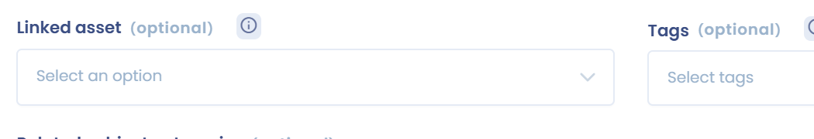
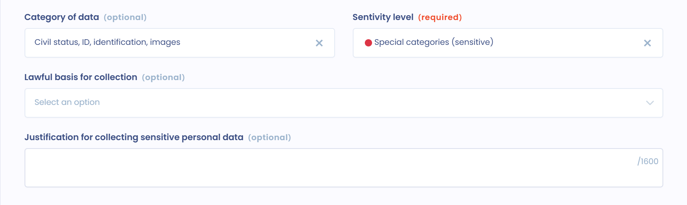
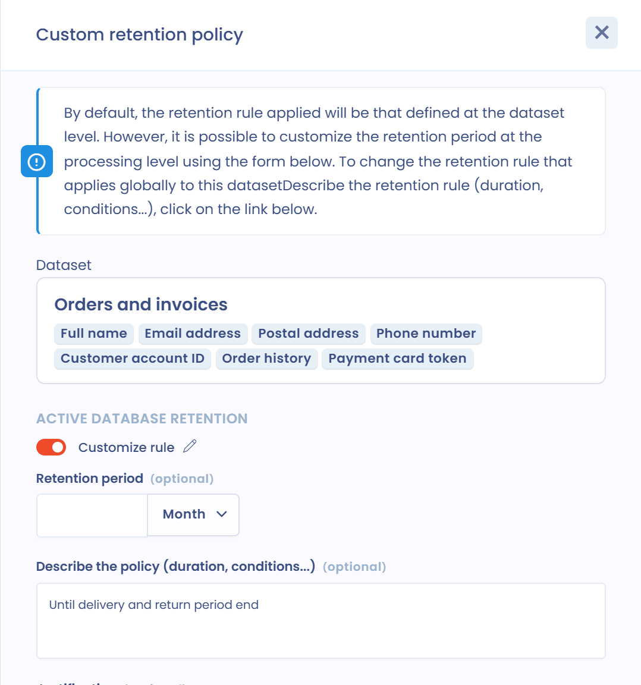

# Daten und Speicherdauer

[**Artikel 30 der DSGVO**](https://dsgvo-gesetz.de/art-30-dsgvo/) verlangt außerdem, dass das Verzeichnis die Kategorien der verarbeiteten Daten aufführt.

In diesem Abschnitt legen Sie die Kategorien der verarbeiteten Daten fest. Sie können gewöhnlich oder sensibel sein. Manche Daten bergen ein höheres Risiko für natürliche Personen, etwa Gesundheitsdaten, politische Meinungen oder die Gewerkschaftszugehörigkeit. Auch Daten über Straftaten oder Verurteilungen sind besonders geschützt.

Ebenso kann die nationale Kennnummer (etwa die Sozialversicherungsnummer) als sensible Information gelten.

Die Erhebung sensibler Daten ist grundsätzlich verboten. Nur die in [**Artikel 9 der DSGVO**](https://dsgvo-gesetz.de/art-9-dsgvo/) vorgesehenen Ausnahmen erlauben sie.

## Datenkategorien

Eine Datenkategorie (in der Anwendung „Datensatz“) fasst die Daten eines bestimmten Elements zusammen, zum Beispiel einer Tabelle in einer Datenbank oder eines Erhebungsformulars auf Papier.

### Mehrere Arten, Datenkategorien zu nutzen

Datenkategorien lassen sich auf mehrere Arten nutzen:

* **Fall 1**: indem Sie **eine Datenkategorie mit genau einem Asset** verknüpfen. Die Datenkategorie entspricht dann den Daten des Assets und ist nicht generisch.
* **Fall 2**: indem Sie **eine Datenkategorie mit der Verarbeitungstätigkeit** verknüpfen. Diese Datenkategorie kann für die Verarbeitungstätigkeit spezifisch sein und wird in keiner anderen Verarbeitungstätigkeit wiederverwendet.
* **Fall 3**: indem Sie **generische Datenkategorien mit der Verarbeitungstätigkeit** verknüpfen. Die Datenkategorie kann dann in mehreren Verarbeitungstätigkeiten wiederverwendet werden.

Für generische Datenkategorien empfehlen wir folgendes Vorgehen:

* Öffnen Sie den Abschnitt **Daten** der Verarbeitungstätigkeit.
* Öffnen Sie die Seite der Datenkategorien der Datenkartierung in einem neuen Tab.
* Wählen Sie die Datenkategorie in der Verarbeitungstätigkeit aus.
* Wenn die Datenkategorie angepasst werden muss, erstellen Sie eine weitere: Wechseln Sie in den anderen Tab und duplizieren Sie die generische Datenkategorie, wobei Sie die gewünschten Felder entfernen oder hinzufügen.
* Zur besseren Übersicht empfehlen wir, diese Datenkategorien mit Tags zu versehen, damit Sie sie in der Auswahl unterscheiden können. Zum Beispiel mit einem Tag „generisch“ und einem Tag für die hinzugefügten oder entfernten Daten.


Eine Datenkategorie kann mit mehreren Verarbeitungstätigkeiten verknüpft sein. Wenn Sie eine Datenkategorie bearbeiten, die in mehreren Verarbeitungstätigkeiten verwendet wird, warnt Dastra Sie, dass sich Ihre Änderungen auf alle auswirken. Unterscheiden sich die Datenfelder für eine Verarbeitungstätigkeit deutlich, erstellen Sie eine Kopie der Datenkategorie und passen Sie die Kopie an.


#### Datenkategorien ohne Felder verwenden

Sie können auch noch allgemeiner bleiben, indem Sie die Datenfelder der Datenkategorie nicht angeben und die Datenkategorie nach einer Art von Daten benennen (was nach der DSGVO ebenfalls zulässig ist).

Je nach Verarbeitungstätigkeit können Sie unterschiedlich vorgehen, abhängig davon, wie sensibel sie im Hinblick auf die Rechte und Freiheiten der betroffenen Personen ist.

### Datenkategorien zur Verarbeitungstätigkeit hinzufügen

Im Abschnitt **Daten** haben Sie zwei Möglichkeiten:

* Sind Ihre Datenkategorien bereits in Ihrer Datenkartierung dokumentiert, klicken Sie auf **Verknüpfen Sie vorhandene Datensätze.** und wählen Sie die Datenkategorien aus, die Sie mit der Verarbeitungstätigkeit verknüpfen möchten.
* Andernfalls klicken Sie auf **Einen Datensatz hinzufügen**. Der Assistent öffnet sich (**Assistent zur Erstellung von Datensätzen**). Erstellen Sie die Datenkategorie mit dem KI-Assistenten (**Erstellen mit KI-Assistent**), aus einer bestehenden Datenkategorie (**Verwenden Sie eine Vorlage**), durch Auswahl ihrer Datenfelder (**Bitte folgen Sie den Anweisungen Schritt für Schritt.**) oder von Grund auf (**Von Grund auf neu erstellen**).

Jede Datenkategorie der Verarbeitungstätigkeit zeigt ihre Regeln zur Speicherdauer und die Zwecke, denen sie dient. Aktivieren Sie **Felder anzeigen**, um zusätzlich die Datenfelder jeder Datenkategorie anzuzeigen. Standardmäßig ist eine Datenkategorie mit allen Zwecken der Verarbeitungstätigkeit verknüpft: Im Menü **...** der Datenkategorie können Sie einen oder mehrere bestimmte Zwecke auswählen. Über dasselbe Menü können Sie die Datenkategorie mit **Bearbeiten** ändern, mit **Duplizieren** kopieren, ihre **Details** ansehen oder mit **Bitte entfernen Sie den Link.** die Verbindung zur Verarbeitungstätigkeit entfernen.

Klicken Sie auf eine Datenkategorie, um sie zu öffnen und die unten beschriebenen Informationen zu vervollständigen.

### Die Herkunft der Daten mit der Datenkategorie verknüpfen

In jeder Datenkategorie können Sie unter **Herkunft der Datenerhebung** die Herkunft der Daten angeben: **Direkt**, **Indirekt** oder **Direkt und indirekt**.

Im Feld **Beschreibung der Herkunft der Datenerhebung** können Sie alle nötigen Einzelheiten ergänzen.

<figure><figcaption>
Herkunft der Daten
</figcaption></figure>

### Ein Asset mit der Datenkategorie verknüpfen

Datenkategorien sind naturgemäß dafür gedacht, mit [Assets](assets.md) verknüpft zu werden.

Ein Asset verknüpfen Sie im Feld **Verbundener Asset** im Block **Allgemeine Informationen** der Datenkategorie mit Ihrer Datenkategorie.

<figure><figcaption>
Auswahl des Assets
</figcaption></figure>

Eine Datenkategorie kann nur mit einem Asset verknüpft werden: Die Datenkategorien eines Assets sind ihm eigen.

Betrachten Sie zum Beispiel eine Buchhaltungssoftware als Asset, dann könnten mehrere Datenkategorien damit verknüpft sein, etwa „Rechnungsdaten“ mit den Daten des Moduls zur Rechnungsverfolgung oder „Kundendaten“ mit den Daten der Kundenkonten.

### Kategorien betroffener Personen zuordnen

Für jede Datenkategorie können Sie unter **Kategorien betroffener Personen** eine oder mehrere Kategorien betroffener Personen verknüpfen.

So erkennen Sie, welche Daten sich auf welche betroffenen Personen beziehen. Das vereinfacht auch Ihre Arbeit an der Datenkartierung.

<figure><figcaption>
Auswahl der Kategorien betroffener Personen
</figcaption></figure>


Die Angabe der betroffenen Personen ist bei der Bearbeitung von [Betroffenenanfragen](../../requests/README.md) nützlich: Sie erkennen schnell die betroffenen Datenkategorien und finden die Daten, die die Anfrage abdeckt.


### Datenfelder zuordnen

Jede Datenkategorie soll mit Datenfeldern vervollständigt werden. Diese Felder sind die Daten selbst.

Klicken Sie im Block **Felder für personenbezogene Daten** auf **Daten anhängen**. Die in der Auswahl angebotenen Felder sind die, die in Ihrem Datenglossar verfügbar sind.

<figure><figcaption>
Auswahl der Datenfelder
</figcaption></figure>

Wenn ein Feld noch nicht existiert, klicken Sie auf **Daten erstellen**, um es anzulegen und der Datenkategorie hinzuzufügen.

Felder können vordefinierten Datenkategorien zugeordnet werden, etwa **Personenstand, Identität, Identifikationsdaten, Bilder...**, **Persönliches Leben**, **Berufliches Leben** oder **Wirtschaftliche und finanzielle Informationen**. Diese Kategorien folgen den Empfehlungen der französischen Aufsichtsbehörde (CNIL).

<figure><figcaption>
Auswahl der Datenkategorie
</figcaption></figure>

Im Datenfeld geben Sie auch die Sensibilitätsstufe der Daten an: **Standard**, **Hochsensible Daten** oder **Sensible Daten** (besondere Kategorien), zum Beispiel Gesundheitsdaten.

Für besondere Kategorien von Daten müssen Sie die Erhebung dieser Daten begründen, insbesondere ihre Rechtsgrundlage, und zwar unter **Rechtsgrundlage für die Datenerhebung** und **Begründung für die Datenerhebung sensibler Daten**.

<figure><figcaption>
Sensible Daten
</figcaption></figure>


Sensible Daten werden im Indikator **Sensibilität** der Verarbeitungstätigkeit berücksichtigt. Datenkategorien, die solche Daten enthalten, sind im Abschnitt **Daten** mit einem Badge für besondere Kategorien personenbezogener Daten (sensibel) gekennzeichnet.


### Eine Regel zur Speicherdauer mit der Datenkategorie verknüpfen

In jeder Datenkategorie können Sie im Block **Speicherdauer** Standardregeln zur Speicherdauer festlegen.

<figure><figcaption>
Speicherdauern
</figcaption></figure>

Diese Speicherdauern sind Standardwerte: Sie können auf der Ebene jeder Verarbeitungstätigkeit angepasst werden (siehe unten).

Sie können eine Speicherdauer in der aktiven Datenbank, eine Speicherdauer in der archivierten Datenbank und eine Regel zur Löschung festlegen:

* **Nutzung**: Die aktive Datenbank ist die laufend genutzte Datenbank der Verarbeitung.
* **Archivierung**: Die Zwischenarchivierung ist eine eingeschränktere Form der Aufbewahrung.
* **Löschung**: Beschreiben Sie die Bedingungen, unter denen die Daten gelöscht oder zur dauerhaften Archivierung übergeben werden.

Geben Sie für die aktive und die archivierte Datenbank die **Speicherdauer** ein, dann **Bitte beschreiben Sie die Regel (Dauer, Bedingungen usw.).**, und ergänzen Sie eine **Begründung**. Füllen Sie für die Regel zur Löschung die **Beschreibung der für das Endergebnis angewandten Regel** und ihre **Begründung** aus.

## Speicherdauer der Daten

Die begrenzte Speicherung von Daten ist einer der allgemeinen Grundsätze des Schutzes personenbezogener Daten, den [**Artikel 5 Absatz 1 Buchstabe e der DSGVO**](https://dsgvo-gesetz.de/art-5-dsgvo/) in Erinnerung ruft. Personenbezogene Daten müssen

> in einer Form gespeichert werden, die die Identifizierung der betroffenen Personen nur so lange ermöglicht, wie es für die Zwecke, für die sie verarbeitet werden, erforderlich ist.

In der Praxis müssen Sie bei der Einführung einer Verarbeitungstätigkeit planen, was mit den Daten geschieht, sobald der Zweck erreicht ist. Die Daten müssen dann dauerhaft vernichtet, anonymisiert oder für einen neuen, vereinbaren Zweck verarbeitet werden.

Die Speicherdauer hängt vom Zweck der Verarbeitung und von der Art der Daten ab. Speicherdauern können nach Datenarten festgelegt werden. Bei der Gehaltsabrechnung zum Beispiel werden die Daten der Gehaltsabrechnung 1 Monat in der aktiven Datenbank und 5 Jahre in der Zwischenarchivierung aufbewahrt, während die Daten des Überweisungsauftrags für die Zahlung so lange in der aktiven Datenbank bleiben, wie es für die Ausstellung der Gehaltsabrechnung nötig ist, und danach 10 Jahre ab Abschluss in der Zwischenarchivierung.

Die Dauer kann als Wert angegeben werden oder, wenn das nicht möglich ist, als die Kriterien, nach denen die Speicherdauer bestimmt wird (zum Beispiel bis zur Kündigung). Insbesondere die CNIL empfiehlt in ihrer [**Empfehlung vom 11. Oktober 2005 zur elektronischen Archivierung im privaten Sektor**](https://www.legifrance.gouv.fr/affichCnil.do?id=CNILTEXT000017651957) (auf Französisch), Verfahren einzurichten, um die Speicherdauern auf der Ebene der Datenkategorie zu steuern und insbesondere die Löschung oder Vernichtung der Daten zu verwalten.

### Die Regel zur Speicherdauer einer Datenkategorie für eine Verarbeitungstätigkeit anpassen

Die Datenfelder einer generischen Datenkategorie können sich von einer Verarbeitungstätigkeit zur anderen nicht unterscheiden. Die Speicherdauer dagegen schon. Sie können die Speicherdauer einer Datenkategorie für eine bestimmte Verarbeitungstätigkeit anpassen: Die Standard-Speicherdauer der Datenkategorie gilt dann für diese Verarbeitungstätigkeit nicht mehr.

Dazu muss die Datenkategorie der Verarbeitungstätigkeit hinzugefügt sein. Klicken Sie im Abschnitt **Daten** auf eine der Schaltflächen zur Speicherdauer der Datenkategorie: **Nutzung**, **Archivierung** oder **Löschung**. Eine grüne Schaltfläche bedeutet, dass die Regel definiert ist. Eine rote Schaltfläche **Nutzung** bedeutet, dass sie fehlt.

<figure><figcaption>
Schaltflächen zur Speicherdauer einer Datenkategorie, mit einer angepassten Regel
</figcaption></figure>

Der Bereich **Anpassung der Speicherdauern** öffnet sich. Er erinnert Sie an die betroffene Datenkategorie. Aktivieren Sie **Regel anpassen** und geben Sie dann die **Speicherdauer**, **Bitte beschreiben Sie die Regel (Dauer, Bedingungen usw.).** und die **Begründung** ein, die nur für diese Verarbeitungstätigkeit gelten.

<figure><figcaption>
Die Speicherdauer für eine Verarbeitungstätigkeit anpassen
</figcaption></figure>

Wird eine Speicherdauer auf Ebene der Verarbeitungstätigkeit angepasst, erscheint auf der entsprechenden Schaltfläche ein Stiftsymbol.

Um die Regel zur Speicherdauer zu ändern, die in allen Verarbeitungstätigkeiten für die Datenkategorie gilt, klicken Sie oben im Bereich auf die angezeigte Datenkategorie.

Langfristig kann das Ziel sein, die Nutzung generischer Datenkategorien einzuschränken und zu einer genaueren Kartierung überzugehen, entweder über Verarbeitungstätigkeiten (Fall 2) oder über Assets (Fall 1).
