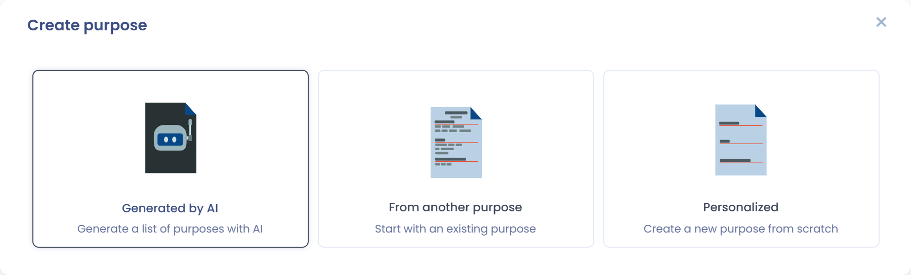
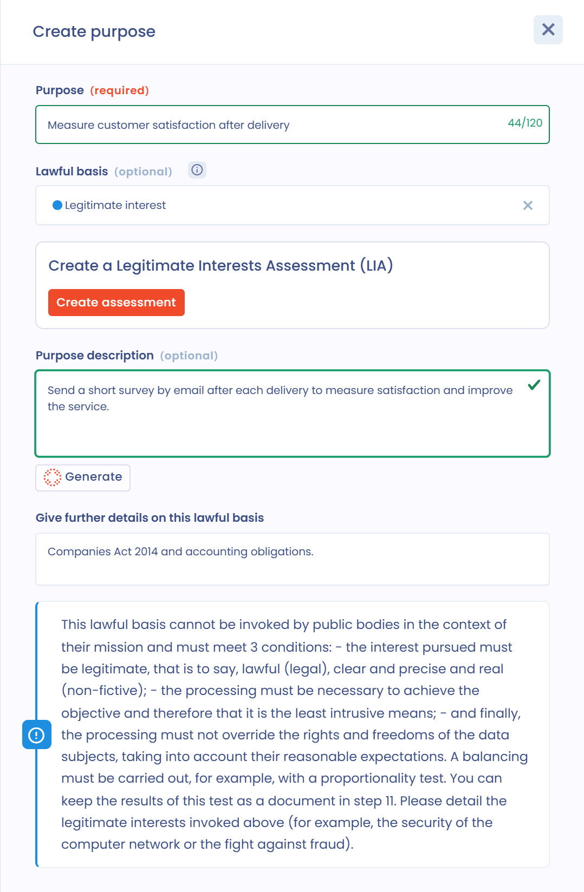

# Zwecke

## Zwecke einer Verarbeitungstätigkeit

Ein **Zweck** ist das Ziel, das mit der Anlage Ihres Eintrags verfolgt wird. Er gibt an, wofür die Verarbeitung personenbezogener Daten dient, ihre Daseinsberechtigung. Dieses Ziel muss klar und verständlich sein.

Die Festlegung des Zwecks ist grundlegend, denn sie ist die Voraussetzung für die anderen Elemente, die die Verarbeitung rahmen: die Speicherdauer, die Angemessenheit, Erheblichkeit und Verhältnismäßigkeit der Daten sowie ihre Richtigkeit und Aktualisierung.

[**Artikel 5 Absatz 1 Buchstabe b der DSGVO**](https://dsgvo-gesetz.de/art-5-dsgvo/) sieht vor, dass der Zweck festgelegt, eindeutig und legitim sein muss.

**Der Zweck muss festgelegt sein**: Der Zweck muss so genau definiert sein, dass die nötigen Datenschutzgarantien angepasst und der Umfang der Datenverarbeitung bestimmt werden können. Das erforderliche Maß an Detail hängt vom Kontext der Datenerhebung und von den betroffenen Daten ab. Manchmal genügt einfache Sprache. Ein lokaler Familienbetrieb braucht für die Beschreibung des Zwecks seiner Kundendatei zum Beispiel nicht dasselbe Maß an Detail wie ein multinationaler Konzern, der mit komplexen Algorithmen personalisierte Angebote und gezielte Werbung erstellt. Der Zweck muss festgelegt sein, bevor die Verarbeitung erfolgt.

**Der Zweck muss eindeutig sein**: Der Zweck darf nicht mehrdeutig sein und muss klar formuliert werden.

**Der Zweck muss legitim sein**: Die Legitimität bezieht sich auf die Rechtsgrundlage, auf der die Datenverarbeitung beruht, wie es [**Artikel 6 der DSGVO**](https://dsgvo-gesetz.de/art-6-dsgvo/) verlangt.

Dieser Begriff verlangt auch, dass der Zweck nicht ganz allgemein gegen das Recht verstößt. Ein Zweck ist zum Beispiel nicht legitim, wenn er zu einer strafrechtlich verbotenen Diskriminierung führt. Insbesondere das Arbeitsrecht, das Verbraucherrecht oder das Vertragsrecht können berücksichtigt werden.

Außerdem muss der Kontext der Verarbeitung berücksichtigt werden, um ihre Legitimität zu beurteilen, insbesondere die vernünftigen Erwartungen der betroffenen Person.

Eine Verarbeitungstätigkeit kann mehrere Zwecke haben. Die Tätigkeit „Recruiting“ könnte zum Beispiel zwei getrennte Zwecke haben: die Analyse der Bewerbungen und die Organisation der Vorstellungsgespräche sowie den Aufbau einer Lebenslaufdatenbank.

Für jeden Zweck müssen Sie die geltende **Rechtsgrundlage** festlegen. Pro Zweck ist nur eine Rechtsgrundlage möglich. Die Wahl dieser Rechtsgrundlage richtet sich nach dem Kontext der Verarbeitung.

## Einen Zweck in Dastra hinzufügen

Zwecke fügen Sie im Abschnitt **Zweck** hinzu, dem dritten Abschnitt der Verarbeitungstätigkeit. Sie können so viele Zwecke hinzufügen, wie Sie brauchen.

1. Klicken Sie im Abschnitt **Zweck** auf **Zweck hinzufügen**. Das Fenster **Zweck hinzufügen** öffnet sich.
2. Wählen Sie, wie Sie den Zweck erstellen:
   * **Mit KI erstellen**: Erstellen Sie mit KI eine Liste von Zwecken. Wählen Sie die Zwecke aus, die Sie behalten möchten, und klicken Sie dann auf **Hinzufügen**.
   * **Ausgehend von einem Zweck**: Beginnen Sie mit einem bestehenden Zweck. Sie können die Zwecke nach **Datenverarbeitung** und nach **Rechtsgrundlage** filtern.
   * **Von Grund auf neu**: Erstellen Sie einen neuen Zweck von Grund auf.

Diese drei Optionen können Sie auch direkt über den Pfeil neben der Schaltfläche **Zweck hinzufügen** öffnen.

<figure><figcaption>
Die drei Wege, einen Zweck zu erstellen
</figcaption></figure>

Wenn Sie einen Zweck von Grund auf erstellen, füllen Sie die folgenden Felder aus und klicken Sie dann auf **Hinzufügen**:

* **Bezeichnung des Zwecks** (Pflichtfeld): der Name des Zwecks, auf 120 Zeichen begrenzt. Dastra schlägt beim Tippen bestehende Zwecke vor.
* **Rechtsgrundlage** (optional): die Rechtsgrundlage dieses Zwecks (siehe unten).
* **Beschreibung des Zwecks** (optional): Beschreiben Sie den Zweck. Die KI-Schaltfläche **Generieren** kann diese Beschreibung für Sie entwerfen.
* **Bitte erläutern Sie die Wahl dieser Rechtsgrundlage.**: wird angezeigt, sobald eine Rechtsgrundlage ausgewählt ist, zum Beispiel um die verfolgten berechtigten Interessen oder die Rechtsvorschrift zu nennen, die die Verarbeitung vorschreibt.

<figure><figcaption>
Einen Zweck von Grund auf erstellen
</figcaption></figure>

Die Zwecke werden in einer Tabelle mit Name, Beschreibung und Rechtsgrundlage aufgelistet. Klicken Sie auf einen Zweck, um ihn zu bearbeiten, oder nutzen Sie das Menü **...**, um ihn mit **Zweck ändern** zu bearbeiten oder mit **Löschen** zu löschen.

## Rechtsgrundlagen

Für eine Datenverarbeitung gibt es 6 mögliche Rechtsgrundlagen. In Dastra bietet die Liste **Rechtsgrundlage** diese 6 Rechtsgrundlagen sowie **Sonstiges**.

### Einwilligung

Die **Einwilligung** muss vier Kriterien erfüllen, damit die Verarbeitung rechtmäßig ist. Sie muss

* freiwillig,
* für den bestimmten Fall,
* in informierter Weise und
* unmissverständlich abgegeben werden.

Sie muss sich ebenso leicht widerrufen wie erteilen lassen. Sie müssen nachweisen können, dass die Einwilligung wirksam eingeholt wurde. Dazu können Sie der Verarbeitungstätigkeit im Abschnitt **Dokumentation** (Abschnitt 11) eine Beschreibung des Verfahrens zur Einholung der Einwilligung beifügen.

### Vertrag

Der **Vertrag** (Vertrag oder vorvertragliche Maßnahmen) muss drei Kriterien erfüllen, um eine gültige Rechtsgrundlage zu sein:

* Zwischen dem Verantwortlichen und der betroffenen Person muss ein Vertragsverhältnis oder ein vorvertragliches Verhältnis bestehen.
* Der Vertrag muss nach dem anwendbaren Recht wirksam sein.
* Die Verarbeitung muss objektiv für die Erfüllung des Vertrags erforderlich sein.

Das Widerspruchsrecht kann bei einer Verarbeitung auf dieser Rechtsgrundlage nicht ausgeübt werden, das Recht auf Datenübertragbarkeit dagegen schon. Den Vertrag, auf den Sie die Verarbeitung stützen, können Sie im Abschnitt **Dokumentation** (Abschnitt 11) als Anhang hinzufügen.

### Gesetzliche Verpflichtung

Die **gesetzliche Verpflichtung** muss

* zwingend sein,
* hinreichend klar und präzise sein, um eine gültige Grundlage für die Verarbeitung zu bieten.

Die Texte, die diese Verpflichtung begründen, müssen zumindest den Zweck der Verarbeitung festlegen.

Die Verpflichtung muss dem Verantwortlichen auferlegt sein und nicht den betroffenen Personen. Sie müssen den Text angeben, der die Verarbeitung vorschreibt (zum Beispiel einen Gesetzesartikel).

### Schutz lebenswichtiger Interessen

Der **Schutz lebenswichtiger Interessen** beschränkt sich auf Situationen, die das Leben der betroffenen Person oder einer anderen natürlichen Person bedrohen. Der naheliegendste Anwendungsfall ist, dass eine Person Opfer eines Unfalls wird, schwer verletzt bewusstlos in ein Krankenhaus eingeliefert wird und nicht in der Lage ist, in die Verarbeitung ihrer Daten zur Behandlung einzuwilligen. Diese Grundlage ist eng auszulegen und nur zu verwenden, wenn die Einwilligung nicht eingeholt werden kann.

### Öffentliches Interesse

**Die Wahrnehmung einer Aufgabe, die im öffentlichen Interesse liegt oder in Ausübung öffentlicher Gewalt erfolgt.** Diese Rechtsgrundlage ist insbesondere für Verarbeitungen gerechtfertigt, die Behörden zur Erfüllung ihrer Aufgaben durchführen.

Zwei Bedingungen sind erforderlich:

* Die Verarbeitung muss die sachgerechte und angemessene Wahrnehmung der der Behörde übertragenen Aufgabe ermöglichen und darf keinen anderen Zweck verfolgen, der mit den Besonderheiten der betreffenden Aufgabe im öffentlichen Interesse nichts zu tun hat oder zu weit davon entfernt ist.
* Das öffentliche Interesse muss gesetzlich bestimmt sein und kann nicht vermutet werden.

Sie müssen die Aufgabe im öffentlichen Interesse angeben, die die Verarbeitung erfordert.

### Berechtigtes Interesse

Die **berechtigten Interessen** des Verantwortlichen oder eines Dritten.

Diese Rechtsgrundlage können Behörden in Erfüllung ihrer Aufgaben nicht geltend machen. Sie muss 3 Bedingungen erfüllen:

* Das verfolgte Interesse muss berechtigt sein, das heißt rechtmäßig, klar und präzise sowie real (nicht fiktiv).
* Die Verarbeitung muss zur Erreichung des Ziels erforderlich sein und daher das mildeste Mittel darstellen.
* Schließlich dürfen die Rechte und Freiheiten der betroffenen Personen nicht überwiegen, unter Berücksichtigung ihrer vernünftigen Erwartungen.

Es muss eine Interessenabwägung durchgeführt werden, zum Beispiel mit einer Verhältnismäßigkeitsprüfung.

Das Ergebnis dieser Prüfung können Sie als Dokument im Abschnitt **Dokumentation** (Abschnitt 11) aufbewahren. Außerdem müssen Sie die geltend gemachten berechtigten Interessen angeben (zum Beispiel die Sicherheit des Computernetzwerks oder die Betrugsbekämpfung).

### Sonstiges

Nur die 6 oben genannten Rechtsgrundlagen können eine Verarbeitung begründen. Verwenden Sie **Sonstiges** nur, wenn Sie noch nicht sicher sind, welche Rechtsgrundlage zutrifft.

## Die Rechtsgrundlage zu einem Zweck hinzufügen

Wählen Sie in jedem Zweck in der Liste **Rechtsgrundlage** eine der oben genannten Rechtsgrundlagen aus. In der Liste wird zu jeder Option eine Beschreibung angezeigt.

<figure><figcaption>
Die Rechtsgrundlage eines Zwecks auswählen
</figcaption></figure>

Sobald die Rechtsgrundlage ausgewählt ist, wird eine Erinnerung an ihre Voraussetzungen angezeigt, und Sie können unter **Bitte erläutern Sie die Wahl dieser Rechtsgrundlage.** eine Beschreibung hinzufügen, zum Beispiel um die betreffenden berechtigten Interessen oder die Rechtsvorschrift zu nennen.


Wenn Sie [Fragebögen](../../questionnaires/README.md) verwenden, schlägt Dastra vor, eine Bewertung zu erstellen, sobald ein Zweck auf **Berechtigte Interessen des Verantwortlichen oder eines Dritten** (**Bewerten Sie berechtigte Interessen (LIA)**) oder auf **Einwilligung** (**Prüfen Sie die Rechtsgrundlage der Einwilligung**) beruht.

