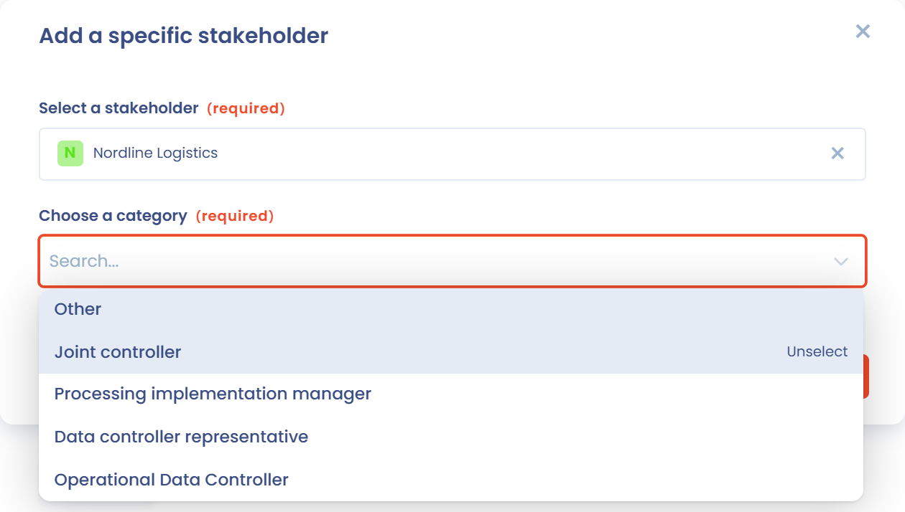

# Stakeholder

Der Abschnitt **Interessengruppen** (früher **Stakeholder** genannt) ist der zweite Abschnitt einer Verarbeitungstätigkeit. Er fasst zwei Listen zusammen:

* die **Nutzer**: Personen, die ein Konto auf der Dastra-Plattform haben und der Verarbeitungstätigkeit zugewiesen sind,
* die **Stakeholder**: die an der Verarbeitung beteiligten Organisationen, Abteilungen oder Personen, etwa der Verantwortliche, sein Datenschutzbeauftragter, gemeinsam Verantwortliche oder der für die Umsetzung der Verarbeitung Zuständige.

## Nutzer einer Verarbeitungstätigkeit zuordnen

Mit Dastra können Sie Nutzer einer Verarbeitungstätigkeit zuordnen.

Es handelt sich nicht um Stakeholder, sondern um Nutzer (natürliche Personen, die ein Konto auf der Dastra-Plattform haben).

1. Klicken Sie im Abschnitt **Interessengruppen** auf **Nutzer hinzufügen**.
2. Wählen Sie unter **Inhaber der Verarbeitung** einen oder mehrere Nutzer aus.
3. Wählen Sie unter **Rollen zuweisen** die Rolle dieser Nutzer.
4. Klicken Sie auf **Hinzufügen**.

Die Nutzer erscheinen in der Tabelle mit ihrer **Funktion**, die Sie jederzeit in der Tabelle ändern können.

Die so definierten Rollen helfen Ihnen, die Verwaltung und Umsetzung Ihrer Verarbeitungstätigkeiten in Dastra zu organisieren:

* **Genehmiger** (Accountable): der Nutzer in Dastra, der dafür zuständig ist, zu bestätigen, dass die Verarbeitungstätigkeit und die zugehörigen Elemente, wie sie in Dastra beschrieben sind, den Erwartungen der Organisation entsprechen. Diese Person kann sich vom Unterzeichner des Verantwortlichen unterscheiden. Es kann sich zum Beispiel um einen Abteilungsleiter, einen Datenschutzbeauftragten oder einen Datenschutz-Ansprechpartner handeln.
* **Verantwortlicher** (Responsible): der Nutzer, der die nötigen Maßnahmen an der Verarbeitungstätigkeit umsetzt und sie beschreibt. Das kann die Umsetzung von Datensicherheitsmaßnahmen sein, die Verwaltung von Zugriffen oder jede andere Aufgabe, die nötig ist, um die Konformität der Verarbeitung sicherzustellen. Es kann sich um einen Projektleiter oder einen eigens benannten Fachverantwortlichen handeln. Diese Rolle ist nicht mit dem Verantwortlichen im Sinne der DSGVO zu verwechseln.
* **Informiert** (Informed): Nutzer, die über Fortschritt und Status der Verarbeitungstätigkeit auf dem Laufenden gehalten werden müssen, ohne eine aktive Rolle bei ihrer Freigabe oder Umsetzung zu haben. Dazu können Mitglieder der Geschäftsführung, Projektleiter oder andere Stakeholder gehören, die ein Interesse an der Verarbeitung haben.

Zugewiesene Nutzer werden über die Maßnahmen an der Verarbeitungstätigkeit benachrichtigt und sind die Standardempfänger der zugehörigen Aufgaben und Benachrichtigungen.


Die Zuweisung eines Nutzers schränkt den Zugriff auf die Verarbeitungstätigkeit nicht ein. Um den Zugriff zu beschränken, nutzen Sie das System der Rollen und Berechtigungen.


## Die wichtigsten Stakeholder der Verarbeitungstätigkeit identifizieren

Sie können die Stakeholder angeben, die an der Umsetzung der Verarbeitung beteiligt sind. Das kann zum Beispiel eine Abteilung eines Unternehmens sein (etwa die Personalabteilung), aber auch eine eigens benannte Person bei einem Projekt (zum Beispiel ein Projektleiter).

Gegebenenfalls geben Sie außerdem den Vertreter des Verantwortlichen und den oder die gemeinsam Verantwortlichen an.

Die ersten Zeilen der Stakeholder-Tabelle werden von der Entität der Organisationseinheit übernommen, die Sie im Abschnitt **Allgemeines** ausgewählt haben, und sind mit einem Schloss-Symbol gekennzeichnet:

* der **Verantwortliche** (bei einer Tätigkeit als Auftragsverarbeiter **Organisation (Auftragsverarbeiter)**),
* sein **Datenschutzbeauftragter (DSB)**,
* sein **Vertreter**.

Um sie zu ändern, bearbeiten Sie die Entität in der Verwaltung der Organisationseinheiten.

## Einen bestimmten Stakeholder hinzufügen

1. Klicken Sie im Abschnitt **Interessengruppen** auf **Spezifische Interessengruppe hinzufügen**.
2. Durchsuchen Sie unter **Einen Stakeholder auswählen** das Stakeholder-Verzeichnis oder klicken Sie auf **Stakeholder erstellen**, um einen neuen hinzuzufügen.
3. Wählen Sie unter **Bitte wählen Sie einen Titel** die Rolle dieses Stakeholders: **Gemeinsam verantwortlich**, **Vertreter des Verantwortlichen für die Verarbeitung**, **Verantwortlich für die Umsetzung der Verarbeitung**, **Verantwortlicher für die operative Verarbeitung** oder **Sonstiges**. Wenn Sie **Sonstiges** wählen, geben Sie die Rolle unter **Stellenbezeichnung** ein.
4. Klicken Sie auf **Hinzufügen**.

<figure><figcaption>
Verfügbare Kategorien für einen bestimmten Stakeholder
</figcaption></figure>

## Einen gemeinsam Verantwortlichen hinzufügen

Um einen gemeinsam Verantwortlichen hinzuzufügen, fügen Sie einen neuen Stakeholder hinzu und wählen unter **Bitte wählen Sie einen Titel** die Kategorie **Gemeinsam verantwortlich**.

<figure><figcaption>
Einen gemeinsam Verantwortlichen zur Verarbeitungstätigkeit hinzufügen
</figcaption></figure>

## Einen für die Umsetzung der Verarbeitung Verantwortlichen hinzufügen

Der für die Umsetzung der Verarbeitung Verantwortliche ist die Abteilung, die operativ für die Verarbeitung zuständig ist. Das ist in der Regel die Abteilung, die die Daten nutzt und die Verarbeitungstätigkeit durchführt.

Es kann sich um eine Abteilung oder um eine Einzelperson handeln.

Fügen Sie ihn in Dastra als Stakeholder mit der Kategorie **Verantwortlich für die Umsetzung der Verarbeitung** hinzu.

## Einen Vertreter des Verantwortlichen hinzufügen

Der Vertreter des Verantwortlichen ist der operative Vertreter des Verantwortlichen. Das kann zum Beispiel ein Mitglied der Geschäftsleitung sein oder ein Gemeinderatsmitglied (wobei der Verantwortliche durch den Bürgermeister vertreten wird).

Fügen Sie ihn in Dastra als Stakeholder mit der Kategorie **Vertreter des Verantwortlichen für die Verarbeitung** hinzu.

## Einen operativen Verantwortlichen hinzufügen

Der **operative Verantwortliche** (Operational Data Controller, ODC) ist ein Konzept, das einige Organisationen intern verwenden, um eine Person mit besonderen Aufgaben in der **operativen Verwaltung der Verarbeitung personenbezogener Daten** zu bezeichnen.

Fügen Sie ihn in Dastra als Stakeholder mit der Kategorie **Verantwortlicher für die operative Verarbeitung** hinzu.

**Rolle des operativen Verantwortlichen in der Governance der DSGVO**\
Der **operative Verantwortliche** ist kein Begriff der DSGVO, aber einige Organisationen verwenden ihn intern, um eine Person mit besonderen **operativen Aufgaben** bei der Verwaltung von Verarbeitungstätigkeiten zu bezeichnen.

### Umsetzung der Datenverarbeitung

* Der operative Verantwortliche dient häufig als **operativer Ansprechpartner des Verantwortlichen** in einer Fachabteilung (zum Beispiel Personal, Marketing, IT).
* Er ist dafür zuständig, die Verarbeitungstätigkeiten im Tagesgeschäft nach den **Weisungen des Verantwortlichen** und unter Beachtung der Datenschutzgrundsätze durchzuführen.

### Anwendung der Compliance-Maßnahmen

* Der operative Verantwortliche stellt sicher, dass Verarbeitungstätigkeiten nach den **internen Compliance-Richtlinien** und den Datenschutzpflichten durchgeführt werden.
* Er wendet die vom Unternehmen festgelegten **technischen und organisatorischen Maßnahmen** an, um die **Sicherheit und Vertraulichkeit** der personenbezogenen Daten zu gewährleisten.

### Zusammenarbeit mit dem Datenschutzbeauftragten und dem Verantwortlichen

* Der operative Verantwortliche arbeitet eng mit dem **Datenschutzbeauftragten (DSB)** zusammen, damit die Verarbeitungstätigkeiten den Datenschutzvorschriften entsprechen.
* Er kann ein zentraler Ansprechpartner für den **DSB** sein, insbesondere bei der Bearbeitung von **Betroffenenanfragen** (zum Beispiel Auskunft, Berichtigung, Löschung).

### Umgang mit Vorfällen und Datenschutzverletzungen

* Der operative Verantwortliche kann an der **Erkennung und Behandlung von Datenschutzverletzungen** beteiligt sein und wendet interne Verfahren an, um **schnell zu reagieren und** Vorfälle bei Bedarf **zu melden**.
* Er verfolgt Vorfälle und hilft bei der Umsetzung von **Korrekturmaßnahmen**.

### Dokumentation und Pflege des Verarbeitungsverzeichnisses

* Der operative Verantwortliche trägt zur Aktualisierung des **Verarbeitungsverzeichnisses** bei, dokumentiert die Verarbeitungen in seiner Verantwortung und stellt sicher, dass die relevanten Informationen korrekt an den **Verantwortlichen oder den DSB** gemeldet werden.

**Unterschied zwischen dem Verantwortlichen und dem operativen Verantwortlichen**

| **Kriterium**                | **Verantwortlicher**                                            | **Operativer Verantwortlicher**                        |
| ---------------------------- | --------------------------------------------------------------- | ------------------------------------------------------ |
| **Rolle**                    | Legt die **Zwecke** und **Mittel** der Verarbeitung fest        | Setzt Verarbeitungstätigkeiten in der Praxis um        |
| **Entscheidungsbefugnis**    | Entscheidet, **warum und wie** Daten verarbeitet werden         | Wendet Entscheidungen an und steuert die Durchführung  |
| **Rechtliche Verantwortung** | Trägt bei Verstößen die **rechtliche Verantwortung**            | Handelt unter der **Weisung des Verantwortlichen**     |
| **Zusammenarbeit mit dem DSB** | Arbeitet mit dem **DSB** an der Festlegung von Richtlinien    | Setzt die **Empfehlungen des DSB** um                  |
