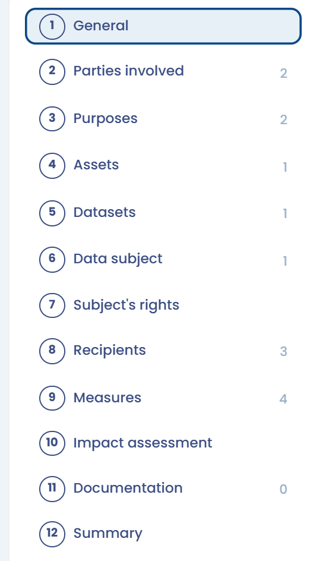

# Verzeichnis „Verantwortlicher“

## Einführung

Artikel 30 der DSGVO legt besondere Pflichten für das _Verzeichnis des Verantwortlichen_ und das _Verzeichnis des Auftragsverarbeiters_ fest. Wenn Ihre Organisation sowohl als Auftragsverarbeiter als auch als Verantwortlicher tätig ist, muss Ihr Verzeichnis die beiden Kategorien von Tätigkeiten daher klar unterscheiden.

**In der Praxis empfiehlt die CNIL in diesem Fall, zwei Verzeichnisse zu führen:**

1. eines für die Verarbeitungen personenbezogener Daten, für die Sie selbst verantwortlich sind,
2. ein weiteres für die Verarbeitungen, die Sie als Auftragsverarbeiter im Auftrag Ihrer Kunden durchführen.

Der Rest dieser Seite behandelt ausschließlich das Verzeichnis „Verantwortlicher“.

## Das Verzeichnis „Verantwortlicher“

Für jede Verarbeitung enthält das Verzeichnis eines Verantwortlichen mindestens:

1. gegebenenfalls **den Namen und die Kontaktdaten** des [gemeinsamen Verantwortlichen](https://dsgvo-gesetz.de/art-26-dsgvo/) der Verarbeitung
2. die **Zwecke** der Verarbeitung, also das Ziel, für das Sie die Daten erhoben haben
3. die Kategorien **betroffener Personen** (Kunde, Interessent, Beschäftigter usw.)
4. die Kategorien **personenbezogener Daten** (zum Beispiel Identität, Familie, wirtschaftliche oder finanzielle Situation, Bankdaten, Verbindungsdaten, Standortdaten usw.)
5. die Kategorien von **Empfängern**, denen die personenbezogenen Daten offengelegt wurden oder werden, einschließlich der von Ihnen eingesetzten Auftragsverarbeiter
6. die **Übermittlungen** personenbezogener Daten an ein Drittland oder an eine internationale Organisation und, in bestimmten besonderen Fällen, die für diese Übermittlungen vorgesehenen Garantien
7. die **Fristen für die Löschung** der verschiedenen Datenkategorien, also die Speicherdauer oder, falls das nicht möglich ist, die Kriterien für ihre Festlegung
8. soweit möglich, **eine allgemeine Beschreibung der technischen und organisatorischen Sicherheitsmaßnahmen**, die Sie umsetzen

In Dastra wird eine als Verantwortlicher angelegte Verarbeitungstätigkeit in 12 Abschnitten dokumentiert: **Allgemeines**, **Interessengruppen**, **Zweck**, **Assets**, **Daten**, **Betroffene Person**, **Rechte von Personen**, **Empfänger**, **Maßnahmen**, **Folgenabschätzung**, **Dokumentation** und **Zusammenfassung**. Die folgenden Abschnitte zeigen, wo Sie jede nach Artikel 30 erforderliche Angabe dokumentieren.

<figure><figcaption>
Die verschiedenen Abschnitte einer Verarbeitungstätigkeit „Verantwortlicher“ in Dastra
</figcaption></figure>

## Stakeholder

Dokumentiert im Abschnitt **Interessengruppen**:

* Die Identität und die Kontaktdaten des Verantwortlichen
* Die Identität und die Kontaktdaten des Datenschutzbeauftragten, falls zutreffend
* Die Identität und die Kontaktdaten des Vertreters, falls zutreffend
* Der oder die gemeinsamen Verantwortlichen, falls zutreffend

## Zwecke

Dokumentiert im Abschnitt **Zweck**:

* Alle Zwecke der Tätigkeit, die die Verarbeitung umfasst

## Rechtsgrundlage

Jedem Zweck wird seine Rechtsgrundlage zugeordnet, ebenfalls im Abschnitt **Zweck**:

* Erfüllung einer rechtlichen Verpflichtung
* Erfüllung eines Vertrags
* Berechtigte Interessen des Unternehmens oder eines Dritten
* Öffentliches Interesse
* Einwilligung
* Schutz lebenswichtiger Interessen der betroffenen Person oder einer anderen Person

## Bestandsaufnahme der Daten und der betroffenen Personen

Dokumentiert in den Abschnitten **Betroffene Person** und **Daten**:

* Art der betroffenen Personen
* Datenkategorien
* Löschfristen oder anwendbare Regel

## Empfänger und Übermittlungen außerhalb des EWR

Dokumentiert im Abschnitt **Empfänger**:

* Identifizierung der Empfänger, einschließlich interner Empfänger (von der Verarbeitung betroffene Abteilung), externer Stellen (Geschäfts- oder institutionelle Partner), Auftragsverarbeiter (Hosting-Anbieter, Lösungsanbieter), gegebenenfalls der betroffenen Person und gemeinsamer Verantwortlicher
* Für jeden Empfänger die Angabe der Übermittlungen außerhalb des Europäischen Wirtschaftsraums (EWR) und der verwendeten rechtlichen Instrumente (verbindliche interne Datenschutzvorschriften bei Übermittlungen an Tochtergesellschaften außerhalb der EU, Standardvertragsklauseln, Land mit anerkanntem Angemessenheitsbeschluss usw.)

## Sicherheitsmaßnahmen

Dokumentiert im Abschnitt **Maßnahmen**:

* Technische und organisatorische Maßnahmen zur Absicherung jeder Datenverarbeitung
* Zum Beispiel Datenverschlüsselung, Pseudonymisierung, Zugriffsbeschränkung

***


Sie können den Typ einer Verarbeitungstätigkeit ändern (von einer als Verantwortlicher angelegten zu einer als Auftragsverarbeiter angelegten und umgekehrt). Die Vorgehensweise finden Sie in den [häufig gestellten Fragen](faq.md#wie-andere-ich-den-typ-einer-verarbeitungstatigkeit-von-verantwortlicher-zu-auftragsverarbeiter-und-umgekehrt).


## Weiterführende Informationen


[Ihr Verzeichnis erstellen](establish.md)

