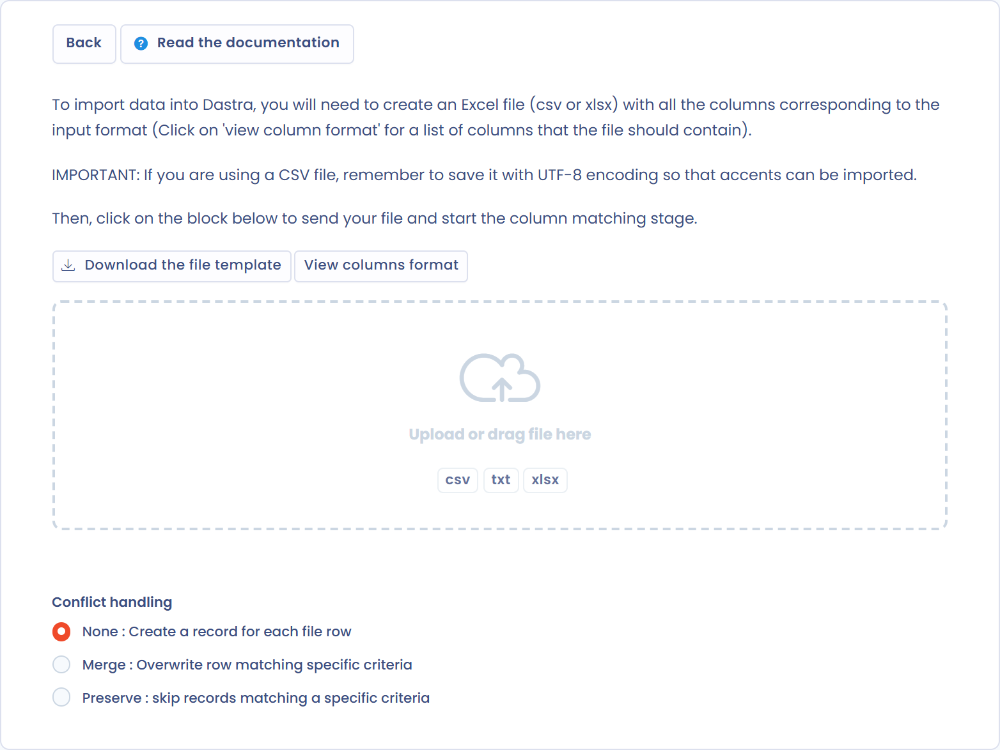
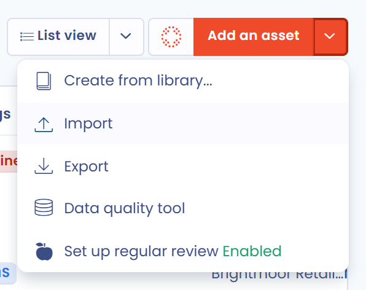

# Verzeichnis exportieren / importieren

## Verzeichnis exportieren

Um das gesamte Verzeichnis zu exportieren, öffnen Sie das Verarbeitungsverzeichnis, klicken Sie auf den Pfeil rechts neben der Schaltfläche **Erstellen Sie eine Datenverarbeitung** und wählen Sie **Exportieren**.

<figure><figcaption>
Das Menü des Verzeichnisses mit der Exportfunktion
</figcaption></figure>

Wählen Sie im sich öffnenden Fenster unter **Bitte wählen Sie das gewünschte Exportformat aus.** das Format: PDF, Word, HTML, CSV, Excel, JSON oder Markdown. Bei PDF, Word und HTML wählen Sie außerdem unter **Bitte wählen Sie einen Exporttyp aus** den Typ (**Vollständig**, **DSGVO (Artikel 30)**, **Standard-Datenschutzerklärung** oder **Richtlinie zur Datenspeicherung**). Klicken Sie dann auf **Datei herunterladen**. Ihr Verzeichnis ist exportiert.

Je nach Format stehen weitere Optionen zur Verfügung, zum Beispiel:

* **Nach Organisationseinheiten gruppieren** (PDF, Word, HTML), um die Verarbeitungstätigkeiten nach Organisationseinheit zu gruppieren
* **Indikatoren für Fortschritt, Qualität und Sensibilität beim Export hinzufügen** und **Exportieren Sie die zugehörigen Aufgaben** (PDF und HTML, Typ Vollständig)
* **Komplexe Tabellenkalkulation (mehrere Blätter)** (Excel)
* **Verwenden Sie die nativen Spalten- oder Berichtsnamen (empfohlen für den Datenimport).** und **Bestimmte Spalten exportieren**, womit Sie die zu exportierenden Spalten wählen (CSV und Excel)
* **Für einen Kunden exportieren**, um einen Export nur für einen Ihrer Kunden zu erzeugen, ohne die Daten der anderen Kunden

PDF-, Word- und HTML-Exporte enthalten bis zu 500 Verarbeitungstätigkeiten, CSV-, Excel-, JSON- und Markdown-Exporte bis zu 10.000. Ist Ihre Auswahl größer, erscheint im Fenster eine Warnung.

Bei einem großen Verzeichnis wird der JSON-Export im Hintergrund vorbereitet: Sie können weiterarbeiten, eine Benachrichtigung informiert Sie über den Fortschritt, und die Datei wird heruntergeladen, sobald sie fertig ist.

### Format DSGVO (Artikel 30)

Das Format DSGVO (Artikel 30) entspricht dem, was die DSGVO verlangt: Der Export enthält nur die Felder, die Artikel 30 für das Verarbeitungsverzeichnis vorschreibt. Er umfasst folgende Angaben:

* Name der Verarbeitungstätigkeit sowie Identität des Verantwortlichen (oder Auftragsverarbeiters), seines Vertreters und seines Datenschutzbeauftragten
* Zwecke (ohne Rechtsgrundlage)
* Kategorien betroffener Personen und personenbezogener Daten sowie Speicherdauern
* Empfänger und mögliche Übermittlungen außerhalb der EU
* Sicherheitsmaßnahmen

### Format Vollständig

Das vollständige Format ist das native Dastra-Format: Sie exportieren alle Felder, aus denen die Verarbeitungstätigkeit besteht.


Sie können auch nur eine oder mehrere Verarbeitungstätigkeiten des Verzeichnisses exportieren statt des gesamten Verzeichnisses. Aktivieren Sie dazu die Kontrollkästchen links neben den betreffenden Verarbeitungstätigkeiten und klicken Sie dann auf **Bitte wählen Sie eine Sammelaktion aus** und **Exportieren**. Um eine einzelne Verarbeitungstätigkeit zu exportieren, können Sie auch **Exportieren** im Menü am Ende ihrer Zeile verwenden.


## Verzeichnis importieren

Klicken Sie auf den Pfeil rechts neben der Schaltfläche **Erstellen Sie eine Datenverarbeitung** und wählen Sie **Importieren**. Das Fenster **Verarbeitungen importieren** bietet drei Formate:

* **Komplexe Excel-Tabelle**: Sie importieren Ihre Verarbeitungstätigkeiten aus einer Excel-Arbeitsmappe mit mehreren Blättern (Beta)
* **Flache Datei**: Sie importieren Ihre Verarbeitungstätigkeiten aus einer CSV-Datei
* **JSON**: Sie importieren Verarbeitungstätigkeiten, die Sie zuvor im JSON-Format aus Dastra exportiert haben, zum Beispiel aus einem anderen Mandanten

<figure><figcaption>
Das Importformat wählen
</figcaption></figure>

### Import mit der komplexen Excel-Tabelle

Ein bestehendes Verzeichnis zu importieren kann mühsam sein, wenn Sie viele Verarbeitungstätigkeiten haben. Mit der komplexen Excel-Tabelle importieren Sie Ihre Verarbeitungstätigkeiten gesammelt in einem Zug. Dastra erkennt die Daten der Arbeitsmappe und legt daraus die Verarbeitungstätigkeiten und die zugehörigen Referenzdaten an.

1. Wählen Sie **Komplexe Excel-Tabelle**.
2. Klicken Sie auf **Laden Sie die Dateivorlage herunter** und füllen Sie sie mit Ihren Daten aus.
3. Wählen Sie die **Organisationseinheit**, in der die Verarbeitungstätigkeiten angelegt werden.
4. Ziehen Sie Ihre ausgefüllte Datei in das Feld, um den Import zu starten.


Beim Import wird keine Organisationseinheit angelegt. Daten aus Feldern, die nicht zur Vorlage gehören, werden in die HTML-Beschreibungsfelder übernommen.


### Eine JSON-Datei importieren

Das JSON-Format ist das des **JSON**-Exports des Verzeichnisses. Es enthält vollständige Verarbeitungstätigkeiten und ist daher das Format, um Tätigkeiten von einem Mandanten in einen anderen zu kopieren. Wählen Sie **JSON**, wählen Sie die **Organisationseinheit**, in der die Verarbeitungstätigkeiten angelegt werden, und legen Sie dann die Datei ab. Das Fenster listet anschließend die angelegten Verarbeitungstätigkeiten und die bereits vorhandenen Elemente auf.

Die Datei hat die Struktur des Exports: `$schema`, `version`, `date`, `label`, `source` und ein Array `records` mit einer Verarbeitungstätigkeit pro Eintrag.

Was der Import akzeptiert:

* eine aus Dastra exportierte Datei mit der Version `1.4`. Eine andere Version wird mit der Meldung „Incorrect version of your JSON import file (required version : 1.4)“ abgelehnt;
* den gesamten Inhalt eines Eintrags: die allgemeinen Informationen, die Zwecke, die Datenkategorien und ihre Regeln zur Speicherdauer, die Assets, die Empfänger und Stakeholder, die Kategorien betroffener Personen, die Sicherheitsmaßnahmen, die Tags und die benutzerdefinierten Felder;
* einen Eintrag mit derselben Bezeichnung wie eine bestehende Verarbeitungstätigkeit: Er legt eine neue an und überschreibt nie;
* die Stakeholder, Assets, Datenkategorien, Kategorien betroffener Personen, Sicherheitsmaßnahmen und Tags eines Eintrags: Existiert im Mandanten bereits ein Element mit demselben Namen, verwendet Dastra es wieder, andernfalls legt es es an;
* die Inhaber eines Eintrags, wenn sie Nutzer der Organisation sind. Die übrigen werden übersprungen.

Was der Import ignoriert oder zurücksetzt:

* die Kennungen: Jede Verarbeitungstätigkeit erhält eine neue;
* die Organisationseinheit der Datei: Alle Tätigkeiten kommen in die Einheit, die Sie gewählt haben;
* den Status und den Workflow-Schritt: Die Tätigkeiten werden als Entwürfe im ersten Schritt des Workflows angelegt;
* den Ersteller, das Erstellungsdatum und die Überprüfungsdaten: Ersteller ist die Person, die importiert, und die Daten beginnen von vorn;
* die Risikostufe und die Bewertungen: Dastra berechnet sie neu;
* die Beziehungen zwischen Verarbeitungstätigkeiten (übergeordnet, untergeordnet, verwandt).

Jeder Eintrag wird geprüft, bevor etwas angelegt wird. Ist ein Eintrag ungültig, zum Beispiel weil ein Pflichtfeld leer ist, bricht der Import mit der Meldung „Error on data processing“ gefolgt von seiner Bezeichnung und seiner Zeilennummer ab, und es wird nichts angelegt.

Der Import setzt die Berechtigung voraus, Verarbeitungstätigkeiten zu importieren.

### Standardimport Schritt für Schritt

Damit Sie nicht jede Verarbeitungstätigkeit von Hand ausfüllen müssen und jedes denkbare Format eines Verzeichnisses verarbeiten können, hat Dastra eine Methode entwickelt, die auf dem Prinzip beruht, **das Verzeichnis in Datendomänen aufzuteilen**. Um ein ganzes bestehendes Verzeichnis in Dastra zu importieren, empfehlen wir 7 Schritte.


Diese Schritte sind nicht verpflichtend, werden aber dennoch dringend empfohlen, vor allem wenn das Verzeichnis viele Verarbeitungstätigkeiten enthält.


Nutzen Sie auch unsere Bibliothek mit Verarbeitungsvorlagen: [https://www.dastra.eu/de/data-processing/referentials](https://www.dastra.eu/de/data-processing/referentials)

Die Importseite funktioniert bei jedem Schritt gleich. Sie ist ausführlich unter [Daten importieren (Excel, CSV)](../general/import.md) beschrieben.

### Schritt 1: Bezeichnungen der Verarbeitungstätigkeiten importieren

Um Ihre bestehenden Bezeichnungen von Verarbeitungstätigkeiten zu importieren, klicken Sie auf den Pfeil rechts neben **Erstellen Sie eine Datenverarbeitung**, wählen Sie **Importieren** und dann **Flache Datei**. Die Seite **Datenimport** öffnet sich.

Klicken Sie auf **Laden Sie die Dateivorlage herunter**, um eine Beispieldatei zu erhalten, und auf **Spaltenformat anzeigen**, um die Liste der erwarteten Spalten, ihrer Regeln und ihrer möglichen Werte zu sehen.

<figure><figcaption>
Die Dateivorlage herunterladen
</figcaption></figure>

Füllen Sie die Datei mit Ihren Verarbeitungstätigkeiten aus. Die wichtigsten Spalten sind:

| Spalte           | Beschreibung                                           | Mögliche Werte                                      |
| ---------------- | ------------------------------------------------------ | --------------------------------------------------- |
| Label            | Name der Verarbeitungstätigkeit (erforderlich)         |                                                     |
| Ref              | Interne Referenz                                       |                                                     |
| Processing state | Status der Verarbeitungstätigkeit                      | "Study", "BeingDeployed", "InProduction", "Stopped" |
| Description      | Kurze Beschreibung der Verarbeitungstätigkeit          |                                                     |

Wählen Sie die **Organisationseinheit** und ziehen Sie dann Ihre Datei in das Feld:

<figure><figcaption>
Die Organisationseinheit wählen, bevor Sie die Datei hochladen
</figcaption></figure>

Ordnen Sie im Schritt **Entsprechungen** die Spalten Ihrer Datei den Dastra-Feldern zu und klicken Sie dann auf **Weiter**, um den Import auszuführen.

Damit sind die Bezeichnungen Ihrer Verarbeitungstätigkeiten importiert.

### Schritt 2: Referenzdaten zu Assets importieren

Um Ihre bestehenden Anwendungen und Assets zu importieren, öffnen Sie das Modul **Metadaten**, den Tab **Assets**, klicken Sie auf den Pfeil rechts neben **Asset erstellen** und wählen Sie **Importieren**:

<figure><figcaption>
Assets importieren
</figcaption></figure>

Laden Sie dann die Dateivorlage herunter, füllen Sie sie mit Ihren Assets aus (die Liste der Spalten finden Sie unter **Spaltenformat anzeigen**) und importieren Sie sie wie in Schritt 1.

Damit sind Ihre Assets importiert.

### Schritt 3: Referenzdaten zu Stakeholdern importieren

Wiederholen Sie dasselbe Vorgehen im Modul **Metadaten**, Tab **Stakeholder**.

Ihre Stakeholder-Referenzdaten listen alle an einer Verarbeitungstätigkeit beteiligten Parteien auf: juristische Personen wie Auftragsverarbeiter, Kunden oder gemeinsam Verantwortliche oder natürliche Personen wie die Ansprechpartner einer Verarbeitungstätigkeit.

Diese Referenzdaten dienen als internes Verzeichnis des Mandanten. Für jeden Stakeholder können Sie einen Typ festlegen, der ihn kennzeichnet. Wenn Sie zum Beispiel Ihre Auftragsverarbeiter hinzufügen möchten, erfassen Sie sie alle als Stakeholder und ordnen dann jeden Auftragsverarbeiter den betreffenden Verarbeitungstätigkeiten zu.

### Schritt 4: Referenzdaten zu Sicherheitsmaßnahmen importieren

Wiederholen Sie dasselbe Vorgehen im Modul **Metadaten**, Tab **Maßnahmen**.

### Schritt 5: Datenglossar importieren

Wiederholen Sie dasselbe Vorgehen im Modul **Metadaten**, Tab **Datensätze**.

### Schritt 6: Referenzdaten zu Datenkategorien importieren

Wiederholen Sie dasselbe Vorgehen im Modul **Metadaten**, Tab **Datenkategorien**.

#### Datenkategorien mit ihren Datenfeldern exportieren und importieren

Sie können Ihre Datenkategorien **einschließlich der zugehörigen Datenfelder** exportieren und importieren. Das erleichtert es, eine bestehende Datenkartierung zu übernehmen oder Ihr Datenglossar gesammelt zu aktualisieren.

**Datenkategorien mit ihren Feldern exportieren**

Im Modul **Metadaten**, Tab **Datenkategorien**:

1. Wählen Sie die Datenkategorien aus, die Sie exportieren möchten, oder exportieren Sie die gesamte Liste.
2. Klicken Sie auf **Exportieren**.
3. Wählen Sie das Format CSV oder Excel und klicken Sie auf **Datei herunterladen**.

Die exportierte Datei enthält für jede Datenkategorie ihren Namen, ihre Beschreibung, ihre Speicherregel und die Liste ihrer Datenfelder. In dieser Spalte wird jedes Datenfeld als `name#sensitivity#category` geschrieben, die Datenfelder sind durch `|` getrennt. Aktivieren Sie **Verwenden Sie die nativen Spalten- oder Berichtsnamen (empfohlen für den Datenimport).**, wenn Sie die Datei erneut importieren möchten.

**Datenkategorien mit ihren Feldern importieren**

Die Importdatei hat dasselbe Format wie der Export. Tragen Sie für jede Datenkategorie ihre Datenfelder in die dafür vorgesehene Spalte ein, zum Beispiel `Last name#Current#CivilStatus|Salary#HighlyPersonalNature#EconomicFinancialData`. Beim Import gilt:

* Datenfelder, die im Datenglossar noch nicht vorhanden sind, werden **automatisch angelegt**.
* Bereits vorhandene Datenfelder (gleicher Name) werden der Datenkategorie **zugeordnet**, ohne Duplikate zu erzeugen.


Diese Funktion ist besonders nützlich, um die Datenkartierung zwischen mehreren Mandanten zu vereinheitlichen oder einen neuen Mandanten aus einer bestehenden Datenkartierung zu initialisieren.


### Schritt 7: Verknüpfungen herstellen

Nachdem alle Referenzdaten importiert sind, bearbeiten Sie jede Verarbeitungstätigkeit und ergänzen ihre Angaben anhand der importierten Daten, nach der folgenden Anleitung:


[Eine Verarbeitung ausfüllen](activity/README.md)


Damit sind die Verknüpfungen hergestellt.
