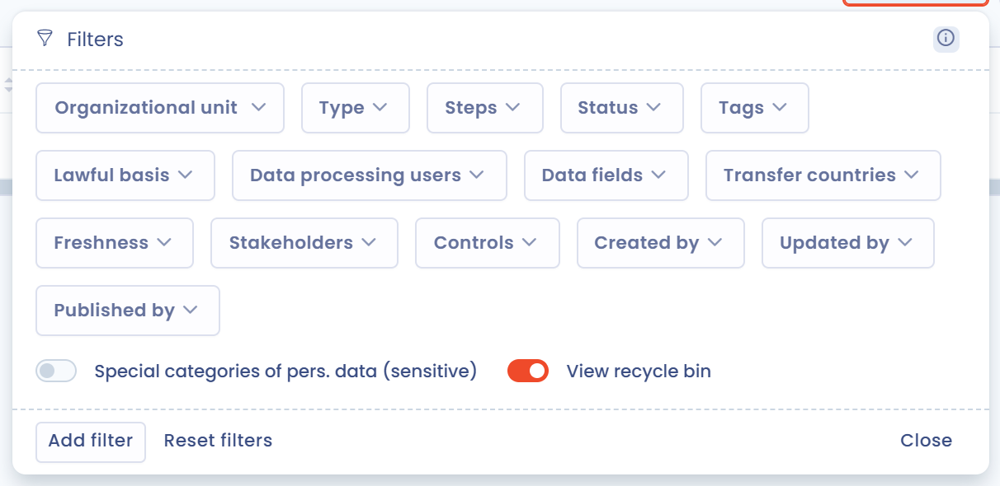
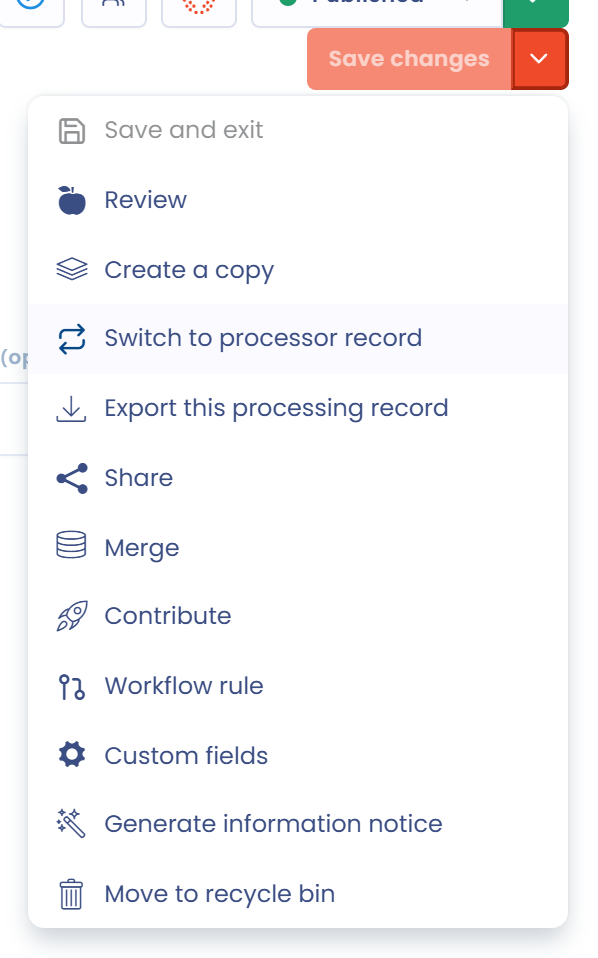

# Häufig gestellte Fragen

## Wie zeigt man den Änderungsverlauf einer Verarbeitungstätigkeit an?

Für alle Verarbeitungstätigkeiten können Sie den Änderungsverlauf und die Details der Änderungen anzeigen.

Klicken Sie dazu oben auf der Seite der Verarbeitungstätigkeit auf das Uhrsymbol (**Aktivitätsverlauf**).

<figure><figcaption>
Schaltfläche für den Zugriff auf den Verlauf
</figcaption></figure>

Klicken Sie bei einem Eintrag auf **Details zu den Änderungen**, um die Versionen zu vergleichen. Von dort aus bringt Sie die Schaltfläche **Wiederherstellen** zu dieser Version zurück, sofern Ihre Rolle es erlaubt.

Änderungen an Organisationseinheiten werden nicht nachverfolgt.

## Kann man im Feld „Stakeholder“ einer neuen Verarbeitungstätigkeit automatisch Elemente hinzufügen?

Nein, Stakeholder können nicht über einen automatisierten Workflow aktualisiert werden.

Sie können jedoch auf Ebene der Stakeholder ein benutzerdefiniertes Feld erstellen, das über den automatisierten Workflow geändert werden kann.

## Wie löscht man eine Verarbeitungstätigkeit?

Um eine Verarbeitungstätigkeit zu löschen, müssen Sie sie zuerst mit **In den Papierkorb verschieben** in den Papierkorb verschieben. Danach können Sie den Papierkorb über die Filter anzeigen und die Verarbeitungstätigkeit endgültig löschen. Das ist ein Schutz vor voreiligen Löschungen.

Um eine Verarbeitungstätigkeit in den Papierkorb zu verschieben, öffnen Sie das Menü am Ende ihrer Zeile und wählen **In den Papierkorb verschieben**.

<figure><figcaption>
Eine Verarbeitungstätigkeit in den Papierkorb verschieben
</figcaption></figure>

Zeigen Sie dann den Papierkorb an: Klicken Sie auf **Filter** und aktivieren Sie **Papierkorb anzeigen**.

<figure><figcaption>
Den Papierkorb anzeigen
</figcaption></figure>

Öffnen Sie schließlich das Menü am Ende der Zeile und wählen Sie **Löschen**. Mit **Wiederherstellen** legen Sie die Verarbeitungstätigkeit stattdessen wieder im Verzeichnis ab.

<figure><figcaption>
Eine Verarbeitungstätigkeit endgültig löschen
</figcaption></figure>

## Wie können Nutzer Datenkategorien verwenden, ohne sie ändern zu können?

Ihre DSB-Vertreter müssen unter Umständen die von Ihnen bereitgestellten Datenkategorien in ihren Verarbeitungstätigkeiten verwenden, ohne neue zu erstellen oder die enthaltenen Datenfelder zu ändern, damit die Verknüpfungen mit anderen Verarbeitungstätigkeiten konsistent bleiben.

Erstellen Sie in diesem Fall eine benutzerdefinierte Rolle. Öffnen Sie die Rollen: [https://app.dastra.eu/general-settings/roles](https://app.dastra.eu/general-settings/roles) (siehe [Rollen und Berechtigungen](../settings/roles.md)).

Erstellen Sie dann eine benutzerdefinierte Rolle mit den folgenden Berechtigungen:

* **Data processing records**: Read, Write
* **Data mapping and repositories**: Read

Weisen Sie diese Rolle anschließend den betreffenden Nutzern zu. Sie können die Datenkategorien in ihren Verarbeitungstätigkeiten verwenden, aber die Elemente der Datenkartierung nicht ändern.

## Wie fügt man Stakeholder oder Empfänger zu mehreren Verarbeitungstätigkeiten hinzu?

Mit Sammelaktionen können Sie Stakeholder oder Empfänger mehreren Verarbeitungstätigkeiten gleichzeitig hinzufügen.

Wählen Sie in der Ansicht **Tabelle** die Verarbeitungstätigkeiten mit den Kontrollkästchen aus. Die Schaltfläche **Bitte wählen Sie eine Sammelaktion aus** erscheint.

Wählen Sie **Stakeholder vernetzen**, dann **Hinzufügen**, wählen Sie die Stakeholder, anschließend ihren **Typ** (zum Beispiel Stakeholder oder Empfänger) und ihre Kategorie und bestätigen Sie. Enthält Ihre Auswahl sowohl Verarbeitungstätigkeiten des Verantwortlichen als auch des Auftragsverarbeiters, steht nur der Typ Stakeholder zur Verfügung.

Dasselbe Fenster entfernt mit der Auswahl **Löschen** Stakeholder aus den ausgewählten Verarbeitungstätigkeiten.

## Wie erhält man die Liste der Assets je Organisationseinheit?

Die Liste der Assets je Organisationseinheit erhalten Sie über die Verknüpfungen zwischen Assets und Verarbeitungstätigkeiten.

Nutzen Sie den Excel-Export der Verarbeitungstätigkeiten: Filtern Sie das Verzeichnis nach Organisationseinheit, wählen Sie die Verarbeitungstätigkeiten aus und exportieren Sie sie. Aktivieren Sie im Exportfenster **Bestimmte Spalten exportieren** und behalten Sie nur die Spalte der Assets: Sie erhalten die Assets dieser Organisationseinheit. Sie können auch nur die Spalten der Organisationseinheit und der Assets behalten, um die Assets aller Organisationseinheiten auf einmal zu erhalten.

Die [Datenkartierung des Verzeichnisses](visualization/data-map.md) zeigt diese Information auch grafisch.

## Wie dupliziert man ein Verzeichnis in einen anderen Mandanten?

Sie können ein Verzeichnis und seine Verarbeitungstätigkeiten auf verschiedene Weise duplizieren:

* entweder durch [Export und erneuten Import](export-import.md) der Verarbeitungstätigkeiten im JSON-Format,
* oder indem Sie in den Zielmandanten wechseln und die Verarbeitungstätigkeiten mit **Erstellen Sie auf der Grundlage von Vorlagen** erstellen: Wählen Sie unter **Datenquelle der Bibliothek** den Mandanten aus, der das ursprüngliche Verzeichnis enthält.

## Wie ändere ich den Typ einer Verarbeitungstätigkeit (von Verantwortlicher zu Auftragsverarbeiter und umgekehrt)?

Öffnen Sie die Verarbeitungstätigkeit, klicken Sie auf den Pfeil rechts neben **Speichern** und dann auf **Wechseln Sie zu einem Auftragsverarbeiter** oder **Wechseln Sie zum Verantwortlichen für die Verarbeitung**:

<figure><figcaption>
Den Typ einer Verarbeitungstätigkeit wechseln
</figcaption></figure>

Wenn Sie eine Verarbeitungstätigkeit des Auftragsverarbeiters wieder zu einer Verarbeitungstätigkeit des Verantwortlichen machen, werden die mit ihr verknüpften Kunden entfernt. Vorher wird eine Bestätigung verlangt.

## Fehlermeldung: „Label field is required.“

Diese Meldung erscheint in der Regel, wenn beim Beantworten eines Fragebogens ein Feld leer gelassen wurde.

## Fehlermeldung: „Bitte beachten Sie, dass ein Feld unzulässigen HTML-Inhalt enthält.“

<figure><figcaption>
Hinweis auf unzulässigen HTML-Inhalt in einem Feld
</figcaption></figure>

Diese Meldung bedeutet, dass HTML-Code (in der Regel in spitzen Klammern `< >`) in einem Feld steht, in dem HTML aus Sicherheitsgründen nicht erlaubt ist.

Die folgende Meldung hilft Ihnen, das betroffene Feld zu erkennen:

<figure><figcaption>
Hinweis auf unzulässigen HTML-Inhalt in einem Feld
</figcaption></figure>

## Fehlermeldung: „Die Kennung des Nutzers ist in Ihrer Organisation nicht vorhanden.“ beim Speichern einer Verarbeitung

In der englischen Oberfläche lautet die vollständige Meldung: „Stakeholders provided does not exist in your current organization. Please check the stakeholders section and remove users not related to your organization.“

Sie bedeutet, dass ein aus Ihrem Mandanten entfernter Nutzer in den Stakeholdern der Verarbeitung noch als verantwortlicher Nutzer eingetragen ist.

Entfernen Sie den gelöschten Nutzer aus den Stakeholdern der Verarbeitung, um das Problem zu beheben.


Wenn Sie die Antwort in diesem Leitfaden nicht finden, können Sie sich an den [Support wenden](../../getting-started/support/request.md).

