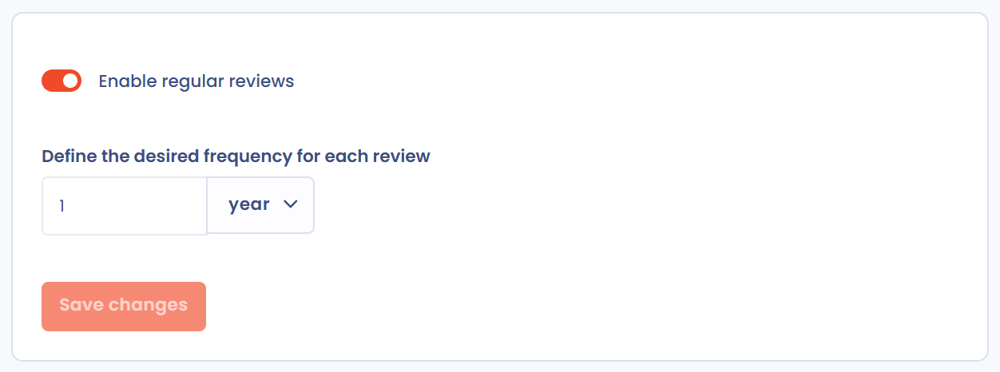
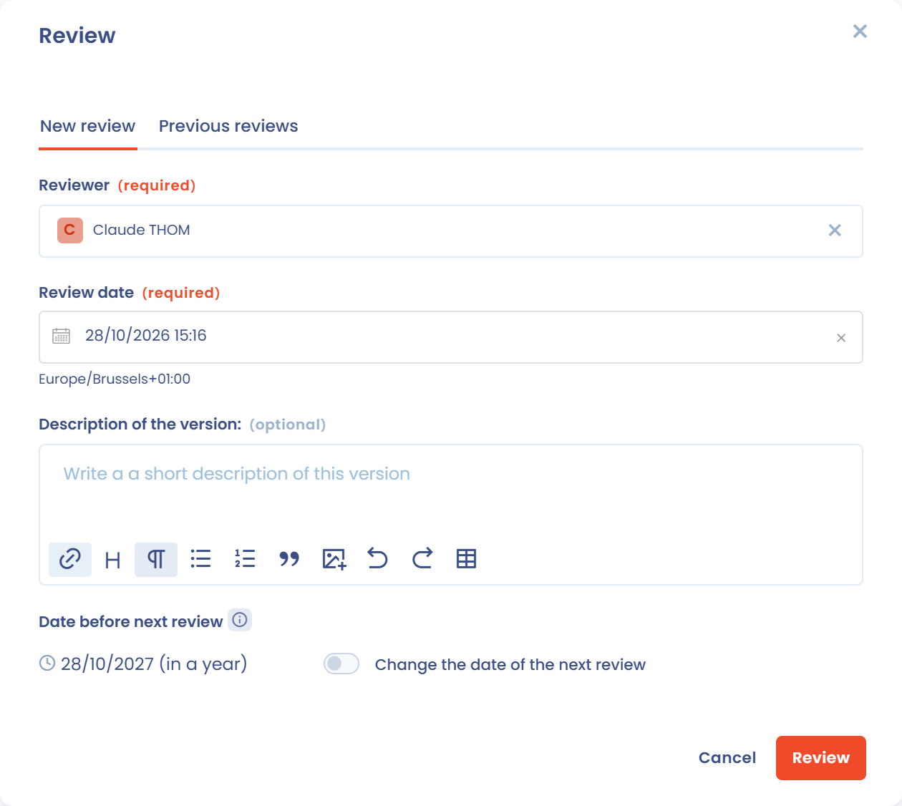

# Aktualität der Verarbeitungen

Die Aktualität einer Verarbeitungstätigkeit zeigt, wann sie zuletzt überprüft wurde. Sobald regelmäßige Überprüfungen aktiviert sind, legt jede Überprüfung ein Datum für die nächste fest, und die Aktualität sinkt, je näher dieses Datum rückt. So stellen Sie sicher, dass die Angaben in Ihrem Verarbeitungsverzeichnis regelmäßig geprüft werden und auf dem neuesten Stand bleiben.


Regelmäßige Überprüfungen gibt es auch für andere Elemente, etwa Stakeholder, Assets, Verträge oder KI-Systeme. Der gemeinsame Mechanismus ist unter [Regelmäßige Überprüfung (Aktualität)](../regular-review.md) beschrieben. Diese Seite erläutert, wie er bei Verarbeitungstätigkeiten funktioniert.


## Die Aktualitätsoption für Verarbeitungstätigkeiten aktivieren

Die Aktualität von Verarbeitungstätigkeiten ist optional und standardmäßig deaktiviert. Sie wird für den gesamten Mandanten in den Mandanteneinstellungen unter **Regelmäßige Überprüfungen** eingerichtet.

Um diese Einstellung aus Ihrem Verzeichnis zu öffnen, klicken Sie auf den Pfeil neben der Schaltfläche **Erstellen Sie eine Datenverarbeitung** und dann auf **Regelmäßige Überprüfung (Aktualität) konfigurieren**. Der Menüeintrag zeigt außerdem an, ob die Option derzeit aktiviert oder deaktiviert ist.

<figure><figcaption>
Der Eintrag zum Konfigurieren der regelmäßigen Überprüfung im Menü zum Erstellen einer Datenverarbeitung
</figcaption></figure>

In den Einstellungen **Regelmäßige Überprüfungen**:

1. Wählen Sie in der Auswahl der Elementtypen **Datenverarbeitung** aus.
2. Aktivieren Sie **Die regelmäßige Überprüfung des Elements aktivieren**.
3. Geben Sie unter **Bitte wählen Sie das gewünschte Intervall zwischen den einzelnen Überprüfungen aus.** den Abstand zwischen zwei Überprüfungen an, in Jahren, Monaten oder Tagen.
4. Klicken Sie auf **Speichern**.

Nur Nutzer mit der Berechtigung **Erweiterte Konfiguration** können diese Einstellung ändern.

<figure><figcaption>
Die Einstellungen der regelmäßigen Überprüfungen für Verarbeitungstätigkeiten
</figcaption></figure>

Das Intervall gilt für alle Verarbeitungstätigkeiten des Mandanten. Das Datum der nächsten Überprüfung einer Verarbeitungstätigkeit ergibt sich aus dem Datum ihrer letzten Überprüfung plus diesem Intervall, es sei denn, bei der Überprüfung wurde ein bestimmtes Datum gewählt (siehe [Eine Verarbeitungstätigkeit überprüfen](#eine-verarbeitungstatigkeit-uberprufen)).

Wenn Sie ein neues Intervall speichern, fragt Dastra, ob es auf die bereits erfassten Überprüfungen angewendet werden soll:

* **Auf alle bestehenden Überprüfungen anwenden**: Die bereits geplanten Überprüfungsdaten werden mit dem neuen Intervall neu berechnet und dabei überschrieben.
* **Nur auf zukünftige Überprüfungen anwenden**: Die bereits geplanten Überprüfungsdaten bleiben erhalten, und das neue Intervall gilt ab der nächsten Überprüfung.

<figure><figcaption>
Wählen Sie, ob das neue Intervall auf bestehende Überprüfungen angewendet wird
</figcaption></figure>


**Beispiel:** Sie legen ein Intervall von 1 Jahr fest. Eine am 15. Januar 2026 überprüfte Verarbeitungstätigkeit hat als nächstes Überprüfungsdatum den 15. Januar 2027. Sie wird den größten Teil des Jahres als **Aktuell** angezeigt, im letzten Zehntel des Intervalls (etwas mehr als einen Monat) als **Demnächst fällig** und, sobald das nächste Überprüfungsdatum verstrichen ist, als **Veraltet**, bis sie erneut überprüft wird.


## Die Aktualitätsoption für Verarbeitungstätigkeiten deaktivieren

Um die Option zu deaktivieren, kehren Sie zu den Einstellungen **Regelmäßige Überprüfungen** zurück, wählen **Datenverarbeitung** aus, deaktivieren **Die regelmäßige Überprüfung des Elements aktivieren** und klicken auf **Speichern**.

Die Aktualitätsanzeigen werden dann nicht mehr angezeigt. Jede Verarbeitungstätigkeit behält ihren Überprüfungsverlauf und das Datum ihrer letzten Überprüfung. Beides wird wieder verwendet, wenn Sie die Option später erneut aktivieren.

## Aktualitätsanzeigen

Die Aktualität wird nur für **veröffentlichte** Verarbeitungstätigkeiten angezeigt, die **mindestens einmal überprüft** wurden. Eine Verarbeitungstätigkeit kann sich in einem der folgenden Zustände befinden:

| Zustand | Bedeutung |
| --- | --- |
| Aktuell (grün) | Die Verarbeitungstätigkeit wurde kürzlich überprüft und erfordert keine sofortige Aufmerksamkeit. |
| Demnächst fällig (orange) | Das letzte Zehntel des Intervalls zwischen zwei Überprüfungen hat begonnen: Die Überprüfung sollte eingeplant werden. |
| Veraltet (rot) | Das Datum der nächsten Überprüfung ist verstrichen: Die Verarbeitungstätigkeit entspricht nicht mehr der Überprüfungsrichtlinie. |
| Überprüfung ausstehend | Die Verarbeitungstätigkeit ist veröffentlicht, wurde aber noch nie überprüft. |

Eine Verarbeitungstätigkeit, die noch ein Entwurf ist, wird in der Liste als **nicht veröffentlicht** angezeigt und in ihrem Eintrag als **Awaiting publication**.

### Auf der Seite der Verarbeitungstätigkeit

Auf einem breiten Bildschirm steht die Aktualitätsanzeige oben im rechten Bereich der Seite der Verarbeitungstätigkeit. Sie zeigt den Balken **Aktualität**, der kürzer wird, je näher das Datum der nächsten Überprüfung rückt, den Zustand und seine Farbe, einen Link **Überprüfung** sowie die Zahl der verbleibenden oder überfälligen Tage.

Auf einem kleineren Bildschirm ist der rechte Bereich ausgeblendet: Der Zustand (zum Beispiel **Aktuell**) steht in der Kopfzeile des Eintrags, neben den Anzeigen **Fortschritt**, **Qualität** und **Sensibilität**. Klicken Sie darauf, um das Fenster **Überprüfung** zu öffnen.

<figure><figcaption>
Auf einem kleineren Bildschirm steht die Aktualitätsanzeige in der Kopfzeile des Eintrags
</figcaption></figure>

### In der Liste Ihres Verzeichnisses

Die Spalte **Datum der letzten Überprüfung** zeigt den Aktualitätszustand jeder Verarbeitungstätigkeit und das Datum ihrer letzten Überprüfung. Bewegen Sie den Mauszeiger über den Zustand, um die Zahl der verbleibenden oder überfälligen Tage zu sehen. Diese Spalte wird Ihrer Listenansicht hinzugefügt, wenn Sie die Option aktivieren. Sie können sie auch jederzeit zu den angezeigten Spalten hinzufügen.

<figure><figcaption>
Die Spalte Datum der letzten Überprüfung
</figcaption></figure>

Sie können außerdem die Spalte **Voraussichtliches Datum der Überprüfung** einblenden, die das für jede Verarbeitungstätigkeit erfasste Datum der nächsten Überprüfung zeigt. Mit dem Filter **Aktualität** (unter **Filter**) filtern Sie Ihr Verzeichnis nach den Werten aktuell, ausstehend (veröffentlicht, aber nie überprüft) oder veraltet.

## Eine Verarbeitungstätigkeit überprüfen

Sie können eine Verarbeitungstätigkeit jederzeit überprüfen, ohne das Datum der nächsten Überprüfung abzuwarten. Dafür ist Schreibzugriff auf das Verarbeitungsverzeichnis erforderlich. Öffnen Sie das Fenster **Überprüfung**:

* von der Seite der Verarbeitungstätigkeit: Klicken Sie auf die Aktualitätsanzeige, auf den Link **Überprüfung** im rechten Bereich oder im Menü neben der Schaltfläche **Speichern** auf **Überprüfung**;
* aus der Liste: Klicken Sie auf die Zelle der Spalte **Datum der letzten Überprüfung**.

Um mehrere Verarbeitungstätigkeiten gleichzeitig zu überprüfen, wählen Sie sie in der Liste aus und wählen dann unter **Bitte wählen Sie eine Sammelaktion aus** den Eintrag **Überprüfung**.

<figure><figcaption>
Das Fenster Überprüfung
</figcaption></figure>

Füllen Sie im Tab **Neue Überprüfung** Folgendes aus:

* **Verantwortlicher für die Überprüfung** (erforderlich): der Nutzer, der die Überprüfung durchgeführt hat, standardmäßig Sie selbst;
* **Überprüfung** (erforderlich): das Datum der Überprüfung, standardmäßig heute;
* **Versionsbeschreibung** (optional): eine kurze Beschreibung dessen, was geprüft oder geändert wurde;
* **Datum vor der nächsten Überprüfung**: wird aus dem Überprüfungsdatum und dem für den Mandanten festgelegten Intervall berechnet. Um für diese Verarbeitungstätigkeit ein bestimmtes Datum festzulegen, aktivieren Sie **Ändern Sie das Datum der nächsten Überprüfung** und wählen ein neues Datum (frühestens der nächste Tag).

Klicken Sie auf **Überprüfung**, um zu speichern. Ab dem Überprüfungsdatum beginnt ein neuer Aktualitätszyklus bis zum Datum der nächsten Überprüfung.

Wenn das Fenster für eine einzelne Verarbeitungstätigkeit geöffnet wird, listet der Tab **Frühere Überprüfungen** ihre bisherigen Überprüfungen auf. Dieser Tab bietet auch die Schaltfläche **Delete all reviews**, mit der Sie den Überprüfungsverlauf löschen: Nach der Bestätigung werden das Datum der letzten und der nächsten Überprüfung gelöscht, und die Aktualitätsanzeige wird nicht mehr angezeigt. Diese Aktion kann nicht rückgängig gemacht werden.

## Wichtige Hinweise zur Funktionsweise der Aktualität

Das Speichern einer Verarbeitungstätigkeit zählt nicht als Überprüfung: Das Datum der letzten Überprüfung ist unabhängig vom Datum der letzten Aktualisierung des Eintrags. Um den Aktualitätszyklus einer Verarbeitungstätigkeit (neu) zu starten, müssen Sie sie überprüfen.

Wird eine Verarbeitungstätigkeit in den letzten Schritt ihres Workflows verschoben, kann dabei ebenfalls eine Überprüfung erfasst werden: Das Fenster zum Statuswechsel zeigt dann einen Schalter **Überprüfung**, der standardmäßig aktiviert ist.
