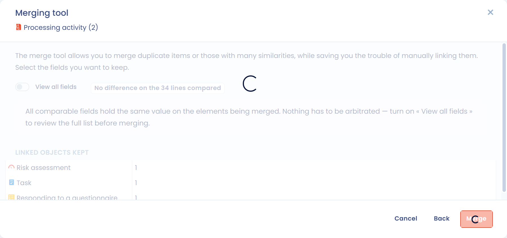

# Verarbeitungen zusammenführen

## Einführung

Mit dem Zusammenführen von Verarbeitungstätigkeiten **fassen Sie mehrere Verarbeitungstätigkeiten zu einer einzigen zusammen** und behalten dabei die Informationen, die Sie auswählen, und die mit ihnen verknüpften Elemente. Das ist besonders nützlich, um **Ihr Verarbeitungsverzeichnis zu konsolidieren**, Duplikate zu entfernen und Ihre Dokumentation konsistent zu halten.

Eine der Verarbeitungstätigkeiten bleibt als **Referenzversion** erhalten: Sie wählen Feld für Feld die Werte aus, die aus den anderen übernommen werden, danach werden die anderen gelöscht.

Zum Zusammenführen benötigen Sie Schreibzugriff auf das Verarbeitungsverzeichnis. Sind in Ihrem Mandanten Aufgabenverwaltung, Risikomanagement oder Fragebögen aktiviert, benötigen Sie auch Schreibzugriff auf diese Module, damit die verknüpften Elemente auf die Referenzversion verschoben werden können.

## Ein Zusammenführen starten

Sie können ein Zusammenführen an drei Stellen starten:

* **Aus der Liste, für mehrere Verarbeitungstätigkeiten**: Wählen Sie die zusammenzuführenden Verarbeitungstätigkeiten aus (weniger als 30), klicken Sie auf **Bitte wählen Sie eine Sammelaktion aus** und dann auf **Zusammenführen**. Der Vergleich öffnet sich direkt.
* **Aus der Liste, für eine Verarbeitungstätigkeit**: Öffnen Sie das Aktionsmenü am Ende ihrer Zeile und klicken Sie auf **Zusammenführen**.
* **Aus einer Verarbeitungstätigkeit**: Klicken Sie auf den Pfeil neben der Schaltfläche **Speichern** und dann auf **Zusammenführen**.

<figure><figcaption>
Der Eintrag Zusammenführen im Aktionsmenü einer Verarbeitungstätigkeit
</figcaption></figure>

Wenn Sie von einer einzelnen Verarbeitungstätigkeit aus starten, fragt das Fenster **Tool zum Zusammenführen von Daten** zuerst, mit welchen Verarbeitungstätigkeiten sie zusammengeführt werden soll: Wählen Sie diese unter **Bitte wählen Sie die Objekte aus, mit denen Sie die Daten zusammenführen möchten.** aus und klicken Sie dann auf **Weiter**.

<figure><figcaption>
Wählen Sie die Verarbeitungstätigkeiten aus, mit denen zusammengeführt wird
</figcaption></figure>

## Die beizubehaltenden Werte auswählen

Das Fenster **Tool zum Zusammenführen von Daten** vergleicht die Verarbeitungstätigkeiten nebeneinander, eine Spalte je Verarbeitungstätigkeit.

1. Haken Sie in der Kopfzeile ihrer Spalte die Verarbeitungstätigkeit an, die erhalten bleiben soll: Sie wird zur **Reference version**. Sie behält ihre Kennung und ihren Verlauf. Die anderen Spalten zeigen das Badge **Keep selected fields**: Diese Verarbeitungstätigkeiten werden nach der Bestätigung des Zusammenführens gelöscht, und nur die Felder, die Sie in ihnen auswählen, werden in die Referenzversion übernommen.
2. Wählen Sie bei jedem Feld mit einem einzelnen Wert die Spalte aus, deren Wert Sie behalten möchten.
3. Haken Sie bei jedem Feld mit einer Liste (Zwecke, Datenkategorien, Empfänger, Sicherheitsmaßnahmen usw.) die Einträge an, die erhalten bleiben sollen, gleich aus welcher Verarbeitungstätigkeit sie stammen: Sie werden in der Referenzversion zusammengeführt.
4. Klicken Sie auf **Zusammenführen**.

<figure><figcaption>
Das Fenster des Zusammenführungstools
</figcaption></figure>

Der Vergleich wird dadurch erleichtert:

* Jedes Feld, dessen Wert sich zwischen den Verarbeitungstätigkeiten unterscheidet, ist mit **Different** markiert, und ein Zähler zeigt die Zahl der betroffenen Zeilen.
* Die Tabelle zeigt nur die Zeilen mit Unterschieden. Aktivieren Sie **View all fields**, um alle vergleichbaren Felder anzuzeigen. Ausgeblendete identische Felder behalten den Wert der Referenzversion.
* Die Schaltfläche **Select all** unter einer Spaltenüberschrift behält die Werte dieser Spalte in allen Zeilen mit Unterschieden bei. Mit **Undo selection** machen Sie das rückgängig. Ein leerer Wert ersetzt nie einen ausgefüllten Wert.

Der Abschnitt **Linked objects kept** zeigt, wie viele Risikobewertungen, Aufgaben und Fragebogenantworten mit den zusammengeführten Verarbeitungstätigkeiten verknüpft sind. Sie werden automatisch der Referenzversion zugeordnet, es geht also nichts verloren, was mit den gelöschten Verarbeitungstätigkeiten verknüpft war.

Nach dem Zusammenführen bestätigt eine Meldung den Vorgang, mit einem Link **Element anzeigen**, der die Referenzversion öffnet.


Die Verarbeitungstätigkeiten außer der Referenzversion werden gelöscht, sobald Sie das Zusammenführen bestätigen, und das lässt sich nicht rückgängig machen. Prüfen Sie Ihre Auswahl, bevor Sie auf **Zusammenführen** klicken, und exportieren Sie die Verarbeitungstätigkeiten vorher, wenn Sie eine Kopie ihres Inhalts behalten möchten.


## Duplikate automatisch finden

Um Verarbeitungstätigkeiten zu finden, bei denen es sich wahrscheinlich um Duplikate handelt, klicken Sie auf den Pfeil neben der Schaltfläche **Erstellen Sie eine Datenverarbeitung** und dann auf **Datenqualitätswerkzeug**. Die erkannten Duplikate werden mit einem Konfidenzwert aufgelistet, und Sie können sie von dort aus zusammenführen.


[Elemente zusammenführen](../general/merge.md)


## Typische Anwendungsfälle

| Fall | Beispiel | Nutzen |
| --- | --- | --- |
| **Konsolidierung** | Zwei Verarbeitungstätigkeiten „Personalverwaltung“ und „Mitarbeiterverwaltung“ | Duplikate vermeiden und die Pflege vereinfachen |
| **Umstrukturierung** | Ähnliche Verarbeitungstätigkeiten, die in mehreren Organisationseinheiten angelegt wurden | Eine einzige aktuelle Verarbeitungstätigkeit behalten |
| **Harmonisierung über Entitäten hinweg** | Gleichartige Verarbeitungstätigkeiten, die mehrere Tochtergesellschaften getrennt dokumentiert haben | Governance und konzernweites Reporting erleichtern |
| **Bereinigung des Verzeichnisses** | Duplikate, die bei einem ersten Import entstanden sind | Übersichtlichkeit und Verlässlichkeit des Verzeichnisses verbessern |

## Bewährte Vorgehensweisen

1. **Kompatibilität prüfen**: Führen Sie nur Verarbeitungstätigkeiten mit identischen oder sehr ähnlichen Zwecken zusammen.
2. **Die rechtliche Bewertung konsistent halten**: Führen Sie keine Verarbeitungstätigkeiten zusammen, die sich auf unterschiedliche Rechtsgrundlagen stützen.
3. **Die Entscheidung dokumentieren**: Begründen Sie das Zusammenführen in einer internen Diskussion zur Referenzversion.


Mit dem Zusammenführen von Verarbeitungstätigkeiten halten Sie Ihr Verzeichnis sauber und aktuell und senken den Verwaltungsaufwand. Sie behalten dabei die Kontrolle über jeden übernommenen Wert.

