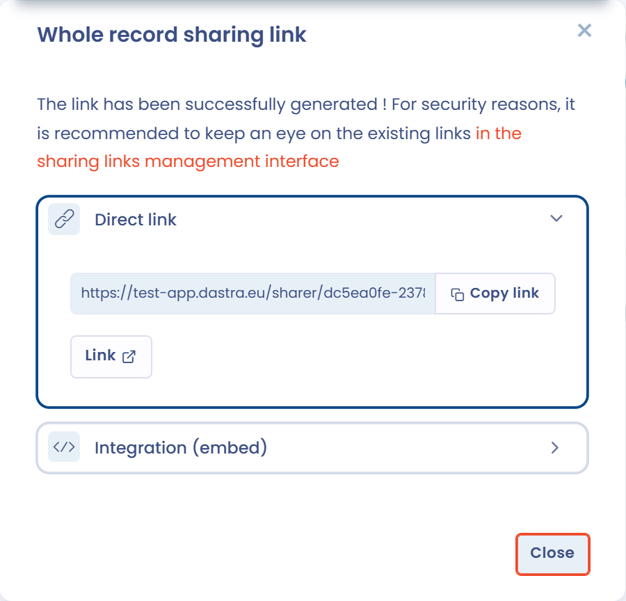
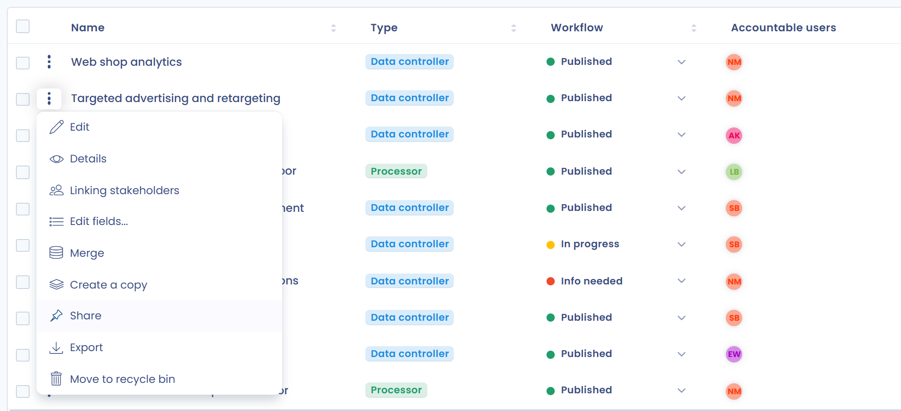
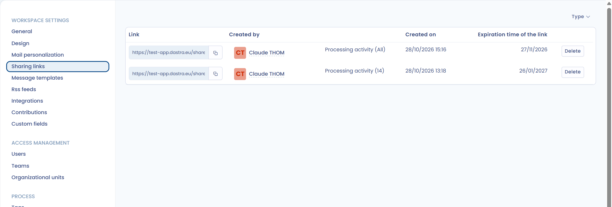

# Das Verzeichnis teilen

Mit einem Freigabelink erhalten externe Nutzer ohne Dastra-Konto Lesezugriff auf Ihr Verarbeitungsverzeichnis oder auf einzelne Verarbeitungstätigkeiten daraus. Für das Teilen ist die Berechtigung **Advanced configuration** erforderlich.


Der Freigabelink ist öffentlich sichtbar: Jeder, der ihn hat, kann ihn bis zu seinem Ablauf öffnen. Achten Sie darauf, wie Sie ihn weitergeben, und behalten Sie aus Sicherheitsgründen die in Ihrem Mandanten veröffentlichten Freigabelinks im Blick.


## Das gesamte Verzeichnis teilen

Klicken Sie im Modul **Verarbeitungstätigkeiten** auf den Pfeil neben der Schaltfläche **Erstellen Sie eine Datenverarbeitung** und dann auf **Teilen**.

<figure><figcaption>
Der Eintrag Teilen im Menü Erstellen Sie eine Datenverarbeitung
</figcaption></figure>

Das Fenster **Freigabe aller Elemente** öffnet sich:

1. Wählen Sie bei **Ablaufdatum des Links** die Gültigkeitsdauer.
2. Wählen Sie bei **Möchten Sie den Link per E-Mail an andere Nutzer senden?** die Antwort **Ja**, um den Link per E-Mail zu versenden. Geben Sie dann die **E-Mails der Empfänger** und optional eine **Individuelle Nachricht** ein.
3. Klicken Sie auf **Link erstellen**.

Die Freigabe umfasst nur Verarbeitungstätigkeiten mit dem Status „Veröffentlicht“. Verarbeitungstätigkeiten im Entwurf werden mit dieser Funktion nicht geteilt: Um eine Verarbeitungstätigkeit im Entwurf zu teilen, teilen Sie sie einzeln (siehe unten).

<figure><figcaption>
Das Fenster Freigabe aller Elemente
</figcaption></figure>

Die Links können folgende Gültigkeitsdauern haben:

* 2 Tage
* 30 Tage (Standard)
* 120 Tage
* Unbegrenzt

Sobald der Link erstellt ist, wird er in Ihre Zwischenablage kopiert. Das Fenster bietet dann zwei Bereiche:

* **Direkter Link**: Kopieren Sie den Link mit **Link kopieren** oder öffnen Sie ihn mit **Link**.
* **Integration (Einbettung)**: Legen Sie **Breite** und **Höhe** der Einbettung fest und kopieren Sie dann den Code, um das geteilte Verzeichnis in eine andere Website einzubetten, zum Beispiel in Ihr Intranet.

Klicken Sie auf **Schließen**, um das Fenster zu schließen.

<figure><figcaption>
Der Freigabelink nach der Erstellung
</figcaption></figure>

## Einen Freigabelink für eine Verarbeitungstätigkeit erstellen

Um eine einzelne Verarbeitungstätigkeit zu teilen, öffnen Sie das Aktionsmenü am Ende ihrer Zeile in der Liste und klicken Sie auf **Teilen**. Das Fenster **Generierung eines Freigabelinks für 1 Element** öffnet sich: Gehen Sie vor wie oben beschrieben.

<figure><figcaption>
Der Eintrag Teilen im Aktionsmenü einer Verarbeitungstätigkeit
</figcaption></figure>

Sie können eine Verarbeitungstätigkeit auch aus ihrem Eintrag heraus teilen: Klicken Sie auf den Pfeil neben der Schaltfläche **Speichern** und dann auf **Teilen**.

Um mehrere Verarbeitungstätigkeiten zu teilen, wählen Sie sie in der Liste aus, klicken Sie auf **Bitte wählen Sie eine Sammelaktion aus** und dann auf **Teilen**.

Auf diese Weise geteilte Verarbeitungstätigkeiten können unabhängig von ihrem Status (veröffentlicht oder Entwurf) geteilt werden. Verarbeitungstätigkeiten im Papierkorb können nicht geteilt werden.

## Freigabelinks verwalten

Alle in Ihrem Mandanten erstellten Freigabelinks sind in den Mandanteneinstellungen unter **Links zum Teilen** zusammengefasst.

Für jeden Link zeigt die Liste den Link selbst (den Sie kopieren können), den Nutzer, der ihn erstellt hat, die Art der geteilten Elemente und ihre Anzahl (**Alle** bei einem ganzen Verzeichnis), das Erstellungsdatum, das Ablaufdatum und die E-Mail-Adressen der Empfänger. Sie können die Liste nach **Typ** filtern und mit **Löschen** einen Link entfernen, der nicht mehr verwendet werden soll.

<figure><figcaption>
Die Einstellungen Links zum Teilen
</figcaption></figure>
